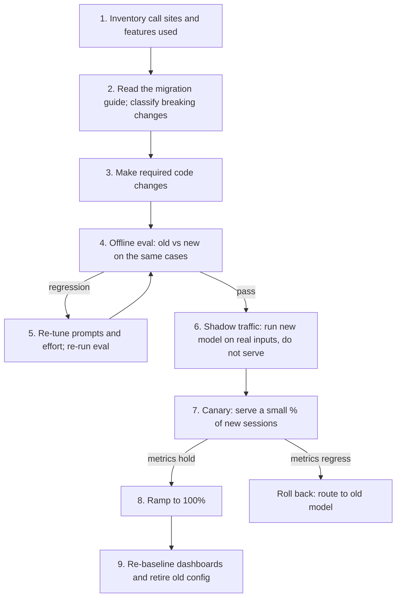

# Migrating to a New Model

## Introduction

Sooner or later, every production agent changes models. Sometimes you choose to: a new model is smarter, faster, or cheaper. Sometimes you have no choice: providers retire old models on a published schedule, and after the retirement date, requests to that model fail.

It is tempting to treat a migration as a one-line change: edit the model string, deploy, done. That rarely works for agents. A new model can:

- **Reject requests** your code sends today (removed parameters, changed request shapes)
- **Behave differently** with the same prompt (more literal instruction following, different verbosity, different tool-calling habits)
- **Count tokens differently**, which shifts cost, limits, and dashboards
- **Change defaults**, such as how much it thinks when you do not say

Think of switching suppliers for a key ingredient in a restaurant. Even if the new flour is "better", you test it in the kitchen first, serve it to a few tables, compare reactions, and keep the old flour in the storeroom until you are sure. That is exactly the process on this page: **an eval-gated migration with shadow traffic, canaries, and a rollback plan.**

## The Migration Process



The rest of this page walks through each step.

## Step 1: Inventory

Find every place the model ID appears, and every API feature you use with it. Not every file that mentions a model ID is a caller. Some are tests, documentation, or config defaults. Classify them before editing.

```bash
# Find references to the old model ID, grouped by top-level directory
grep -rl "claude-sonnet-5" --include="*.py" --include="*.yaml" . \
  | cut -d/ -f2 | sort | uniq -c | sort -rn
```

For each real call site, note which features it uses: thinking or reasoning settings, sampling parameters (`temperature`, `top_p`), assistant prefill, forced tool choice, structured outputs, specific tool types, streaming, and caching. Breaking changes are almost always about features, so this list tells you where to look.

If you followed [Versioning Prompts, Tools and Models](./7-agents-versioning.mdx), the model ID lives in one release bundle per agent, which makes this step much easier.

## Step 2: Classify Breaking Changes

Read your provider's migration guide for the target model. Anthropic publishes one in its docs (and the claude-api skill for Claude Code bundles a detailed version). You do not need to memorize model-specific details, but it helps to know the **categories** of change to look for. Using Anthropic's recent migration notes as examples:

| Category | What it looks like | Example from recent Claude migrations | Effect if missed |
|---|---|---|---|
| Removed parameters | A parameter the old model accepted now returns an error | Non-default `temperature`/`top_p`, and fixed thinking budgets (`budget_tokens`), are rejected on recent models | 400 error on every request |
| Changed request shapes | A technique that used to work is no longer allowed | Assistant-message prefill and forced `tool_choice` return 400 on recent models; use structured outputs or `auto` tool choice with instructions instead | 400 error |
| Tool version changes | Built-in tool types get new versions | Computer use moved to a new toolset type on some models | 400 error or missing capability |
| Changed defaults | Same request, different behavior | Thinking on by default; a different default effort level | Silent latency and cost change |
| Tokenizer changes | Same text, different token count | One recent Sonnet release noted roughly 30% more tokens for the same text | Budgets, `max_tokens`, and cost dashboards shift |
| Behavioral shifts | Same prompt, different style or tool use | Newer models follow instructions more literally, so "CRITICAL: ALWAYS use the search tool" can make them overuse it | Quality regressions, over-triggering |
| Conversation-state rules | New rules about what history can be resent | Thinking blocks tied to the model and conversation that produced them | Errors when switching models mid-conversation |
| Retirement | The old ID stops working | Retired model IDs return 404 | Outage on the retirement date |

Anthropic's guide tags each checklist item as **[BLOCKS]** (causes an error or breakage if missed: fix it as a code change) or **[TUNE]** (quality or cost adjustment: evaluate and decide). That split is useful for any provider:

- **BLOCKS** items are mandatory and mechanical. Make the change, test it, done.
- **TUNE** items are judgment calls. Decide them with evals, not by feel.

## Step 3: Make the Required Changes

Fix the BLOCKS items first. Typical changes look like this:

```python
# Before: code written for an older model
old_request = {
    "model": "claude-sonnet-4-6",
    "max_tokens": 4000,
    "temperature": 0.2,
    "tool_choice": {"type": "tool", "name": "record_answer"},
    "messages": [
        {"role": "user", "content": "Extract the invoice total."},
        {"role": "assistant", "content": "{"},          # prefill to force JSON
    ],
}

# After: the same intent, expressed in a way current models accept
new_request = {
    "model": "claude-sonnet-5-5",
    "max_tokens": 16000,
    "output_config": {
        "effort": "low",
        "format": {
            "type": "json_schema",
            "schema": {
                "type": "object",
                "properties": {"total": {"type": "number"}, "currency": {"type": "string"}},
                "required": ["total", "currency"],
                "additionalProperties": False,
            },
        },
    },
    "messages": [{"role": "user", "content": "Extract the invoice total."}],
}

removed = sorted(set(old_request) - set(new_request))
added = sorted(set(new_request) - set(old_request))
print("removed:", removed)
print("added:  ", added)
```

Output:

```text
removed: ['temperature', 'tool_choice']
added:   ['output_config']
```

The prefill and forced tool call were both ways to get JSON. Structured outputs now guarantee the shape directly. See [Structured Outputs](../1-agents-llm-apis/6-agents-structured-outputs.mdx) and [Reasoning, Thinking and Effort](../1-agents-llm-apis/7-agents-thinking-and-effort.mdx).

For every edit, write down **what** changed and **why**, especially for system prompt edits. Prompt changes are judgment calls, and the people who own the prompt deserve to see the before and after text and the reason.

## Step 4: Offline Evaluation, Old vs New

Run your eval set against both configurations, with the same cases, and compare **quality and cost together**.

```python
from statistics import mean


def run_suite(config: dict, cases: list) -> list[dict]:
    """Stand-in for running real eval cases. Returns one result per case."""
    import random
    rng = random.Random(config["seed"])
    return [{"case": c, "passed": rng.random() < config["p_pass"],
             "usd": config["usd"] * rng.uniform(0.7, 1.3),
             "turns": rng.randint(*config["turns"])} for c in cases]


def summarize(results: list[dict]) -> dict:
    passed = [r for r in results if r["passed"]]
    total = sum(r["usd"] for r in results)
    return {"pass_rate": round(len(passed) / len(results), 3),
            "usd_per_completed": round(total / max(len(passed), 1), 4),
            "avg_turns": round(mean(r["turns"] for r in results), 1)}


cases = list(range(60))
old = summarize(run_suite({"seed": 9, "p_pass": 0.88, "usd": 0.050, "turns": (3, 7)}, cases))
new = summarize(run_suite({"seed": 1, "p_pass": 0.92, "usd": 0.042, "turns": (2, 6)}, cases))
print("old:", old)
print("new:", new)
```

Example output (from the stand-in function, not real model results):

```text
old: {'pass_rate': 0.883, 'usd_per_completed': 0.0562, 'avg_turns': 4.9}
new: {'pass_rate': 0.933, 'usd_per_completed': 0.0448, 'avg_turns': 4.1}
```

Rules that keep the comparison honest:

- **Same cases, same graders, same tools.** Only the model configuration changes.
- **Enough cases and repeated trials.** Model outputs vary between runs. A difference of one or two cases on a single run is noise. Anthropic's cost guide suggests around fifty cases and several trials per configuration as a reasonable bar before a production cutover.
- **Look at individual failures,** not just the average. A new model can improve overall and still fail a category that matters a lot to you (for example, refund decisions).
- **Include hard cases.** Easy cases make every model look the same.

If the eval shows a regression, go to step 5. If it passes, go to step 6. See [Agent Evaluation Introduction](../11-agents-evaluation-and-testing/0-agents-evaluation-introduction.mdx).

## Step 5: Re-tune (the TUNE Items)

A prompt written for the old model is tuned to its habits. Common re-tuning work:

- **Soften shouting.** Words like "CRITICAL" and "YOU MUST" were often added to make older models pay attention. Newer models that follow instructions closely may now over-apply them.
- **Re-check length and format instructions.** Default verbosity often changes between models.
- **Sweep effort from the new model's default.** Effort levels do not map one-to-one between models, and defaults differ. Do not copy the old setting; measure. See [Cost Optimization](./4-agents-cost-optimization.mdx).
- **Re-check `max_tokens` and budgets** if the tokenizer changed.
- **Re-check caching.** The minimum cacheable prompt length can differ by model, and switching models starts with a cold cache.

Change one thing at a time and re-run the eval after each change.

## Step 6: Shadow Traffic

Offline evals cover the cases you thought of. Real traffic contains the ones you did not. In **shadow mode**, the new model processes a copy of real requests, but its output is never shown to users or used to take actions. You compare the two outputs afterward.

```python
import asyncio
import random


async def call_model(model: str, request: dict) -> dict:
    await asyncio.sleep(0.01)                     # stands in for a real API call
    return {"model": model, "answer": f"answer from {model}", "usd": 0.004}


async def handle_request(request: dict, shadow_rate: float, shadow_log: list) -> dict:
    primary = await call_model("claude-sonnet-5", request)          # served to the user
    if random.random() < shadow_rate:
        async def shadow() -> None:
            try:
                candidate = await call_model("claude-sonnet-5-5", request)
                shadow_log.append({"request": request["id"], "primary": primary["answer"],
                                   "candidate": candidate["answer"]})
            except Exception as exc:                             # never affect the user
                shadow_log.append({"request": request["id"], "error": str(exc)})
        asyncio.create_task(shadow())
    return primary


async def main() -> None:
    random.seed(3)
    log: list = []
    for i in range(20):
        await handle_request({"id": i}, shadow_rate=0.25, shadow_log=log)
    await asyncio.sleep(0.05)                      # let shadow tasks finish
    print(f"served 20 requests, shadowed {len(log)}")


asyncio.run(main())
```

Example output:

```text
served 20 requests, shadowed 5
```

Shadow mode rules for agents:

- **Never let the shadow agent perform real side effects.** Give it read-only tools or stubbed write tools that record what *would* have happened. A shadow agent that sends real emails is not a shadow.
- **Budget for it.** Shadowing doubles model cost for the sampled traffic. Sample a percentage and run it for a fixed period.
- **Grade the pairs.** Use rules, an LLM judge comparing the two answers, or human review of a sample. Pay attention to disagreements.
- **Mind privacy.** Shadow traffic is still user data sent to a model; the same policies apply.

## Step 7: Canary and Ramp

When shadow results look good, serve the new model to a small slice of **new sessions** (for example 5%). Use a stable hash so a user does not flip between models.

```python
import hashlib


def bucket(key: str) -> int:
    return int(hashlib.sha256(key.encode()).hexdigest(), 16) % 100


def choose_model(session_id: str, canary_percent: int) -> str:
    return "claude-sonnet-5-5" if bucket(session_id) < canary_percent else "claude-sonnet-5"


sessions = [f"session-{i}" for i in range(1000)]
for pct in (5, 25, 100):
    share = sum(choose_model(s, pct) == "claude-sonnet-5-5" for s in sessions) / len(sessions)
    print(f"canary {pct:>3}% -> {share:.1%} of sessions on the new model")
```

Example output:

```text
canary   5% -> 4.1% of sessions on the new model
canary  25% -> 25.4% of sessions on the new model
canary 100% -> 100.0% of sessions on the new model
```

Because the hash is stable, the sessions in the 5% group stay in the group as you ramp to 25%, and you never move a conversation to a different model mid-way. Compare canary and control on the metrics from [Monitoring and Alerting](./6-agents-monitoring-and-alerting.mdx): task success, escalations, latency, turns per task, cost per completed task, and sampled quality scores. Decide the rollback thresholds **before** the canary starts.

## Step 8: Rollback

Rollback must be fast and boring. If the model is part of a versioned release and routing is controlled by a flag, rollback is setting the canary percentage to 0. Keep in mind:

- **Roll back new sessions; let old ones finish** on whatever model they started with, unless the new model is causing harm. Switching a live conversation's model loses the prompt cache and, on current Claude models, may lose reasoning context.
- **Keep the old configuration deployable** until the old model's retirement date or until you are confident.
- **Do not delete the old prompt.** If you re-tuned prompts for the new model, the old model needs the old prompt.

## Step 9: Re-baseline

After the migration, your dashboards' "normal" changes. Token counts may be higher or lower for the same text, latency shifts, and cost per task changes. Re-baseline alert thresholds, cost forecasts, and capacity plans. Also verify that the new model is actually serving traffic by checking the `model` field in responses:

```python
import anthropic

client = anthropic.Anthropic()
TARGET = "claude-sonnet-5-5"

response = client.messages.create(
    model=TARGET, max_tokens=64, messages=[{"role": "user", "content": "ping"}],
)
assert response.model.startswith(TARGET), response.model
print("serving model:", response.model)
```

## Real-World Scenario

Your company's contract-review agent runs on an older Sonnet model whose retirement date is announced for four months from now. The agent extracts clauses with a prefilled JSON response, uses `temperature=0`, and forces a `record_findings` tool call. It has a 120-case eval set.

**The plan:**

1. **Inventory** finds the model ID in 7 files: 3 call sites, 2 tests, a config default, and a README.
2. **Classification** from the provider's guide: the prefill, `temperature`, and forced `tool_choice` are BLOCKS items. A tokenizer change and a different default effort are TUNE items.
3. **Code changes**: the prefill and forced tool call become structured outputs; `temperature` is removed. The team documents each change in the pull request.
4. **Offline eval**: the new model passes 93% vs 90% before, but fails 4 of 9 indemnity-clause cases. Investigation shows the prompt's "ALWAYS flag any limitation of liability" line now causes over-flagging. Softening it fixes the category.
5. **Effort sweep** from the new model's default: `medium` and `high` tie on the eval, so `medium` is kept.
6. **Shadow** 20% of real contracts for a week with write tools stubbed. A lawyer reviews 40 disagreements; the new model is judged better or equal in 36.
7. **Canary** 10% of new review sessions for a week, then 50%, then 100%, with rollback thresholds on success rate and reviewer override rate.
8. **Re-baseline** cost dashboards and the `max_tokens` setting for the new token counts. Remove the old config two weeks after full rollout, well before the retirement date.

**Why this approach fits.** Contract review is high-stakes and the eval caught a category regression that the average hid. Shadow mode found real-world differences safely, and the canary limited exposure.

**When not to use it.** For a low-risk internal summarizer, steps 1 to 4 plus a quick canary are enough. Full shadow mode with expert review is worth its cost only when mistakes are expensive.

### Alternatives and Trade-offs

| Approach | Pros | Cons | Best for |
|---|---|---|---|
| Swap the ID and deploy | Fastest | Errors and regressions found by users | Prototypes only |
| Offline eval gate only | Cheap, catches known regressions | Misses real-world input variety | Low-risk agents |
| Eval + canary | Real traffic, limited exposure | Needs per-version metrics and routing | Most production agents |
| Eval + shadow + canary | Safest; real inputs with no user risk | Doubles cost during shadow; more tooling | High-stakes agents |
| Stay on the old model until retirement | No work now | Last-minute rush; misses improvements | Rarely wise |

## Common Mistakes

- **Treating a model change as a config change.** It is a behavior change; evaluate it.
- **Copying old effort or token settings** to the new model without measuring.
- **Keeping "shouting" prompts** that over-trigger on models that follow instructions closely.
- **Shadow agents with real write access.**
- **Switching live conversations mid-way.** Migrate new sessions; let old ones finish.
- **Forgetting to re-baseline** dashboards and alerts after the tokenizer or pricing changes.
- **Waiting for the retirement date.** Start early so you have time for a careful rollout.

## Summary

- Migrations are eval-gated releases: inventory, classify, change, evaluate, re-tune, shadow, canary, roll out, re-baseline.
- Classify breaking changes by category (removed parameters, request shapes, tool versions, defaults, tokenizer, behavior, conversation rules, retirement) and split them into must-fix and tune.
- Compare old and new on the same eval cases, with repeated trials and attention to per-category failures.
- Use shadow traffic with no real side effects, then a stable-hash canary of new sessions.
- Roll back by routing, keep old configurations deployable, and verify the served model.

## Exercises

1. Pick an agent you have built and write its migration inventory: every call site and every API feature it uses.
2. Turn the canary function into a small module that reads the percentage from a feature flag file, and write a test proving that a session's model never changes as the percentage increases.
3. Build a shadow-mode wrapper for one of your tools that logs the intended write instead of performing it.
4. Read your provider's current migration guide for its newest model and sort each listed change into the category table above.

Related: [Choosing the Right Model](../1-agents-llm-apis/10-agents-model-selection.mdx), [Regression Testing for Agents](../11-agents-evaluation-and-testing/6-agents-regression-testing.mdx), [Iterating on Prompts with Evidence](../3-agents-prompt-engineering/10-agents-prompt-iteration.mdx), and Anthropic's [models overview](https://platform.claude.com/docs/en/about-claude/models/overview) and [model deprecations](https://platform.claude.com/docs/en/about-claude/model-deprecations) pages.
