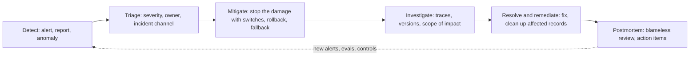

# Incident Response for Agents

## Introduction

Every production system has incidents. Agents have the usual ones (outages, slow dependencies, bad deploys) plus some new kinds:

- The agent **does the wrong thing at scale**: issues hundreds of refunds, emails the wrong customers, closes tickets it should have escalated.
- The agent **costs far more than expected**: a loop runs until the turn limit on every task, or a cache breaks, and the bill climbs for days.
- The agent's **quality silently drops** after a prompt, tool, or model change, with no errors anywhere.
- Someone **manipulates the agent** with prompt injection to leak data or misuse a tool.
- The **model provider** has an outage or you hit a rate or spend limit.

What makes agent incidents tricky is that many of them produce **no errors**. HTTP 200, `stop_reason: "end_turn"`, and a confident answer that happens to be wrong.

Fire departments do not invent their plan when the alarm rings. They have equipment ready, defined roles, and practiced drills. This page gives you the same for agents: kill switches built before you need them, clear roles, a triage flow, investigation tools based on traces, and a blameless review afterward. The practices come from standard incident management, such as the [Google SRE book's chapter on managing incidents](https://sre.google/sre-book/managing-incidents/), adapted for agents.

## Types of Agent Incidents

| Type | How it shows up | First mitigation |
|---|---|---|
| Harmful or wrong actions | Spike in a tool's call rate, customer complaints, finance alerts | Disable the tool or switch to approval-required mode |
| Cost runaway | Spend alert, turns-per-run rising, cache hit ratio falling | Lower turn limits, disable the route, or roll back |
| Quality regression | Success rate or grader scores drop, escalations rise, user feedback worsens | Roll back new sessions to the previous release |
| Prompt injection or data exposure | Unusual tool arguments, data in outputs that should not be there, security report | Disable affected tools or data sources; preserve evidence |
| Provider outage or overload | Model error rate up, 529s, timeouts | Fallback model or degraded mode |
| Rate or spend limit hit | 429s; spend-limit error code | Shed low-priority traffic; raise limits; alert billing owner |
| Tool backend failure | Tool error rate up for one tool | Mark tool unavailable; agent tells user or escalates |

## Build the Controls Before You Need Them

The worst moment to discover you cannot turn off a tool is during an incident. Build these controls in advance, and make each one changeable **without a deploy**, using a feature-flag service or a small config store.

| Control | What it does |
|---|---|
| Global kill switch | Disables the agent and shows a fallback experience |
| Per-tool switch | Removes or blocks a specific tool (for example `issue_refund`) |
| Approval mode | Forces human approval for a tool that normally runs automatically |
| Read-only mode | Blocks all tools that write or send |
| Release routing | Sends new sessions to a specific release version (rollback) |
| Model routing | Switches new sessions to a fallback model |
| Limits override | Lowers turn limits, token budgets, or concurrency |
| Per-tenant block | Disables the agent for one customer (for abuse or targeted attacks) |

Here is a small implementation where the agent loop checks the controls on every tool call. In production, the flags would come from a flag service or Redis with a short cache.

```python
import time


class Controls:
    """Runtime switches read on every call. Backed by a flag service in production."""

    def __init__(self):
        self.flags = {
            "agent_enabled": True,
            "read_only": False,
            "disabled_tools": set(),
            "approval_required_tools": set(),
        }
        self.audit: list[tuple[float, str, str]] = []

    def set(self, name: str, value, who: str) -> None:
        self.flags[name] = value
        self.audit.append((time.time(), who, f"{name}={value!r}"))


WRITE_TOOLS = {"issue_refund", "send_email", "close_ticket"}


def gate_tool_call(controls: Controls, tool_name: str) -> str:
    """Return 'allow', 'needs_approval', or a reason string for blocking."""
    f = controls.flags
    if not f["agent_enabled"]:
        return "blocked: agent disabled"
    if tool_name in f["disabled_tools"]:
        return "blocked: tool disabled by operator"
    if f["read_only"] and tool_name in WRITE_TOOLS:
        return "blocked: read-only mode"
    if tool_name in f["approval_required_tools"]:
        return "needs_approval"
    return "allow"


controls = Controls()
print("normal:      ", gate_tool_call(controls, "issue_refund"))
controls.set("approval_required_tools", {"issue_refund"}, who="alice (incident #231)")
print("approval:    ", gate_tool_call(controls, "issue_refund"))
controls.set("read_only", True, who="alice (incident #231)")
print("read-only:   ", gate_tool_call(controls, "issue_refund"))
print("lookup ok:   ", gate_tool_call(controls, "lookup_order"))
print("audit entries:", len(controls.audit))
```

Output:

```text
normal:       allow
approval:     needs_approval
read-only:    blocked: read-only mode
lookup ok:    allow
audit entries: 2
```

When a tool call is blocked, return a `tool_result` with `is_error: True` and a clear message ("This action is temporarily unavailable; offer to escalate to a human."), so the model can respond sensibly instead of retrying. Every change to a control is audited with who changed it and why.

:::tip
Enforce these controls in **code**, in the tool execution layer, not in the prompt. A prompt instruction like "do not issue refunds right now" can be ignored or overridden by injected text. A blocked function call cannot.
:::

## The Incident Flow



### Detect

Most agent incidents are detected by one of these:

- **Alerts** on success rate, turns per run, spend, tool call rates, model error rate (see [Monitoring and Alerting](./6-agents-monitoring-and-alerting.mdx))
- **Users or support staff** reporting strange answers or actions
- **Downstream systems**: finance noticing refunds, security noticing data access
- **Online grader scores** dropping

Add an alert on the **call rate of each high-impact tool** compared with its normal range. "Refunds per hour is three times normal" is one of the most valuable alerts an agent can have.

### Triage

Decide severity quickly, using a simple scale agreed in advance:

| Severity | Example | Response |
|---|---|---|
| SEV1 | Agent taking harmful actions at scale, data exposure | Page immediately, all hands, mitigate within minutes |
| SEV2 | Agent unavailable for most users, or quality badly degraded | Page on-call, mitigate within the hour |
| SEV3 | Partial degradation, cost anomaly without user harm | Handle in working hours |
| SEV4 | Minor issue, single-user problem | Ticket |

For SEV1 and SEV2, assign roles: an **incident commander** who coordinates and decides, an **operations lead** who makes changes to the system (only this person or group changes production), a **communications lead** who updates stakeholders, and, for long incidents, a **planner** who tracks follow-ups and what has been changed so it can be reverted later. These roles come straight from established incident management practice.

### Mitigate First, Investigate Second

The priority order is: **stop the damage, restore service, preserve evidence.** You do not need to know the root cause to flip a kill switch.

For agents, the mitigation ladder usually looks like this, from least to most disruptive:

1. Require approval for the affected tool
2. Disable the affected tool
3. Switch to read-only or draft-only mode
4. Roll back new sessions to the previous release
5. Switch new sessions to a fallback model
6. Disable the agent entirely and show the fallback experience

Think about **in-flight sessions** too. Rolling back routing affects new sessions only. If running sessions are causing harm, the tool-level switches stop them immediately because they are checked on every call.

### Investigate with Traces

Once the damage is contained, figure out what happened and how far it reached. This is where traces and versioned logs pay off. Typical questions:

- **When did it start?** Look for the first anomalous run and line it up with deploy annotations.
- **What changed?** Compare the release versions and fingerprints before and after.
- **How many runs and users are affected?** Query runs that called the tool, in the time window, on the bad version.
- **Was it manipulated?** Look at what the model read just before the bad action: a web page, an email, a document with injected instructions.

```python
from datetime import datetime

# In production these records come from your trace store or log warehouse.
tool_calls = [
    {"run_id": "r1", "ts": "2026-10-08T09:12:00", "tool": "issue_refund", "version": "2026.10.3",
     "input": {"order_id": "A-1", "amount": 15}},
    {"run_id": "r2", "ts": "2026-10-08T14:05:00", "tool": "issue_refund", "version": "2026.10.4",
     "input": {"order_id": "A-2", "amount": 20}},
    {"run_id": "r3", "ts": "2026-10-08T14:07:00", "tool": "issue_refund", "version": "2026.10.4",
     "input": {"order_id": "A-3", "amount": 20}},
    {"run_id": "r4", "ts": "2026-10-08T14:09:00", "tool": "lookup_order", "version": "2026.10.4",
     "input": {"order_id": "A-4"}},
]


def affected_actions(calls: list, tool: str, version: str, since: str) -> list:
    start = datetime.fromisoformat(since)
    return [c for c in calls if c["tool"] == tool and c["version"] == version
            and datetime.fromisoformat(c["ts"]) >= start]


hits = affected_actions(tool_calls, "issue_refund", "2026.10.4", "2026-10-08T14:00:00")
print(f"{len(hits)} refunds by version 2026.10.4, total ${sum(c['input']['amount'] for c in hits)}")
for c in hits:
    print(c["run_id"], c["input"])
```

Output:

```text
2 refunds by version 2026.10.4, total $40
r2 {'order_id': 'A-2', 'amount': 20}
r3 {'order_id': 'A-3', 'amount': 20}
```

This list drives the **remediation**: which refunds to review, which customers to contact, which tickets to reopen. Without per-run traces that include tool inputs and the agent version, you cannot answer these questions precisely, and you may have to treat every action in the period as suspect. See [Tracing Agent Runs](../11-agents-evaluation-and-testing/8-agents-tracing.mdx) and [Debugging Agents](../11-agents-evaluation-and-testing/10-agents-debugging.mdx).

:::warning
For suspected prompt injection or data exposure, **preserve evidence before cleaning up**: the traces, the source documents, and the tool inputs. Involve your security team early. Treat it as a security incident, not only an agent bug. See [Prompt Injection](../12-agents-safety-and-security/1-agents-prompt-injection.mdx).
:::

### Resolve and Remediate

Resolution has two parts:

- **Fix the cause**: revert or correct the prompt, tool, or model change; add input validation or hard limits in the tool; fix the backend.
- **Fix the effects**: reverse wrong actions where possible, contact affected users, correct records. Agents that act on the world create cleanup work that a typical bug does not.

Before re-enabling a tool or rolling forward, add the failing cases to your eval set so the same problem cannot ship again unnoticed.

## Communicating During an Incident

Clear communication prevents a second incident: confused stakeholders making their own changes, or support staff giving customers wrong information. The communications lead sends short updates on a fixed rhythm (for example every 30 minutes for SEV1), even when there is nothing new.

```text
[SEV2] Support agent issuing incorrect credits - Update 2 (16:00)
Status: Mitigated, investigating
Impact: Since ~14:00, the support agent issued about 4x the normal number of credits.
        No credits have been issued automatically since 15:45.
Actions taken: issue_credit now requires human approval; new sessions routed to
        the previous release (2026.10.3).
Next steps: Identify affected credits from traces; propose remediation to finance.
Next update: 16:30, or sooner if anything changes.
Incident commander: Alice | Ops lead: Bob | Comms: Carol
```

Tell support staff what to say to customers, and tell them which agent behaviors are currently disabled so they are not surprised.

## Recognizing Common Agent Incident Signatures

Many agent incidents have a recognizable shape in the metrics. Learning these speeds up triage:

| Signature in the metrics | Likely cause | Where to look first |
|---|---|---|
| Turns per run up, cost up, success flat or down | Loop: a tool returns unhelpful results, or a prompt change made the agent over-verify | Traces of turn-limit runs; recent tool or prompt changes |
| Cost up, turns flat, cache hit ratio down | Caching broke: dynamic content entered the prompt prefix | Diff of the rendered system prompt and tool list between releases |
| One tool's call rate up sharply | Prompt or description change, injection, or a new kind of input | Inputs preceding the calls; release fingerprints |
| Success down for one route only | Data change in that route's knowledge base or tool backend | Retrieval index version, backend health |
| Model error rate up across all routes | Provider issue, rate limit, or spend limit | Error types (429 vs 529 vs 5xx), provider status page |
| Refusals up | New input pattern, or a model or prompt change | Sample refused runs; recent changes |

## Verifying Recovery

Before declaring an incident resolved, confirm with data, not with a feeling:

- The metric that fired the alert is back in its normal range, **and** stays there for a reasonable period (for example, an hour of normal traffic).
- The sampled quality scores and user feedback for the fixed version match the pre-incident baseline.
- Every temporary control you changed is either reverted or deliberately kept, and the planner's list of changes is empty.
- New eval cases covering the failure pass on the fixed release.

## Runbooks

A runbook is a short, practical guide that an on-call engineer can follow at 3 a.m. Keep one per alert, and link it from the alert. A minimal template:

```yaml
alert: RefundToolRateHigh
meaning: >
  issue_refund calls per hour are more than 3x the 7-day average.
impact: Possible financial loss; customers may receive incorrect refunds.
confirm:
  - Open the "Agent actions" Grafana dashboard; check refunds/hour by version.
  - Sample 5 recent refund traces. Are the refunds justified by the ticket?
mitigate:
  - "Set approval_required_tools += issue_refund (flag service, no deploy)."
  - "If refunds look clearly wrong: disable issue_refund."
  - "If a recent release is involved: route new sessions to the previous release."
investigate:
  - Compare release fingerprints before and after the spike.
  - Look for repeated text in the inputs preceding refund calls (possible injection).
escalate:
  - Page the support-agent owner; notify finance on-call for SEV1/SEV2.
```

Practice runbooks in **game days**: deliberately trigger a fake incident in staging and walk through the steps. Gaps show up quickly (a flag nobody has permission to change, a dashboard that does not exist).

## Blameless Postmortems

After a SEV1 or SEV2, write a blameless postmortem: a factual account focused on how the system allowed the failure, not on who made a mistake. A useful structure:

- **Summary**: what happened, impact (users, money, duration), severity
- **Timeline**: detection, key decisions, mitigation, resolution, with timestamps
- **Root cause and contributing factors**: often several, for example "prompt change lacked an eval case for partial refunds" **and** "no rate alert on the refund tool" **and** "refund limit enforced only in the prompt"
- **What went well and what did not**
- **Action items** with owners and dates: new evals, new alerts, hard limits in tools, new controls

Agent postmortems often produce the same few kinds of action items: move a limit from the prompt into code, add an eval case, add a per-tool rate alert, and make a control changeable without a deploy. Track them; a postmortem without completed action items is a story, not an improvement.

## Real-World Scenario

You run a subscription support agent that can pause subscriptions and issue credits up to $20. On a Thursday afternoon, a prompt update ships that rewords the refund policy section. At 14:00 the release reaches 100% of new sessions. At 15:40, the finance team posts in the support channel: credits issued today are four times the usual amount.

**How the response goes:**

1. **15:42 Triage.** The on-call engineer declares SEV2, opens an incident channel, and takes the incident commander role. A second engineer is the operations lead.
2. **15:45 Mitigate.** The operations lead sets `issue_credit` to approval-required. New credits now go to a human queue. No deploy needed.
3. **15:50 Confirm.** The dashboard shows credits by version: almost all from version 2026.10.4. The operations lead routes new sessions back to 2026.10.3.
4. **16:00 Communicate.** The comms lead updates finance and support leadership with the impact so far and the mitigation in place.
5. **16:30 Investigate.** Trace queries list 212 credits issued by the new version. Sampling 20 shows the reworded policy made the agent treat "unhappy with the product" as eligible for a credit.
6. **Next day: Remediate.** Support reviews the 212 credits; most are kept as goodwill, a few are reversed. The prompt is fixed, and 15 new eval cases cover credit eligibility.
7. **Postmortem.** Action items: a per-tool rate alert on `issue_credit`, a daily credit cap per customer enforced in the tool, a required eval category for any policy text change, and a canary stage (the release had gone straight to 100%).

**Why this approach fits.** The pre-built approval switch stopped the damage within minutes, without needing to understand the cause. Versioned traces made the scope precise, so only the affected credits were reviewed.

**When not to use it.** A full incident process with roles and postmortems is too heavy for a SEV4 issue affecting one user. Fix it, add an eval case, and move on.

### Alternatives and Trade-offs

| Mitigation | Pros | Cons | Best for |
|---|---|---|---|
| Require approval for a tool | Keeps service running, stops unreviewed actions | Creates a human queue | Suspicious actions with real users waiting |
| Disable a tool | Immediate, precise | Agent loses a capability | Clearly harmful tool behavior |
| Read-only or draft-only mode | Agent still helps with answers | No automated actions | Broad uncertainty about actions |
| Roll back release routing | Fixes regressions from a change | Only affects new sessions | Problems tied to a deploy |
| Fallback model | Restores service during provider issues | Quality may differ | Provider outages |
| Full kill switch | Stops everything | Users lose the feature | SEV1 harm or security incidents |

## Common Mistakes

- **No controls until the incident.** Build switches and test them in advance.
- **Limits only in the prompt.** Injection or a prompt change can remove them; enforce in code.
- **Investigating before mitigating.** Stop the damage first.
- **No per-tool action alerts.** Harmful actions often look like normal successful runs.
- **Traces without tool inputs or versions.** You cannot scope the impact.
- **Cleaning up before preserving evidence** in security incidents.
- **Postmortems that blame a person.** The question is how the system let it happen.
- **Untracked action items.** The same incident happens again.

## Summary

- Agent incidents include wrong actions at scale, cost runaways, silent quality regressions, injection, and provider problems; many produce no errors.
- Build runtime controls before you need them: kill switch, per-tool switches, approval and read-only modes, release and model routing, all changeable without a deploy and enforced in code.
- Follow detect, triage, mitigate, investigate, resolve, and postmortem; assign clear roles for serious incidents.
- Use versioned traces with tool inputs to scope impact and drive remediation.
- Keep runbooks linked from alerts, practice with game days, and turn postmortem findings into evals, alerts, and hard limits.

## Exercises

1. List every tool your agent can call. For each, decide which controls it needs (disable, approval, read-only) and where in code they are enforced.
2. Extend `gate_tool_call` with a per-tenant block list and write tests for each path.
3. Write a runbook for a "cost per hour above forecast" alert, including how to tell a traffic spike from a looping agent.
4. Run a game day: in a test environment, simulate a looping agent and walk through detection, mitigation, and investigation. Note every step that was slower than it should be.

Next: [AgentOps Best Practices](./10-agents-agentops-best-practices.mdx). Related: [Human Approval Gates](../12-agents-safety-and-security/7-agents-approval-gates.mdx), [Red Teaming Agents](../12-agents-safety-and-security/10-agents-red-teaming.mdx), and the site's [PagerDuty integration guide](../../../observability/prometheus/4-prometheus-alerting/10-pagerduty-integration.mdx).
