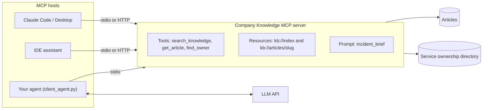

# Project: Company Knowledge MCP Server

## Introduction

Every new agent your company builds needs the same context: internal docs, runbooks, who owns which service. Without a shared approach, each team writes its own "search the wiki" tool, in its own way, for its own agent.

The **Model Context Protocol (MCP)** solves this with a standard interface. You build a **server** once, and any MCP-capable **host** can use it: Claude Code, Claude Desktop, IDE assistants, other vendors' tools, and your own agents. It's similar to how a REST API lets many clients use one backend.

In this project you will build a **Company Knowledge MCP server** with the official MCP Python SDK. It exposes:

- **Tools** the model can call: `search_knowledge`, `get_article`, `find_owner`
- **Resources** the host can read: an index of articles and each article by URI
- A **prompt** template: an "incident brief" workflow users can pick from a menu

Then you will connect it three ways: the MCP Inspector, an off-the-shelf host, and a small agent of your own that turns MCP tools into LLM tool definitions.

### What You'll Learn

- How the three MCP building blocks (tools, resources, prompts) map onto a real use case
- How to build a server with the MCP Python SDK v2 (`MCPServer`)
- How to return errors the model can act on, and why stdout is off-limits for stdio servers
- How to bridge MCP tools into an LLM agent loop
- How to test a server in-process without spawning subprocesses
- What changes when you move from local stdio to a remote HTTP server

### Prerequisites

- Python 3.10+, `ANTHROPIC_API_KEY` set (MCP itself is provider-neutral; the bridge works with any tool-calling model)
- [MCP Introduction](../7-agents-mcp/0-agents-mcp-introduction.mdx), [MCP Architecture](../7-agents-mcp/1-agents-mcp-architecture.mdx), and [Building Your First MCP Server](../7-agents-mcp/2-agents-mcp-first-server.mdx)

:::note
This page uses version 2 of the MCP Python SDK (the `mcp` package, 2.x), where the high-level server class is `MCPServer`. In 1.x the same class was called `FastMCP` and lived in `mcp.server.fastmcp`. If you're on 1.x, see the SDK's [migration guide](https://py.sdk.modelcontextprotocol.io/migration/). Pin your version in `requirements.txt` either way.
:::

## Goal and Requirements

**Functional requirements**

- Search articles by keywords and return titles, slugs, and snippets
- Fetch a full article by slug
- Find the owning team, chat channel, and on-call rotation for a service
- Expose an article index and individual articles as resources
- Provide an "incident brief" prompt that guides a model through gathering context for a service

**Non-functional requirements**

- Read-only: every tool is annotated as read-only and has no side effects
- Restricted articles are never exposed by this server
- Clear, actionable error messages for unknown slugs or services
- Works over stdio for local hosts; can run over Streamable HTTP for shared deployments
- Tested in-process with the SDK's client

## Architecture



The server never talks to an LLM. It only answers protocol requests. The host decides which model to use and when to call tools. That separation is what makes one server reusable across many hosts.

## Design Decisions

| Decision | Choice | Alternatives | Trade-off |
| --- | --- | --- | --- |
| Integration style | MCP server | Tool functions copied into each agent; a REST API plus custom tool wrappers | MCP gives every host the same tools without glue code. For a single agent in one codebase, plain functions are simpler. |
| What becomes a tool vs resource | Search and lookups as tools; articles also as resources | Everything as tools | Tools are model-controlled; resources are application-controlled (the user or host attaches them). Offering both lets hosts choose. See [MCP Tools, Resources and Prompts](../7-agents-mcp/3-agents-mcp-tools-resources-prompts.mdx). |
| Transport | stdio by default, Streamable HTTP optional | HTTP only | stdio is simplest for local use and inherits the user's environment. HTTP is needed for a shared server, and then authentication becomes mandatory. |
| SDK | Official Python SDK, high-level `MCPServer` | Low-level server API, other frameworks | Type hints become the input schema automatically. The low-level API gives more control over protocol details. |
| Access control | Server filters restricted content | Rely on the host or model to hide it | Anything a server returns can reach the model and the user. Filter at the source. |
| Search | Simple keyword scoring | Embeddings | Enough for a demo. Swap in your real search backend behind the same tool. |

## Step-by-Step Build

### Step 1: Project Layout

```text
kb_server/
├── kb_data.py       # sample articles + service ownership directory
├── server.py        # the MCP server
├── client_agent.py  # an agent that uses the server's tools via an LLM
└── tests/
    └── test_server.py
```

```bash
pip install "mcp[cli]>=2,<3" anthropic pytest
```

The `cli` extra installs the `mcp` command-line tool, which includes the Inspector launcher used below.

### Step 2: Knowledge Data

In production, this module would call your wiki's search API and your service catalog. The data shape is what matters.

```python
# kb_data.py
ARTICLES = {
    "deploy-checklist": {
        "title": "Production deploy checklist", "team": "platform", "visibility": "all",
        "updated": "2026-09-14", "tags": ["deploy", "release", "rollback"],
        "body": "1. Check the CI pipeline is green. 2. Announce in #deploys. 3. Deploy to "
                "canary and watch error rate for 10 minutes. 4. Roll out to 100%. To roll "
                "back, run the 'rollback' job in the deploy pipeline for the previous tag."},
    "checkout-runbook": {
        "title": "Checkout API runbook", "team": "payments", "visibility": "all",
        "updated": "2026-08-30", "tags": ["checkout", "incident", "database"],
        "body": "Symptoms: 5xx on /checkout. First check recent deploys and the DB "
                "connection pool. Dashboards: grafana/checkout. Escalate to #payments-oncall "
                "if checkout is degraded for more than 10 minutes."},
    "oncall-policy": {
        "title": "On-call policy", "team": "sre", "visibility": "all",
        "updated": "2026-05-02", "tags": ["oncall", "incident", "pager"],
        "body": "Acknowledge pages within 5 minutes. SEV1 incidents need an incident "
                "commander. Write a postmortem within 5 business days for SEV1 and SEV2."},
    "acquisition-plan": {
        "title": "Project Falcon acquisition plan", "team": "exec", "visibility": "restricted",
        "updated": "2026-10-01", "tags": ["confidential"],
        "body": "Confidential. Not for general access."},
}

SERVICE_OWNERS = {
    "checkout-api": {"team": "payments", "channel": "#payments", "oncall": "payments-primary"},
    "search-api": {"team": "discovery", "channel": "#discovery", "oncall": "discovery-primary"},
    "deploy-pipeline": {"team": "platform", "channel": "#platform", "oncall": "platform-primary"},
}


def public_articles() -> dict[str, dict]:
    """The only articles this server may expose."""
    return {slug: a for slug, a in ARTICLES.items() if a["visibility"] == "all"}
```

### Step 3: The MCP Server

With `MCPServer`, a tool is a typed Python function. The type hints become the JSON input schema and the docstring becomes the description the model reads, so write docstrings for the model, including when to use the tool.

```python
# server.py
import logging
import sys

from mcp.server import MCPServer
from mcp.server.mcpserver.exceptions import ResourceNotFoundError, ToolError
from mcp.types import ToolAnnotations

from kb_data import SERVICE_OWNERS, public_articles

# stdio servers talk JSON-RPC over stdout: never print() to stdout. Log to stderr.
logging.basicConfig(stream=sys.stderr, level=logging.INFO)
log = logging.getLogger("company-knowledge")

mcp = MCPServer(
    "company-knowledge",
    instructions="Internal engineering knowledge: runbooks, policies, and service "
                 "ownership. Search first, then read the most relevant article.",
)
READ_ONLY = ToolAnnotations(readOnlyHint=True, openWorldHint=False)


@mcp.tool(annotations=READ_ONLY)
def search_knowledge(query: str, limit: int = 5) -> list[dict]:
    """Search internal engineering articles (runbooks, checklists, policies) by keywords.

    Use this before answering any question about internal processes or services.
    Returns slug, title, owning team, last update date and a short snippet.
    Then call get_article with a slug to read the full text.
    """
    words = [w.lower() for w in query.split() if len(w) > 2]
    if not words:
        raise ToolError("Query needs at least one word of 3+ characters.")
    scored = []
    for slug, a in public_articles().items():
        text = " ".join([a["title"], a["body"], " ".join(a["tags"])]).lower()
        score = sum(text.count(w) for w in words) + 3 * sum(w in a["tags"] for w in words)
        if score:
            scored.append((score, slug, a))
    scored.sort(key=lambda s: s[0], reverse=True)
    log.info("search %r -> %d hits", query, len(scored))
    return [{"slug": slug, "title": a["title"], "team": a["team"], "updated": a["updated"],
             "snippet": a["body"][:140]} for _, slug, a in scored[:max(1, min(limit, 10))]]


@mcp.tool(annotations=READ_ONLY)
def get_article(slug: str) -> str:
    """Read the full text of an article by its slug (from search_knowledge results)."""
    article = public_articles().get(slug)
    if article is None:
        raise ToolError(f"No article {slug!r}. Use search_knowledge to find valid slugs.")
    return (f"# {article['title']}\nTeam: {article['team']} | Updated: {article['updated']}"
            f"\n\n{article['body']}")


@mcp.tool(annotations=READ_ONLY)
def find_owner(service: str) -> dict:
    """Find the team, chat channel and on-call rotation that own a service.

    Use for questions like 'who owns X' or 'who do I page for X'.
    """
    owner = SERVICE_OWNERS.get(service.strip().lower())
    if owner is None:
        known = ", ".join(sorted(SERVICE_OWNERS))
        raise ToolError(f"Unknown service {service!r}. Known services: {known}.")
    return {"service": service, **owner}


@mcp.resource("kb://index")
def article_index() -> str:
    """List of all available articles (slug and title)."""
    return "\n".join(f"{slug}: {a['title']}" for slug, a in public_articles().items())


@mcp.resource("kb://articles/{slug}")
def article_resource(slug: str) -> str:
    """A single article as Markdown."""
    article = public_articles().get(slug)
    if article is None:
        raise ResourceNotFoundError(f"No article {slug!r}")
    return f"# {article['title']}\n\n{article['body']}"


@mcp.prompt()
def incident_brief(service: str) -> str:
    """Prepare an incident brief for a service: owners, runbook and escalation policy."""
    return (f"I'm responding to an incident on {service}. Using the company-knowledge "
            f"tools: 1) find the owner of {service}, 2) search for its runbook and read it, "
            "3) check the on-call policy. Then give me a short brief: who to contact, the "
            "first three things to check, and when to escalate. Cite article slugs.")


if __name__ == "__main__":
    if "--http" in sys.argv:
        # Shared deployments: put this behind authentication (see Security Considerations).
        mcp.run("streamable-http", host="127.0.0.1", port=8000)
    else:
        mcp.run()  # stdio
```

Three details worth noticing:

- **`ToolError` vs other exceptions.** In SDK v2, raising `ToolError` sends your message back to the model as an error result it can act on ("Use search_knowledge to find valid slugs"). Any other exception is treated as a crash: the model sees only a generic "Error executing tool" message, and the traceback stays in the server log. That protects internal details while still letting you write helpful errors.
- **Annotations.** `readOnlyHint=True` tells hosts the tool has no side effects, which some hosts use to skip confirmation prompts. Annotations are hints for the host, not security controls.
- **Restricted content** is filtered by `public_articles()` everywhere, so no tool, resource, or prompt can return the acquisition plan.

### Step 4: Try It with the MCP Inspector

The Inspector is a web UI for calling a server's tools, reading resources, and rendering prompts by hand. It's the fastest way to check your server before connecting a model.

```bash
mcp dev server.py
```

Call `search_knowledge` with `query="checkout incident"` and you should see the checkout runbook first. Call `get_article` with a bad slug to see your error message.

### Step 5: Connect an MCP Host

Most MCP hosts launch local servers from a command. For Claude Code, register the server with the CLI:

```bash
claude mcp add company-knowledge -- python /absolute/path/to/kb_server/server.py
```

Many desktop hosts, including Claude Desktop, use a JSON configuration file with an `mcpServers` section:

```json
{
  "mcpServers": {
    "company-knowledge": {
      "command": "python",
      "args": ["/absolute/path/to/kb_server/server.py"]
    }
  }
}
```

Use absolute paths, because hosts start servers from their own working directory. Each host documents where its configuration lives; check its docs for current details.

### Step 6: Your Own Agent as an MCP Client

Hosts are convenient, but you'll often want MCP tools inside **your own** agent. The bridge is short: list the server's tools, convert each one into an LLM tool definition, and forward tool calls to `call_tool`.

```python
# client_agent.py
import asyncio
import sys

import anthropic
from mcp import Client, StdioServerParameters

MODEL = "claude-opus-5-5"
MAX_STEPS = 10


def to_llm_tools(mcp_tools) -> list[dict]:
    """MCP tool definitions -> Anthropic tool definitions."""
    return [{"name": t.name, "description": t.description or "",
             "input_schema": t.input_schema} for t in mcp_tools]


def result_text(result) -> str:
    parts = [c.text for c in result.content if getattr(c, "type", "") == "text"]
    return "\n".join(parts) or "(no text content)"


async def run_agent(question: str, mcp_client: Client, llm) -> str:
    tools = to_llm_tools((await mcp_client.list_tools()).tools)
    messages = [{"role": "user", "content": question}]
    for _ in range(MAX_STEPS):
        response = await llm.messages.create(
            model=MODEL, max_tokens=4000, tools=tools, messages=messages,
            system="Answer using the company-knowledge tools. Cite article slugs.",
        )
        messages.append({"role": "assistant", "content": response.content})
        if response.stop_reason == "tool_use":
            results = []
            for block in (b for b in response.content if b.type == "tool_use"):
                result = await mcp_client.call_tool(block.name, block.input)
                results.append({"type": "tool_result", "tool_use_id": block.id,
                                "content": result_text(result), "is_error": result.is_error})
            messages.append({"role": "user", "content": results})
            continue
        if response.stop_reason == "pause_turn":
            continue
        return "".join(b.text for b in response.content if b.type == "text").strip()
    return "Stopped: step limit reached."


async def main() -> None:
    question = " ".join(sys.argv[1:]) or "Checkout is throwing 5xx errors. Who do I contact and what should I check first?"
    server = StdioServerParameters(command=sys.executable, args=["server.py"])
    async with Client(server) as mcp_client:
        print(await run_agent(question, mcp_client, anthropic.AsyncAnthropic()))


if __name__ == "__main__":
    asyncio.run(main())
```

`Client` accepts a URL for Streamable HTTP servers, `StdioServerParameters` to launch a local server as a subprocess, or (in tests) a server object to connect in-process. The agent code doesn't change between them.

:::tip
The Anthropic Python SDK also ships MCP conversion helpers (`anthropic.lib.tools.mcp`) for use with its tool runner, and the API offers an **MCP connector** that lets the API itself connect to a remote MCP server over HTTP. See [Connecting MCP Servers to LLM APIs](../7-agents-mcp/6-agents-mcp-with-llm-apis.mdx). The manual bridge above works with any provider and any MCP server, local or remote.
:::

## Sample Run

```bash
python client_agent.py
```

Example output (your wording will differ):

```text
**Contact:** checkout-api is owned by the payments team. Post in #payments; the on-call
rotation is payments-primary.

**First checks** (from checkout-runbook):
1. Recent deploys: did anything ship just before the errors started?
2. The database connection pool.
3. The grafana/checkout dashboard for error and latency trends.

**Escalate** to #payments-oncall if checkout stays degraded for more than 10 minutes.
For a SEV1, an incident commander is required and a postmortem is due within
5 business days (oncall-policy).
```

Behind the scenes, the model called `find_owner` and `search_knowledge` in parallel, then `get_article` twice. The restricted acquisition plan never appeared in any result.

## Testing and Evaluating

### In-Process Server Tests

Passing the server object to `Client` connects in memory: no subprocess, no ports. The tests use `asyncio.run` so you don't need a pytest async plugin.

```python
# tests/test_server.py
import asyncio
from types import SimpleNamespace

from mcp import Client

from client_agent import run_agent
from server import mcp


def call(coro_fn):
    async def runner():
        async with Client(mcp) as client:
            return await coro_fn(client)
    return asyncio.run(runner())


def test_tools_are_listed_with_schemas_and_read_only_hints():
    async def check(client):
        tools = {t.name: t for t in (await client.list_tools()).tools}
        assert set(tools) == {"search_knowledge", "get_article", "find_owner"}
        assert tools["search_knowledge"].input_schema["required"] == ["query"]
        assert all(t.annotations.read_only_hint for t in tools.values())
    call(check)


def test_search_ranks_runbook_and_hides_restricted():
    async def check(client):
        result = await client.call_tool("search_knowledge", {"query": "checkout incident"})
        hits = result.structured_content["result"]
        assert hits[0]["slug"] == "checkout-runbook"
        everything = await client.call_tool("search_knowledge", {"query": "confidential plan"})
        assert "acquisition-plan" not in str(everything.content)
    call(check)


def test_bad_slug_returns_actionable_error():
    async def check(client):
        result = await client.call_tool("get_article", {"slug": "acquisition-plan"})
        assert result.is_error
        assert "search_knowledge" in result.content[0].text
    call(check)


def test_resources_and_prompt():
    async def check(client):
        index = await client.read_resource("kb://index")
        assert "deploy-checklist" in index.contents[0].text
        assert "acquisition-plan" not in index.contents[0].text
        prompt = await client.get_prompt("incident_brief", {"service": "checkout-api"})
        assert "checkout-api" in prompt.messages[0].content.text
    call(check)


class FakeLLM:
    """Async stand-in for AsyncAnthropic that scripts two turns."""

    def __init__(self):
        self.turns = [
            SimpleNamespace(stop_reason="tool_use", content=[SimpleNamespace(
                type="tool_use", id="t1", name="find_owner",
                input={"service": "checkout-api"})]),
            SimpleNamespace(stop_reason="end_turn", content=[SimpleNamespace(
                type="text", text="Contact #payments.")]),
        ]
        self.requests = []
        self.messages = self

    async def create(self, **kwargs):
        self.requests.append({**kwargs, "messages": list(kwargs["messages"])})
        return self.turns.pop(0)


def test_agent_bridge_with_fake_llm():
    llm = FakeLLM()

    async def check(client):
        return await run_agent("Who owns checkout?", client, llm)

    assert call(check) == "Contact #payments."
    assert {t["name"] for t in llm.requests[0]["tools"]} >= {"find_owner"}
    tool_result = llm.requests[1]["messages"][-1]["content"][0]
    assert "#payments" in tool_result["content"] and not tool_result["is_error"]
```

Output:

```text
.....                                                                    [100%]
5 passed in 0.74s
```

### Evaluating Usefulness

A server is only as good as the model's ability to use it. Evaluate through a host or `client_agent.py`:

- **Tool selection**: for 20 realistic questions, did the model call the expected tools? (Record calls; grade with code.)
- **Answer quality**: does the answer cite the right article slugs and contain the key facts? (Code checks plus an LLM judge.)
- **Description tuning**: if the model skips `search_knowledge` or guesses slugs, improve the docstrings. Tool descriptions are prompts. See [Prompting for Better Tool Use](../3-agents-prompt-engineering/4-agents-prompting-for-tool-use.mdx).
- **Cross-host checks**: try two different hosts. Hosts phrase tool lists differently, so behavior can vary.

## Security Considerations

- **The server is the trust boundary.** Filter restricted data inside the server, as `public_articles()` does. Anything returned can reach any connected model and user.
- **Authentication for remote servers.** A stdio server runs with the local user's permissions. An HTTP server is reachable over the network, so it needs authentication; the MCP specification defines an OAuth-based authorization flow, and the Python SDK has settings for it. Never expose an unauthenticated HTTP server beyond localhost. See [MCP Security](../7-agents-mcp/8-agents-mcp-security.mdx) and the [authorization spec](https://modelcontextprotocol.io/specification/latest).
- **Per-user permissions.** If different employees may see different documents, the server must know who is calling (from the auth token) and filter per user, not per server.
- **Tool poisoning and supply chain.** Hosts read your tool descriptions as instructions. Users installing third-party MCP servers should review them like any dependency, because a malicious server can embed instructions in descriptions or results.
- **Content from the wiki is untrusted.** Anyone who can edit an article can try to inject instructions. Keep this server read-only so the worst case is a misleading answer.
- **Never write to stdout in stdio servers.** It's a reliability issue rather than a security one, but it causes confusing failures: stray prints corrupt the protocol stream.

## Real-World Scenario

Your company has five teams building internal agents: an on-call assistant, a support bot, a coding agent, an onboarding helper, and a Slack bot. Each team wrote its own wiki search, with different bugs, and two of them accidentally exposed restricted pages.

**Why this approach fits:** one MCP server becomes the single, reviewed path to internal knowledge. Access rules live in one place. Developers also get the same tools in their IDE and in Claude Code with a one-line configuration.

**When to use it:** several agents or hosts need the same capability, or you want developer tools to access internal systems in a standard way.

**When not to use it:** a single agent in a single codebase is simpler with plain tool functions. Add MCP when reuse appears.

| Approach | Pros | Cons | Best for |
| --- | --- | --- | --- |
| Shared MCP server (this project) | Reusable across hosts, one place for access rules | Another service to run and secure | Many agents or hosts, developer tooling |
| Plain tool functions in each agent | Simplest, no extra process | Duplicated code and rules | One agent, one team |
| REST API plus per-agent wrappers | Familiar, works with anything | Every agent writes glue code | Existing API-first platforms |
| Provider-hosted connectors | No server to run | Limited to supported systems | Popular SaaS tools |

## Extensions and Exercises

1. **Real search.** Replace keyword scoring with your wiki's search API or the BM25 index from [Project: Document Q&A Agent](./4-agents-project-document-qa.mdx).
2. **Remote deployment.** Run with `--http`, put it behind authentication, and connect `client_agent.py` with `Client("http://127.0.0.1:8000/mcp")`. See [MCP Transports](../7-agents-mcp/5-agents-mcp-transports.mdx).
3. **Per-user filtering.** Add a `visibility` per team and filter results by the caller's identity from the auth token.
4. **Structured outputs.** Add a typed return model (a Pydantic class) to `find_owner` and inspect `structured_content` on the client side.
5. **Wrap an existing API.** Expose your service catalog's REST API as MCP tools. See [Wrapping an Existing API with MCP](../7-agents-mcp/7-agents-mcp-wrapping-existing-apis.mdx).

## Summary

- MCP lets you build a capability once and use it from many hosts and agents
- Tools are model-controlled actions, resources are application-controlled data, prompts are user-selectable templates
- With SDK v2, typed functions become tools; raise `ToolError` for messages the model should see
- Bridging MCP into your own agent is a short loop: list tools, convert schemas, forward calls
- Filter sensitive data in the server, authenticate remote servers, and test in-process

## Further Learning

- [MCP Tools, Resources and Prompts](../7-agents-mcp/3-agents-mcp-tools-resources-prompts.mdx)
- [Building an MCP Client](../7-agents-mcp/4-agents-mcp-client.mdx)
- [MCP Security](../7-agents-mcp/8-agents-mcp-security.mdx)
- [The MCP Ecosystem](../7-agents-mcp/9-agents-mcp-ecosystem.mdx)
- Official docs: [modelcontextprotocol.io](https://modelcontextprotocol.io) and the [Python SDK docs](https://py.sdk.modelcontextprotocol.io/)
- Previous: [Project: Adding an Agent Feature to a SaaS App](./9-agents-project-saas-feature.mdx) · Next: [Capstone: Production-Ready Agent](./11-agents-project-capstone.mdx)
