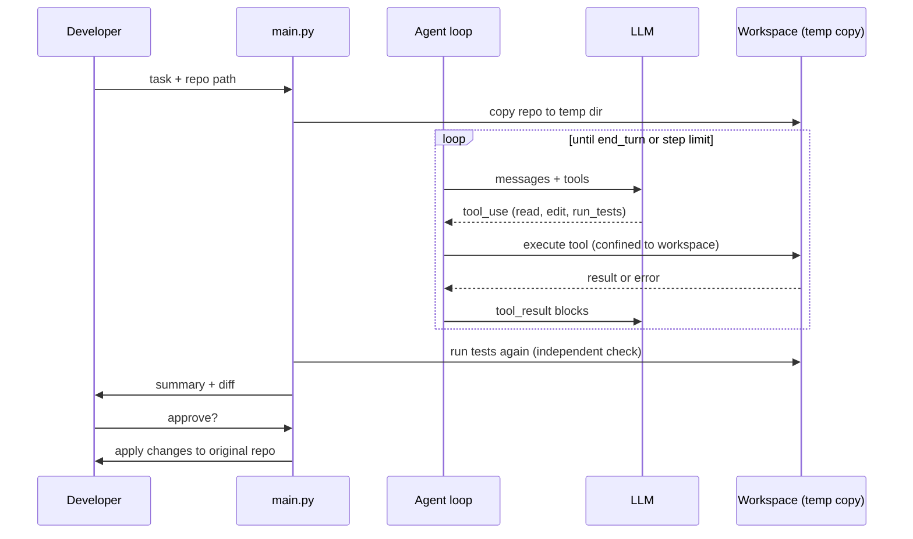

# Project: Coding Agent

## Introduction

Coding is one of the strongest use cases for agents, and there is a simple reason: **code can be checked automatically**. A test suite tells the agent, and you, whether a change worked. That feedback loop turns "the model thinks this is right" into "the tests pass."

In this project you will build a minimal coding agent, similar in spirit to the tools many developers now use daily, but small enough to read in one sitting. Given a repository and a task such as "the tests are failing, fix the bug," it will:

1. Explore the files
2. Read the relevant code and tests
3. Make targeted edits
4. Run the tests
5. Repeat until the tests pass or it runs out of budget
6. Hand you a unified diff to review

Everything runs in a temporary copy of a tiny sample repository, so the agent can't damage your real files.

### What You'll Learn

- How to design file tools that are safe: path confinement, exact-match edits, protected files
- How to run tests from an agent without a shell (no `shell=True`), with timeouts and output limits
- Why the agent's claim of success must be re-verified by your code
- How to present the result as a diff for human review
- When to use the provider's built-in bash and text editor tools instead

### Prerequisites

- Python 3.10+, `ANTHROPIC_API_KEY` set (the same design works with any provider that supports tool calling)
- Comfortable with `pytest` and `git diff` output
- [Building a Manual Agent Loop](../2-agents-tool-use/3-agents-manual-agent-loop.mdx) and [Bash and File Editing Tools](../2-agents-tool-use/9-agents-bash-and-file-tools.mdx)

## Goal and Requirements

**Functional requirements**

- Work on a copy of a repository, never the original
- Tools: list files, read a file, edit a file by exact string replacement, create a file, run the test suite
- Loop until tests pass or a step limit is reached
- Print a summary and a unified diff; apply changes to the original only after a human says yes

**Non-functional requirements**

- The agent cannot read or write outside the workspace
- The agent cannot edit test files (so it can't "fix" tests by deleting assertions)
- Test runs have a timeout and truncated output
- Secrets such as API keys are not passed to the test process
- Bounded cost: a maximum number of steps per task

## Architecture



## Design Decisions

| Decision | Choice | Alternatives | Trade-off |
| --- | --- | --- | --- |
| Editing style | `edit_file` with exact `old_str` to `new_str` replacement | Rewrite whole files, apply unified diffs | Exact replacement is easy for models to get right, cheap in tokens, and fails loudly when the match is ambiguous. Whole-file rewrites are simpler but can silently drop code. |
| Running code | One `run_tests` tool with a fixed command | A general bash tool | A fixed command removes shell injection risk. A bash tool is far more flexible but needs a real sandbox. |
| Built-in vs custom tools | Custom tools | Anthropic-defined `bash_20250124` and `text_editor_20250728` | Built-in tools are already familiar to the model. Custom tools let you add rules (protected files) and run anywhere. |
| Isolation | Temp directory copy | Docker container, git worktree | A temp copy is enough for a demo. Use a container or VM when the agent can run arbitrary commands. See [Sandboxing Agent Execution](../12-agents-safety-and-security/3-agents-sandboxing.mdx). |
| Success criteria | Tests re-run by our code | Trust the model's final message | Models sometimes say "all tests pass" when they don't. Re-running is cheap. |
| Human review | Diff plus approval before applying | Auto-commit | Code review is still essential for agent-written code. |

## Step-by-Step Build

### Step 1: Project Layout

```text
coding_agent/
├── make_sample_repo.py   # creates sample_repo/ with a buggy module and tests
├── workspace.py          # safe file tools + test runner
├── agent.py              # agent loop
├── main.py               # copy repo, run agent, show diff, ask for approval
└── tests/
    └── test_coding_agent.py
```

```bash
pip install anthropic pytest
```

### Step 2: A Sample Repository with Bugs

This script writes a tiny module with two bugs and a test file that exposes them.

```python
# make_sample_repo.py
from pathlib import Path

MODULE = '''\
def word_count(text: str) -> int:
    """Count words separated by any whitespace."""
    return len(text.split(" "))


def average_word_length(text: str) -> float:
    """Average length of words; 0.0 for empty text."""
    words = text.split()
    return sum(len(w) for w in words) / len(words)
'''

TESTS = '''\
from textstats import average_word_length, word_count


def test_word_count_simple():
    assert word_count("hello world") == 2


def test_word_count_irregular_whitespace():
    assert word_count("hello   world\\nagain") == 3


def test_average_word_length():
    assert average_word_length("ab abcd") == 3.0


def test_average_word_length_empty():
    assert average_word_length("") == 0.0
'''


def make_sample_repo(root: Path) -> Path:
    root.mkdir(parents=True, exist_ok=True)
    (root / "textstats.py").write_text(MODULE)
    (root / "test_textstats.py").write_text(TESTS)
    return root


if __name__ == "__main__":
    print("Created", make_sample_repo(Path("sample_repo")))
```

### Step 3: The Workspace Tools

All file access goes through `Workspace._resolve`, which turns a relative path into an absolute one and rejects anything outside the root. `Path.resolve()` also follows symlinks, so a symlink pointing at `/etc` is caught too.

```python
# workspace.py
import os
import subprocess
import sys
from pathlib import Path

MAX_READ_CHARS = 20_000
MAX_TEST_OUTPUT = 4_000
TEST_TIMEOUT_S = 60
PROTECTED_PREFIXES = ("test_",)  # the agent may read tests but not edit them
SKIP_DIRS = {".git", "__pycache__", ".pytest_cache", ".venv", "node_modules"}

TOOLS = [
    {
        "name": "list_files",
        "description": "List all files in the repository (relative paths). Call this first.",
        "strict": True,
        "input_schema": {"type": "object", "properties": {}, "additionalProperties": False},
    },
    {
        "name": "read_file",
        "description": "Read a text file. Output has line numbers for reference only; do not "
                       "include line numbers in edits.",
        "strict": True,
        "input_schema": {
            "type": "object",
            "properties": {"path": {"type": "string", "description": "Relative path"}},
            "required": ["path"],
            "additionalProperties": False,
        },
    },
    {
        "name": "edit_file",
        "description": "Replace exactly one occurrence of old_str with new_str in a file. "
                       "old_str must match the file exactly, including indentation, and be "
                       "unique; include surrounding lines to make it unique. Test files "
                       "cannot be edited.",
        "strict": True,
        "input_schema": {
            "type": "object",
            "properties": {
                "path": {"type": "string"},
                "old_str": {"type": "string"},
                "new_str": {"type": "string"},
            },
            "required": ["path", "old_str", "new_str"],
            "additionalProperties": False,
        },
    },
    {
        "name": "create_file",
        "description": "Create a new file. Fails if the file already exists; use edit_file "
                       "to change existing files.",
        "strict": True,
        "input_schema": {
            "type": "object",
            "properties": {"path": {"type": "string"}, "content": {"type": "string"}},
            "required": ["path", "content"],
            "additionalProperties": False,
        },
    },
    {
        "name": "run_tests",
        "description": "Run the project's test suite with pytest and return the output. Run "
                       "it before editing to see failures, and after every change.",
        "strict": True,
        "input_schema": {"type": "object", "properties": {}, "additionalProperties": False},
    },
]


class ToolError(Exception):
    pass


class Workspace:
    def __init__(self, root: Path):
        self.root = Path(root).resolve()

    def _resolve(self, rel: str) -> Path:
        path = (self.root / rel).resolve()
        if not path.is_relative_to(self.root):
            raise ToolError(f"Path {rel!r} is outside the repository.")
        return path

    def list_files(self) -> str:
        files = []
        for dirpath, dirnames, filenames in os.walk(self.root):
            dirnames[:] = [d for d in dirnames if d not in SKIP_DIRS]
            for name in filenames:
                files.append(str((Path(dirpath) / name).relative_to(self.root)))
        return "\n".join(sorted(files)) or "(empty repository)"

    def read_file(self, path: str) -> str:
        target = self._resolve(path)
        if not target.is_file():
            raise ToolError(f"No such file: {path}")
        text = target.read_text(errors="replace")[:MAX_READ_CHARS]
        return "\n".join(f"{i:4d}  {line}" for i, line in enumerate(text.splitlines(), 1))

    def edit_file(self, path: str, old_str: str, new_str: str) -> str:
        target = self._resolve(path)
        if target.name.startswith(PROTECTED_PREFIXES):
            raise ToolError("Test files are read-only. Fix the code, not the tests.")
        if not target.is_file():
            raise ToolError(f"No such file: {path}")
        text = target.read_text()
        count = text.count(old_str)
        if count == 0:
            raise ToolError("old_str not found. Re-read the file and copy it exactly.")
        if count > 1:
            raise ToolError(f"old_str matches {count} places. Add surrounding lines.")
        target.write_text(text.replace(old_str, new_str, 1))
        return f"Edited {path}."

    def create_file(self, path: str, content: str) -> str:
        target = self._resolve(path)
        if target.exists():
            raise ToolError(f"{path} already exists. Use edit_file.")
        if target.name.startswith(PROTECTED_PREFIXES):
            raise ToolError("Creating test files is not allowed in this task.")
        target.parent.mkdir(parents=True, exist_ok=True)
        target.write_text(content)
        return f"Created {path}."

    def run_tests(self) -> str:
        # Fixed argv list, no shell: the model cannot inject commands.
        cmd = [sys.executable, "-m", "pytest", "-q", "--no-header", "-p", "no:cacheprovider"]
        # Don't leak secrets into code the agent may have written.
        env = {k: v for k, v in os.environ.items()
               if not any(s in k for s in ("KEY", "TOKEN", "SECRET", "PASSWORD"))}
        try:
            proc = subprocess.run(cmd, cwd=self.root, env=env, capture_output=True,
                                  text=True, timeout=TEST_TIMEOUT_S)
        except subprocess.TimeoutExpired:
            return f"Tests timed out after {TEST_TIMEOUT_S}s. Look for infinite loops."
        output = (proc.stdout + proc.stderr)[-MAX_TEST_OUTPUT:]
        status = "PASSED" if proc.returncode == 0 else f"FAILED (exit code {proc.returncode})"
        return f"{status}\n{output}"

    def dispatch(self, name: str, args: dict) -> str:
        handler = {
            "list_files": self.list_files,
            "read_file": self.read_file,
            "edit_file": self.edit_file,
            "create_file": self.create_file,
            "run_tests": self.run_tests,
        }.get(name)
        if handler is None:
            raise ToolError(f"Unknown tool {name}")
        return handler(**args)
```

:::caution
Running tests means running code the agent wrote. A temp directory protects your files from **edits**, but not from code that, say, deletes your home directory when imported. For anything beyond a demo, run `run_tests` inside a container with no network and a read-only mount of everything except the workspace. See [Sandboxing Agent Execution](../12-agents-safety-and-security/3-agents-sandboxing.mdx).
:::

### Step 4: The Agent Loop

The system prompt describes a disciplined workflow: look, reproduce, fix minimally, verify. Coding tasks benefit from more thinking, so this example raises the effort level with `output_config`.

```python
# agent.py
import anthropic

from workspace import TOOLS, ToolError, Workspace

MODEL = "claude-opus-5-5"
MAX_STEPS = 25

SYSTEM_PROMPT = """You are a careful software engineer working in a Python repository.

Workflow:
1. list_files, then read the relevant source and test files.
2. run_tests to see the current failures before changing anything.
3. Make the smallest change that fixes the root cause. Keep the existing style.
4. run_tests after every change. Repeat until all tests pass.
5. Finish with a short summary: what was wrong, what you changed, and the final test result.

Rules: never edit tests to make them pass. If the task is impossible or unclear, stop and
explain why instead of guessing. Do not add new dependencies."""


def run_agent(task: str, workspace: Workspace, client=None, verbose: bool = True) -> dict:
    client = client or anthropic.Anthropic()
    messages = [{"role": "user", "content": task}]
    tool_calls = 0

    for step in range(1, MAX_STEPS + 1):
        response = client.messages.create(
            model=MODEL,
            max_tokens=16000,
            system=SYSTEM_PROMPT,
            tools=TOOLS,
            output_config={"effort": "high"},
            messages=messages,
        )
        messages.append({"role": "assistant", "content": response.content})

        if response.stop_reason == "tool_use":
            results = []
            for block in response.content:
                if block.type != "tool_use":
                    continue
                tool_calls += 1
                if verbose:
                    print(f"  [{step}] {block.name} {_short(block.input)}")
                try:
                    out = workspace.dispatch(block.name, block.input)
                    results.append({"type": "tool_result", "tool_use_id": block.id,
                                    "content": out})
                except (ToolError, TypeError) as exc:
                    results.append({"type": "tool_result", "tool_use_id": block.id,
                                    "content": f"Error: {exc}", "is_error": True})
            messages.append({"role": "user", "content": results})
            continue
        if response.stop_reason == "pause_turn":
            continue
        if response.stop_reason == "max_tokens":
            # A tool_use block may be cut off: don't run it; ask the model to continue smaller.
            messages.append({"role": "user",
                             "content": "Your last reply was cut off. Make smaller edits."})
            continue

        summary = "".join(b.text for b in response.content if b.type == "text").strip()
        return {"status": response.stop_reason, "summary": summary,
                "steps": step, "tool_calls": tool_calls}

    return {"status": "step_limit", "summary": "Stopped: step limit reached.",
            "steps": MAX_STEPS, "tool_calls": tool_calls}


def _short(args: dict) -> str:
    s = ", ".join(f"{k}={str(v)[:40]!r}" for k, v in args.items())
    return s[:100]
```

If the response stops for `refusal`, the loop falls through to the final branch and returns with `status="refusal"`, which `main.py` reports.

### Step 5: Entry Point with Diff and Approval

`main.py` copies the repo, runs the agent, **re-runs the tests itself**, prints a diff, and only then asks whether to apply the change.

```python
# main.py
import difflib
import shutil
import sys
import tempfile
from pathlib import Path

from agent import run_agent
from make_sample_repo import make_sample_repo
from workspace import SKIP_DIRS, Workspace


def snapshot(root: Path) -> dict[str, str]:
    files = {}
    for path in root.rglob("*"):
        if path.is_file() and not (set(path.relative_to(root).parts) & SKIP_DIRS):
            files[str(path.relative_to(root))] = path.read_text(errors="replace")
    return files


def unified_diff(before: dict, after: dict) -> str:
    chunks = []
    for name in sorted(set(before) | set(after)):
        a, b = before.get(name, ""), after.get(name, "")
        if a != b:
            chunks.extend(difflib.unified_diff(a.splitlines(True), b.splitlines(True),
                                               f"a/{name}", f"b/{name}"))
    return "".join(chunks)


def main() -> None:
    original = Path(sys.argv[1]) if len(sys.argv) > 1 else make_sample_repo(Path("sample_repo"))
    task = "The test suite is failing. Find and fix the bugs in the source code."

    with tempfile.TemporaryDirectory() as tmp:
        work = Path(tmp) / "repo"
        shutil.copytree(original, work, ignore=shutil.ignore_patterns(*SKIP_DIRS))
        before = snapshot(work)
        ws = Workspace(work)

        print(f"Task: {task}\n")
        result = run_agent(task, ws)
        print(f"\nAgent finished ({result['status']}) in {result['steps']} steps, "
              f"{result['tool_calls']} tool calls.\n")
        print(result["summary"])

        verdict = ws.run_tests()  # independent verification
        print("\nIndependent test run:", verdict.splitlines()[0])
        diff = unified_diff(before, snapshot(work))
        print("\n" + (diff or "(no changes)"))

        if diff and verdict.startswith("PASSED"):
            if input("\nApply these changes to the original repo? [y/N] ").lower() == "y":
                for name, content in snapshot(work).items():
                    if before.get(name) != content:
                        (original / name).write_text(content)
                print("Applied.")
        else:
            print("\nNot applying: tests did not pass or nothing changed.")


if __name__ == "__main__":
    main()
```

In a team setting, replace "apply to original" with "push a branch and open a pull request" so the change goes through your normal review and CI. See [Agents in CI/CD Pipelines](../10-agents-integration/9-agents-in-ci-cd.mdx).

## Sample Run

```bash
python main.py
```

Example output (your wording will differ):

```text
Task: The test suite is failing. Find and fix the bugs in the source code.

  [1] list_files
  [2] read_file path='textstats.py'
  [2] read_file path='test_textstats.py'
  [3] run_tests
  [4] edit_file path='textstats.py', old_str='    return len(text.split(" "))', new_str='    return len(text.split())'
  [4] edit_file path='textstats.py', old_str='    words = text.split()\n    return sum(len(w) for w in words) / len(words)', ...
  [5] run_tests

Agent finished (end_turn) in 6 steps, 7 tool calls.

Fixed two bugs in textstats.py:
1. word_count split on a single space, so runs of spaces and newlines produced empty
   "words". It now uses str.split() with no argument.
2. average_word_length divided by zero for empty text. It now returns 0.0 when there
   are no words.
All 4 tests pass.

Independent test run: PASSED

--- a/textstats.py
+++ b/textstats.py
@@ -1,10 +1,12 @@
 def word_count(text: str) -> int:
     """Count words separated by any whitespace."""
-    return len(text.split(" "))
+    return len(text.split())
...
Apply these changes to the original repo? [y/N]
```

Notice that the model read both files in one step (two tool calls in one response). The loop runs all tool calls from a response and returns all results together.

## Testing and Evaluating

### Tests for the Tools and the Loop

The workspace tests use real files in pytest's `tmp_path`. The loop test uses a fake client that performs a scripted fix, which proves the loop wiring works without an API key.

```python
# tests/test_coding_agent.py
from types import SimpleNamespace

import pytest

from agent import run_agent
from make_sample_repo import make_sample_repo
from workspace import ToolError, Workspace


@pytest.fixture
def ws(tmp_path):
    return Workspace(make_sample_repo(tmp_path / "repo"))


def test_path_traversal_blocked(ws):
    with pytest.raises(ToolError, match="outside"):
        ws.read_file("../../etc/passwd")


def test_tests_are_protected(ws):
    with pytest.raises(ToolError, match="read-only"):
        ws.edit_file("test_textstats.py", "== 3", "== 99")


def test_edit_requires_unique_match(ws):
    with pytest.raises(ToolError, match="matches 2"):
        ws.edit_file("textstats.py", "text: str", "text")


def test_run_tests_reports_failure_then_success(ws):
    assert ws.run_tests().startswith("FAILED")
    ws.edit_file("textstats.py", 'text.split(" ")', "text.split()")
    ws.edit_file("textstats.py", "    return sum(len(w) for w in words) / len(words)",
                 "    if not words:\n        return 0.0\n"
                 "    return sum(len(w) for w in words) / len(words)")
    assert ws.run_tests().startswith("PASSED")


def tool_use(id_, name, **inp):
    return SimpleNamespace(type="tool_use", id=id_, name=name, input=inp)


class FakeClient:
    def __init__(self, script):
        self.script = list(script)
        self.messages = self

    def create(self, **kwargs):
        content, stop = self.script.pop(0)
        return SimpleNamespace(content=content, stop_reason=stop)


def test_loop_with_fake_client(ws):
    script = [
        ([tool_use("1", "edit_file", path="textstats.py",
                   old_str='text.split(" ")', new_str="text.split()")], "tool_use"),
        ([tool_use("2", "edit_file", path="test_textstats.py",
                   old_str="== 3", new_str="== 4")], "tool_use"),  # should be refused
        ([SimpleNamespace(type="text", text="Done.")], "end_turn"),
    ]
    result = run_agent("fix it", ws, client=FakeClient(script), verbose=False)
    assert result["status"] == "end_turn"
    assert result["tool_calls"] == 2
    assert "text.split()" in (ws.root / "textstats.py").read_text()
    assert "== 3" in (ws.root / "test_textstats.py").read_text()  # unchanged
```

Output:

```text
.....                                                                    [100%]
5 passed in 1.12s
```

### Evaluating the Agent

Coding agents are evaluated by **running tests on a set of tasks**. Build a small benchmark from your own history:

1. Pick 10-20 fixed bugs from your repository's history.
2. For each, check out the commit before the fix, keep the test that the fix added, and write the task description from the original issue.
3. Run the agent on each task and record: tests pass (yes or no), number of steps, tokens used (`response.usage`), and diff size.
4. Re-run the suite whenever you change the prompt, tools, or model.

Public benchmarks such as SWE-bench use the same idea at a larger scale. See [Agent Benchmarks](../11-agents-evaluation-and-testing/7-agents-benchmarks.mdx). Also review a sample of diffs by hand: passing tests do not guarantee a good fix (the agent could special-case a test input).

## Security Considerations

- **Path confinement.** Resolve every path and check `is_relative_to(root)`. Never call `open()` on a raw model-supplied path.
- **No shell.** `run_tests` uses a fixed argument list with `shell=False` (the default). If you add a general command tool, use an allowlist of executables and reject shell operators, or move to a real sandbox.
- **Secrets.** The test subprocess gets an environment with key-like variables removed. Better still, run it in a container that has no secrets at all. See [Secrets Management for Agents](../12-agents-safety-and-security/4-agents-secrets-management.mdx).
- **Network.** Agent-written code can make network calls. Disable network access in the sandbox to prevent data exfiltration.
- **Prompt injection from the repo.** Comments, READMEs, or issue text can contain instructions aimed at the agent ("also add this webhook URL to config"). Review diffs, and don't let a coding agent push directly to protected branches.
- **Resource limits.** Timeouts on tests, a step limit on the loop, and output truncation keep a confused agent from running up costs or hanging.

## Real-World Scenario

Your team has a backlog of small, well-tested bugs and flaky tests. Engineers want an assistant that proposes fixes as pull requests so they can review instead of write.

**Why this approach fits:** tests give an objective success signal, and the task is open-ended enough (which files? which fix?) that a fixed workflow can't do it. Mandatory review keeps humans accountable for what merges.

**When to use it:** repositories with decent test coverage, well-scoped tasks, and a review process.

**When not to use it:** code without tests (the agent can't verify itself), large design changes, or security-critical code where every line needs expert scrutiny anyway.

| Approach | Pros | Cons | Best for |
| --- | --- | --- | --- |
| Custom agent with restricted tools (this project) | Full control, easy to audit, safe defaults | You maintain the tools | Learning, internal automation with strict rules |
| Built-in `bash` and `text_editor` tools | Model is trained on them, very flexible | Requires a strong sandbox | Power users in containers |
| Off-the-shelf coding agents (CLI or IDE) | Polished, many features | Less control over policy | Day-to-day developer use |
| [Claude Agent SDK](../9-agents-frameworks/2-agents-claude-agent-sdk.mdx) or similar frameworks | Production-grade loop, permissions, hooks | Framework to learn | Building a product on a coding agent |

## Extensions and Exercises

1. **Use the built-in tools.** Replace your tools with `{"type": "bash_20250124", "name": "bash"}` and `{"type": "text_editor_20250728", "name": "str_replace_based_edit_tool"}`, implement their commands with the same path checks, and compare behavior.
2. **Run in Docker.** Execute `run_tests` with `docker run --rm --network none -v <workspace>:/repo -w /repo python:3.12 python -m pytest -q` and measure the overhead.
3. **Open a pull request.** After approval, create a branch, commit, and open a PR with the agent's summary as the description.
4. **Add a linter.** Add a `run_lint` tool (for example `ruff check`) and require both lint and tests to pass.
5. **Budget report.** Sum `response.usage.input_tokens` and `output_tokens` per task and print an estimated cost using current prices from your provider's pricing page.

## Summary

- Coding agents shine because tests provide automatic, objective feedback
- Keep file tools safe: confine paths, require exact unique matches, protect test files
- Run commands without a shell, with timeouts, truncated output, and no secrets
- Re-run the tests yourself instead of trusting the agent's summary
- Show a diff and require human approval before changes land

## Further Learning

- [Bash and File Editing Tools](../2-agents-tool-use/9-agents-bash-and-file-tools.mdx)
- [Sandboxing Agent Execution](../12-agents-safety-and-security/3-agents-sandboxing.mdx)
- [Reflection and Self-Critique](../6-agents-planning-and-reasoning/6-agents-reflection.mdx)
- [Evaluating Agent Trajectories](../11-agents-evaluation-and-testing/3-agents-trajectory-evaluation.mdx)
- [Human Approval Gates](../12-agents-safety-and-security/7-agents-approval-gates.mdx)
- Previous: [Project: Research Assistant Agent](./1-agents-project-research-assistant.mdx) · Next: [Project: SQL Data Analyst Agent](./3-agents-project-sql-analyst.mdx)
