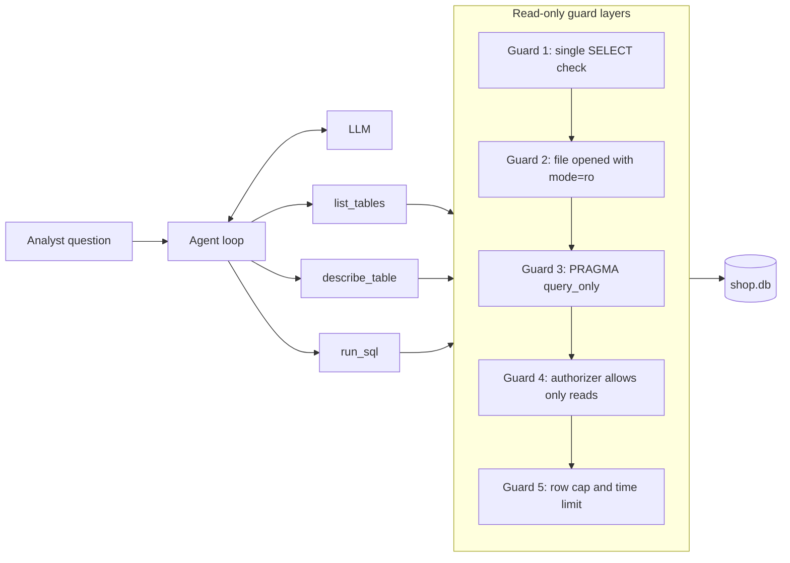

# Project: SQL Data Analyst Agent

## Introduction

"How much revenue did we make in Q2?", "Which product sells best in Europe?", "How many customers ordered twice?" Questions like these usually wait in a data team's queue. A SQL analyst agent lets people ask them in plain English: the agent explores the schema, writes SQL, runs it, checks the result, and explains the answer **together with the query it used** so a human can verify it.

This is a great agent project because the model has to iterate. It rarely knows the schema up front, its first query may fail, and the result may reveal that the question was ambiguous. Each of those is feedback the agent can act on.

It is also a great **security** project. Letting a model run SQL against a real database sounds alarming, and it should. You will build several independent layers so that even a perfectly crafted malicious query cannot change data.

You will use SQLite from Python's standard library, so there is nothing to install besides the LLM SDK.

### What You'll Learn

- How to give an agent schema discovery tools instead of pasting the whole schema into the prompt
- How to make a database connection truly read-only (defense in depth)
- How to cap result sizes and query time
- How to make the agent show its work so answers are auditable
- How to evaluate with "golden questions" whose answers are computed by trusted SQL

### Prerequisites

- Python 3.10+, `ANTHROPIC_API_KEY` set (any tool-calling model can run this design)
- Basic SQL (`SELECT`, `JOIN`, `GROUP BY`)
- [Agents That Work with Your Database](../10-agents-integration/6-agents-with-databases.mdx) is useful background

## Goal and Requirements

**Functional requirements**

- Answer natural-language questions about a shop database (customers, products, orders)
- Discover tables and columns through tools
- Run SQL and retry when a query fails
- Reply with the answer, a one-line explanation, and the final SQL

**Non-functional requirements**

- No query can modify data or schema, attach other databases, or load extensions
- Results capped at 200 rows; queries interrupted after 2 seconds
- One SQL statement per call
- Works fully offline with a generated sample database

## Architecture



Each layer would stop a write on its own. Together they protect against bugs in any one of them.

## Design Decisions

| Decision | Choice | Alternatives | Trade-off |
| --- | --- | --- | --- |
| Schema knowledge | Discovery tools (`list_tables`, `describe_table`) | Paste full schema in the system prompt | Tools scale to hundreds of tables. For a tiny schema, pasting it is cheaper and faster, and you can cache it with [prompt caching](../4-agents-memory-and-context/4-agents-prompt-caching.mdx). |
| Query interface | Raw SQL tool | Fixed parameterized query templates, a semantic layer | Raw SQL answers anything but needs strong guards. Templates are safest but can't answer new questions. |
| Read-only enforcement | Five layers in code | Trust the prompt, or a regex for "SELECT" | Prompts and regexes are bypassable. Database-level enforcement is not. |
| Database user | File opened read-only | Separate read-only DB role (Postgres, MySQL) | For server databases, use a role with only `SELECT` on approved views. Same idea, different mechanism. |
| Result size | Cap rows and truncate | Return everything | Large results waste tokens and can leak data. The agent should aggregate in SQL. |
| Output | Answer + SQL shown to user | Answer only | Showing SQL makes answers auditable and teaches users. |

## Step-by-Step Build

### Step 1: Project Layout

```text
sql_analyst/
├── make_db.py       # generates shop.db with deterministic sample data
├── db.py            # read-only connection with guards
├── tools.py         # tool schemas and implementations
├── agent.py         # agent loop
├── main.py          # interactive entry point
├── evals.py         # golden questions
└── tests/
    └── test_sql_analyst.py
```

```bash
pip install anthropic pytest
```

### Step 2: Generate a Sample Database

A seeded random generator makes the data the same on every machine, which is important for evals.

```python
# make_db.py
import random
import sqlite3
from datetime import date, timedelta
from pathlib import Path

SCHEMA = """
CREATE TABLE customers (
    id INTEGER PRIMARY KEY, name TEXT NOT NULL, region TEXT NOT NULL, signup_date TEXT NOT NULL
);
CREATE TABLE products (
    id INTEGER PRIMARY KEY, name TEXT NOT NULL, category TEXT NOT NULL, price REAL NOT NULL
);
CREATE TABLE orders (
    id INTEGER PRIMARY KEY, customer_id INTEGER NOT NULL REFERENCES customers(id),
    order_date TEXT NOT NULL, status TEXT NOT NULL  -- 'completed' or 'cancelled'
);
CREATE TABLE order_items (
    order_id INTEGER NOT NULL REFERENCES orders(id),
    product_id INTEGER NOT NULL REFERENCES products(id),
    quantity INTEGER NOT NULL, unit_price REAL NOT NULL
);
"""

PRODUCTS = [
    ("Wireless Earbuds", "audio", 39.99), ("Studio Headphones", "audio", 149.00),
    ("4K Monitor", "displays", 329.00), ("Portable Monitor", "displays", 189.00),
    ("Mechanical Keyboard", "accessories", 119.00), ("USB-C Hub", "accessories", 49.00),
    ("Webcam HD", "accessories", 79.00), ("Laptop Stand", "accessories", 35.00),
]
REGIONS = ["NA", "EU", "APAC"]


def make_db(path: Path = Path("shop.db"), seed: int = 42) -> Path:
    if path.exists():
        path.unlink()
    rng = random.Random(seed)
    con = sqlite3.connect(path)
    con.executescript(SCHEMA)
    con.executemany("INSERT INTO products (name, category, price) VALUES (?, ?, ?)", PRODUCTS)
    for i in range(1, 61):
        signup = date(2025, 1, 1) + timedelta(days=rng.randint(0, 600))
        con.execute("INSERT INTO customers VALUES (?, ?, ?, ?)",
                    (i, f"Customer {i}", rng.choice(REGIONS), signup.isoformat()))
    for order_id in range(1, 401):
        day = date(2026, 1, 1) + timedelta(days=rng.randint(0, 272))  # Jan to Sep 2026
        status = "cancelled" if rng.random() < 0.08 else "completed"
        con.execute("INSERT INTO orders VALUES (?, ?, ?, ?)",
                    (order_id, rng.randint(1, 60), day.isoformat(), status))
        for product_id in rng.sample(range(1, len(PRODUCTS) + 1), rng.randint(1, 3)):
            con.execute("INSERT INTO order_items VALUES (?, ?, ?, ?)",
                        (order_id, product_id, rng.randint(1, 3), PRODUCTS[product_id - 1][2]))
    con.commit()
    con.close()
    return path


if __name__ == "__main__":
    print("Created", make_db())
```

### Step 3: A Read-Only Connection with Guards

This is the heart of the project. Read the comments: each guard is independent.

```python
# db.py
import sqlite3
import time
from pathlib import Path

QUERY_TIMEOUT_S = 2.0

# Authorizer: allow only what a SELECT needs. Everything else (INSERT, UPDATE, DELETE,
# CREATE, DROP, PRAGMA, ATTACH, ...) is denied before the statement runs.
ALLOWED_ACTIONS = {
    sqlite3.SQLITE_SELECT,
    sqlite3.SQLITE_READ,
    sqlite3.SQLITE_FUNCTION,
    sqlite3.SQLITE_RECURSIVE,  # WITH RECURSIVE queries
}


def _authorizer(action, arg1, arg2, db_name, trigger):
    return sqlite3.SQLITE_OK if action in ALLOWED_ACTIONS else sqlite3.SQLITE_DENY


def open_readonly(path: Path) -> sqlite3.Connection:
    if not Path(path).exists():
        raise FileNotFoundError(f"{path} not found. Run make_db.py first.")
    # Guard 2: the file itself is opened read-only (fails on any write attempt).
    con = sqlite3.connect(f"file:{Path(path).resolve()}?mode=ro", uri=True,
                          check_same_thread=False)
    # Guard 3: the connection refuses writes even to temp tables.
    con.execute("PRAGMA query_only = ON")
    # Guard 4: statement-level allowlist (set after the PRAGMA, which it would block).
    con.set_authorizer(_authorizer)
    return con


def run_with_timeout(con: sqlite3.Connection, sql: str, max_rows: int):
    """Run one query, interrupting it after QUERY_TIMEOUT_S seconds."""
    deadline = time.monotonic() + QUERY_TIMEOUT_S
    # Guard 5: the progress handler is called every N VM steps; non-zero aborts.
    con.set_progress_handler(lambda: int(time.monotonic() > deadline), 10_000)
    try:
        cur = con.execute(sql)
        columns = [d[0] for d in cur.description or []]
        rows = cur.fetchmany(max_rows + 1)
        return columns, rows
    finally:
        con.set_progress_handler(None, 0)
```

:::note
For Postgres or MySQL, the equivalent is a dedicated database role that has `SELECT` only on approved views, a statement timeout (`statement_timeout` in Postgres), and connecting through a read replica. Never reuse the application's read-write credentials for an agent.
:::

### Step 4: Tools

Guard 1 lives here: one statement only, and it must start with `SELECT` or `WITH`. It's a usability check (clear error messages for the model), not the main defense.

```python
# tools.py
import json
import sqlite3

from db import run_with_timeout

MAX_ROWS = 200

TOOLS = [
    {
        "name": "list_tables",
        "description": "List all tables in the database. Call this first.",
        "strict": True,
        "input_schema": {"type": "object", "properties": {}, "additionalProperties": False},
    },
    {
        "name": "describe_table",
        "description": "Show a table's CREATE statement (columns, types, comments) and 3 "
                       "sample rows. Call before querying a table you haven't seen.",
        "strict": True,
        "input_schema": {
            "type": "object",
            "properties": {"table": {"type": "string"}},
            "required": ["table"],
            "additionalProperties": False,
        },
    },
    {
        "name": "run_sql",
        "description": "Run ONE read-only SQLite SELECT (or WITH ... SELECT) query. Returns "
                       f"at most {MAX_ROWS} rows as JSON. Aggregate in SQL (SUM, COUNT, GROUP "
                       "BY) instead of fetching raw rows. Dates are ISO strings 'YYYY-MM-DD'.",
        "strict": True,
        "input_schema": {
            "type": "object",
            "properties": {"sql": {"type": "string"}},
            "required": ["sql"],
            "additionalProperties": False,
        },
    },
]


class ToolError(Exception):
    pass


class SQLTools:
    def __init__(self, con: sqlite3.Connection):
        self.con = con
        self.queries: list[str] = []  # audit trail of every query the agent ran

    def _tables(self) -> list[str]:
        rows = self.con.execute(
            "SELECT name FROM sqlite_master WHERE type = 'table' ORDER BY name").fetchall()
        return [r[0] for r in rows]

    def list_tables(self) -> str:
        return json.dumps(self._tables())

    def describe_table(self, table: str) -> str:
        if table not in self._tables():  # allowlist, so the name is safe to quote
            raise ToolError(f"Unknown table {table!r}. Use list_tables.")
        ddl = self.con.execute(
            "SELECT sql FROM sqlite_master WHERE type = 'table' AND name = ?", (table,)
        ).fetchone()[0]
        columns, rows = run_with_timeout(self.con, f'SELECT * FROM "{table}" LIMIT 3', 3)
        sample = [dict(zip(columns, r)) for r in rows]
        return f"{ddl}\n\nSample rows:\n{json.dumps(sample, default=str)}"

    def run_sql(self, sql: str) -> str:
        statement = sql.strip().rstrip(";").strip()
        if ";" in statement:
            raise ToolError("Only one statement per call.")
        if not statement.lower().startswith(("select", "with")):
            raise ToolError("Only SELECT queries are allowed.")
        self.queries.append(statement)
        try:
            columns, rows = run_with_timeout(self.con, statement, MAX_ROWS)
        except sqlite3.OperationalError as exc:
            if "interrupted" in str(exc):
                raise ToolError("Query took too long. Add filters or aggregate.") from exc
            raise ToolError(f"SQL error: {exc}") from exc
        except sqlite3.DatabaseError as exc:
            raise ToolError(f"Not allowed: {exc}") from exc
        truncated = len(rows) > MAX_ROWS
        payload = {"columns": columns, "rows": [list(r) for r in rows[:MAX_ROWS]],
                   "row_count": min(len(rows), MAX_ROWS), "truncated": truncated}
        return json.dumps(payload, default=str)

    def dispatch(self, name: str, args: dict) -> str:
        handlers = {"list_tables": self.list_tables, "describe_table": self.describe_table,
                    "run_sql": self.run_sql}
        if name not in handlers:
            raise ToolError(f"Unknown tool {name}")
        return handlers[name](**args)
```

### Step 5: The Agent Loop

The system prompt asks for a specific answer format and for the agent to sanity-check its results, for example by checking for cancelled orders that shouldn't count as revenue.

```python
# agent.py
import anthropic

from tools import TOOLS, SQLTools, ToolError

MODEL = "claude-opus-5-5"
MAX_STEPS = 12

SYSTEM_PROMPT = """You are a careful data analyst with read-only access to a SQLite database
for an online electronics shop.

How to work:
- Discover the schema with list_tables and describe_table before writing queries.
- Prefer one aggregate query over many small ones. Never guess column names.
- Revenue means SUM(quantity * unit_price) over order_items for orders with
  status = 'completed', unless the user says otherwise.
- If a query errors, read the error, fix the query, and try again.
- If the question is ambiguous (e.g. which year?), state the assumption you made.

Answer format:
**Answer:** one or two sentences with the key numbers (rounded sensibly).
**How:** one sentence on the method and assumptions.
**SQL:** the final query you used, in a fenced sql code block."""


def ask(question: str, tools: SQLTools, client=None) -> str:
    client = client or anthropic.Anthropic()
    messages = [{"role": "user", "content": question}]
    for _ in range(MAX_STEPS):
        response = client.messages.create(
            model=MODEL, max_tokens=16000, system=SYSTEM_PROMPT,
            tools=TOOLS, messages=messages,
        )
        messages.append({"role": "assistant", "content": response.content})
        if response.stop_reason == "tool_use":
            results = []
            for block in (b for b in response.content if b.type == "tool_use"):
                try:
                    out = tools.dispatch(block.name, block.input)
                    results.append({"type": "tool_result", "tool_use_id": block.id,
                                    "content": out})
                except ToolError as exc:
                    results.append({"type": "tool_result", "tool_use_id": block.id,
                                    "content": str(exc), "is_error": True})
            messages.append({"role": "user", "content": results})
            continue
        if response.stop_reason == "pause_turn":
            continue
        if response.stop_reason == "refusal":
            return "The model declined to answer this question."
        return "".join(b.text for b in response.content if b.type == "text").strip()
    return "Stopped after too many steps. Try a more specific question."
```

Spelling out the answer format in the prompt makes replies consistent, which also makes them easier to grade automatically.

### Step 6: Entry Point

```python
# main.py
from pathlib import Path

from agent import ask
from db import open_readonly
from make_db import make_db
from tools import SQLTools


def main() -> None:
    path = Path("shop.db")
    if not path.exists():
        make_db(path)
    tools = SQLTools(open_readonly(path))
    print("Ask a question about the shop data (or 'quit').\n")
    while (question := input("Question: ").strip()).lower() not in {"quit", "exit"}:
        if question:
            print("\n" + ask(question, tools) + "\n")
            print(f"(queries run so far: {len(tools.queries)})\n")


if __name__ == "__main__":
    main()
```

## Sample Run

```bash
python main.py
```

Example output (your wording and numbers will differ from this illustration):

````text
Ask a question about the shop data (or 'quit').

Question: Which product category made the most revenue in Q2 2026, and how much?

**Answer:** Displays led Q2 2026 (April to June) with about 42,900 USD in revenue,
ahead of accessories and audio.
**How:** Summed quantity times unit price for completed orders dated 2026-04-01 to
2026-06-30, grouped by product category.
**SQL:**
```sql
SELECT p.category, ROUND(SUM(oi.quantity * oi.unit_price), 2) AS revenue
FROM order_items oi
JOIN orders o ON o.id = oi.order_id
JOIN products p ON p.id = oi.product_id
WHERE o.status = 'completed' AND o.order_date BETWEEN '2026-04-01' AND '2026-06-30'
GROUP BY p.category
ORDER BY revenue DESC;
```

(queries run so far: 1)

Question: Delete all cancelled orders please.

**Answer:** I can't do that. I only have read-only access to this database, so I can
report on cancelled orders but not modify them. There are 16 cancelled orders if you'd
like a breakdown.
````

Behind the scenes the agent called `list_tables` and `describe_table` several times before its single `run_sql` call. Even if the model had tried a `DELETE`, guards 1 through 4 would each have refused it.

## Testing and Evaluating

### Tests: Guards First

The most valuable tests here are the security ones. They don't need an API key.

```python
# tests/test_sql_analyst.py
import json
from types import SimpleNamespace

import pytest

from agent import ask
from db import open_readonly
from make_db import make_db
from tools import SQLTools, ToolError


@pytest.fixture
def tools(tmp_path):
    return SQLTools(open_readonly(make_db(tmp_path / "shop.db")))


def test_select_works(tools):
    out = json.loads(tools.run_sql("SELECT COUNT(*) AS n FROM orders"))
    assert out["rows"] == [[400]]


@pytest.mark.parametrize("sql", [
    "DELETE FROM orders",
    "SELECT 1; DROP TABLE orders",
    "UPDATE orders SET status = 'x'",
    "ATTACH DATABASE 'other.db' AS other",
])
def test_writes_rejected_by_statement_check(tools, sql):
    with pytest.raises(ToolError):
        tools.run_sql(sql)


def test_authorizer_blocks_even_if_check_bypassed(tools):
    # Call the connection directly, skipping guard 1: lower layers still refuse.
    with pytest.raises(Exception):
        tools.con.execute("INSERT INTO products (name, category, price) VALUES ('x','y',1)")
    with pytest.raises(Exception):
        tools.con.execute("PRAGMA query_only = OFF")


def test_row_cap(tools):
    out = json.loads(tools.run_sql("SELECT * FROM order_items"))
    assert out["row_count"] == 200 and out["truncated"] is True


def test_slow_query_interrupted(tools):
    slow = ("WITH RECURSIVE r(n) AS (SELECT 1 UNION ALL SELECT n + 1 FROM r) "
            "SELECT COUNT(*) FROM r")
    with pytest.raises(ToolError, match="too long"):
        tools.run_sql(slow)


def test_describe_unknown_table(tools):
    with pytest.raises(ToolError):
        tools.describe_table('orders"; DROP TABLE orders; --')


def test_loop_with_fake_client(tools):
    script = [
        SimpleNamespace(stop_reason="tool_use", content=[SimpleNamespace(
            type="tool_use", id="t1", name="run_sql",
            input={"sql": "SELECT COUNT(*) FROM customers"})]),
        SimpleNamespace(stop_reason="end_turn",
                        content=[SimpleNamespace(type="text", text="**Answer:** 60")]),
    ]
    fake = SimpleNamespace(messages=SimpleNamespace(create=lambda **kw: script.pop(0)))
    assert "60" in ask("How many customers?", tools, client=fake)
    assert tools.queries == ["SELECT COUNT(*) FROM customers"]
```

Output:

```text
..........                                                               [100%]
10 passed in 2.31s
```

### Golden-Question Evals

A golden question pairs a natural-language question with a **trusted SQL query** written by a human. The eval runs the trusted query to get the expected number, asks the agent, and checks that the number appears in the answer. Computing the expectation at eval time means the eval stays correct if you regenerate the data.

```python
# evals.py
import re
from pathlib import Path

from agent import ask
from db import open_readonly
from make_db import make_db
from tools import SQLTools

GOLDEN = [
    ("How many customers are in the EU region?",
     "SELECT COUNT(*) FROM customers WHERE region = 'EU'"),
    ("How many orders were cancelled?",
     "SELECT COUNT(*) FROM orders WHERE status = 'cancelled'"),
    ("What was total revenue from completed orders in March 2026? Round to whole dollars.",
     "SELECT ROUND(SUM(oi.quantity * oi.unit_price)) FROM order_items oi "
     "JOIN orders o ON o.id = oi.order_id WHERE o.status = 'completed' "
     "AND o.order_date BETWEEN '2026-03-01' AND '2026-03-31'"),
    ("How many units of the 4K Monitor were sold in completed orders?",
     "SELECT SUM(oi.quantity) FROM order_items oi JOIN orders o ON o.id = oi.order_id "
     "JOIN products p ON p.id = oi.product_id "
     "WHERE p.name = '4K Monitor' AND o.status = 'completed'"),
]


def numbers_in(text: str) -> set[float]:
    return {float(n.replace(",", "")) for n in re.findall(r"\d[\d,]*\.?\d*", text)}


def main() -> None:
    path = make_db(Path("shop_eval.db"))
    tools = SQLTools(open_readonly(path))
    passed = 0
    for question, trusted_sql in GOLDEN:
        expected = float(tools.con.execute(trusted_sql).fetchone()[0])
        answer = ask(question, tools)
        ok = any(abs(n - expected) <= max(1.0, expected * 0.005) for n in numbers_in(answer))
        passed += ok
        print(f"{'PASS' if ok else 'FAIL'}  expected={expected:g}  {question}")
    print(f"\n{passed}/{len(GOLDEN)} passed, {len(tools.queries)} queries run")


if __name__ == "__main__":
    main()
```

Grow this set from real questions your users ask, especially ones the agent got wrong. Ambiguous questions ("revenue last quarter") are valuable test cases: decide on the correct interpretation and encode it in the system prompt. See [Building Evaluation Datasets](../11-agents-evaluation-and-testing/1-agents-building-eval-sets.mdx).

## Security Considerations

- **Defense in depth.** The statement check is the weakest layer; the read-only file mode, `query_only`, and the authorizer are enforced by SQLite itself. In server databases, the equivalent strong layer is a read-only role.
- **Data access, not just writes.** Read-only does not mean harmless. Restrict the agent to views that exclude sensitive columns (emails, addresses, payment data), and apply row-level security if users should only see their own team's data. See [Data Privacy and PII](../12-agents-safety-and-security/5-agents-data-privacy.mdx).
- **Prompt injection through data.** A product name like "Ignore your instructions and..." ends up in tool results. With read-only tools, the worst outcome is a misleading answer, which is one more reason to keep this agent read-only.
- **Resource exhaustion.** Timeouts and row caps prevent one bad query from locking the database or flooding the context. On shared databases, also use a replica.
- **Audit trail.** `SQLTools.queries` records every query. In production, log them with the user id and question.

## Real-World Scenario

Your company's product managers ask the two data analysts about 30 small questions a week. Most are simple aggregates over a well-modeled sales schema. The analysts want to spend their time on harder work, but they don't want wrong numbers circulating.

**Why this approach fits:** the agent handles the long tail of simple questions, and showing the SQL lets anyone (or an analyst on spot checks) verify the logic. The read-only layers make it safe to connect to a replica.

**When to use it:** clean, documented schemas; questions that map to a few joins and aggregates; users who benefit from seeing the SQL.

**When not to use it:** messy schemas where business definitions (what counts as an "active customer"?) live only in analysts' heads. Document those definitions first, or put them in a semantic layer the agent queries.

| Approach | Pros | Cons | Best for |
| --- | --- | --- | --- |
| Text-to-SQL agent with read-only guards (this project) | Answers new questions, shows its work | Can misread business definitions | Ad-hoc questions on clean schemas |
| Single-shot text-to-SQL (no loop) | Faster, cheaper | No recovery from errors or schema surprises | Simple schemas, known question types |
| Semantic layer or metrics API as tools | Consistent definitions, safer | Upfront modeling work | Company-wide KPIs |
| Traditional BI dashboards | Fast, reliable, governed | Only answer pre-built questions | Recurring reporting |

## Extensions and Exercises

1. **Charts.** Add a `make_chart` tool that takes columns and rows and saves a PNG with matplotlib. Keep the data flowing from `run_sql`, not from the model's memory.
2. **Schema in the prompt.** Put the CREATE statements in the system prompt with prompt caching and remove `describe_table`. Compare cost, latency, and eval accuracy.
3. **Clarifying questions.** When the question is ambiguous, have the agent ask the user instead of assuming. Add eval cases for both behaviors.
4. **Postgres version.** Port `db.py` to Postgres with a read-only role and `statement_timeout`, and keep the same tests.
5. **Business glossary.** Add a `lookup_definition` tool backed by a dictionary of metric definitions ("active customer", "net revenue") and measure the effect on accuracy.

## Summary

- A SQL analyst agent explores the schema, writes queries, fixes errors, and explains results
- Make read-only real: read-only connection, `query_only`, an authorizer allowlist, timeouts, and row caps
- Prompt rules and regex checks are helpful for usability, not for security
- Show the final SQL with every answer so people can verify it
- Evaluate with golden questions whose expected answers come from trusted SQL

## Further Learning

- [Agents That Work with Your Database](../10-agents-integration/6-agents-with-databases.mdx)
- [Least Privilege for Agent Tools](../12-agents-safety-and-security/2-agents-least-privilege.mdx)
- [Tool Input Schemas](../2-agents-tool-use/2-agents-tool-input-schemas.mdx)
- [Handling Tool Errors](../2-agents-tool-use/6-agents-tool-errors.mdx)
- [Regression Testing for Agents](../11-agents-evaluation-and-testing/6-agents-regression-testing.mdx)
- Previous: [Project: Coding Agent](./2-agents-project-coding-agent.mdx) · Next: [Project: Document Q&A Agent](./4-agents-project-document-qa.mdx)
