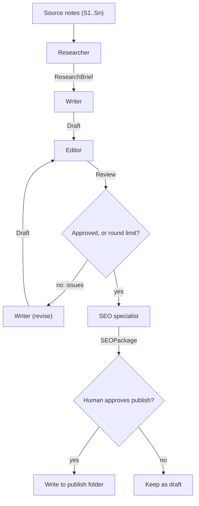

# Project: Multi-Agent Content Pipeline

## Introduction

Writing a good technical article involves distinct jobs: gathering facts, drafting, editing for accuracy and clarity, and packaging for search engines. Human teams split these jobs between people because each one needs a different mindset. Multi-agent systems split them between **specialized LLM calls**, each with its own focused instructions.

In this project you will build a content pipeline for a developer blog:

1. A **researcher** turns raw source notes into a structured brief with sourced claims
2. A **writer** drafts the article from the brief
3. An **editor** reviews the draft against the brief and sources, and returns structured issues
4. The writer **revises** until the editor approves or a round limit is reached
5. An **SEO specialist** produces a slug, meta description, and keywords
6. A **human** approves before anything is published

The handoffs between agents are typed Pydantic models, not free text, so each stage gets exactly what it needs and your code can inspect every step.

### What You'll Learn

- When splitting work across agents helps, and when it only adds cost
- How to use structured outputs as contracts between agents
- How to build an evaluator-optimizer revision loop with a hard stop
- How to track cost and latency per stage
- How to keep a human in charge of publishing

### Prerequisites

- Python 3.10+, `ANTHROPIC_API_KEY` set (any provider with JSON-schema outputs can run the same design)
- [Structured Outputs](../1-agents-llm-apis/6-agents-structured-outputs.mdx), [Evaluator-Optimizer Loops](../6-agents-planning-and-reasoning/7-agents-evaluator-optimizer.mdx), and [Multi-Agent Systems Introduction](../8-agents-multi-agent-systems/0-agents-multi-agent-introduction.mdx)

## Goal and Requirements

**Functional requirements**

- Input: a topic, a target audience, and source notes with ids
- Output: a Markdown article, an SEO package, and a review history
- Every factual claim in the brief references a source note id
- The editor checks the draft against the brief and flags unsupported claims
- Revision loop stops on approval or after 3 rounds
- Human approval before writing the article to the publish folder

**Non-functional requirements**

- Each stage's input and output is a validated Pydantic model
- Cost and latency reported per stage
- Cheaper models for simpler stages
- Fully testable with a fake client

## Architecture

The orchestrator is ordinary Python code. It decides the order of stages, passes typed objects between them, and enforces the round limit. Each "agent" is a single LLM call with its own system prompt and output schema.



## Design Decisions

| Decision | Choice | Alternatives | Trade-off |
| --- | --- | --- | --- |
| Orchestration | Code-driven workflow | LLM orchestrator that picks the next agent | The stages are known in advance, so code is cheaper, faster, and predictable. An LLM orchestrator fits when the steps vary per task. See [Orchestrator-Workers Pattern](../8-agents-multi-agent-systems/1-agents-orchestrator-workers.mdx). |
| Handoffs | Pydantic models via `client.messages.parse` | Free-text messages between agents | Typed handoffs prevent "telephone game" drift and let code check each stage. |
| Number of agents | Four roles | One agent with one long prompt | Focused prompts are easier to tune and evaluate. A single well-prompted call is cheaper and often good enough for short posts. |
| Revision loop | Editor returns structured issues; max 3 rounds | Unbounded loop; no review | Structured issues give the writer actionable feedback. The cap prevents endless polishing. |
| Model per stage | Strong model for writer and editor, small model for SEO | Same model everywhere | Matches cost to difficulty. Verify with evals before downgrading a stage. |
| Publishing | Human approval | Auto-publish when approved by the editor | Published content represents your brand. Humans catch tone and judgment issues. |

:::info
Multi-agent systems usually spend noticeably more tokens than a single agent doing the same task, because context is repeated across calls. Use them when specialization measurably improves quality. Measure both versions on the same eval set before committing. See [Single Agent vs Multi-Agent](../8-agents-multi-agent-systems/10-agents-single-vs-multi-agent.mdx).
:::

## Step-by-Step Build

### Step 1: Project Layout

```text
content_pipeline/
├── sources.py       # sample source notes
├── schemas.py       # typed handoffs between agents
├── agents.py        # one function per agent role
├── pipeline.py      # orchestrator with revision loop and cost tracking
├── main.py          # run + human publish approval
└── tests/
    └── test_pipeline.py
```

```bash
pip install anthropic pydantic pytest
```

### Step 2: Source Notes

In a real pipeline, these come from interviews, docs, or a [research agent](./1-agents-project-research-assistant.mdx). Every note has an id the researcher must cite.

```python
# sources.py
TOPIC = "Getting started with Python type hints"
AUDIENCE = "Python developers with 1-2 years of experience who have never used type hints"

SOURCE_NOTES = {
    "S1": "PEP 484 introduced type hints in Python 3.5. They are optional and not enforced "
          "at runtime by the interpreter.",
    "S2": "Static type checkers such as mypy and pyright read type hints and report errors "
          "before the code runs.",
    "S3": "Since Python 3.9, built-in collections can be used as generics: list[int], "
          "dict[str, float]. Before that, typing.List and typing.Dict were needed.",
    "S4": "Python 3.10 added the X | Y syntax for union types, e.g. int | None.",
    "S5": "Team interview: adding hints to function signatures first gave the best "
          "return on effort; annotating every local variable added little value.",
}
```

### Step 3: Typed Handoffs

These models are the contracts between agents. Keep them small and specific: each field should be something the next stage actually uses.

```python
# schemas.py
from typing import Literal

from pydantic import BaseModel


class KeyPoint(BaseModel):
    claim: str
    source_ids: list[str]


class ResearchBrief(BaseModel):
    working_title: str
    angle: str
    key_points: list[KeyPoint]
    outline: list[str]


class Draft(BaseModel):
    title: str
    body_markdown: str


class Issue(BaseModel):
    severity: Literal["high", "medium", "low"]
    quote: str        # the text in the draft the issue refers to
    problem: str
    suggested_fix: str


class Review(BaseModel):
    approved: bool
    issues: list[Issue]


class SEOPackage(BaseModel):
    slug: str
    meta_description: str
    keywords: list[str]
```

### Step 4: The Agents

Each agent is one function: a system prompt, an input rendered as text, and an output model. A small helper records token usage and time for every call.

```python
# agents.py
import json
import time

from schemas import Draft, ResearchBrief, Review, SEOPackage

STRONG = "claude-opus-5-5"
FAST = "claude-haiku-5-5"


class Usage:
    def __init__(self):
        self.rows: list[dict] = []

    def record(self, stage: str, model: str, response, seconds: float) -> None:
        u = getattr(response, "usage", None)
        self.rows.append({"stage": stage, "model": model, "seconds": round(seconds, 1),
                          "input_tokens": getattr(u, "input_tokens", 0),
                          "output_tokens": getattr(u, "output_tokens", 0)})


def call(client, usage: Usage, stage: str, model: str, system: str, prompt: str, schema):
    start = time.monotonic()
    response = client.messages.parse(
        model=model, max_tokens=8000, system=system,
        messages=[{"role": "user", "content": prompt}],
        output_format=schema,
    )
    usage.record(stage, model, response, time.monotonic() - start)
    if response.parsed_output is None:  # e.g. refusal or truncated output
        raise RuntimeError(f"{stage} returned no valid output")
    return response.parsed_output


def research(client, usage, topic: str, audience: str, notes: dict) -> ResearchBrief:
    system = ("You are a research editor. Build a brief for an article using ONLY the "
              "source notes. Every key point must list the ids of the notes that support it. "
              "Do not add facts that are not in the notes.")
    prompt = f"Topic: {topic}\nAudience: {audience}\nNotes:\n{json.dumps(notes, indent=2)}"
    return call(client, usage, "research", STRONG, system, prompt, ResearchBrief)


def write(client, usage, brief: ResearchBrief, audience: str) -> Draft:
    system = ("You are a technical writer for a developer blog. Write a clear, friendly "
              "article of 500-800 words in Markdown with short code examples. Use only the "
              "facts in the brief. Do not invent version numbers, statistics, or quotes.")
    prompt = f"Audience: {audience}\nBrief:\n{brief.model_dump_json(indent=2)}"
    return call(client, usage, "write", STRONG, system, prompt, Draft)


def review(client, usage, draft: Draft, brief: ResearchBrief, notes: dict) -> Review:
    system = ("You are a strict technical editor and fact-checker. Compare the draft with "
              "the brief and source notes. Report factual claims not supported by the notes "
              "as high severity, incorrect code as high, unclear explanations as medium, "
              "style nits as low. Approve only if there are no high or medium issues.")
    prompt = (f"Source notes:\n{json.dumps(notes, indent=2)}\n\n"
              f"Brief:\n{brief.model_dump_json(indent=2)}\n\n"
              f"Draft:\n# {draft.title}\n{draft.body_markdown}")
    return call(client, usage, "review", STRONG, system, prompt, Review)


def revise(client, usage, draft: Draft, feedback: Review, brief: ResearchBrief) -> Draft:
    system = ("You are the article's writer. Fix every high and medium issue from the "
              "editor. Keep everything else unchanged. Use only facts from the brief.")
    prompt = (f"Brief:\n{brief.model_dump_json(indent=2)}\n\n"
              f"Editor issues:\n{feedback.model_dump_json(indent=2)}\n\n"
              f"Current draft:\n# {draft.title}\n{draft.body_markdown}")
    return call(client, usage, "revise", STRONG, system, prompt, Draft)


def seo(client, usage, draft: Draft) -> SEOPackage:
    system = ("You are an SEO specialist. Produce a lowercase hyphenated slug, a meta "
              "description of 120-155 characters, and 3-6 keywords that appear in the text.")
    prompt = f"# {draft.title}\n{draft.body_markdown}"
    return call(client, usage, "seo", FAST, system, prompt, SEOPackage)
```

Notice what each agent **doesn't** see. The SEO agent gets only the final draft. The writer never sees the raw notes, only the brief, which forces facts to flow through the researcher's sourced key points. Limiting each agent's context is part of the design, not an accident.

### Step 5: The Orchestrator

The orchestrator runs the stages, loops on review, and runs a few **code checks** that are cheaper and more reliable than asking a model.

```python
# pipeline.py
import re
from dataclasses import dataclass, field

import anthropic

import agents
from schemas import Draft, ResearchBrief, Review, SEOPackage

MAX_ROUNDS = 3


@dataclass
class PipelineResult:
    brief: ResearchBrief
    draft: Draft
    seo: SEOPackage
    reviews: list[Review] = field(default_factory=list)
    approved_by_editor: bool = False
    code_check_errors: list[str] = field(default_factory=list)
    usage: list[dict] = field(default_factory=list)


def code_checks(brief: ResearchBrief, draft: Draft, seo: SEOPackage, notes: dict) -> list[str]:
    errors = []
    for point in brief.key_points:
        bad = [s for s in point.source_ids if s not in notes]
        if not point.source_ids or bad:
            errors.append(f"Key point without valid source: {point.claim[:60]}")
    words = len(draft.body_markdown.split())
    if not 400 <= words <= 1000:
        errors.append(f"Draft length {words} words is outside 400-1000")
    if not re.fullmatch(r"[a-z0-9]+(-[a-z0-9]+)*", seo.slug):
        errors.append(f"Bad slug {seo.slug!r}")
    if not 100 <= len(seo.meta_description) <= 160:
        errors.append(f"Meta description is {len(seo.meta_description)} chars")
    return errors


def run_pipeline(topic: str, audience: str, notes: dict, client=None,
                 verbose: bool = True) -> PipelineResult:
    client = client or anthropic.Anthropic()
    usage = agents.Usage()
    log = print if verbose else (lambda *a: None)

    brief = agents.research(client, usage, topic, audience, notes)
    log(f"[research] {len(brief.key_points)} key points")
    draft = agents.write(client, usage, brief, audience)
    log(f"[write] {len(draft.body_markdown.split())} words")

    reviews, approved = [], False
    for round_no in range(1, MAX_ROUNDS + 1):
        feedback = agents.review(client, usage, draft, brief, notes)
        reviews.append(feedback)
        blocking = [i for i in feedback.issues if i.severity in ("high", "medium")]
        log(f"[review {round_no}] approved={feedback.approved} blocking={len(blocking)}")
        if feedback.approved and not blocking:
            approved = True
            break
        if round_no < MAX_ROUNDS:
            draft = agents.revise(client, usage, draft, feedback, brief)
            log(f"[revise {round_no}] done")

    package = agents.seo(client, usage, draft)
    log(f"[seo] slug={package.slug}")
    return PipelineResult(brief=brief, draft=draft, seo=package, reviews=reviews,
                          approved_by_editor=approved,
                          code_check_errors=code_checks(brief, draft, package, notes),
                          usage=usage.rows)
```

Two details matter here. First, the orchestrator trusts the **issues list**, not just the `approved` flag: an editor that says "approved" while listing a high-severity issue is treated as not approved. Second, after the last allowed round the pipeline doesn't revise again without review; it returns with `approved_by_editor=False` so the human knows.

### Step 6: Entry Point with Publish Approval

```python
# main.py
from pathlib import Path

from pipeline import run_pipeline
from sources import AUDIENCE, SOURCE_NOTES, TOPIC


def main() -> None:
    result = run_pipeline(TOPIC, AUDIENCE, SOURCE_NOTES)
    print("\n" + "=" * 60)
    print(f"# {result.draft.title}\n")
    print(result.draft.body_markdown[:1200] + "\n...")
    print("=" * 60)
    print(f"Slug: {result.seo.slug}\nMeta: {result.seo.meta_description}")
    print(f"Editor approved: {result.approved_by_editor} after {len(result.reviews)} review(s)")
    for err in result.code_check_errors:
        print("CHECK FAILED:", err)

    print("\nStage            model              sec   in_tok  out_tok")
    for row in result.usage:
        print(f"{row['stage']:<16} {row['model']:<18} {row['seconds']:>4}  "
              f"{row['input_tokens']:>7}  {row['output_tokens']:>7}")

    ok_to_offer = result.approved_by_editor and not result.code_check_errors
    prompt = "Publish? [y/N] " if ok_to_offer else "Not editor-approved. Publish anyway? [y/N] "
    if input("\n" + prompt).strip().lower() == "y":
        out = Path("published") / f"{result.seo.slug}.md"
        out.parent.mkdir(exist_ok=True)
        out.write_text(f"---\ntitle: \"{result.draft.title}\"\n"
                       f"description: \"{result.seo.meta_description}\"\n---\n\n"
                       f"{result.draft.body_markdown}\n")
        print(f"Published to {out}")
    else:
        print("Kept as draft.")


if __name__ == "__main__":
    main()
```

## Sample Run

```bash
python main.py
```

Example output (your wording, timings, and token counts will differ):

```text
[research] 5 key points
[write] 742 words
[review 1] approved=False blocking=2
[revise 1] done
[review 2] approved=True blocking=0
[seo] slug=python-type-hints-getting-started
============================================================
# Python Type Hints: A Practical First Step

If you've written Python for a year or two, you've probably read code like
`def total(prices: list[float]) -> float:` and wondered whether it's worth the
extra typing. Type hints, introduced by PEP 484 in Python 3.5, are optional...
...
============================================================
Slug: python-type-hints-getting-started
Meta: Learn Python type hints step by step: syntax for lists, dicts and unions, plus how mypy and pyright catch bugs before your code runs.
Editor approved: True after 2 review(s)

Stage            model              sec   in_tok  out_tok
research         claude-opus-5-5    6.2      612      540
write            claude-opus-5-5   18.4      790     1390
review           claude-opus-5-5    9.1     2210      420
revise           claude-opus-5-5   17.0     2400     1410
review           claude-opus-5-5    7.8     2230       90
seo              claude-haiku-5-5   1.9     1450       80

Publish? [y/N] y
Published to published/python-type-hints-getting-started.md
```

In round 1, the editor flagged a claim that "type hints make Python code run faster" (not in the notes, and not generally true) and an example that used `Optional` without importing it. The revision fixed both.

## Testing and Evaluating

### Tests with a Fake Client

The fake client returns a canned object for each output schema. A queue of reviews lets you test the revision loop's branches: approval in round 2, and hitting the round limit.

```python
# tests/test_pipeline.py
from types import SimpleNamespace

from pipeline import MAX_ROUNDS, code_checks, run_pipeline
from schemas import Draft, Issue, KeyPoint, ResearchBrief, Review, SEOPackage
from sources import SOURCE_NOTES

BRIEF = ResearchBrief(working_title="Type hints", angle="practical",
                      key_points=[KeyPoint(claim="Hints are optional", source_ids=["S1"])],
                      outline=["Intro"])
DRAFT = Draft(title="Type hints", body_markdown="word " * 600)
SEO = SEOPackage(slug="python-type-hints",
                 meta_description="x" * 130, keywords=["python", "type hints"])
BAD = Review(approved=False, issues=[Issue(severity="high", quote="faster",
                                           problem="unsupported", suggested_fix="remove")])
GOOD = Review(approved=True, issues=[])


class FakeClient:
    def __init__(self, reviews):
        self.reviews = list(reviews)
        self.calls = []
        self.messages = self

    def parse(self, **kwargs):
        schema = kwargs["output_format"]
        self.calls.append(schema.__name__)
        output = {ResearchBrief: BRIEF, Draft: DRAFT, SEOPackage: SEO}.get(schema)
        if schema is Review:
            output = self.reviews.pop(0)
        return SimpleNamespace(parsed_output=output, usage=None)


def test_approves_after_one_revision():
    fake = FakeClient([BAD, GOOD])
    result = run_pipeline("t", "a", SOURCE_NOTES, client=fake, verbose=False)
    assert result.approved_by_editor
    assert fake.calls == ["ResearchBrief", "Draft", "Review", "Draft", "Review", "SEOPackage"]
    assert result.code_check_errors == []


def test_stops_at_round_limit():
    fake = FakeClient([BAD] * MAX_ROUNDS)
    result = run_pipeline("t", "a", SOURCE_NOTES, client=fake, verbose=False)
    assert not result.approved_by_editor
    assert fake.calls.count("Review") == MAX_ROUNDS
    assert fake.calls.count("Draft") == MAX_ROUNDS  # 1 write + (MAX_ROUNDS - 1) revisions


def test_approved_flag_with_blocking_issue_is_not_trusted():
    sneaky = Review(approved=True, issues=BAD.issues)
    fake = FakeClient([sneaky, GOOD])
    result = run_pipeline("t", "a", SOURCE_NOTES, client=fake, verbose=False)
    assert len(result.reviews) == 2


def test_code_checks_catch_bad_sources_and_slug():
    brief = BRIEF.model_copy(update={"key_points": [KeyPoint(claim="x", source_ids=["S99"])]})
    seo = SEO.model_copy(update={"slug": "Bad Slug!"})
    errors = code_checks(brief, DRAFT, seo, SOURCE_NOTES)
    assert any("source" in e for e in errors) and any("slug" in e for e in errors)
```

Output:

```text
....                                                                     [100%]
4 passed in 0.21s
```

### Evaluating Quality and Cost

For content, combine three kinds of measurement:

1. **Code checks** (above): sources, length, slug format, meta description length.
2. **An LLM judge with a rubric**, run by a different prompt (and ideally a different model) than the editor: accuracy against notes, clarity for the target audience, working code examples. Score 1-5 per criterion.
3. **A baseline comparison**: run a single-call version ("write an article from these notes") on the same 10 topics. If the pipeline doesn't win clearly on the rubric, its extra cost isn't justified.

Track the usage table across runs. If revision rounds are consistently 3, the writer's prompt or the editor's standards need tuning. See [Grading Methods](../11-agents-evaluation-and-testing/2-agents-grading-methods.mdx).

## Security Considerations

- **Source notes are input.** Notes copied from the web or customer emails can contain instructions. The researcher only outputs a typed brief, which limits how far injected text can travel, but review the brief for odd claims.
- **No autonomous publishing.** Publishing is a human action. If you later automate it, keep a review step for anything public-facing. See [Human Approval Gates](../12-agents-safety-and-security/7-agents-approval-gates.mdx).
- **Misinformation.** LLMs can state false things confidently (OWASP lists "Misinformation" as an LLM risk). The source-id requirement and the fact-checking editor reduce it; a human reviewer remains the last line of defense.
- **Copyright and attribution.** Make sure source notes are yours to use, and cite external sources in the published article where appropriate.
- **Cost controls.** The round cap bounds the worst case. Add a per-run token budget that aborts the pipeline if exceeded. See [Cost Optimization](../13-agents-production/4-agents-cost-optimization.mdx).

## Real-World Scenario

Your developer relations team publishes two tutorials a week. Writers spend most of their time on first drafts and checking facts against internal docs. The team wants agents to produce reviewed drafts so writers can focus on editing and examples.

**Why this approach fits:** the work has clear stages with different skills, and the stages are always the same, so a code-driven pipeline is predictable. The editor loop catches many factual and clarity problems before a human sees the draft.

**When to use it:** repeatable content formats, trusted source material, and a human editor at the end.

**When not to use it:** short content (a tweet or a changelog entry), where one well-prompted call is enough; or content that depends on original insight and voice that source notes can't provide.

| Approach | Pros | Cons | Best for |
| --- | --- | --- | --- |
| Code-orchestrated multi-agent pipeline (this project) | Predictable, inspectable stages, quality loop | More tokens, more code | Repeatable long-form content |
| Single call with a detailed prompt | Cheap, fast, simple | No independent review | Short or low-stakes content |
| LLM orchestrator choosing agents dynamically | Flexible for varied tasks | Harder to debug, less predictable cost | Mixed content requests |
| Framework crews (e.g. CrewAI, AutoGen) | Built-in roles and handoffs | Framework abstractions to learn | Teams already using a framework |

## Extensions and Exercises

1. **Parallel reviewers.** Run a fact-checker and a clarity editor in parallel and merge their issues. See [Parallel Agents](../8-agents-multi-agent-systems/4-agents-parallel-agents.mdx).
2. **Baseline comparison.** Implement the single-call baseline and compare both on 5 topics using an LLM judge and your cost table.
3. **Framework port.** Rebuild the pipeline in LangGraph or CrewAI and compare code size and debuggability. See [Agent Framework Landscape](../9-agents-frameworks/0-agents-framework-landscape.mdx).
4. **Style guide memory.** Load your team's style guide into the editor's system prompt with prompt caching, and measure cache hits via `response.usage`.
5. **Human feedback loop.** When a human edits the article before publishing, store the diff and use common edits to improve the writer's prompt.

## Summary

- Multi-agent pipelines split work into focused roles with their own prompts and models
- Typed handoffs (structured outputs) are contracts that keep stages consistent and testable
- A code orchestrator is the right choice when the stages are fixed
- Evaluator-optimizer loops improve quality but need a hard round limit and structured feedback
- Measure cost per stage and compare against a single-call baseline; keep a human approval before publishing

## Further Learning

- [Prompt Chaining](../6-agents-planning-and-reasoning/1-agents-prompt-chaining.mdx)
- [Evaluator-Optimizer Loops](../6-agents-planning-and-reasoning/7-agents-evaluator-optimizer.mdx)
- [Agent Handoffs](../8-agents-multi-agent-systems/3-agents-handoffs.mdx)
- [Multi-Agent Failure Modes](../8-agents-multi-agent-systems/9-agents-multi-agent-failure-modes.mdx)
- [Single Agent vs Multi-Agent](../8-agents-multi-agent-systems/10-agents-single-vs-multi-agent.mdx)
- Previous: [Project: Email and Calendar Assistant](./6-agents-project-personal-assistant.mdx) · Next: [Project: Browser Automation Agent](./8-agents-project-browser-automation.mdx)
