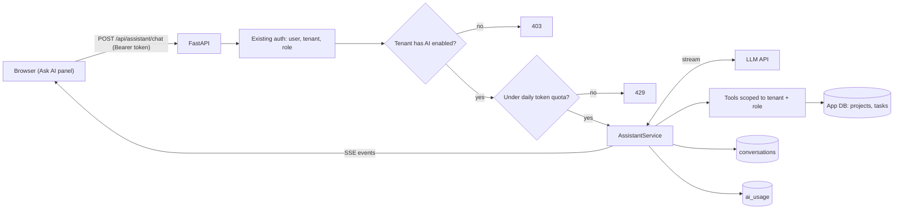

# Project: Adding an Agent Feature to a SaaS App

## Introduction

Most agents in the real world aren't standalone products. They're **features inside an existing application**: an "Ask AI" panel in a project management tool, a copilot in a CRM, a helper in an admin dashboard. Building the agent loop is the easy part. The hard part is fitting it into an app that already has users, tenants, permissions, billing, and uptime expectations.

In this project you'll add an AI assistant to **TaskFlow**, a small multi-tenant project management API built with FastAPI and SQLite. Users will be able to ask "What's overdue in the Website project?" or "Create a task to update the pricing page, due Friday" and get a streamed answer.

Along the way you'll handle the concerns that separate a demo from a shippable feature:

- **Tenant isolation**: the assistant can only see the current tenant's data
- **Permissions**: viewers can ask questions; only editors can create tasks
- **Streaming**: answers appear token by token in the browser via Server-Sent Events (SSE)
- **Persistence**: conversations survive page reloads
- **Quotas and metering**: per-tenant token budgets
- **Feature flags and fallback**: turn the feature on per tenant, and keep the app working when the model API is down

### What You'll Learn

- How to derive tool permissions from the app's existing auth model
- How to stream an agent's output (including tool activity) to a frontend
- How to persist conversations that contain tool calls
- How to enforce quotas and record usage per tenant
- How to roll out an AI feature gradually and fail gracefully

### Prerequisites

- Python 3.10+, `ANTHROPIC_API_KEY` set (any provider with streaming tool use works similarly)
- FastAPI basics, and [Exposing an Agent as an API Service](../10-agents-integration/1-agents-as-api-service.mdx)
- [Streaming Agent Output to a Frontend](../10-agents-integration/2-agents-streaming-to-frontend.mdx) and [User Authentication and Agent Permissions](../10-agents-integration/5-agents-auth-and-permissions.mdx)

## Goal and Requirements

**Functional requirements**

- `POST /api/assistant/chat` takes a message and optional `conversation_id`, and streams events: text deltas, tool activity, and a final `done` event
- Tools: list projects, list tasks (filter by status, overdue), create task
- Conversations are stored per user and can be continued
- The UI shows "Creating task..." while tools run

**Non-functional requirements**

- Every tool query filters by the caller's `tenant_id`; tenant ids never come from the model
- Role-based tool access: `viewer` gets read tools only; `editor` also gets `create_task`
- Per-tenant daily token budget; requests over budget return HTTP 429
- Feature flag per tenant
- If the model API fails, the user gets a friendly message and the rest of the app is unaffected
- Tests run without network access

## Architecture



The assistant is a module inside the existing app, not a separate service. It reuses the app's database, auth, and deployment. You can split it out later if scaling needs differ; see [Deployment Architectures](../13-agents-production/1-agents-deployment-architectures.mdx).

## Design Decisions

| Decision | Choice | Alternatives | Trade-off |
| --- | --- | --- | --- |
| Where the agent runs | In the existing API process | Separate agent microservice | In-process is simplest and reuses auth and DB access. A separate service isolates load and failures but adds network calls and auth plumbing. |
| Data access | Purpose-built tools with tenant-scoped SQL | Give the agent SQL or the internal REST API | Narrow tools are easy to secure and test. Raw SQL is flexible but hard to scope per tenant. |
| Permissions | Tools filtered by role before the call | Pass role in the prompt and trust the model | The model can't call a tool it was never given. |
| Transport | Server-Sent Events | WebSockets, polling | SSE is one-directional, works over plain HTTP, and fits "request, then stream a reply." WebSockets suit bidirectional, long-lived sessions. |
| Persistence | Full message history as JSON per conversation | Store only text | Tool calls and results must be replayed exactly for the next turn. |
| Quotas | Daily token budget per tenant | Request count limits | Tokens track cost more closely than requests. |
| Rollout | Feature flag per tenant | Release to everyone | Lets you start with internal and beta tenants. See [Incrementally Adding AI to a Product](../10-agents-integration/10-agents-incremental-adoption.mdx). |

## Step-by-Step Build

### Step 1: Project Layout

The `assistant/` package is the new code. Everything else stands in for the existing app.

```text
taskflow/
├── app_db.py            # existing app: schema + seed data (SQLite)
├── auth.py              # existing app: token -> user
├── assistant/
│   ├── __init__.py
│   ├── tools.py         # tenant- and role-scoped tools
│   ├── store.py         # conversation persistence + usage metering
│   └── service.py       # streaming agent loop
├── api.py               # FastAPI routes, including the new chat endpoint
└── tests/
    └── test_assistant_feature.py
```

```bash
pip install anthropic fastapi uvicorn httpx pytest
```

### Step 2: The Existing App (Database and Auth)

This is a minimal stand-in for an app you already have. Two tenants (Acme and Globex), users with roles, projects, and tasks.

```python
# app_db.py
import sqlite3
from pathlib import Path

SCHEMA = """
CREATE TABLE tenants (id TEXT PRIMARY KEY, name TEXT, ai_enabled INTEGER, ai_daily_tokens INTEGER);
CREATE TABLE users (id TEXT PRIMARY KEY, tenant_id TEXT, email TEXT, role TEXT, api_token TEXT);
CREATE TABLE projects (id INTEGER PRIMARY KEY, tenant_id TEXT, name TEXT);
CREATE TABLE tasks (id INTEGER PRIMARY KEY, tenant_id TEXT, project_id INTEGER, title TEXT,
                    status TEXT, due_date TEXT, assignee TEXT);
CREATE TABLE conversations (id TEXT PRIMARY KEY, tenant_id TEXT, user_id TEXT,
                            messages_json TEXT, updated_at TEXT);
CREATE TABLE ai_usage (tenant_id TEXT, day TEXT, input_tokens INTEGER, output_tokens INTEGER);
CREATE TABLE audit_log (ts TEXT, tenant_id TEXT, user_id TEXT, action TEXT, detail TEXT);
"""

SEED = """
INSERT INTO tenants VALUES ('t_acme', 'Acme', 1, 200000), ('t_globex', 'Globex', 0, 0);
INSERT INTO users VALUES
  ('u_ana', 't_acme', 'ana@acme.test', 'editor', 'tok-ana'),
  ('u_vic', 't_acme', 'vic@acme.test', 'viewer', 'tok-vic'),
  ('u_gus', 't_globex', 'gus@globex.test', 'editor', 'tok-gus');
INSERT INTO projects VALUES (1, 't_acme', 'Website'), (2, 't_acme', 'Mobile App'),
                            (3, 't_globex', 'Secret Merger');
INSERT INTO tasks VALUES
  (1, 't_acme', 1, 'Update pricing page', 'open', '2026-10-05', 'ana@acme.test'),
  (2, 't_acme', 1, 'Fix footer links', 'done', '2026-10-01', 'vic@acme.test'),
  (3, 't_acme', 2, 'Release 2.3 to app stores', 'open', '2026-10-20', 'ana@acme.test'),
  (4, 't_globex', 3, 'Draft term sheet', 'open', '2026-10-08', 'gus@globex.test');
"""


def init_db(path: Path) -> None:
    if path.exists():
        path.unlink()
    con = sqlite3.connect(path)
    con.executescript(SCHEMA + SEED)
    con.commit()
    con.close()


def connect(path: Path) -> sqlite3.Connection:
    con = sqlite3.connect(path, check_same_thread=False)
    con.row_factory = sqlite3.Row
    return con
```

```python
# auth.py
from dataclasses import dataclass


@dataclass(frozen=True)
class CurrentUser:
    id: str
    tenant_id: str
    email: str
    role: str  # "viewer" or "editor"


def user_from_token(con, token: str) -> CurrentUser | None:
    row = con.execute("SELECT id, tenant_id, email, role FROM users WHERE api_token = ?",
                      (token,)).fetchone()
    return CurrentUser(**dict(row)) if row else None
```

### Step 3: Tenant- and Role-Scoped Tools

`tools_for(user)` returns only the tools this user may use, and every handler closes over the user's `tenant_id`. The model has no way to name another tenant.

```python
# assistant/tools.py
import json
from datetime import date, datetime, timezone

from auth import CurrentUser

READ_TOOLS = [
    {"name": "list_projects", "description": "List projects in the user's workspace.",
     "strict": True,
     "input_schema": {"type": "object", "properties": {}, "additionalProperties": False}},
    {"name": "list_tasks",
     "description": "List tasks in a project. status: open, done, or any. Set overdue_only "
                    "to true to get open tasks past their due date.",
     "strict": True,
     "input_schema": {"type": "object",
                      "properties": {"project_id": {"type": "integer"},
                                     "status": {"type": "string",
                                                "enum": ["open", "done", "any"]},
                                     "overdue_only": {"type": "boolean"}},
                      "required": ["project_id", "status", "overdue_only"],
                      "additionalProperties": False}},
]
WRITE_TOOLS = [
    {"name": "create_task",
     "description": "Create a task in a project. Only when the user explicitly asks to "
                    "create one. due_date is YYYY-MM-DD.",
     "strict": True,
     "input_schema": {"type": "object",
                      "properties": {"project_id": {"type": "integer"},
                                     "title": {"type": "string"},
                                     "due_date": {"type": "string"}},
                      "required": ["project_id", "title", "due_date"],
                      "additionalProperties": False}},
]


class ToolError(Exception):
    pass


def tools_for(user: CurrentUser) -> list[dict]:
    return READ_TOOLS + (WRITE_TOOLS if user.role == "editor" else [])


def make_handlers(con, user: CurrentUser, today: date) -> dict:
    tenant = user.tenant_id

    def _project(project_id: int):
        row = con.execute("SELECT id, name FROM projects WHERE id = ? AND tenant_id = ?",
                          (project_id, tenant)).fetchone()
        if row is None:
            raise ToolError(f"No project {project_id} in this workspace.")
        return row

    def list_projects() -> str:
        rows = con.execute("SELECT id, name FROM projects WHERE tenant_id = ? ORDER BY id",
                           (tenant,)).fetchall()
        return json.dumps([dict(r) for r in rows])

    def list_tasks(project_id: int, status: str, overdue_only: bool) -> str:
        _project(project_id)
        sql = ("SELECT id, title, status, due_date, assignee FROM tasks "
               "WHERE tenant_id = ? AND project_id = ?")
        params: list = [tenant, project_id]
        if status != "any":
            sql += " AND status = ?"
            params.append(status)
        if overdue_only:
            sql += " AND status = 'open' AND due_date < ?"
            params.append(today.isoformat())
        rows = con.execute(sql + " ORDER BY due_date", params).fetchall()
        return json.dumps([dict(r) for r in rows])

    def create_task(project_id: int, title: str, due_date: str) -> str:
        if user.role != "editor":  # defense in depth: the tool isn't offered to viewers
            raise ToolError("You don't have permission to create tasks.")
        project = _project(project_id)
        date.fromisoformat(due_date)  # raises ValueError on bad dates
        cur = con.execute(
            "INSERT INTO tasks (tenant_id, project_id, title, status, due_date, assignee) "
            "VALUES (?, ?, ?, 'open', ?, ?)", (tenant, project_id, title[:200], due_date,
                                               user.email))
        con.execute("INSERT INTO audit_log VALUES (?, ?, ?, 'ai.create_task', ?)",
                    (datetime.now(timezone.utc).isoformat(), tenant, user.id,
                     json.dumps({"task_id": cur.lastrowid, "title": title})))
        con.commit()
        return f"Created task #{cur.lastrowid} '{title}' in {project['name']}, due {due_date}."

    handlers = {"list_projects": list_projects, "list_tasks": list_tasks}
    if user.role == "editor":
        handlers["create_task"] = create_task
    return handlers
```

Creating a task is low-risk and easily undone, so it runs without a confirmation step. For destructive or expensive actions (deleting a project, inviting external users), add a confirmation flow as shown in [Project: Email and Calendar Assistant](./6-agents-project-personal-assistant.mdx).

### Step 4: Conversation Store and Usage Metering

Conversations hold the full message list, including `tool_use` and `tool_result` blocks, because the next turn must replay them exactly. SDK content blocks are Pydantic models, so `model_dump()` turns them into JSON-friendly dicts.

```python
# assistant/store.py
import json
import uuid
from datetime import date, datetime, timezone

from auth import CurrentUser


def to_jsonable(content):
    if isinstance(content, str):
        return content
    out = []
    for block in content:
        if isinstance(block, dict):
            out.append(block)
        elif hasattr(block, "model_dump"):
            out.append(block.model_dump(mode="json", exclude_none=True))
        else:  # e.g. test doubles
            out.append({k: v for k, v in vars(block).items() if v is not None})
    return out


class ConversationStore:
    def __init__(self, con):
        self.con = con

    def load(self, user: CurrentUser, conversation_id: str | None) -> tuple[str, list]:
        if conversation_id:
            row = self.con.execute(
                "SELECT messages_json FROM conversations WHERE id = ? AND tenant_id = ? "
                "AND user_id = ?", (conversation_id, user.tenant_id, user.id)).fetchone()
            if row is None:
                raise KeyError("conversation not found")
            return conversation_id, json.loads(row["messages_json"])
        return uuid.uuid4().hex, []

    def save(self, user: CurrentUser, conversation_id: str, messages: list) -> None:
        payload = json.dumps([{"role": m["role"], "content": to_jsonable(m["content"])}
                              for m in messages])
        self.con.execute(
            "INSERT INTO conversations VALUES (?, ?, ?, ?, ?) ON CONFLICT(id) DO UPDATE SET "
            "messages_json = excluded.messages_json, updated_at = excluded.updated_at",
            (conversation_id, user.tenant_id, user.id, payload,
             datetime.now(timezone.utc).isoformat()))
        self.con.commit()


class UsageMeter:
    def __init__(self, con):
        self.con = con

    def used_today(self, tenant_id: str, day: date) -> int:
        row = self.con.execute(
            "SELECT COALESCE(SUM(input_tokens + output_tokens), 0) AS n FROM ai_usage "
            "WHERE tenant_id = ? AND day = ?", (tenant_id, day.isoformat())).fetchone()
        return row["n"]

    def record(self, tenant_id: str, day: date, usage) -> None:
        if usage is None:
            return
        self.con.execute("INSERT INTO ai_usage VALUES (?, ?, ?, ?)",
                         (tenant_id, day.isoformat(), usage.input_tokens, usage.output_tokens))
        self.con.commit()
```

### Step 5: The Streaming Agent Service

`AssistantService.chat` is a generator of events. For each model call it uses `client.messages.stream(...)`, yields text deltas as they arrive, then reads the complete message with `get_final_message()` to handle tool calls. If the model API fails, it yields an error event instead of raising.

```python
# assistant/service.py
from datetime import date

import anthropic

from assistant.store import ConversationStore, UsageMeter
from assistant.tools import ToolError, make_handlers, tools_for
from auth import CurrentUser

MODEL = "claude-sonnet-5-5"  # interactive feature: balance speed, cost and quality
MAX_STEPS = 6
HISTORY_LIMIT = 40  # keep the most recent messages; see the memory section for compaction


def trim_history(messages: list) -> list:
    """Keep recent messages, but always start on a plain-text user message."""
    messages = messages[-HISTORY_LIMIT:]
    while messages and not (messages[0]["role"] == "user"
                            and isinstance(messages[0]["content"], str)):
        messages = messages[1:]  # drop leading assistant turns and orphaned tool results
    return messages


def system_prompt(user: CurrentUser, today: date) -> str:
    return (f"You are TaskFlow's in-app assistant. Today is {today.isoformat()}. "
            f"The user is {user.email} (role: {user.role}). Answer questions about their "
            "projects and tasks using the tools; never guess data. Be brief. "
            + ("You can create tasks when explicitly asked." if user.role == "editor"
               else "You cannot create or change anything; say so if asked."))


class AssistantService:
    def __init__(self, con, client=None, today: date | None = None):
        self.con = con
        self.client = client or anthropic.Anthropic()
        self.store = ConversationStore(con)
        self.meter = UsageMeter(con)
        self.today = today or date.today()

    def chat(self, user: CurrentUser, message: str, conversation_id: str | None):
        conversation_id, messages = self.store.load(user, conversation_id)
        messages = trim_history(messages)
        messages.append({"role": "user", "content": message})
        handlers = make_handlers(self.con, user, self.today)
        yield {"type": "start", "conversation_id": conversation_id}

        try:
            for _ in range(MAX_STEPS):
                with self.client.messages.stream(
                    model=MODEL, max_tokens=4000, system=system_prompt(user, self.today),
                    tools=tools_for(user), messages=messages,
                ) as stream:
                    for text in stream.text_stream:
                        yield {"type": "text", "delta": text}
                    final = stream.get_final_message()
                self.meter.record(user.tenant_id, self.today, final.usage)
                messages.append({"role": "assistant", "content": final.content})

                if final.stop_reason == "tool_use":
                    results = []
                    for block in (b for b in final.content if b.type == "tool_use"):
                        yield {"type": "tool", "name": block.name}
                        handler = handlers.get(block.name)
                        try:
                            if handler is None:
                                raise ToolError(f"Tool {block.name} is not available.")
                            out = handler(**block.input)
                            results.append({"type": "tool_result", "tool_use_id": block.id,
                                            "content": out})
                        except (ToolError, ValueError) as exc:
                            results.append({"type": "tool_result", "tool_use_id": block.id,
                                            "content": f"Error: {exc}", "is_error": True})
                    messages.append({"role": "user", "content": results})
                    continue
                if final.stop_reason == "pause_turn":
                    continue
                break
        except (anthropic.RateLimitError, anthropic.APIStatusError,
                anthropic.APIConnectionError) as exc:
            yield {"type": "error",
                   "message": "The assistant is temporarily unavailable. Please try again."}
            print(f"[assistant] model API error: {exc!r}")  # send to your error tracker
            return  # don't save a half-finished turn
        self.store.save(user, conversation_id, messages)
        yield {"type": "done"}
```

Notes on the details:

- **History trimming** must not start on an assistant message or an orphaned `tool_result`, or the API will reject the request. `trim_history` drops messages until the history starts with a plain user message. For long conversations, prefer summarization; see [Compaction and Summarization](../4-agents-memory-and-context/2-agents-compaction-and-summarization.mdx).
- **Tool activity events** (`{"type": "tool"}`) let the UI show "Looking up tasks..." so users aren't staring at a frozen panel.
- **Usage is recorded per model call**, so a long tool loop is metered accurately.
- On errors, the turn isn't saved, so a retry starts from a clean state.

### Step 6: The API Endpoint

The endpoint reuses the app's auth, checks the feature flag and quota, then returns a `StreamingResponse` in SSE format (`data: <json>` followed by a blank line).

```python
# api.py
import json
import os
from pathlib import Path

from fastapi import Depends, FastAPI, Header, HTTPException
from fastapi.responses import StreamingResponse
from pydantic import BaseModel, Field

from app_db import connect, init_db
from assistant.service import AssistantService
from auth import CurrentUser, user_from_token

DB_PATH = Path(os.environ.get("TASKFLOW_DB", "taskflow.db"))
if not DB_PATH.exists():
    init_db(DB_PATH)

app = FastAPI(title="TaskFlow")
con = connect(DB_PATH)
service: AssistantService | None = None  # created lazily so tests can inject a fake


def get_service() -> AssistantService:
    global service
    if service is None:
        service = AssistantService(con)
    return service


def current_user(authorization: str = Header(default="")) -> CurrentUser:
    user = user_from_token(con, authorization.removeprefix("Bearer ").strip())
    if user is None:
        raise HTTPException(status_code=401, detail="invalid token")
    return user


class ChatRequest(BaseModel):
    message: str = Field(min_length=1, max_length=4000)
    conversation_id: str | None = None


@app.post("/api/assistant/chat")
def chat(req: ChatRequest, user: CurrentUser = Depends(current_user),
         svc: AssistantService = Depends(get_service)):
    tenant = con.execute("SELECT ai_enabled, ai_daily_tokens FROM tenants WHERE id = ?",
                         (user.tenant_id,)).fetchone()
    if not tenant["ai_enabled"]:
        raise HTTPException(status_code=403, detail="AI assistant not enabled for this workspace")
    if svc.meter.used_today(user.tenant_id, svc.today) >= tenant["ai_daily_tokens"]:
        raise HTTPException(status_code=429, detail="Daily AI quota reached")
    try:
        events = svc.chat(user, req.message, req.conversation_id)
        first = next(events)  # surfaces "conversation not found" before streaming starts
    except KeyError:
        raise HTTPException(status_code=404, detail="conversation not found")

    def sse():
        yield f"data: {json.dumps(first)}\n\n"
        for event in events:
            yield f"data: {json.dumps(event)}\n\n"

    return StreamingResponse(sse(), media_type="text/event-stream",
                             headers={"Cache-Control": "no-cache"})


@app.get("/api/projects")
def projects(user: CurrentUser = Depends(current_user)):
    rows = con.execute("SELECT id, name FROM projects WHERE tenant_id = ?", (user.tenant_id,))
    return [dict(r) for r in rows]
```

On the frontend, read the stream with `fetch` (the browser `EventSource` API only supports GET requests, so `fetch` is the usual choice for POST):

```typescript
async function askAssistant(message: string, conversationId?: string) {
  const res = await fetch("/api/assistant/chat", {
    method: "POST",
    headers: { "Content-Type": "application/json", Authorization: `Bearer ${token}` },
    body: JSON.stringify({ message, conversation_id: conversationId }),
  });
  if (!res.ok) return showError(res.status === 429 ? "Daily AI limit reached" : "Unavailable");
  const reader = res.body!.pipeThrough(new TextDecoderStream()).getReader();
  let buffer = "";
  while (true) {
    const { value, done } = await reader.read();
    if (done) break;
    buffer += value;
    const frames = buffer.split("\n\n");
    buffer = frames.pop()!;
    for (const frame of frames) {
      const event = JSON.parse(frame.replace(/^data: /, ""));
      if (event.type === "text") appendToChat(event.delta);
      if (event.type === "tool") showStatus(`Running ${event.name}...`);
      if (event.type === "error") showError(event.message);
    }
  }
}
```

Run the API with `uvicorn api:app --reload`.

## Sample Run

```bash
curl -N -X POST localhost:8000/api/assistant/chat \
  -H "Authorization: Bearer tok-ana" -H "Content-Type: application/json" \
  -d '{"message": "What is overdue in the Website project? Then add a task to email the designer, due 2026-10-14."}'
```

Example output (your wording will differ):

```text
data: {"type": "start", "conversation_id": "5f0c9e1b7d2a4c58a1e3f6b2c9d0e7a4"}

data: {"type": "tool", "name": "list_projects"}

data: {"type": "tool", "name": "list_tasks"}

data: {"type": "text", "delta": "One task is overdue in Website: **Update pricing page** "}

data: {"type": "text", "delta": "(due Oct 5, assigned to you)."}

data: {"type": "tool", "name": "create_task"}

data: {"type": "text", "delta": " I've also created task #5 \"Email the designer\", due Oct 14."}

data: {"type": "done"}
```

The same request with `tok-vic` (a viewer) gets the overdue list, plus "I can't create tasks with your permissions." With `tok-gus`, whose tenant hasn't enabled the feature, the API returns `403`.

## Testing and Evaluating

### Tests

The fake client implements `messages.stream()` as a context manager with `text_stream` and `get_final_message()`, matching the SDK's streaming helper. Tests use FastAPI's `TestClient` against a temporary database.

```python
# tests/test_assistant_feature.py
import importlib
import json
from datetime import date
from types import SimpleNamespace

import pytest
from fastapi.testclient import TestClient


class FakeStream:
    def __init__(self, text, content, stop):
        self.text_stream = [text] if text else []
        self._final = SimpleNamespace(content=content, stop_reason=stop,
                                      usage=SimpleNamespace(input_tokens=100, output_tokens=20))

    def __enter__(self):
        return self

    def __exit__(self, *exc):
        return False

    def get_final_message(self):
        return self._final


class FakeClient:
    def __init__(self, turns):
        self.turns = list(turns)
        self.requests = []
        self.messages = self

    def stream(self, **kwargs):
        # Copy the list: the service keeps appending to the same object.
        self.requests.append({**kwargs, "messages": list(kwargs["messages"])})
        return FakeStream(*self.turns.pop(0))


def text(t):
    return SimpleNamespace(type="text", text=t)


def tool(id_, tool_name, **inp):
    return SimpleNamespace(type="tool_use", id=id_, name=tool_name, input=inp)


@pytest.fixture
def api(tmp_path, monkeypatch):
    monkeypatch.setenv("TASKFLOW_DB", str(tmp_path / "t.db"))
    import api as api_module
    api_module = importlib.reload(api_module)
    return api_module


def run(api, token, turns, message="hi", today=date(2026, 10, 10)):
    from assistant.service import AssistantService
    fake = FakeClient(turns)
    api.service = AssistantService(api.con, client=fake, today=today)
    client = TestClient(api.app)
    res = client.post("/api/assistant/chat", json={"message": message},
                      headers={"Authorization": f"Bearer {token}"})
    events = [json.loads(line[6:]) for line in res.text.splitlines() if line.startswith("data: ")]
    return res, events, fake


def test_overdue_and_tenant_scoping(api):
    turns = [("", [tool("1", "list_tasks", project_id=3, status="any", overdue_only=False)],
              "tool_use"),
             ("", [tool("2", "list_tasks", project_id=1, status="open", overdue_only=True)],
              "tool_use"),
             ("Update pricing page is overdue.", [text("Update pricing page is overdue.")],
              "end_turn")]
    res, events, fake = run(api, "tok-ana", turns)
    assert res.status_code == 200 and events[-1] == {"type": "done"}
    results = fake.requests[2]["messages"]
    other_tenant, overdue = results[-3]["content"][0], results[-1]["content"][0]
    assert other_tenant["is_error"] is True  # project 3 belongs to Globex
    assert "Update pricing page" in overdue["content"]
    assert "Release 2.3" not in overdue["content"]


def test_viewer_gets_no_write_tool(api):
    res, events, fake = run(api, "tok-vic", [("No.", [text("No.")], "end_turn")])
    names = [t["name"] for t in fake.requests[0]["tools"]]
    assert "create_task" not in names


def test_editor_creates_task_and_audit_logged(api):
    turns = [("", [tool("1", "create_task", project_id=1, title="Email designer",
                        due_date="2026-10-14")], "tool_use"),
             ("Done.", [text("Done.")], "end_turn")]
    run(api, "tok-ana", turns)
    assert api.con.execute("SELECT COUNT(*) FROM tasks WHERE title = 'Email designer'"
                           ).fetchone()[0] == 1
    assert api.con.execute("SELECT COUNT(*) FROM audit_log").fetchone()[0] == 1


def test_feature_flag_and_quota(api):
    assert run(api, "tok-gus", [])[0].status_code == 403
    api.con.execute("UPDATE tenants SET ai_daily_tokens = 50 WHERE id = 't_acme'")
    run(api, "tok-ana", [("ok", [text("ok")], "end_turn")])  # uses 120 tokens
    assert run(api, "tok-ana", [])[0].status_code == 429


def test_conversation_persists_and_continues(api):
    _, events, _ = run(api, "tok-ana", [("Hi!", [text("Hi!")], "end_turn")])
    conv_id = events[0]["conversation_id"]
    from assistant.service import AssistantService
    fake = FakeClient([("Again", [text("Again")], "end_turn")])
    api.service = AssistantService(api.con, client=fake, today=date(2026, 10, 10))
    TestClient(api.app).post("/api/assistant/chat",
                             json={"message": "more", "conversation_id": conv_id},
                             headers={"Authorization": "Bearer tok-ana"})
    sent = fake.requests[0]["messages"]
    assert [m["role"] for m in sent] == ["user", "assistant", "user"]
    other = TestClient(api.app).post("/api/assistant/chat",
                                     json={"message": "x", "conversation_id": conv_id},
                                     headers={"Authorization": "Bearer tok-vic"})
    assert other.status_code == 404  # another user can't open it
```

Output:

```text
.....                                                                    [100%]
5 passed in 0.93s
```

### Evaluating the Feature

Product features need product metrics as well as model evals:

- **Offline evals**: 30-50 realistic questions per role, graded by code (correct tool calls, correct task created, permission refusals) and by an LLM judge for answer quality. Re-run on every prompt or model change. See [Regression Testing for Agents](../11-agents-evaluation-and-testing/6-agents-regression-testing.mdx).
- **Online metrics**: adoption (weekly users of the panel), task completion (did the user act on the answer?), thumbs up/down, latency to first token, error rate, and tokens per tenant.
- **Cost guardrails**: alert when a tenant's daily usage jumps, which can indicate abuse or a loop. See [Monitoring and Alerting](../13-agents-production/6-agents-monitoring-and-alerting.mdx).

## Security Considerations

- **Tenant isolation lives in the tools.** Every query includes `tenant_id = ?` from the authenticated user. Add a test for each tool that tries to read another tenant's ids.
- **Role-based tool lists.** Viewers never receive write tools, and write handlers re-check the role. See [Least Privilege for Agent Tools](../12-agents-safety-and-security/2-agents-least-privilege.mdx).
- **Stored prompt injection.** Task titles are user-generated, and they come back in tool results. A malicious title in a shared project could try to make the assistant create spam tasks. Keep write tools narrow, cap lengths, log every AI-initiated write in the audit log, and consider confirmation for bulk actions.
- **Conversation privacy.** Conversations are scoped to tenant and user. Apply your data retention policy and include AI conversations in data export and deletion requests. See [Data Privacy and PII](../12-agents-safety-and-security/5-agents-data-privacy.mdx).
- **Abuse and cost.** Quotas per tenant, request size limits (`max_length=4000`), and per-user rate limits protect your bill. See [Abuse Prevention and Rate Limiting](../12-agents-safety-and-security/8-agents-abuse-and-rate-limiting.mdx).
- **Secrets.** The API key lives in server-side configuration, never in the frontend bundle.

## Real-World Scenario

Your B2B project management product is losing deals to competitors with AI features. Sales asks for an assistant "by next quarter." Engineering's concerns are data leaks between customers, surprise model bills, and on-call pages when the model provider has an outage.

**Why this approach fits:** the assistant reuses the existing auth and data access patterns, so tenant isolation and permissions follow rules the team already understands. Feature flags allow a beta with friendly customers, quotas cap cost, and the fallback keeps the core product unaffected by model outages.

**When to use it:** your users already work in your app, and an assistant can save them clicks on data that's already there.

**When not to use it:** if users mainly need search or a better filter, build that first; it's cheaper and more predictable. An assistant shines when requests combine several steps or are hard to express in a UI.

| Approach | Pros | Cons | Best for |
| --- | --- | --- | --- |
| In-process assistant module (this project) | Reuses auth and DB, quick to ship | Shares resources with the main app | First AI feature in an existing app |
| Separate agent service | Independent scaling and deploys | More infrastructure, service-to-service auth | High traffic or many AI features |
| Managed agent platform | Hosted loop and sandbox | Less control over data flow, vendor coupling | Teams without infra capacity |
| Non-agent AI feature (summaries, autocomplete) | Simple, predictable cost | Can't take actions | Single-step assistance |

## Extensions and Exercises

1. **Confirmation for writes.** Turn `create_task` into a two-step flow: the tool returns a preview and the frontend shows Confirm and Cancel buttons.
2. **Prompt caching.** Mark the system prompt and tools for caching and check `cache_read_input_tokens` in `final.usage` across turns. See [Prompt Caching](../4-agents-memory-and-context/4-agents-prompt-caching.mdx).
3. **Background jobs.** For long requests ("summarize every project"), enqueue a job and stream progress from a job id. See [Running Agents as Background Jobs](../10-agents-integration/3-agents-background-jobs.mdx).
4. **Model fallback.** On `overloaded` or 5xx errors, retry once with a different model and record which one served the request. See [Reliability and Fallbacks](../13-agents-production/5-agents-reliability-and-fallbacks.mdx).
5. **Tracing.** Add a span per model call and tool call, tagged with tenant id and conversation id. See [Tracing Agent Runs](../11-agents-evaluation-and-testing/8-agents-tracing.mdx).

## Summary

- An agent feature is mostly integration work: auth, tenancy, permissions, persistence, quotas, rollout
- Derive tool access from the app's existing roles and scope every query to the authenticated tenant
- Stream text and tool activity over SSE so the UI feels responsive
- Persist full message history, including tool blocks, and trim it safely
- Meter tokens per tenant, gate the feature with flags, and fail gracefully when the model API is down

## Further Learning

- [Integrating Agents into Existing Applications](../10-agents-integration/0-agents-integration-overview.mdx)
- [Agents in Web Applications](../10-agents-integration/7-agents-in-web-apps.mdx)
- [Session Persistence](../4-agents-memory-and-context/10-agents-session-persistence.mdx)
- [Scaling and Concurrency](../13-agents-production/2-agents-scaling.mdx)
- [Production Readiness Checklist](../13-agents-production/0-agents-production-readiness.mdx)
- Previous: [Project: Browser Automation Agent](./8-agents-project-browser-automation.mdx) · Next: [Project: Company Knowledge MCP Server](./10-agents-project-mcp-integration.mdx)
