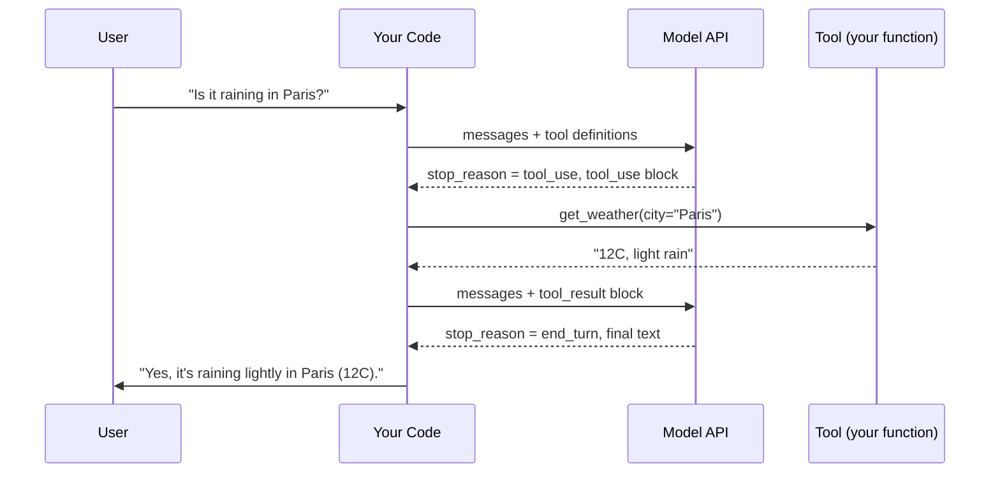

# Tool Use Introduction

## Introduction

A large language model on its own can only produce text. It cannot check today's weather, look up an order in your database, send an email, or run a test suite. Everything it "knows" comes from its training data and whatever you paste into the prompt.

**Tool use** (also called **function calling**) removes that limit. You describe a set of functions to the model: their names, what they do, and what arguments they take. When the model decides one of those functions would help, it does not run the function itself. Instead, it replies with a structured request such as "please call `get_weather` with `city = "Paris"`". Your code runs the function, sends the result back, and the model continues with real data in hand.

That small mechanism is the foundation of every AI agent. An agent is, at its core, a model that calls tools in a loop until a task is done. You already met that loop conceptually in [The Agent Loop](../0-agents-fundamentals/4-agents-agent-loop.mdx). This section shows you how to build it for real.

:::tip Analogy
Think of the model as a smart manager sitting in an office with no computer. It can reason, plan, and write, but it has to ask an assistant (your code) to look things up or take action. Tool definitions are the list of jobs the assistant knows how to do. Tool results are the assistant's reports back to the manager.
:::

## What You Will Learn in This Section

| Page | What it covers |
| --- | --- |
| Defining Tools | Names, descriptions, and how the model decides which tool to call |
| Tool Input Schemas | JSON Schema for arguments, strict mode, and validation |
| Building a Manual Agent Loop | A complete, runnable agent written from scratch |
| Using an SDK Tool Runner | Letting the SDK run the loop for you |
| Parallel Tool Calls | Handling several tool calls in one turn |
| Handling Tool Errors | Reporting failures so the model can recover |
| Tool Design Principles | Designing tools that agents actually use well |
| Server-Side Tools | Web search, web fetch, and code execution run by the provider |
| Bash and File Editing Tools | Giving an agent a shell and a text editor, safely |
| Working with Large Toolsets | Tool search, namespacing, and consolidation |
| Tool Security Basics | Least privilege, approval gates, and untrusted output |

## How Tool Use Works

Tool use is a conversation with a specific shape. Here is one full round trip:



The key points:

1. **You send tool definitions with every request.** The API is stateless, so the model only knows about the tools you include in that call.
2. **The model decides whether to call a tool.** With the default setting, it may answer directly if no tool is needed.
3. **The model never executes anything.** It returns a `tool_use` content block with a tool name, an `id`, and an `input` object.
4. **Your code executes the tool** and replies with a `tool_result` block that references the same `id`.
5. **The model continues.** It may call more tools or produce a final answer.

### The Building Blocks

With the Anthropic Messages API, everything travels as content blocks inside ordinary `user` and `assistant` messages:

| Block | Who sends it | Purpose |
| --- | --- | --- |
| `tool_use` | Assistant (model) | "Please run tool X with these inputs." Has `id`, `name`, `input`. |
| `tool_result` | User (your code) | "Here is the output of tool call `id`." Has `tool_use_id`, `content`, optional `is_error`. |
| `text` | Either | Normal prose, often the model explaining what it is about to do. |

The response also carries a `stop_reason`. When it is `"tool_use"`, the model is waiting for you to run tools. When it is `"end_turn"`, the model is done.

## Your First Tool Call

Let's walk through a single round trip by hand. This example uses the Anthropic Python SDK. Install it with `pip install anthropic` and set the `ANTHROPIC_API_KEY` environment variable (see [Setting Up Your Agent Development Environment](../1-agents-llm-apis/0-agents-environment-setup.mdx)).

### Step 1: Describe the Tool

```python
weather_tool = {
    "name": "get_weather",
    "description": (
        "Get the current weather for a city. Use this whenever the user asks "
        "about current conditions, temperature, or rain in a specific place."
    ),
    "input_schema": {
        "type": "object",
        "properties": {
            "city": {
                "type": "string",
                "description": "City name, optionally with country, e.g. 'Paris, France'",
            }
        },
        "required": ["city"],
    },
}
```

A tool definition is just data: a `name`, a natural-language `description`, and an `input_schema` written in JSON Schema. The next two pages cover both in depth.

### Step 2: Send the Request

```python
from anthropic import Anthropic

client = Anthropic()  # reads ANTHROPIC_API_KEY from the environment

messages = [{"role": "user", "content": "Is it raining in Paris right now?"}]

response = client.messages.create(
    model="claude-opus-5-5",
    max_tokens=16000,
    tools=[weather_tool],
    messages=messages,
)

print("stop_reason:", response.stop_reason)
for block in response.content:
    print(block.type, "->", getattr(block, "text", None) or getattr(block, "input", None))
```

Example output:

```text
stop_reason: tool_use
text -> I'll check the current weather in Paris for you.
tool_use -> {'city': 'Paris, France'}
```

The model did not answer the question. It asked for data.

:::note
Current Claude models think adaptively by default, so `response.content` may also contain a `thinking` block before the text. Code that loops over blocks and checks `block.type` handles that automatically.
:::

### Step 3: Run the Tool and Send the Result Back

```python
def get_weather(city: str) -> str:
    # A real implementation would call a weather API.
    fake_data = {"Paris, France": "12C, light rain", "Tokyo, Japan": "22C, clear"}
    return fake_data.get(city, f"No weather data for {city}")

# 1. Keep the assistant turn exactly as returned (all blocks, not just text).
messages.append({"role": "assistant", "content": response.content})

# 2. Run every requested tool and collect the results.
tool_results = []
for block in response.content:
    if block.type == "tool_use":
        output = get_weather(**block.input)
        tool_results.append(
            {
                "type": "tool_result",
                "tool_use_id": block.id,  # must match the tool_use block's id
                "content": output,
            }
        )

# 3. Send all results back in a single user message.
messages.append({"role": "user", "content": tool_results})

final = client.messages.create(
    model="claude-opus-5-5",
    max_tokens=16000,
    tools=[weather_tool],
    messages=messages,
)

print("stop_reason:", final.stop_reason)
print("".join(b.text for b in final.content if b.type == "text"))
```

Example output:

```text
stop_reason: end_turn
Yes, it's raining lightly in Paris right now, with a temperature of about 12C.
Bring an umbrella if you're heading out!
```

### What the Raw Messages Look Like

SDK objects hide the wire format, but it helps to see it once. Here is the conversation from the example as plain JSON:

```json
[
  { "role": "user", "content": "Is it raining in Paris right now?" },
  {
    "role": "assistant",
    "content": [
      { "type": "text", "text": "I'll check the current weather in Paris for you." },
      {
        "type": "tool_use",
        "id": "toolu_01A09q90qw90lq917835lq9",
        "name": "get_weather",
        "input": { "city": "Paris, France" }
      }
    ]
  },
  {
    "role": "user",
    "content": [
      {
        "type": "tool_result",
        "tool_use_id": "toolu_01A09q90qw90lq917835lq9",
        "content": "12C, light rain"
      }
    ]
  }
]
```

Three things to notice:

- The tool result travels in a `user` message. There is no special "tool" role in the Anthropic API (some other providers do use one).
- `tool_use_id` in the result matches `id` in the request exactly.
- The `tool_result` content can be a plain string, as here, or a list of content blocks (text, images, or documents) when a tool returns richer output.

That is tool use in its simplest form. An **agent** wraps steps 2 and 3 in a loop so the model can call as many tools as it needs. You will build that loop in [Building a Manual Agent Loop](./3-agents-manual-agent-loop.mdx).

## Client Tools vs Server Tools

Not every tool runs in your code.

| Kind | Who executes it | Examples | What you do |
| --- | --- | --- | --- |
| **Client tools** (user-defined) | Your application | `get_weather`, `lookup_order`, `create_ticket` | Define schema, run the function, return `tool_result` |
| **Anthropic-schema client tools** | Your application, with a schema built into the model | bash, text editor, memory, computer use | Declare by `type`, implement the handler |
| **Server tools** | The API provider's infrastructure | web search, web fetch, code execution | Declare by `type`; no execution code needed |

Most of this section focuses on client tools, because that is how you connect an agent to your own systems. Server tools are covered in [Server-Side Tools: Web Search and Code Execution](./8-agents-server-tools.mdx), and the bash and editor tools in [Bash and File Editing Tools](./9-agents-bash-and-file-tools.mdx).

## Tool Use Across Providers

The concept is the same everywhere. Only the field names change.

| Provider | Feature name | Model asks for a call via | You return results via |
| --- | --- | --- | --- |
| Anthropic (Claude) | Tool use | `tool_use` content block | `tool_result` block in a `user` message |
| OpenAI | Function calling / tools | function call items in the response | function call output items |
| Google Gemini | Function calling | `functionCall` part | `functionResponse` part |
| Open models (Ollama, vLLM) | Tools / function calling | `tool_calls` on the assistant message | message with role `tool` |

All of them use JSON Schema (or a close subset) to describe arguments. If you understand the patterns in this section, switching providers is mostly a matter of renaming fields. Frameworks such as LangChain or the OpenAI Agents SDK hide these differences further; see [Agent Framework Landscape](../9-agents-frameworks/0-agents-framework-landscape.mdx).

## Why Tools Matter

Tools give a model three capabilities it does not have on its own:

- **Fresh information.** Prices, weather, inventory, ticket status, search results.
- **Private information.** Your company's database, documents, and internal APIs.
- **Actions.** Creating tickets, sending messages, deploying code, issuing refunds.

They also improve **reliability**. A model asked to multiply two 8-digit numbers might get it wrong. A model with a `calculator` tool will call the tool and get it right. Offloading precise work to deterministic code is one of the most effective ways to reduce hallucinations.

### What Tools Cost You

Tools are not free, and it is worth knowing the costs before you add them everywhere:

- **Tokens.** Every tool definition is sent with every request, and tool results are added to the conversation as input tokens. A tool that returns a 5,000-line log file makes every later request in that conversation more expensive.
- **Latency.** Each tool call is at least one extra model round trip plus however long your function takes.
- **Complexity.** You now own code that runs on the model's behalf, so you need validation, error handling, and logging.
- **Risk.** A tool that writes data or sends messages can do real damage if the model is misled, for example by a prompt injection hidden in a web page it read.

The rest of this section shows how to keep each of these under control.

## Real-World Scenario

Your team runs an online store. Customer support gets hundreds of messages a day asking "Where is my order?" Today an agent copies the order number into an admin panel, reads the status, and types a reply. You want an assistant that can answer these questions directly in the chat widget.

### The Solution

You expose one narrowly scoped tool:

```python
order_status_tool = {
    "name": "get_order_status",
    "description": (
        "Look up the shipping status of a customer's order by order number. "
        "Use this when the customer asks where their order is, when it will arrive, "
        "or whether it has shipped. Returns status, carrier, and estimated delivery date. "
        "Does not return payment details."
    ),
    "input_schema": {
        "type": "object",
        "properties": {
            "order_number": {
                "type": "string",
                "description": "The order number, e.g. 'ORD-10442'. Ask the customer if it is missing.",
            }
        },
        "required": ["order_number"],
    },
}
```

Your backend implements `get_order_status` by querying the orders table, **scoped to the logged-in customer** so the model can never read someone else's order. The model handles the conversation: greeting, asking for a missing order number, explaining a delay politely. Your code handles the data.

### Why This Approach

- The model is good at language and at deciding *when* to look something up.
- Your code is good at exact data retrieval and access control.
- Tool use splits the work cleanly between them.

### When to Use It and When Not To

Use tool use when the answer depends on data or actions outside the model. Do **not** reach for tools when:

- The task is pure text transformation (summarize, translate, classify). A plain API call is simpler.
- The workflow is fixed and predictable. If every request is "look up order, then reply", you can call the database first and pass the result into one prompt. That is a **workflow**, not an agent, and it is cheaper and easier to test. See [Agents vs Workflows](../0-agents-fundamentals/3-agents-vs-workflows.mdx).

### Alternatives and Trade-offs

| Approach | Pros | Cons | Best for |
| --- | --- | --- | --- |
| Plain prompt, no tools | Simplest, cheapest | No fresh or private data | Text-only tasks |
| Pre-fetch data, then prompt | Deterministic, easy to test | Rigid; you must know what data is needed up front | Fixed workflows |
| Tool use (model decides) | Flexible; handles varied requests | More tokens, more round trips, needs guardrails | Open-ended requests |
| Full agent loop with many tools | Handles multi-step tasks | Hardest to test and secure | Complex, variable tasks |

## Common Mistakes

- **Expecting the model to run code.** The model only *requests* a call. If your code does not execute it and return a result, nothing happens.
- **Dropping the `tool_use` block from history.** Always append the full `response.content` as the assistant turn. If you only keep the text, the next request fails because the `tool_result` refers to an `id` that no longer exists.
- **Mismatched IDs.** Every `tool_result` must carry the `tool_use_id` of the call it answers.
- **Putting text before tool results.** In the `user` message that carries results, `tool_result` blocks must come first. Any extra text goes after them.
- **Vague descriptions.** The model chooses tools based almost entirely on the name and description. "Gets data" is not enough.
- **Trusting tool inputs blindly.** Tool inputs are model output. Validate them like any other untrusted input. See [Tool Security Basics](./11-agents-tool-security-basics.mdx).

## Summary

- Tool use lets a model request function calls; your code executes them and returns results.
- The model signals a request with `stop_reason == "tool_use"` and one or more `tool_use` blocks.
- You reply with `tool_result` blocks that reference each call's `id`, all in one `user` message.
- Client tools run in your code; server tools run on the provider's infrastructure.
- Every major LLM provider supports the same idea under slightly different names.
- An agent is a loop around this round trip, which you will build in the next few pages.
- Tools add tokens, latency, and risk, so add them where fresh data, private data, or actions are genuinely needed.

## Exercises

1. Modify the first example to add a second tool, `get_time(city)`, and ask "What's the weather and local time in Tokyo?" Print every `tool_use` block the model returns.
2. Remove the `"required"` list from the weather tool's schema and ask "What's the weather?" without naming a city. Does the model ask a follow-up question or call the tool anyway?
3. Rewrite the order-status scenario as a **workflow** (fetch the order first, then make one model call). List two situations where the agent version would still be better.

**Next:** [Defining Tools](./1-agents-defining-tools.mdx) shows how to write tool names and descriptions that lead the model to the right call.
