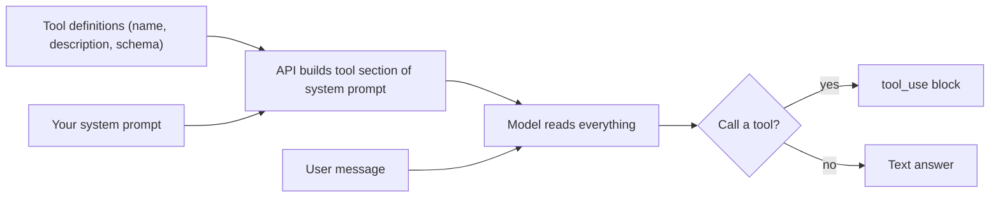

# Defining Tools

## Introduction

A tool definition is the only thing the model sees about your function. It never reads your source code. It reads a **name**, a **description**, and an **input schema**, and from those three things it decides whether to call the tool, when to call it, and what arguments to pass.

That makes tool definitions a form of prompt engineering. A well-written definition leads to correct calls on the first try. A vague one leads to wrong tools, missing arguments, or the model guessing instead of looking things up.

In this page you will learn:

- The anatomy of a tool definition
- How to write names and descriptions the model understands
- How to generate definitions from Python code
- How `tool_choice` controls whether the model must, may, or must not call tools
- How definitions affect cost

## Anatomy of a Tool Definition

Here is a complete definition for the Anthropic Messages API:

```json
{
  "name": "search_products",
  "description": "Search the store catalog by keyword. Use this when the customer asks whether we sell something, wants product suggestions, or asks about price or stock. Returns up to 10 matching products with name, price in USD, and stock status. Does not return discontinued products.",
  "input_schema": {
    "type": "object",
    "properties": {
      "query": {
        "type": "string",
        "description": "Search keywords, e.g. 'waterproof hiking boots'"
      },
      "max_price": {
        "type": "number",
        "description": "Optional upper price limit in USD"
      }
    },
    "required": ["query"]
  }
}
```

| Field | Required | Purpose |
| --- | --- | --- |
| `name` | Yes | Identifier the model uses in `tool_use` blocks. Must match `^[a-zA-Z0-9_-]{1,128}$`. |
| `description` | Strongly recommended | Plain-text explanation of what the tool does and when to use it. |
| `input_schema` | Yes | A JSON Schema object describing the arguments. Covered in [Tool Input Schemas](./2-agents-tool-input-schemas.mdx). |
| `input_examples` | No | Example inputs that must validate against the schema. Useful for complex or format-sensitive tools. |
| `strict` | No | When `true`, the model's inputs are guaranteed to match the schema. |
| `cache_control` | No | Marks a prompt-caching breakpoint. See [Prompt Caching](../4-agents-memory-and-context/4-agents-prompt-caching.mdx). |

Behind the scenes, the API turns your tool list into part of the system prompt. That is why the wording of each definition matters so much: it is literally text the model reads.



## Writing Good Names

Names should be short, specific, and action-oriented. Use `verb_noun` in `snake_case`.

| Weak name | Better name | Why |
| --- | --- | --- |
| `weather` | `get_current_weather` | Says it returns *current* conditions, not a forecast |
| `db` | `search_customers` | Says what it searches |
| `do_action` | `refund_order` | One clear action |
| `tool1` | `github_create_issue` | Namespaced by service as your toolset grows |

When you have tools from several systems, prefix them with the service name (`github_`, `slack_`, `jira_`). This makes selection unambiguous and helps tool search later. See [Working with Large Toolsets](./10-agents-large-toolsets.mdx).

## Writing Good Descriptions

Anthropic's documentation calls detailed descriptions "by far the most important factor in tool performance." A good description answers four questions:

1. **What does the tool do?**
2. **When should the model use it, and when not?**
3. **What does each parameter mean?** (The schema covers this, but the description can add context.)
4. **What are the caveats?** What does it *not* return? What are the limits?

Aim for at least three or four sentences for each tool, more for complex ones.

### A Poor Description

```python
poor = {
    "name": "get_stock_price",
    "description": "Gets the stock price for a ticker.",
    "input_schema": {
        "type": "object",
        "properties": {"ticker": {"type": "string"}},
        "required": ["ticker"],
    },
}
```

The model is left guessing. Which exchange? Which currency? Real-time or delayed? Can it get company news here too?

### A Good Description

```python
good = {
    "name": "get_stock_price",
    "description": (
        "Retrieves the latest trade price for a stock listed on NYSE or NASDAQ. "
        "Use this when the user asks for the current or most recent price of a specific "
        "public company. Returns the price in USD and the time of the last trade. "
        "It does not return historical prices, company news, or fundamentals; "
        "say so if the user asks for those."
    ),
    "input_schema": {
        "type": "object",
        "properties": {
            "ticker": {
                "type": "string",
                "description": "Stock ticker symbol in uppercase, e.g. 'AAPL' for Apple Inc.",
            }
        },
        "required": ["ticker"],
    },
}
```

### Be Prescriptive About When to Call

Recent Claude models tend to be fairly conservative about reaching for tools. Anthropic's guidance is to state **trigger conditions** explicitly: "Call this when the user asks about current prices or recent events." Compare:

- Descriptive only: "Searches the knowledge base."
- Prescriptive: "Searches the internal knowledge base. Call this before answering any question about our product's features, pricing, or policies, even if you think you know the answer, because the knowledge base is more current than your training data."

The second version tells the model *when* to act, not just what the tool is.

:::tip
If you want a reason or justification as a parameter (for audit logs), ask for "a short explanation" rather than "your step-by-step reasoning." Anthropic notes that parameters asking the model to dump its internal reasoning can trigger refusals. Keep reasoning in thinking blocks.
:::

## Providing Input Examples

For tools with nested objects or format-sensitive fields, you can add `input_examples`. Each example must validate against the schema, or the API returns a 400 error.

```python
create_event_tool = {
    "name": "calendar_create_event",
    "description": (
        "Create a calendar event for the current user. Use this when the user asks to "
        "schedule, book, or add a meeting. Times are in the user's local timezone."
    ),
    "input_schema": {
        "type": "object",
        "properties": {
            "title": {"type": "string", "description": "Short event title"},
            "start": {"type": "string", "description": "Start time, ISO 8601, e.g. 2026-11-03T14:00"},
            "duration_minutes": {"type": "integer", "description": "Length of the event in minutes"},
            "attendees": {
                "type": "array",
                "items": {"type": "string"},
                "description": "Attendee email addresses",
            },
        },
        "required": ["title", "start", "duration_minutes"],
    },
    "input_examples": [
        {"title": "1:1 with Dana", "start": "2026-11-03T14:00", "duration_minutes": 30},
        {
            "title": "Sprint planning",
            "start": "2026-11-04T10:00",
            "duration_minutes": 60,
            "attendees": ["dana@example.com", "lee@example.com"],
        },
    ],
}
```

Examples add tokens to every request (roughly tens of tokens for simple ones, more for nested objects), so use them where they earn their keep.

## Generating Definitions from Python Code

Writing JSON by hand gets tedious. Two common approaches keep definitions close to the code.

### Option 1: Pydantic Models

Pydantic can generate JSON Schema from a class, and you can reuse the same class to validate inputs later.

```python
from pydantic import BaseModel, Field


class SearchProductsInput(BaseModel):
    """Arguments for search_products."""

    query: str = Field(description="Search keywords, e.g. 'waterproof hiking boots'")
    max_price: float | None = Field(default=None, description="Optional upper price limit in USD")


def to_tool(name: str, description: str, model: type[BaseModel]) -> dict:
    schema = model.model_json_schema()
    schema.pop("title", None)  # the API does not need the class title
    return {"name": name, "description": description, "input_schema": schema}


search_tool = to_tool(
    "search_products",
    "Search the store catalog by keyword. Use this when the customer asks whether we "
    "sell something or wants product suggestions. Returns up to 10 products.",
    SearchProductsInput,
)
print(search_tool["input_schema"]["required"])
```

Output:

```text
['query']
```

### Option 2: SDK Decorators

The Anthropic Python SDK's `@beta_tool` decorator builds the schema from a function's type hints and docstring. It is designed for use with the SDK's tool runner, which you will meet in [Using an SDK Tool Runner](./4-agents-tool-runner.mdx).

```python
from anthropic import beta_tool


@beta_tool
def search_products(query: str, max_price: float | None = None) -> str:
    """Search the store catalog by keyword.

    Use this when the customer asks whether we sell something or wants product
    suggestions. Returns up to 10 products.

    Args:
        query: Search keywords, e.g. 'waterproof hiking boots'.
        max_price: Optional upper price limit in USD.
    """
    return "[]"  # real implementation goes here
```

Other ecosystems have the same idea: the OpenAI Agents SDK has `@function_tool`, LangChain has `@tool`, and MCP servers built with FastMCP use `@mcp.tool()`.

## Controlling Tool Use with tool_choice

The `tool_choice` parameter tells the API how much freedom the model has:

| Value | Meaning |
| --- | --- |
| `{"type": "auto"}` | Default. The model decides whether to call tools. |
| `{"type": "none"}` | The model must not call tools (they stay defined, which keeps the prompt cache stable). |
| `{"type": "any"}` | The model must call at least one tool. |
| `{"type": "tool", "name": "..."}` | The model must call that specific tool. |

:::warning Forced tool use on current models
Claude Opus 5.5, Claude Sonnet 5.5, Claude Fable 5.1, and Claude Mythos 5.1 **reject** `{"type": "any"}` and `{"type": "tool", ...}` with a 400 error. On these models, use `auto` and say what you expect in the prompt ("Use the get_weather tool to answer"). If you need guaranteed valid arguments, add `"strict": true` to the tool. If you only wanted the forced call to extract JSON, use structured outputs instead (see [Structured Outputs](../1-agents-llm-apis/6-agents-structured-outputs.mdx)). Older models still accept forced tool use. Check the official docs for the current list, because model support changes.
:::

Because `auto` does not *guarantee* a call, production code should check whether a `tool_use` block came back and handle the case where it did not.

```python
from anthropic import Anthropic

client = Anthropic()

response = client.messages.create(
    model="claude-opus-5-5",
    max_tokens=16000,
    tools=[good],  # the get_stock_price tool from above
    tool_choice={"type": "auto"},
    messages=[{"role": "user", "content": "What's Apple trading at? Use the get_stock_price tool."}],
)

tool_calls = [b for b in response.content if b.type == "tool_use"]
if not tool_calls:
    print("Model answered without a tool:", response.content)
else:
    print("Tool requested:", tool_calls[0].name, tool_calls[0].input)
```

Example output:

```text
Tool requested: get_stock_price {'ticker': 'AAPL'}
```

You can also add `"disable_parallel_tool_use": true` inside `tool_choice` so the model calls at most one tool per turn. See [Parallel Tool Calls](./5-agents-parallel-tool-calls.mdx).

## How Tool Definitions Affect Cost

Tool definitions are input tokens. They are sent on every request in the conversation. A few practical consequences:

- Ten tools with long descriptions can easily add a few thousand tokens to every call.
- Changing the tool list between requests invalidates the prompt cache from that point on, because tools sit at the very front of the prompt. Keep the tool list and its order stable within a session.
- When you have dozens or hundreds of tools, loading them all every time is wasteful and hurts selection accuracy. Tool search solves this; see [Working with Large Toolsets](./10-agents-large-toolsets.mdx).

Do not shorten descriptions to save tokens until you have measured. A clear description that prevents one wrong tool call usually pays for itself.

## Real-World Scenario

Your company has an internal IT helpdesk bot. It started with one tool, `run_query`, which accepted raw SQL against the ticketing database. The bot often wrote broken SQL, sometimes queried the wrong tables, and once tried to `DELETE` rows. The team wants to fix tool selection and safety without rewriting everything.

### The Solution

Replace the single generic tool with a few task-shaped tools whose descriptions spell out when to use them:

```python
helpdesk_tools = [
    {
        "name": "tickets_search",
        "description": (
            "Search IT support tickets by keyword, status, or requester email. Use this when "
            "the user asks about existing tickets, e.g. 'is my laptop ticket still open?'. "
            "Returns at most 20 tickets with id, title, status, and last update. "
            "Read-only."
        ),
        "input_schema": {
            "type": "object",
            "properties": {
                "keyword": {"type": "string", "description": "Words to match in title or body"},
                "status": {"type": "string", "enum": ["open", "pending", "closed"]},
                "requester_email": {"type": "string", "description": "Filter by requester"},
            },
        },
    },
    {
        "name": "tickets_create",
        "description": (
            "Create a new IT support ticket for the current user. Use this only after "
            "confirming the issue is not already covered by an open ticket (search first). "
            "Returns the new ticket id."
        ),
        "input_schema": {
            "type": "object",
            "properties": {
                "title": {"type": "string", "description": "One-line summary of the problem"},
                "details": {"type": "string", "description": "Full description from the user"},
                "priority": {"type": "string", "enum": ["low", "normal", "high"]},
            },
            "required": ["title", "details"],
        },
    },
]
```

### Why This Approach

- Specific tools turn an open-ended SQL-writing task into a simple choice between clear options.
- Each description says when to use the tool and what it returns, so the model stops guessing.
- Read-only and write operations are separate, so you can add an approval step to `tickets_create` without affecting searches.
- The `enum` on `status` and `priority` prevents invented values.

### When to Use It and When Not To

Task-shaped tools are the right default for production agents. A generic tool (raw SQL, raw HTTP, a shell) can still make sense for internal power users, for exploratory analysis in a sandbox, or for read-only replicas. See [Agents That Work with Your Database](../10-agents-integration/6-agents-with-databases.mdx).

### Alternatives and Trade-offs

| Approach | Pros | Cons | Best for |
| --- | --- | --- | --- |
| One generic tool (`run_query`) | Maximum flexibility; few definitions | Error-prone; hard to secure; needs schema knowledge | Sandboxed analysis by experts |
| Many tiny CRUD tools (one per endpoint) | Mirrors the API; easy to generate | Model must chain many calls; selection gets harder | Rarely ideal for agents |
| A few task-shaped tools | Clear selection; easy to gate and audit | Requires design work | Most production agents |
| One tool with an `action` enum | Fewer definitions; groups related operations | Description must explain every action | Families of related operations |

## Best Practices

- **Describe when to call, not just what it does.** Trigger conditions improve how often the model calls the tool when it should.
- **Mention what the tool does not do.** This prevents the model from expecting data that will never come.
- **Use unambiguous parameter names.** `user_id` is better than `user`; `amount_cents` is better than `amount`.
- **Keep the tool list stable within a conversation** to preserve the prompt cache.
- **Namespace tools by service** once you have more than a handful.
- **Check for the `tool_use` block** instead of assuming the model called a tool.
- **Test with real prompts.** Read the transcripts and note where the model hesitated or picked the wrong tool, then fix the description. [Iterating on Prompts with Evidence](../3-agents-prompt-engineering/10-agents-prompt-iteration.mdx) describes a disciplined way to do this.

## Summary

- A tool definition is `name` + `description` + `input_schema`, plus optional `input_examples`, `strict`, and `cache_control`.
- The model selects tools based on what it reads in the definitions, so write them like documentation for a new teammate.
- Good descriptions state what the tool does, when to use it, what it returns, and its limits.
- Pydantic models or SDK decorators can generate schemas from code.
- `tool_choice` controls whether tools are optional, required, or disabled; current top models reject forced tool use, so steer with prompts and use `strict`.
- Tool definitions cost tokens on every request and affect prompt caching.

## Exercises

1. Take the poor `get_stock_price` description and write three variants: minimal, good, and overly long. Run each with 10 different user questions and count how often the tool is called correctly.
2. Convert the `tickets_create` definition into a Pydantic model and generate its schema with `model_json_schema()`. Compare the output with the hand-written version.
3. Write a tool definition for a `send_email` tool. Include trigger conditions, caveats, and at least one `input_examples` entry.

**Next:** [Tool Input Schemas](./2-agents-tool-input-schemas.mdx) goes deep on JSON Schema, strict mode, and validating the inputs your tools receive.
