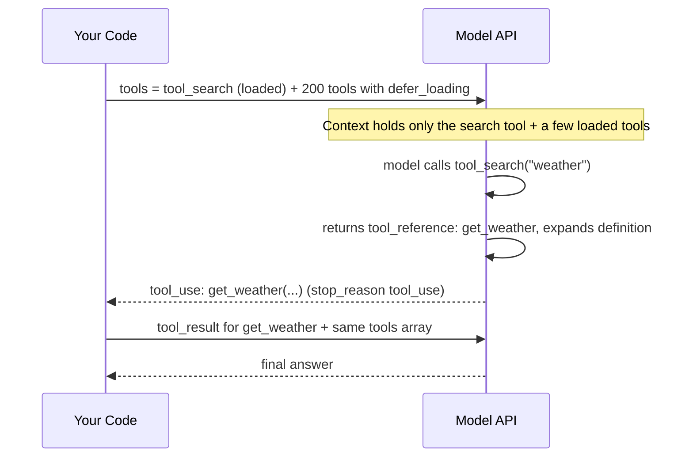

# Working with Large Toolsets

## Introduction

An agent with five tools is easy. An agent connected to GitHub, Slack, Jira, Grafana, PagerDuty, and your internal APIs might have **hundreds**. Each MCP server you connect (see [MCP Introduction](../7-agents-mcp/0-agents-mcp-introduction.mdx)) can add dozens more.

Large toolsets cause two problems:

1. **Context bloat.** Every tool definition is sent with every request. Anthropic's tool search documentation gives the example of a typical multi-server setup (GitHub, Slack, Sentry, Grafana, Splunk) consuming roughly 55,000 tokens of definitions before the agent does any work.
2. **Worse tool selection.** The same documentation notes that selection accuracy degrades once you exceed roughly 30 to 50 available tools. More similar-looking options mean more wrong picks.

They also cost money and latency on every turn, and they make prompt caching fragile if the tool list changes.

This page covers the main strategies, from simplest to most powerful:

| Strategy | Idea |
| --- | --- |
| Consolidate | Fewer, task-shaped tools |
| Namespace | Clear prefixes so similar tools are distinguishable |
| Route | Pick a tool subset in code before calling the model |
| Tool search | Let the model search a catalog and load only what it needs |
| Subagents | Split tools across specialized agents |
| Programmatic tool calling | Let the model call many tools from code, keeping results out of context |

## Start by Shrinking the Toolset

Before adding infrastructure, apply [Tool Design Principles](./7-agents-tool-design-principles.mdx):

- **Consolidate** list/get/create triplets into task-shaped tools. Anthropic's define-tools guidance also suggests grouping related operations behind an `action` parameter (one `github_pull_request` tool instead of `create_pr`, `review_pr`, `merge_pr`).
- **Remove tools nobody uses.** Check your logs: if a tool has not been called in a month, it is costing tokens for nothing.
- **Namespace** the rest (`github_`, `slack_`, `jira_`) so selection and search both work better.

Often this alone takes a 60-tool agent down to 15 to 20 tools, which is manageable without anything else.

## Strategy: Route in Code

If requests fall into clear categories, you can choose the toolset **before** the model sees the request: a cheap classifier (a small model or simple rules) picks a category, and you send only that category's tools.

```python
TOOLSETS = {
    "billing": ["billing_get_invoice", "billing_issue_refund", "billing_update_card"],
    "shipping": ["orders_lookup", "orders_track_package", "orders_change_address"],
    "account": ["account_reset_password", "account_update_email"],
}


def tools_for(category: str, all_tools: dict) -> list[dict]:
    return [all_tools[name] for name in TOOLSETS[category]]
```

Routing is simple and predictable, but it has costs: a misclassified request gets the wrong tools, cross-category requests ("refund my order and change my address") need special handling, and a different tool list per request means a different prompt-cache prefix. See [Routing](../6-agents-planning-and-reasoning/2-agents-routing.mdx).

## Strategy: Tool Search with Deferred Loading

Tool search flips the approach: instead of you deciding which tools to show, the model **searches** for the tools it needs. Anthropic provides tool search as a server tool in two variants:

- `tool_search_tool_regex_20251119`: the model writes regex patterns (Python `re.search` syntax, case-insensitive).
- `tool_search_tool_bm25_20251119`: the model writes natural-language queries.

You still send **every** tool definition in `tools`, but you mark most of them with `"defer_loading": true`. Deferred tools are not loaded into the model's context. When the model searches, the API returns matching tools as `tool_reference` blocks (up to 5 by default) and expands them into full definitions automatically.



### Example

```python
from anthropic import Anthropic

client = Anthropic()

catalog = [
    {
        "name": "get_weather",
        "description": "Get the current weather for a city.",
        "input_schema": {
            "type": "object",
            "properties": {"location": {"type": "string"}},
            "required": ["location"],
        },
        "defer_loading": True,
    },
    {
        "name": "search_files",
        "description": "Search through files in the workspace by keyword.",
        "input_schema": {
            "type": "object",
            "properties": {"query": {"type": "string"}},
            "required": ["query"],
        },
        "defer_loading": True,
    },
    # ... hundreds more, all with defer_loading: True
]

response = client.messages.create(
    model="claude-opus-5-5",
    max_tokens=16000,
    tools=[{"type": "tool_search_tool_bm25_20251119", "name": "tool_search_tool_bm25"}] + catalog,
    messages=[{"role": "user", "content": "What is the weather in San Francisco?"}],
)

for block in response.content:
    print(block.type, getattr(block, "name", ""), getattr(block, "input", ""))
```

Example output:

```text
text
server_tool_use tool_search_tool_bm25 {'query': 'weather for a city'}
tool_search_tool_result
text
tool_use get_weather {'location': 'San Francisco, CA'}
```

From here it is a normal tool call: run `get_weather`, return a `tool_result`, and continue with the **same** `tools` array. Never send a `tool_result` for the `srvtoolu_` search call; the API answered it already. Keep the `server_tool_use` and `tool_search_tool_result` blocks in history as returned, so discovered tools stay available in later turns without searching again.

### Tool Search Rules and Tips

- At least one tool must **not** be deferred. Never defer the search tool itself.
- Keep your **3 to 5 most frequently used tools non-deferred** so common requests do not need a search first.
- Search covers tool names, descriptions, argument names, and argument descriptions, so put the words users actually say into descriptions.
- Consistent namespacing helps one search find a whole group (`github_`).
- A system prompt line describing available categories helps: "You can search for tools to work with GitHub, Slack, Jira, and Grafana."
- Deferred tools are excluded from the cached prompt prefix and appended when discovered, so **tool search preserves prompt caching**. A deferred tool cannot also carry `cache_control`.

Anthropic's guidance for **when** to use it: about 10 or more tools, tool definitions over about 10,000 tokens, noticeable selection errors, multiple MCP servers, or a tool library that keeps growing. Below that, plain tool calling is simpler.

## Strategy: Custom Tool Search

You can also implement tool search yourself, for example with embeddings, your own ranking, or permission filtering. Define an ordinary client tool, and when the model calls it, return a `tool_result` whose content is a list of `tool_reference` blocks. Every referenced tool must be in `tools` (normally with `defer_loading: true`), and the API expands the references the same way.

```python
import re


def make_tool(name: str, description: str, properties: dict, required: list) -> dict:
    return {
        "name": name,
        "description": description,
        "input_schema": {"type": "object", "properties": properties, "required": required},
        "defer_loading": True,  # sent with the request, but not loaded into context up front
    }


CATALOG = [
    make_tool("github_create_issue", "Create a GitHub issue in a repository.",
              {"repo": {"type": "string"}, "title": {"type": "string"}, "body": {"type": "string"}},
              ["repo", "title"]),
    make_tool("github_list_pull_requests", "List open pull requests in a GitHub repository.",
              {"repo": {"type": "string"}}, ["repo"]),
    make_tool("slack_send_message", "Send a message to a Slack channel.",
              {"channel": {"type": "string"}, "text": {"type": "string"}}, ["channel", "text"]),
    make_tool("pagerduty_list_incidents", "List open PagerDuty incidents, newest first.",
              {"service": {"type": "string"}}, []),
    make_tool("grafana_query_metric", "Query a Grafana/Prometheus metric over a time range.",
              {"promql": {"type": "string"}, "minutes": {"type": "integer"}}, ["promql"]),
    # ... imagine 200 more
]

FIND_TOOLS = {
    "name": "find_tools",
    "description": (
        "Search the catalog of additional tools by keyword. Call this whenever you need "
        "a capability you do not currently have, e.g. 'create github issue' or "
        "'slack message'. Matching tools become available to call right after."
    ),
    "input_schema": {
        "type": "object",
        "properties": {
            "query": {"type": "string", "description": "Keywords describing the capability"},
            "limit": {"type": "integer", "description": "Max tools to return. Defaults to 3."},
        },
        "required": ["query"],
    },
}


STOPWORDS = {"a", "an", "the", "to", "in", "of", "for", "and", "or", "on"}


def keywords(text: str) -> set[str]:
    return set(re.findall(r"[a-z0-9]+", text.lower())) - STOPWORDS


def find_tools(query: str, limit: int = 3) -> list[dict]:
    """Rank catalog tools by keyword overlap; return tool_reference blocks."""
    words = keywords(query)
    scored = []
    for tool in CATALOG:
        score = len(words & keywords(tool["name"].replace("_", " ") + " " + tool["description"]))
        if score:
            scored.append((score, tool["name"]))
    scored.sort(key=lambda pair: -pair[0])
    return [{"type": "tool_reference", "tool_name": name} for _, name in scored[:limit]]


# Every request sends the search tool (loaded) plus the whole catalog (deferred).
ALL_TOOLS = [FIND_TOOLS] + CATALOG
```

Trying the ranking function:

```python
print(find_tools("open a github issue"))
print(find_tools("send slack message", limit=1))
print(find_tools("quantum teleport"))
```

Output:

```text
[{'type': 'tool_reference', 'tool_name': 'github_create_issue'}, {'type': 'tool_reference', 'tool_name': 'github_list_pull_requests'}, {'type': 'tool_reference', 'tool_name': 'pagerduty_list_incidents'}]
[{'type': 'tool_reference', 'tool_name': 'slack_send_message'}]
[]
```

Notice the third result for the GitHub query: `pagerduty_list_incidents` matched only because its description contains the word "open." Keyword overlap is crude; in production, embedding similarity or BM25 ranks better (see [Embeddings](../5-agents-rag/1-agents-embeddings.mdx)).

In your agent loop, handle `find_tools` like any other tool, but put the list of references directly into `content`:

```python
for block in response.content:
    if block.type == "tool_use" and block.name == "find_tools":
        refs = find_tools(**block.input)
        tool_results.append({
            "type": "tool_result",
            "tool_use_id": block.id,
            "content": refs if refs else "No matching tools. Try different keywords.",
        })
```

And send `tools=ALL_TOOLS` on every request. A custom search tool is also a good place to enforce **permissions**: only return references to tools the current user is allowed to use.

## Strategy: Split Across Subagents

Another approach is to give different agents different toolsets: a "GitHub agent", a "monitoring agent", and an orchestrator that delegates to them. Each subagent sees a small, focused set of tools and its own clean context window. This adds coordination overhead, so it pays off mainly when the domains are genuinely separate. See [Subagents and Context Isolation](../8-agents-multi-agent-systems/8-agents-subagents-and-context-isolation.mdx).

## Strategy: Programmatic Tool Calling

Sometimes the problem is not the number of tools but the number of **calls**: checking 50 servers, looking up 20 customers, or aggregating a large result. With standard tool use, every call is a model round trip and every result lands in the context window.

**Programmatic tool calling** lets the model write a script that calls your tools from inside the code execution container. You mark a tool with `"allowed_callers": ["code_execution_20260120"]` and include the code execution tool. When the script calls your tool, the API pauses and returns a normal `tool_use` block (with a `caller` field naming the code execution call); you return the result, and the script continues. Only the script's final output reaches the model's context.

```python
tools = [
    {"type": "code_execution_20260120", "name": "code_execution"},
    {
        "name": "query_database",
        "description": "Run a read-only SQL query against the sales database. "
                       "Returns rows as a JSON list of objects.",
        "input_schema": {
            "type": "object",
            "properties": {"sql": {"type": "string", "description": "SQL to run"}},
            "required": ["sql"],
        },
        "allowed_callers": ["code_execution_20260120"],
    },
]
```

Anthropic's documentation describes it as a strong fit for fan-out over many items and for large results that should be filtered before reaching the model, and a weak fit for short, strictly sequential workflows. It has some constraints (for example, tool results for programmatic calls must be text, and the reply message must contain only `tool_result` blocks), so read the [programmatic tool calling docs](https://platform.claude.com/docs/en/agents-and-tools/tool-use/programmatic-tool-calling) before adopting it, and measure token usage with and without it.

## Strategy: Changing Tools Mid-Conversation

Normally the tool list is fixed for a conversation, because changing it rewrites the front of the prompt and invalidates the cache. Anthropic offers a **beta** feature for cases where **your application** (not the model) decides the toolset should change, for example when a user switches the assistant into "admin mode" or revokes a capability. You declare every possible tool up front (the ones to add later with `defer_loading: true`) and append a system-role message with `tool_addition` or `tool_removal` blocks that reference a tool by name. The cached prefix survives.

| Use | Feature |
| --- | --- |
| The model should discover what it needs | Tool search |
| Your application decides the toolset changed | Mid-conversation tool changes (beta) |

Because it is beta and limited to certain models, check the current tool-use docs for the required beta header and model support before relying on it.

## Real-World Scenario

An internal "engineering copilot" connects to GitHub, Jira, Slack, Grafana, PagerDuty, and an internal deploy service through six MCP servers, about 140 tools in total. Every request costs tens of thousands of input tokens before any work starts, and the agent regularly calls `jira_search_issues` when users ask about GitHub issues.

### The Solution

1. **Prune and consolidate.** Remove rarely used tools and merge overlapping ones, bringing the total to about 90.
2. **Namespace** every tool by service.
3. **Enable tool search** (BM25 variant) and defer every tool except `github_search_issues`, `slack_send_message`, `pagerduty_list_incidents`, and the search tool itself, which cover most requests.
4. **Describe categories in the system prompt**: "You can search for tools to work with GitHub, Jira, Slack, Grafana, PagerDuty, and Deploy."
5. **Monitor** which tools are discovered for which requests, and improve descriptions where searches miss.
6. **Keep deploy tools out of search results for users without deploy permission** by moving the deploy tools to a custom search tool that filters by role.

### Why This Approach

Most requests touch only two or three tools. Tool search loads exactly those, cutting the fixed per-request cost and leaving fewer near-duplicates for the model to confuse. Because deferred tools are appended rather than swapped, the cached prefix stays stable.

### When to Use It and When Not To

Use tool search when the toolset is large, growing, or assembled from multiple MCP servers. Do not bother for agents with fewer than about ten small tools, or when every request uses every tool. If requests split cleanly into categories handled by different teams, routing or subagents might be simpler to reason about.

### Alternatives and Trade-offs

| Approach | Pros | Cons | Best for |
| --- | --- | --- | --- |
| Load all tools | Simplest; no extra round trips | Token cost and selection errors grow with the toolset | Fewer than about 10 tools |
| Consolidate and prune | Improves everything else too | Design effort; may not be enough alone | Always do this first |
| Route in code | Predictable; cheap | Misroutes; cross-category requests; cache prefix varies | Clear, separate request categories |
| Server-side tool search | Scales to thousands of tools; preserves cache | Extra search step; descriptions must be searchable | Large or growing catalogs |
| Custom tool search | Your ranking, permissions, embeddings | You build and maintain it | Permission-aware or domain-specific catalogs |
| Subagents per domain | Small, focused contexts | Coordination overhead | Clearly separable domains |
| Programmatic tool calling | Many calls, little context | Requires code execution; some feature limits | Fan-out and large data processing |

## Common Mistakes

- **Deferring every tool**, including the search tool. The API rejects this.
- **Omitting deferred tools from later requests.** Send the full `tools` array every time, or discovered tools cannot be expanded.
- **Answering the search tool's `srvtoolu_` call** with a `tool_result`.
- **Changing the tool list every turn** without tool search, which breaks prompt caching.
- **Vague descriptions.** Search can only find what your names and descriptions describe.
- **Jumping to infrastructure before pruning.** Many large toolsets are mostly unused tools.

## Summary

- Large toolsets waste tokens and reduce selection accuracy.
- First consolidate, prune, and namespace.
- Routing in code is simple but rigid; tool search lets the model discover tools on demand.
- With tool search, send all definitions, defer most of them, and keep a few common tools loaded.
- Custom tool search returns `tool_reference` blocks from your own ranking logic and can enforce permissions.
- Subagents and programmatic tool calling address the problem from other angles: smaller contexts and fewer round trips.
- Mid-conversation tool changes (beta) let your application add or remove tools without breaking the prompt cache.
- Measure: track tokens per request, discovered tools, and selection errors before and after each change.

## Exercises

1. Count the tokens of your agent's tool definitions using the token counting endpoint (see [Tokens and Context Windows](../1-agents-llm-apis/8-agents-tokens-and-context.mdx)) with and without `defer_loading` on most tools.
2. Replace the keyword ranking in `find_tools` with embedding similarity and compare results on ten realistic queries.
3. Add a `user_role` argument to your custom search (from your session, not from the model) so that `deploy_` tools are only returned for users with the `deployer` role.

**Next:** [Tool Security Basics](./11-agents-tool-security-basics.mdx) covers how to keep all these tools from being misused.
