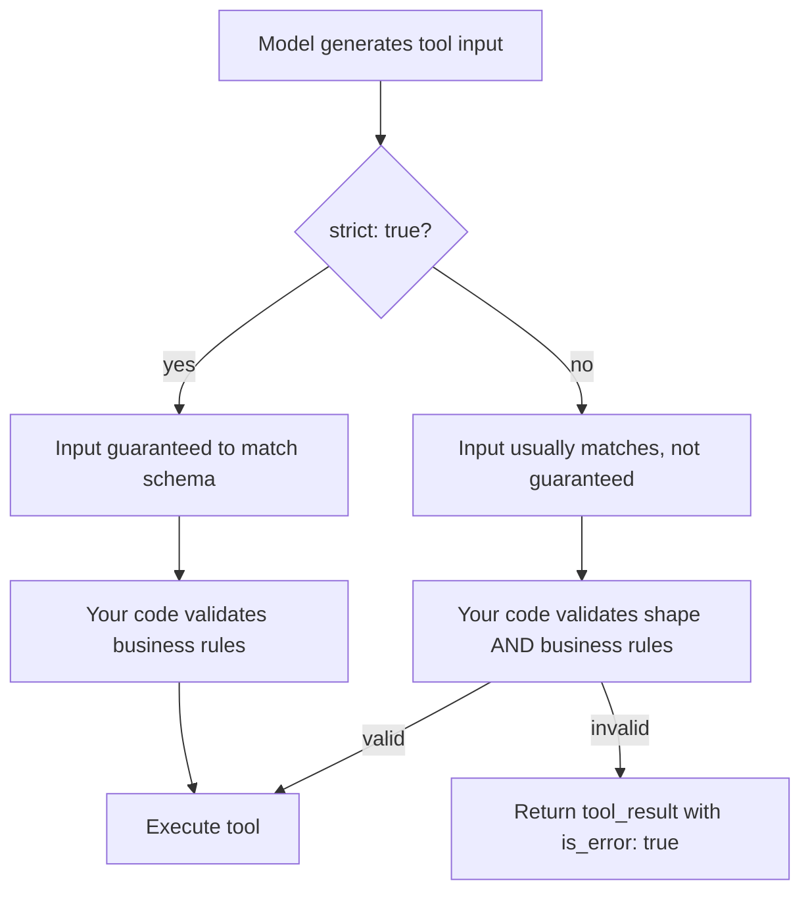

# Tool Input Schemas

## Introduction

Every tool has an `input_schema`: a [JSON Schema](https://json-schema.org/) object that describes the arguments the tool accepts. The schema does two jobs at once:

1. **It instructs the model.** Types, enums, descriptions, and required fields tell the model exactly what to produce.
2. **It defines a contract for your code.** Your function can rely on receiving data in that shape, as long as you validate it (or use strict mode).

A loose schema invites mistakes: a string where you wanted a number, a made-up status value, a missing ID. A precise schema removes whole classes of errors before your code runs.

This page covers:

- JSON Schema essentials for tool inputs
- Design choices that reduce ambiguity
- Strict mode (`strict: true`) and its limitations
- Validating inputs at runtime with Pydantic

## JSON Schema Essentials

A tool's `input_schema` is always an object at the top level:

```json
{
  "type": "object",
  "properties": {
    "city": { "type": "string", "description": "City name, e.g. 'Lisbon'" }
  },
  "required": ["city"]
}
```

### Basic Types

| JSON Schema type | Python value the tool receives | Example |
| --- | --- | --- |
| `string` | `str` | `"ORD-1042"` |
| `integer` | `int` | `3` |
| `number` | `int` or `float` | `19.99` |
| `boolean` | `bool` | `true` |
| `array` | `list` | `["a", "b"]` |
| `object` | `dict` | `{"street": "..."}` |
| `null` | `None` | `null` |

### Enums for Fixed Choices

Whenever a parameter has a fixed set of valid values, use `enum`. This is the single most effective way to stop the model from inventing values.

```json
{
  "type": "string",
  "enum": ["standard", "express", "overnight"],
  "description": "Shipping speed"
}
```

### Required vs Optional

List truly required fields in `required`. Leave others optional and document their default in the description.

```json
{
  "type": "object",
  "properties": {
    "query": { "type": "string", "description": "Search text" },
    "limit": { "type": "integer", "description": "Max results to return. Defaults to 10." }
  },
  "required": ["query"]
}
```

Your Python function should apply the same default (`limit: int = 10`) so behavior is consistent whether or not the model sends the field.

### Nested Objects and Arrays

```json
{
  "type": "object",
  "properties": {
    "customer_id": { "type": "string" },
    "items": {
      "type": "array",
      "description": "Line items to add to the cart",
      "items": {
        "type": "object",
        "properties": {
          "sku": { "type": "string", "description": "Product SKU, e.g. 'BOOT-42-BLK'" },
          "quantity": { "type": "integer", "description": "Number of units, at least 1" }
        },
        "required": ["sku", "quantity"]
      }
    }
  },
  "required": ["customer_id", "items"]
}
```

Nesting is fine, but every level adds room for error. If a schema gets deeply nested, consider whether the tool is doing too much.

### String Formats

JSON Schema `format` values such as `date`, `date-time`, `email`, `uri`, and `uuid` signal the expected shape of a string:

```json
{ "type": "string", "format": "date", "description": "Delivery date, YYYY-MM-DD" }
```

Always repeat the format in the description too. The description is what the model reads most carefully.

## Designing Schemas That Remove Ambiguity

The best schemas make the wrong call hard to express. Some rules of thumb:

| Problem | Ambiguous | Clear |
| --- | --- | --- |
| Units | `"amount": number` | `"amount_cents": integer` with "Amount in US cents, e.g. 1999 for $19.99" |
| Time zones | `"time": string` | `"start_utc": string` with "ISO 8601 in UTC, e.g. 2026-11-03T14:00:00Z" |
| Identifiers | `"user": string` | `"user_email": string` (or `user_id` with an example) |
| Free text vs codes | `"country": string` | `"country_code"` with `enum` or "ISO 3166-1 alpha-2, e.g. 'DE'" |
| Booleans with unclear polarity | `"flag": boolean` | `"include_closed_tickets": boolean` |

Also prefer **flat, small schemas**. A tool with three well-described fields is called correctly far more often than one with fifteen optional fields.



## Strict Mode

By default, the model follows your schema very closely, but there is no hard guarantee. It might occasionally send `"2"` instead of `2`, or omit a required field. Setting `"strict": true` on a tool changes that. The API uses **grammar-constrained sampling**, which means the model literally cannot produce tokens that would violate the schema.

```python
from anthropic import Anthropic

client = Anthropic()

book_flight = {
    "name": "book_flight",
    "description": (
        "Book a flight for the current user. Use only after the user has confirmed "
        "destination, date, and passenger count."
    ),
    "strict": True,
    "input_schema": {
        "type": "object",
        "properties": {
            "destination": {"type": "string", "description": "IATA airport code, e.g. 'NRT'"},
            "date": {"type": "string", "format": "date", "description": "Departure date, YYYY-MM-DD"},
            "passengers": {"type": "integer", "enum": [1, 2, 3, 4, 5, 6, 7, 8]},
        },
        "required": ["destination", "date", "passengers"],
        "additionalProperties": False,
    },
}

response = client.messages.create(
    model="claude-opus-5-5",
    max_tokens=16000,
    tools=[book_flight],
    messages=[{"role": "user", "content": "Yes, book Tokyo Narita on 2026-12-20 for two of us."}],
)

for block in response.content:
    if block.type == "tool_use":
        print(block.input)
```

Example output:

```text
{'destination': 'NRT', 'date': '2026-12-20', 'passengers': 2}
```

### Strict Mode Requirements and Limits

- Every object in the schema must set `"additionalProperties": false`.
- Supported: basic types, `enum`, `const`, `anyOf`, `allOf`, `$ref`/`$defs`, and common string formats (`date`, `date-time`, `email`, `uri`, `uuid`, and others).
- **Not supported:** recursive schemas, numeric limits (`minimum`, `maximum`, `multipleOf`), string length limits (`minLength`, `maxLength`), and complex array constraints. The Python and TypeScript SDKs strip unsupported constraints from what they send and check them client-side when they generate the schema for you, but a hand-written raw schema should avoid them.
- The first request with a new schema has extra latency while the grammar compiles. Compiled schemas are cached for a while afterward.

:::note
Strict mode guarantees **shape**, not **meaning**. A strictly valid `{"order_id": "ORD-999999"}` can still refer to an order that does not exist or belongs to another customer. You still need business-rule validation and authorization checks in your tool.
:::

Other providers have the same feature: OpenAI also offers a `strict` flag on function definitions, and Gemini supports schema-constrained output. Check each provider's docs for its supported JSON Schema subset.

## Validating Inputs with Pydantic

Without strict mode, and for business rules even with it, validate inputs before running the tool. Pydantic lets you define the schema once and use it both to generate `input_schema` and to validate what the model sends.

```python
from typing import Literal

from pydantic import BaseModel, Field, ValidationError, field_validator


class RefundInput(BaseModel):
    order_id: str = Field(description="Order ID, e.g. 'ORD-10442'")
    amount_cents: int = Field(description="Refund amount in US cents, e.g. 1999 for $19.99")
    reason: Literal["damaged", "late", "wrong_item", "other"] = Field(
        description="Reason category for the refund"
    )

    @field_validator("order_id")
    @classmethod
    def check_order_format(cls, value: str) -> str:
        if not value.startswith("ORD-"):
            raise ValueError("order_id must look like 'ORD-12345'")
        return value

    @field_validator("amount_cents")
    @classmethod
    def check_positive(cls, value: int) -> int:
        if value <= 0:
            raise ValueError("amount_cents must be a positive integer")
        return value


def refund_tool_definition() -> dict:
    schema = RefundInput.model_json_schema()
    schema.pop("title", None)
    return {
        "name": "issue_refund",
        "description": (
            "Issue a refund for an order. Use only after confirming the order with "
            "lookup_order and getting the customer's agreement on the amount."
        ),
        "input_schema": schema,
    }


def run_issue_refund(raw_input: dict) -> tuple[str, bool]:
    """Return (content, is_error) ready to put in a tool_result block."""
    try:
        args = RefundInput.model_validate(raw_input)
    except ValidationError as exc:
        problems = "; ".join(
            f"{'.'.join(str(p) for p in err['loc'])}: {err['msg']}" for err in exc.errors()
        )
        return f"Invalid input: {problems}. Fix these fields and try again.", True
    # ... call the payments service here ...
    return f"Refunded {args.amount_cents} cents on {args.order_id} ({args.reason}).", False


print(run_issue_refund({"order_id": "ORD-10442", "amount_cents": 1999, "reason": "damaged"}))
print(run_issue_refund({"order_id": "10442", "amount_cents": -5, "reason": "broken"}))
```

Output:

```text
('Refunded 1999 cents on ORD-10442 (damaged).', False)
("Invalid input: order_id: Value error, order_id must look like 'ORD-12345'; amount_cents: Value error, amount_cents must be a positive integer; reason: Input should be 'damaged', 'late', 'wrong_item' or 'other'. Fix these fields and try again.", True)
```

The error message is written **for the model**: it lists exactly which fields are wrong and how to fix them. The model reads that `tool_result`, corrects its input, and tries again. You will see this pattern in depth in [Handling Tool Errors](./6-agents-tool-errors.mdx).

:::tip
Pydantic's generated schema includes `title` fields on every property. They are harmless, but you can strip them to save tokens. For strict mode, make sure the generated schema has `"additionalProperties": false` on every object. With Pydantic v2 you can set `model_config = ConfigDict(extra="forbid")` on the model.
:::

## Schemas for Tools with Several Actions

Sometimes it is cleaner to group related operations into one tool with an `action` field rather than defining many tiny tools. Anthropic's tool-definition guidance suggests this for families of related operations.

```json
{
  "name": "github_pull_request",
  "description": "Work with a GitHub pull request. action='get' returns title, status, and checks. action='comment' posts a comment (requires body). action='merge' merges it if all checks pass.",
  "input_schema": {
    "type": "object",
    "properties": {
      "action": { "type": "string", "enum": ["get", "comment", "merge"] },
      "repo": { "type": "string", "description": "owner/name, e.g. 'acme/web'" },
      "number": { "type": "integer", "description": "Pull request number" },
      "body": { "type": "string", "description": "Comment text. Required when action='comment'." }
    },
    "required": ["action", "repo", "number"]
  }
}
```

The trade-off: JSON Schema cannot easily express "`body` is required only when `action` is `comment`," so your code must check it and return a clear error if it is missing. If different actions have very different risk levels (reading versus merging), separate tools are easier to gate. See [Tool Security Basics](./11-agents-tool-security-basics.mdx).

## Real-World Scenario

You are building a travel-booking assistant. Early tests show three recurring bugs:

- Dates arrive as "next Friday" or "12/03" (is that March 12 or December 3?).
- Passenger counts arrive as `"two"`.
- The model sometimes sends a `cabin` value of `"premium"`, which your booking API does not recognize.

### The Solution

1. Rename and document fields so there is only one reasonable interpretation: `departure_date` with "YYYY-MM-DD, resolve relative dates like 'next Friday' using today's date from the system prompt."
2. Use `enum` for `cabin` (`economy`, `premium_economy`, `business`, `first`).
3. Turn on `strict: true` with `additionalProperties: false` so `passengers` is always an integer and no extra fields appear.
4. Keep a Pydantic model for business rules the schema cannot express: the date must be in the future, and `passengers` must be between 1 and 9.
5. Put today's date in the system prompt so the model can resolve relative dates.

### Why This Approach

The schema handles **shape** (types, allowed values) at generation time, which is cheap and guaranteed. Pydantic handles **rules** that depend on runtime context (today's date, account limits). Clear field names and descriptions prevent most errors before either layer needs to act.

### When to Use It and When Not To

Use strict mode for any tool whose input feeds directly into another system: bookings, payments, database writes. You might skip it for exploratory tools with free-form inputs (a `search` query) where the schema is already trivial, or when your schema relies on features strict mode does not support.

### Alternatives and Trade-offs

| Approach | Pros | Cons | Best for |
| --- | --- | --- | --- |
| Loose schema, no validation | Quick to write | Runtime crashes, silent bad data | Prototypes only |
| Precise schema + runtime validation | Catches shape and rule errors; model can self-correct | Invalid calls cost an extra round trip | Most tools |
| Strict mode + runtime business rules | Shape guaranteed; fewer retries | Limited JSON Schema subset; first-call compile latency | Tools that write to other systems |
| Structured outputs instead of a tool | Guaranteed JSON response | No tool loop; one-shot extraction only | Extracting data, not taking action |

## Common Mistakes

- **Using `number` for money.** Floating-point amounts cause rounding bugs. Use integer cents.
- **Forgetting `required`.** Without it, every field is optional, and the model may skip important ones.
- **Free-text fields for categorical data.** If there are five valid values, list them in an `enum`.
- **Relying on `minimum`/`maxLength` in strict mode.** They are not enforced by the grammar. Check them in code.
- **Assuming strict mode means safe.** It guarantees format, not authorization or existence.
- **Returning raw validation tracebacks.** Return a concise, field-by-field message the model can act on.
- **Letting schema and code drift apart.** Generate the schema from the same Pydantic model or typed function that validates the input.

## Summary

- `input_schema` is JSON Schema with `type: object` at the top level.
- Use precise types, `enum`s, clear field names, units, and examples in descriptions.
- `strict: true` guarantees schema-valid inputs via constrained sampling; it requires `additionalProperties: false` and supports a subset of JSON Schema.
- Validate business rules at runtime, and return actionable errors with `is_error: true` so the model can retry.
- Pydantic lets one model drive both schema generation and validation.

## Exercises

1. Write a schema for a `schedule_meeting` tool that avoids timezone ambiguity. Test it with prompts like "tomorrow at 3" and "Thursday 9am Berlin time."
2. Convert the `RefundInput` model to strict-compatible form (`extra="forbid"`) and print the generated schema. Confirm `additionalProperties` is `false`.
3. Design a single `github_pull_request` tool and two or three separate tools for the same operations. List which version you would ship and why.

**Next:** [Building a Manual Agent Loop](./3-agents-manual-agent-loop.mdx) puts tools, schemas, and validation together into a complete, runnable agent.
