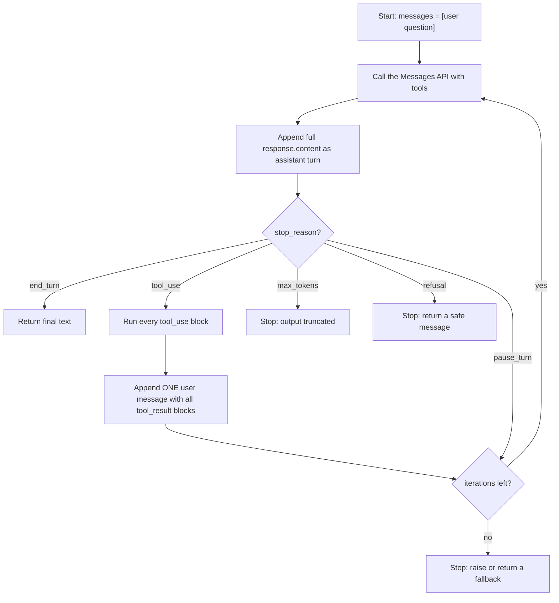

# Building a Manual Agent Loop

## Introduction

In the [Tool Use Introduction](./0-agents-tool-use-introduction.mdx) you made a single tool call by hand: send a request, run the tool, send the result back. An **agent** repeats that cycle until the task is finished. The model decides at each step whether it needs another tool or is ready to answer.

In this page you will write that loop yourself, line by line, and end up with a complete, runnable support agent that can look up orders and check the weather. Writing the loop by hand once is the best way to understand what SDK helpers and frameworks do for you, and it gives you full control when you need it.

You will learn:

- The exact message flow an agent loop must follow
- How to react to every `stop_reason`
- How to dispatch tool calls safely and report failures
- Why a **max-iterations guard** is not optional
- When to use a manual loop instead of the SDK's tool runner

## The Loop at a Glance



Five rules make the loop correct:

1. **Loop while the model asks for tools** (`stop_reason == "tool_use"`).
2. **Append the full `response.content`** as the assistant turn. Not just the text. The `tool_use` blocks (and any thinking blocks) must stay in history.
3. **Answer every `tool_use` block** with a `tool_result` that has the matching `tool_use_id`.
4. **Send all results in one `user` message**, with the `tool_result` blocks first.
5. **Cap the number of iterations** so a confused model cannot loop forever.

## Step 1: Define the Tools

The agent has two tools: `lookup_order` and `get_weather`. Both use `strict: true` so their inputs always match the schema (see [Tool Input Schemas](./2-agents-tool-input-schemas.mdx)).

```python
TOOLS = [
    {
        "name": "lookup_order",
        "description": (
            "Look up a customer order by its order id. Use this whenever the customer "
            "asks about an order's status, shipping carrier, delivery date, destination, "
            "or contents. Returns status, carrier, estimated delivery date (eta), "
            "destination city, and item names. Does not return payment information."
        ),
        "input_schema": {
            "type": "object",
            "properties": {
                "order_id": {"type": "string", "description": "Order id in the form 'ORD-1001'."}
            },
            "required": ["order_id"],
            "additionalProperties": False,
        },
        "strict": True,
    },
    # get_weather is defined the same way; see the full program below.
]
```

## Step 2: Map Tool Names to Functions

The model returns a tool **name** and an **input** dictionary. Your code needs a lookup table from name to Python function, plus a dispatcher that never crashes the loop.

```python
import json


def execute_tool(name: str, tool_input: dict) -> tuple[str, bool]:
    """Run one tool. Returns (content, is_error) for the tool_result block."""
    func = TOOL_FUNCTIONS.get(name)
    if func is None:
        return f"Error: unknown tool '{name}'.", True
    try:
        result = func(**tool_input)
    except Exception as exc:  # report every tool failure back to the model
        return f"Error: {exc}", True
    return json.dumps(result), False
```

Two design decisions are worth calling out:

- **Errors become data, not exceptions.** If a tool fails, the model gets a `tool_result` with `is_error: True` and a readable message. It can then ask the user for a corrected order id or try a different approach. Crashing the loop would throw away the whole conversation. [Handling Tool Errors](./6-agents-tool-errors.mdx) covers this in depth.
- **Results are serialized to a string.** `tool_result` content can be a string or a list of content blocks. JSON text is easy for the model to read and easy for you to log.

## Step 3: Handle Every Stop Reason

Each API response has a `stop_reason`. A robust loop handles all of them explicitly:

| `stop_reason` | Meaning | What the loop does |
| --- | --- | --- |
| `end_turn` | The model finished its answer | Return the text |
| `tool_use` | The model wants one or more tools run | Execute them, append results, continue |
| `pause_turn` | A server-side tool loop paused (web search, code execution) | Re-send the conversation so the server resumes |
| `max_tokens` | Output hit the `max_tokens` limit | Stop; never execute a possibly truncated `tool_use` |
| `refusal` | The model declined for safety reasons | Stop and return a safe message |
| `stop_sequence` | A custom stop sequence was hit | Return the text |

:::caution
A `tool_use` block cut off by `max_tokens` can still parse as a valid but incomplete object. Never run tools from a turn that ended with `max_tokens`. Raise the limit or retry instead.
:::

## Step 4: The Complete Agent

Here is the full program. Save it as `support_agent.py`, set `ANTHROPIC_API_KEY`, and run `python support_agent.py`. It needs the `anthropic` package (`pip install anthropic`) and Python 3.10 or newer.

```python
"""support_agent.py - a complete tool-using agent with a manual loop."""
import json

import anthropic
from anthropic import Anthropic

client = Anthropic()  # reads ANTHROPIC_API_KEY from the environment

MODEL = "claude-opus-5-5"
MAX_ITERATIONS = 10  # hard cap on model calls per user request

SYSTEM_PROMPT = (
    "You are a support assistant for Trailhead Outfitters, an online outdoor store. "
    "Use the tools to look up real order and weather data; never guess order details. "
    "If a tool returns an error, explain the problem to the customer or ask for the "
    "missing information. Keep answers short and friendly."
)

# --- Fake data sources (replace with real APIs and databases) ---------------

ORDERS = {
    "ORD-1001": {"status": "shipped", "carrier": "UPS", "eta": "2026-10-14",
                 "destination_city": "Denver", "items": ["Trail Runner 2 shoes"]},
    "ORD-1002": {"status": "processing", "carrier": None, "eta": "2026-10-18",
                 "destination_city": "Seattle", "items": ["Ultralight tent", "Sleeping pad"]},
}

WEATHER = {
    "denver": {"temp_c": 9, "conditions": "snow showers"},
    "seattle": {"temp_c": 13, "conditions": "rain"},
}

# --- Tool implementations -----------------------------------------------------


def lookup_order(order_id: str) -> dict:
    key = order_id.strip().upper()
    order = ORDERS.get(key)
    if order is None:
        raise ValueError(
            f"No order found with id '{order_id}'. Order ids look like 'ORD-1001'. "
            "Ask the customer to double-check the id."
        )
    return {"order_id": key, **order}


def get_weather(city: str) -> dict:
    data = WEATHER.get(city.strip().lower())
    if data is None:
        raise ValueError(f"No weather data for '{city}'. Try a major city name.")
    return {"city": city, **data}


TOOL_FUNCTIONS = {
    "lookup_order": lookup_order,
    "get_weather": get_weather,
}

TOOLS = [
    {
        "name": "lookup_order",
        "description": (
            "Look up a customer order by its order id. Use this whenever the customer "
            "asks about an order's status, shipping carrier, delivery date, destination, "
            "or contents. Returns status, carrier, estimated delivery date (eta), "
            "destination city, and item names. Does not return payment information."
        ),
        "input_schema": {
            "type": "object",
            "properties": {
                "order_id": {
                    "type": "string",
                    "description": "Order id in the form 'ORD-1001'.",
                }
            },
            "required": ["order_id"],
            "additionalProperties": False,
        },
        "strict": True,
    },
    {
        "name": "get_weather",
        "description": (
            "Get current weather for a city. Use this when the customer asks about "
            "weather, or when weather could affect a delivery or how they use their "
            "gear. Returns temperature in Celsius and a short conditions summary."
        ),
        "input_schema": {
            "type": "object",
            "properties": {
                "city": {"type": "string", "description": "City name, e.g. 'Denver'."}
            },
            "required": ["city"],
            "additionalProperties": False,
        },
        "strict": True,
    },
]

# --- Tool dispatch -------------------------------------------------------------


def execute_tool(name: str, tool_input: dict) -> tuple[str, bool]:
    """Run one tool. Returns (content, is_error) for the tool_result block."""
    func = TOOL_FUNCTIONS.get(name)
    if func is None:
        return f"Error: unknown tool '{name}'.", True
    try:
        result = func(**tool_input)
    except Exception as exc:  # report every tool failure back to the model
        return f"Error: {exc}", True
    return json.dumps(result), False


def final_text(response) -> str:
    return "".join(block.text for block in response.content if block.type == "text")


# --- The agent loop ------------------------------------------------------------


def run_agent(user_message: str, verbose: bool = True) -> str:
    messages = [{"role": "user", "content": user_message}]

    for iteration in range(1, MAX_ITERATIONS + 1):
        response = client.messages.create(
            model=MODEL,
            max_tokens=16000,
            system=SYSTEM_PROMPT,
            tools=TOOLS,
            messages=messages,
        )

        # 1. Always keep the full assistant turn: text, thinking, and tool_use blocks.
        messages.append({"role": "assistant", "content": response.content})

        # 2. Decide what to do based on why the model stopped.
        if response.stop_reason == "end_turn":
            return final_text(response)

        if response.stop_reason == "tool_use":
            tool_results = []
            for block in response.content:
                if block.type != "tool_use":
                    continue
                content, is_error = execute_tool(block.name, block.input)
                if verbose:
                    status = "ERROR" if is_error else "ok"
                    print(f"[step {iteration}] {block.name}({block.input}) -> {status}")
                tool_results.append({
                    "type": "tool_result",
                    "tool_use_id": block.id,
                    "content": content,
                    "is_error": is_error,
                })
            # 3. All results go back together in ONE user message.
            messages.append({"role": "user", "content": tool_results})
            continue

        if response.stop_reason == "pause_turn":
            # Only happens with server-side tools (web search, code execution).
            # The assistant turn is already appended; re-send to let it resume.
            continue

        if response.stop_reason == "max_tokens":
            # Output was cut off. A truncated tool_use block must never be executed.
            raise RuntimeError("Response hit max_tokens; raise max_tokens or simplify the task.")

        if response.stop_reason == "refusal":
            return "Sorry, I can't help with that request."

        # stop_sequence or any future stop reason: return whatever text we have.
        return final_text(response)

    raise RuntimeError(f"Agent did not finish within {MAX_ITERATIONS} iterations.")


if __name__ == "__main__":
    question = (
        "Hi! Where is my order ORD-1001, and what's the weather like where it's going?"
    )
    try:
        answer = run_agent(question)
        print("\nAgent:", answer)
    except anthropic.RateLimitError:
        print("Rate limited by the API. Wait a moment and try again.")
    except anthropic.APIStatusError as exc:
        print(f"API error {exc.status_code}: {exc.message}")
    except anthropic.APIConnectionError:
        print("Could not reach the API. Check your network connection.")
```

Example output:

```text
[step 1] lookup_order({'order_id': 'ORD-1001'}) -> ok
[step 2] get_weather({'city': 'Denver'}) -> ok

Agent: Your order ORD-1001 (Trail Runner 2 shoes) has shipped with UPS and should
arrive in Denver on October 14. Heads up: it's currently 9C with snow showers in
Denver, so the carrier may run a little behind. Enjoy the new shoes!
```

Notice how the model needed two steps: it could not know the destination city until `lookup_order` returned, so `get_weather` had to wait for the next iteration. That dependency is exactly why we need a loop rather than a single call.

## Walking Through the Loop

### Why append `response.content` and not just the text?

The assistant turn contains `tool_use` blocks with IDs. The next request's `tool_result` blocks reference those IDs. If you keep only the text, the API returns a 400 error because the results point to calls that are no longer in the history. Current Claude models also return `thinking` blocks, which should be passed back unchanged so the model keeps its reasoning context across tool calls. Appending the whole `response.content` list handles all of this.

### Why one user message for all results?

When the model asks for several tools in one turn, it expects all the answers together. Sending them as separate `user` messages breaks the expected structure, and Anthropic's docs note that it also "teaches" the model to stop making parallel calls. See [Parallel Tool Calls](./5-agents-parallel-tool-calls.mdx).

### Why a max-iterations guard?

Without a cap, a model that keeps getting confusing tool results can call tools indefinitely, burning tokens and money. `MAX_ITERATIONS = 10` means at most ten model calls per user request. Pick a number from real traces: look at how many steps successful runs take, then add headroom. When the guard trips, raise an error (as here) or return a polite fallback and log the full transcript for debugging. [Stopping Conditions and Budgets](../6-agents-planning-and-reasoning/10-agents-stopping-conditions.mdx) covers richer budgets such as token and time limits.

### Why does `pause_turn` just `continue`?

`pause_turn` only appears when you use **server-side tools** such as web search. The API ran its own internal loop and paused a long turn. To resume, you send the conversation back with the paused assistant turn as the last message, which our loop already appended. Do not add an extra "please continue" message. This agent has no server tools, so the branch is defensive. Because it still counts against `MAX_ITERATIONS`, a turn that keeps pausing cannot loop forever.

### What about API errors?

The SDK already retries connection errors, 429 rate limits, and 5xx server errors with exponential backoff (two retries by default). The `try`/`except` in `__main__` handles what is left, catching the most specific exception first. See [Error Handling and Retries](../1-agents-llm-apis/9-agents-api-error-handling.mdx).

## Seeing the Message History

It helps to print the conversation after a run to see the exact structure the API expects. After the example above, `messages` looks like this (simplified):

```text
1. user:      "Hi! Where is my order ORD-1001, and what's the weather like..."
2. assistant: [text "Let me look that up.", tool_use(id=toolu_A, lookup_order, ORD-1001)]
3. user:      [tool_result(tool_use_id=toolu_A, '{"order_id": "ORD-1001", "status": "shipped", ...}')]
4. assistant: [tool_use(id=toolu_B, get_weather, Denver)]
5. user:      [tool_result(tool_use_id=toolu_B, '{"city": "Denver", "temp_c": 9, ...}')]
6. assistant: [text "Your order ORD-1001 has shipped..."]   <- stop_reason end_turn
```

Roles strictly alternate, every `tool_use` is answered in the very next message, and IDs line up.

## Adding Conversation Memory

`run_agent` starts a fresh conversation each time. For a chat widget, keep `messages` between user turns and append each new user message:

```python
def chat_turn(history: list, user_text: str) -> str:
    history.append({"role": "user", "content": user_text})
    for _ in range(MAX_ITERATIONS):
        response = client.messages.create(
            model=MODEL, max_tokens=16000, system=SYSTEM_PROMPT, tools=TOOLS, messages=history
        )
        history.append({"role": "assistant", "content": response.content})
        if response.stop_reason != "tool_use":
            return final_text(response)
        results = []
        for block in response.content:
            if block.type == "tool_use":
                content, is_error = execute_tool(block.name, block.input)
                results.append({"type": "tool_result", "tool_use_id": block.id,
                                "content": content, "is_error": is_error})
        history.append({"role": "user", "content": results})
    raise RuntimeError("Too many tool steps in one turn.")
```

This compact version treats every non-`tool_use` stop as final. For production, keep the full stop-reason handling from `run_agent`. Long conversations eventually need trimming or summarizing; see [Short-Term Memory](../4-agents-memory-and-context/1-agents-short-term-memory.mdx) and [Compaction and Summarization](../4-agents-memory-and-context/2-agents-compaction-and-summarization.mdx).

## Manual Loop vs SDK Tool Runner

The Anthropic SDK (and most other SDKs) ship a **tool runner** that implements this loop for you. You will use it in the next page. Anthropic recommends the tool runner as the default for custom-tool agents. Reach for a manual loop when you need control the runner does not expose:

| Situation | Manual loop | Tool runner |
| --- | --- | --- |
| Learning how agents work | Best | Hides the details |
| Quick prototype or typical agent | More code to maintain | Best |
| Avoiding a beta SDK dependency | Yes | The Python runner is beta |
| Custom transport or unusual request shapes | Yes | Limited |
| Interleaving unrelated work mid-loop (e.g. checkpointing to a database each step) | Natural | Possible but awkward |
| Approval gates, logging, result rewriting | Easy | Also supported through hooks |
| Other providers | Same pattern, different field names | Provider-specific |

Approval gates and logging are **not** reasons by themselves to hand-write a loop; the runner supports both. Choose the manual loop when you want to own the whole control flow.

## Real-World Scenario

Your team runs a SaaS helpdesk for an outdoor-gear retailer. Customers ask combined questions such as "Where's my order, and will the weather delay it?" Support staff currently open three different admin screens to answer. You want an agent embedded in the help widget that handles these questions end to end, and you need to log every step to your own audit table.

### The Solution

- Start from the `support_agent.py` program above.
- Replace `ORDERS` and `WEATHER` with calls to your order service and a weather API.
- Scope `lookup_order` to the authenticated customer so the agent cannot read other people's orders (the customer id comes from your session, **not** from the model).
- Inside the loop, after each tool call, insert a row into your audit table with the tool name, input, `is_error`, and latency.
- Keep `MAX_ITERATIONS` at 10, and log any run that hits the guard so you can investigate.

### Why This Approach

A manual loop makes per-step side effects (audit rows, metrics, checkpoints) plain Python statements in the place where they happen. The team can read the entire control flow in one function, and nothing is hidden in a library.

### When to Use It and When Not To

Use a manual loop when you want full visibility and control, when you integrate with infrastructure the SDK does not know about, or when you are learning. If your agent is a standard "call tools until done" assistant, the tool runner gives you the same behavior with less code. If every request follows the same fixed sequence (always look up the order, then always check weather), you do not need an agent at all; a two-step workflow is cheaper and easier to test.

### Alternatives and Trade-offs

| Approach | Pros | Cons | Best for |
| --- | --- | --- | --- |
| Manual loop | Total control; no beta dependency; easy to instrument | More code; easy to get message structure wrong | Custom infrastructure, learning |
| SDK tool runner | Little code; schemas from type hints; built-in error wrapping | Beta API; less obvious control flow | Most new agents |
| Agent framework (LangGraph, OpenAI Agents SDK, etc.) | Higher-level features: state, handoffs, tracing | Extra abstraction and dependencies | Multi-agent or complex state |
| Fixed workflow (no loop) | Predictable, cheap, easy to test | Cannot adapt to varied requests | Repetitive, well-defined tasks |

## Common Mistakes

- **Appending only the text of the assistant response.** You lose `tool_use` IDs and thinking blocks, and the next request fails.
- **Sending one `user` message per tool result.** Put all results in one message.
- **Putting a text block before the `tool_result` blocks.** Results must come first in the content list.
- **Letting an exception in a tool crash the loop.** Catch it and return `is_error: True`.
- **No iteration cap.** Always bound the loop.
- **Running tools after `max_tokens`.** The last `tool_use` block may be truncated.
- **Trusting `block.input` for authorization.** Take the user's identity from your session, not from model-generated arguments.
- **Re-creating the tool list on every iteration with different ordering.** Keep tools stable so prompt caching works.

## Summary

- An agent loop calls the model, runs requested tools, sends results back, and repeats until `stop_reason` is `end_turn`.
- Always append the full `response.content`, answer every `tool_use` by `id`, and send all results in one `user` message.
- Handle `tool_use`, `end_turn`, `pause_turn`, `max_tokens`, and `refusal` explicitly.
- Convert tool failures into `is_error` results instead of crashing.
- A max-iterations guard protects against runaway loops and runaway costs.
- Prefer the SDK tool runner for typical agents; write the loop yourself when you need full control.

## Exercises

1. Add a third tool, `cancel_order(order_id)`, that only works when the status is `"processing"`. Return a clear error otherwise. Test with ORD-1001 and ORD-1002.
2. Track total input and output tokens across iterations using `response.usage` and print them at the end of each run.
3. Replace the `RuntimeError` on iteration exhaustion with a graceful fallback message, and write the full `messages` list to a JSON file for debugging. (Hint: use `block.model_dump()` to serialize SDK content blocks.)
4. Port the loop to another provider's SDK (for example OpenAI or a local model through Ollama) and list every field name you had to change.

**Next:** [Using an SDK Tool Runner](./4-agents-tool-runner.mdx) rebuilds this same agent in a fraction of the code.
