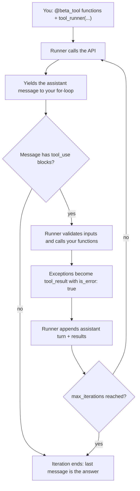

# Using an SDK Tool Runner

## Introduction

In [Building a Manual Agent Loop](./3-agents-manual-agent-loop.mdx) you wrote about 60 lines of loop logic: call the API, check `stop_reason`, dispatch tools, catch exceptions, build `tool_result` blocks, and enforce an iteration cap. Every tool-using agent needs that same logic, so SDKs now ship it as a reusable component called a **tool runner**.

With the Anthropic Python SDK, you decorate ordinary Python functions with `@beta_tool`, hand them to `client.beta.messages.tool_runner(...)`, and iterate. The runner:

- Generates each tool's JSON schema from the function's type hints and docstring
- Validates the model's inputs against that schema before calling your function
- Calls your functions when the model requests them
- Wraps exceptions into `tool_result` blocks with `is_error: true`
- Appends messages correctly and loops until the model stops calling tools

Anthropic recommends the tool runner as the default for agents built on custom tools.

:::info Beta feature
The tool runner is in **beta** in the Python SDK, which is why it lives under `client.beta`. Its method names and behavior can change between SDK versions. The examples here were checked against the 1.x Python SDK. Pin your SDK version and check the [official tool runner docs](https://platform.claude.com/docs/en/agents-and-tools/tool-use/tool-runner) when upgrading.
:::

## What the Runner Does for You



## Defining Tools with @beta_tool

```python
from anthropic import beta_tool


@beta_tool
def get_weather(city: str, unit: str = "celsius") -> str:
    """Get current weather for a city.

    Use this when the user asks about current conditions or temperature.

    Args:
        city: City name, e.g. 'Denver'.
        unit: Temperature unit, either 'celsius' or 'fahrenheit'.
    """
    return f"9 degrees {unit}, snow showers in {city}"


print(get_weather.to_dict())
```

Output:

```text
{'name': 'get_weather', 'description': 'Get current weather for a city.\n\nUse this when the user asks about current conditions or temperature.', 'input_schema': {'additionalProperties': False, 'properties': {'city': {'description': "City name, e.g. 'Denver'.", 'title': 'City', 'type': 'string'}, 'unit': {'default': 'celsius', 'description': "Temperature unit, either 'celsius' or 'fahrenheit'.", 'title': 'Unit', 'type': 'string'}}, 'required': ['city'], 'type': 'object'}}
```

How the decorator maps your function to a tool definition:

| Python | Tool definition |
| --- | --- |
| Function name | `name` |
| Docstring text above `Args:` | `description` |
| `Args:` entries | Each property's `description` |
| Type hints | Property `type` |
| Parameters without defaults | `required` |
| Return value (string) | `tool_result` content |

Everything you learned in [Defining Tools](./1-agents-defining-tools.mdx) still applies: the docstring **is** the description, so write it with trigger conditions and caveats. The decorator also accepts keyword arguments such as `name=`, `description=`, `input_schema=`, and `strict=` when you need to override what it infers.

Tools should return a string (or a list of content blocks). To return structured data, serialize it with `json.dumps`.

## The Support Agent, Rebuilt

Here is the same order-and-weather agent from the manual loop page, rewritten with the tool runner. Compare the amount of loop code.

```python
"""support_agent_runner.py - the support agent rebuilt with the SDK tool runner."""
import json

from anthropic import Anthropic, beta_tool
from anthropic.lib.tools import ToolError

client = Anthropic()

MODEL = "claude-opus-5-5"
SYSTEM_PROMPT = (
    "You are a support assistant for Trailhead Outfitters, an online outdoor store. "
    "Use the tools to look up real order and weather data; never guess order details. "
    "If a tool returns an error, explain the problem or ask for the missing information."
)

ORDERS = {
    "ORD-1001": {"status": "shipped", "carrier": "UPS", "eta": "2026-10-14",
                 "destination_city": "Denver", "items": ["Trail Runner 2 shoes"]},
    "ORD-1002": {"status": "processing", "carrier": None, "eta": "2026-10-18",
                 "destination_city": "Seattle", "items": ["Ultralight tent", "Sleeping pad"]},
}
WEATHER = {
    "denver": {"temp_c": 9, "conditions": "snow showers"},
    "seattle": {"temp_c": 13, "conditions": "rain"},
}


@beta_tool
def lookup_order(order_id: str) -> str:
    """Look up a customer order by its order id.

    Use this whenever the customer asks about an order's status, shipping carrier,
    delivery date, destination, or contents. Does not return payment information.

    Args:
        order_id: Order id in the form 'ORD-1001'.
    """
    key = order_id.strip().upper()
    order = ORDERS.get(key)
    if order is None:
        raise ToolError(
            f"No order found with id '{order_id}'. Order ids look like 'ORD-1001'. "
            "Ask the customer to double-check the id."
        )
    return json.dumps({"order_id": key, **order})


@beta_tool
def get_weather(city: str) -> str:
    """Get current weather for a city.

    Use this when the customer asks about weather, or when weather could affect a
    delivery. Returns temperature in Celsius and a short conditions summary.

    Args:
        city: City name, e.g. 'Denver'.
    """
    data = WEATHER.get(city.strip().lower())
    if data is None:
        raise ToolError(f"No weather data for '{city}'. Try a major city name.")
    return json.dumps({"city": city, **data})


def run_agent(user_message: str) -> str:
    runner = client.beta.messages.tool_runner(
        model=MODEL,
        max_tokens=16000,
        system=SYSTEM_PROMPT,
        tools=[lookup_order, get_weather],
        messages=[{"role": "user", "content": user_message}],
        max_iterations=10,  # same safety cap as the manual loop
    )

    final_message = None
    for message in runner:  # one BetaMessage per model call
        for block in message.content:
            if block.type == "tool_use":
                print(f"[tool] {block.name}({block.input})")
        final_message = message

    if final_message is None:
        raise RuntimeError("The runner produced no messages.")
    if final_message.stop_reason == "tool_use":
        # The loop ended while the model still wanted tools: max_iterations was hit.
        raise RuntimeError("Agent did not finish within max_iterations.")
    return "".join(b.text for b in final_message.content if b.type == "text")


if __name__ == "__main__":
    print(run_agent("Where is my order ORD-1001, and what's the weather like there?"))
```

Example output:

```text
[tool] lookup_order({'order_id': 'ORD-1001'})
[tool] get_weather({'city': 'Denver'})
Your order ORD-1001 (Trail Runner 2 shoes) has shipped with UPS and is due in Denver
on October 14. It's 9C with snow showers there right now, so a short delay is possible.
```

### What Changed Compared to the Manual Loop

- **No dispatch table.** The runner matches `tool_use` names to your decorated functions.
- **No `try`/`except` around tools.** If a tool raises, the runner sends the error back to the model as a `tool_result` with `is_error: true`.
- **No message bookkeeping.** The runner appends assistant turns and tool results itself.
- **`max_iterations=10`** replaces the hand-written `for iteration in range(...)` guard.

The runner yields one message per model call, so the `for` loop is where you observe progress: print tool calls, stream updates to a UI, or record metrics.

:::caution Detecting the iteration cap
When `max_iterations` is reached, the runner simply stops. It does not raise. If the last message still has `stop_reason == "tool_use"`, the model wanted more tool calls, so the task is unfinished. The example checks for this and raises, just like the manual loop did.
:::

## Getting Just the Final Answer

If you do not need to observe intermediate steps, `until_done()` runs the loop to completion and returns the last message:

```python
runner = client.beta.messages.tool_runner(
    model="claude-opus-5-5",
    max_tokens=16000,
    tools=[lookup_order, get_weather],
    messages=[{"role": "user", "content": "Is ORD-1002 shipped yet?"}],
    max_iterations=10,
)
final_message = runner.until_done()
print("".join(b.text for b in final_message.content if b.type == "text"))
```

Example output:

```text
Not yet. ORD-1002 (Ultralight tent and Sleeping pad) is still being processed and is
expected to arrive in Seattle around October 18.
```

## Reporting Errors with ToolError

Any exception raised inside a tool becomes an error result. In Python, the model sees the exception's type and message, and the SDK logs the full traceback through the standard `logging` module so you can debug it.

For **expected** failures, raise `ToolError` instead. It is treated as an intentional error response: the message you write is sent to the model, and it is not logged as a crash.

```python
from anthropic import beta_tool
from anthropic.lib.tools import ToolError


@beta_tool
def cancel_order(order_id: str) -> str:
    """Cancel an order that has not shipped yet.

    Use this only when the customer explicitly asks to cancel. Orders that have
    already shipped cannot be cancelled; offer a return instead.

    Args:
        order_id: Order id in the form 'ORD-1001'.
    """
    order = ORDERS.get(order_id.upper())
    if order is None:
        raise ToolError(f"No order '{order_id}'. Ask the customer to confirm the id.")
    if order["status"] != "processing":
        raise ToolError(
            f"Order {order_id} is already {order['status']} and cannot be cancelled. "
            "Offer to start a return instead."
        )
    order["status"] = "cancelled"
    return f"Order {order_id} cancelled."
```

Write `ToolError` messages for the model: say what went wrong and what to do next. See [Handling Tool Errors](./6-agents-tool-errors.mdx).

## Inspecting Tool Results Before They Are Sent

The runner is not a black box. Inside the loop, `runner.generate_tool_call_response()` runs the pending tools (once; the result is cached) and returns the `user` message the runner is about to send. You can log it, check for errors, or stop early:

```python
import logging

logger = logging.getLogger("agent")

runner = client.beta.messages.tool_runner(
    model="claude-opus-5-5",
    max_tokens=16000,
    tools=[lookup_order, get_weather],
    messages=[{"role": "user", "content": "Where is ORD-9999?"}],
    max_iterations=10,
)

consecutive_errors = 0
for message in runner:
    tool_response = runner.generate_tool_call_response()  # None when no tools were requested
    if tool_response is None:
        continue
    errors = [b for b in tool_response["content"] if b.get("is_error")]
    for block in errors:
        logger.warning("tool error: %s", block["content"])
    consecutive_errors = consecutive_errors + 1 if errors else 0
    if consecutive_errors >= 3:
        raise RuntimeError("Tools failed three turns in a row; stopping the agent.")
```

If you want to **change** the results (for example, redact data or add `cache_control`), modify `tool_response` and pass it to `runner.append_messages(message, tool_response)`. Calling `append_messages()` tells the runner you are managing history for that iteration, so you must include both the assistant message and the tool results. To change request parameters for the next call without taking over history (for example, raising `max_tokens`), use `runner.set_messages_params(lambda params: {**params, "max_tokens": 32000})`.

## Human Approval Inside a Tool

A common misconception is that approval gates require a manual loop. The simplest pattern is to gate inside the tool itself and return a "declined" result:

```python
@beta_tool
def issue_refund(order_id: str, amount_cents: int) -> str:
    """Issue a refund. Use only after confirming the order and amount with the customer.

    Args:
        order_id: Order id in the form 'ORD-1001'.
        amount_cents: Refund amount in US cents.
    """
    answer = input(f"Approve refund of ${amount_cents / 100:.2f} on {order_id}? [y/N] ")
    if answer.strip().lower() != "y":
        return "The support supervisor declined this refund. Tell the customer it needs review."
    # ... call the payments API here ...
    return f"Refunded ${amount_cents / 100:.2f} on {order_id}."
```

In a web app you would replace `input()` with a request to your approval queue. Anthropic's docs also describe inspecting the pending `tool_use` blocks in each yielded message and taking over history with `append_messages()` to allow or deny calls before they run. For approval workflows that wait hours for a human, a manual loop with persisted state is usually easier; see [Human Approval Gates](../12-agents-safety-and-security/7-agents-approval-gates.mdx).

## Streaming, Async, and Server Tools

- **Streaming:** pass `stream=True`. Each iteration then yields a stream object; iterate it for events and call `get_final_message()` on it for the complete message. See [Streaming Responses](../1-agents-llm-apis/5-agents-streaming.mdx).
- **Async:** use `AsyncAnthropic`, decorate `async def` functions with `@beta_async_tool`, and iterate with `async for message in runner`.
- **Server tools:** you can mix raw server-tool definitions such as `{"type": "web_search_20260209", "name": "web_search"}` into `tools` alongside decorated functions. They run on Anthropic's side; see [Server-Side Tools](./8-agents-server-tools.mdx).

:::note pause_turn and older SDKs
Long server-tool turns can end with `stop_reason: "pause_turn"`. Current 1.x versions of the Python runner send a paused turn back automatically. Some older SDK versions ended the loop at a paused turn instead, returning a silently incomplete answer. If you rely on server tools, check the final message's `stop_reason` and test with your installed version.
:::

## Tool Runners in Other Ecosystems

| SDK or framework | How you define tools | How the loop runs |
| --- | --- | --- |
| Anthropic Python | `@beta_tool` | `client.beta.messages.tool_runner(...)` |
| Anthropic TypeScript | `betaZodTool()` or `betaTool()` | `client.beta.messages.toolRunner(...)` |
| OpenAI Agents SDK | `@function_tool` | `Runner.run(agent, input)` |
| LangChain / LangGraph | `@tool` | Prebuilt agent executors and graphs |
| Claude Agent SDK | Built-in and custom tools, MCP | A full agent harness with its own loop |

The Anthropic SDKs for Go, Java, C#, Ruby, and PHP also include tool runners. The idea is the same everywhere: you write functions, the library owns the loop. See [Agent Framework Landscape](../9-agents-frameworks/0-agents-framework-landscape.mdx) for how these compare.

## Real-World Scenario

A small team maintains an internal "ops assistant" for their e-commerce company. It answers questions like "How many orders failed payment today?" and "Restart the image-resize worker." The first version used a 200-line hand-written loop that had already caused two production bugs: once it sent tool results as separate messages, and once a tool exception crashed the whole chat session.

### The Solution

- Rewrite each operation as a `@beta_tool` function with a detailed docstring.
- Raise `ToolError` for expected failures ("worker not found", "insufficient permissions").
- Run with `max_iterations=15` and check the final `stop_reason`.
- Gate the dangerous tool (`restart_worker`) inside the function with an approval check against the team's chat-ops approval API.
- Log every result through `generate_tool_call_response()` into their existing logging stack.

The loop code shrinks to about ten lines, and both earlier bugs become impossible, because the runner always batches results correctly and wraps exceptions.

### Why This Approach

The team's value is in the tools (the operations knowledge), not in loop plumbing. The runner removes code that is easy to get subtly wrong while keeping hooks for the things they care about: logging, approval, and limits.

### When to Use It and When Not To

Use the tool runner for most single-agent applications built on your own functions. Consider a manual loop if you need a custom transport, want to avoid a beta dependency, need to persist and resume state between steps (for example, a job queue that runs one step per worker invocation), or interleave unrelated work in the middle of the loop.

### Alternatives and Trade-offs

| Approach | Pros | Cons | Best for |
| --- | --- | --- | --- |
| SDK tool runner | Minimal code; schema from type hints; correct message handling | Beta; behavior can change between SDK versions | Most custom-tool agents |
| Manual loop | Full control; no beta dependency | More code; easy to introduce subtle bugs | Custom infrastructure, resumable jobs |
| Agent framework | State graphs, handoffs, tracing, multi-provider | Heavier abstraction; another dependency to learn | Complex or multi-agent systems |
| Managed agent platform | Hosted sandbox, sessions, and tools | Less control; vendor-specific | Long-running agents without your own infra |

## Common Mistakes

- **Docstrings without trigger conditions.** The docstring becomes the description. "Gets weather." is as weak here as anywhere else.
- **Returning dicts or objects.** Return a string (for example via `json.dumps`) or content blocks.
- **Assuming `max_iterations` raises.** It stops quietly; check the final `stop_reason`.
- **Calling `append_messages()` without including the assistant message.** Once you take over history for an iteration, you are responsible for keeping it valid.
- **Catching every exception inside tools and returning "OK".** Let errors surface as `ToolError` so the model knows the call failed.
- **Forgetting it is beta.** Pin the SDK version and re-test after upgrades.

## Summary

- The tool runner implements the agent loop: call, run tools, append results, repeat.
- `@beta_tool` turns typed, documented Python functions into validated tools.
- Exceptions become `is_error` results; `ToolError` gives you control over the message.
- `max_iterations` caps the loop; check the final `stop_reason` to see whether it finished.
- `generate_tool_call_response()`, `append_messages()`, and `set_messages_params()` let you inspect and adjust each step.
- Prefer the runner by default; drop to a manual loop when you need to own the control flow.

## Exercises

1. Add the `cancel_order` tool to the runner agent and test "Please cancel ORD-1001" and "Please cancel ORD-1002." Check how the model explains each outcome.
2. Use `generate_tool_call_response()` to measure how long each tool takes and print a per-tool timing summary at the end of the run.
3. Rewrite the runner agent with `AsyncAnthropic` and `@beta_async_tool`, and make `get_weather` call a real public weather API with an async HTTP client.

**Next:** [Parallel Tool Calls](./5-agents-parallel-tool-calls.mdx) explains what happens when the model requests several tools at once, and how to run them concurrently.
