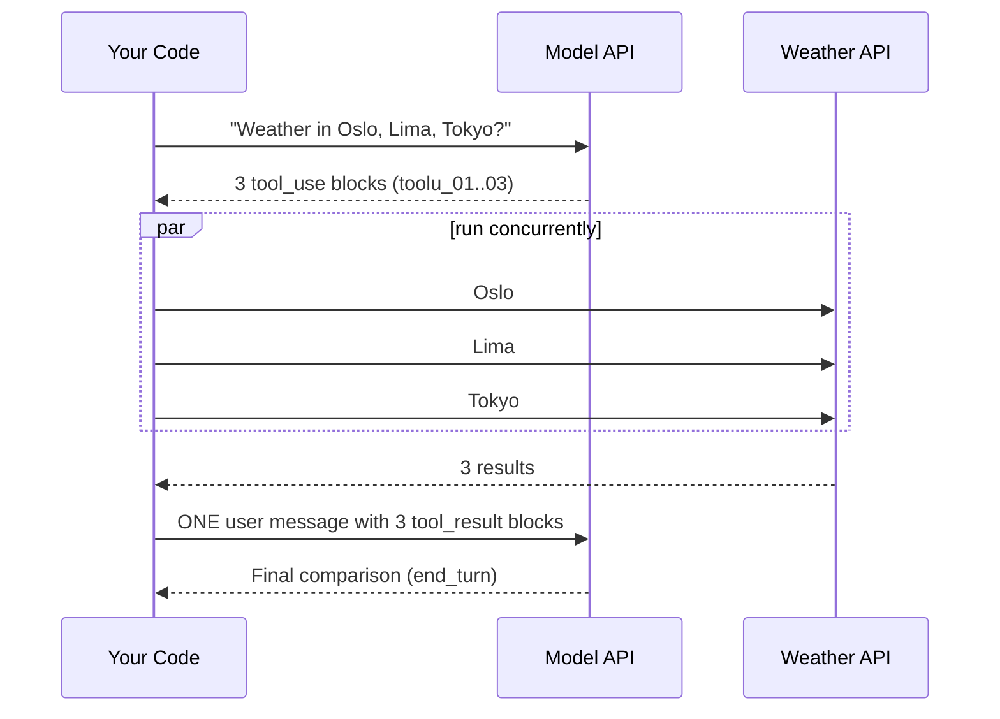

# Parallel Tool Calls

## Introduction

Ask an agent "What's the weather in Oslo, Lima, and Tokyo?" and a well-built agent will not make three separate round trips. The model can request **several tool calls in a single response**, one `tool_use` block per city. This is called **parallel tool use**, and it is on by default for Claude and most other modern models.

Parallel tool use matters for two reasons:

- **Fewer model round trips.** Three calls in one turn means one extra model request instead of three. That saves latency and tokens.
- **Concurrent execution.** Your code can run independent calls at the same time. Three one-second API calls finish in about one second instead of three.

But parallel calls also introduce responsibilities. You must return **every** result, in **one** message, matched by ID, and you must decide which calls are actually safe to run concurrently.

## What a Parallel Response Looks Like

```json
{
  "stop_reason": "tool_use",
  "content": [
    { "type": "text", "text": "I'll check all three cities at once." },
    { "type": "tool_use", "id": "toolu_01", "name": "get_weather", "input": { "city": "Oslo" } },
    { "type": "tool_use", "id": "toolu_02", "name": "get_weather", "input": { "city": "Lima" } },
    { "type": "tool_use", "id": "toolu_03", "name": "get_weather", "input": { "city": "Tokyo" } }
  ]
}
```

And the correct reply is a single `user` message with three results:

```json
{
  "role": "user",
  "content": [
    { "type": "tool_result", "tool_use_id": "toolu_01", "content": "{\"temp_c\": 4}" },
    { "type": "tool_result", "tool_use_id": "toolu_02", "content": "{\"temp_c\": 19}" },
    { "type": "tool_result", "tool_use_id": "toolu_03", "content": "{\"temp_c\": 22}" }
  ]
}
```



## The Rules

1. **One `tool_result` per `tool_use`.** If the model asked for three calls, send back three results, even if some failed or were skipped.
2. **All results in one `user` message.** Never split them across messages.
3. **Match by `tool_use_id`.** The API pairs results to calls by ID, not by position, though keeping the original order makes logs easier to read.
4. **Results first.** If you add any text to that message, it must come after all `tool_result` blocks.
5. **Execution order is up to you.** The API does not care whether you ran the calls concurrently, sequentially, or in a mix.

:::warning Separate messages "teach" the model to stop parallelizing
Anthropic's troubleshooting guide lists one-message-per-result as the most common reason models stop making parallel calls. The conversation history shows the model that parallel calls are not handled well, so it falls back to one call per turn.
:::

If you choose **not** to run a call (for example, because an earlier call in the same batch failed and the later one depended on it), still return a result for it:

```json
{
  "type": "tool_result",
  "tool_use_id": "toolu_02",
  "is_error": true,
  "content": "Not executed: the preceding write_file call failed."
}
```

## Running Independent Calls Concurrently

The loop from [Building a Manual Agent Loop](./3-agents-manual-agent-loop.mdx) runs tool calls one after another. That is always correct, but slow when tools wait on the network. Here is a drop-in replacement that runs calls concurrently **only when every call in the batch is read-only**:

```python
import json
import time
from concurrent.futures import ThreadPoolExecutor

# Tools that only read data can safely run at the same time.
PARALLEL_SAFE = {"get_weather", "lookup_order", "get_inventory"}


def get_weather(city: str) -> dict:
    time.sleep(1.0)  # simulate a slow network call
    return {"city": city, "temp_c": 12}


def get_inventory(sku: str) -> dict:
    time.sleep(1.0)
    return {"sku": sku, "in_stock": 7}


TOOL_FUNCTIONS = {"get_weather": get_weather, "get_inventory": get_inventory}


def execute_tool(name: str, tool_input: dict) -> tuple[str, bool]:
    func = TOOL_FUNCTIONS.get(name)
    if func is None:
        return f"Error: unknown tool '{name}'.", True
    try:
        return json.dumps(func(**tool_input)), False
    except Exception as exc:
        return f"Error: {exc}", True


def run_tool_calls(tool_use_blocks: list) -> list[dict]:
    """Execute all tool_use blocks from one assistant turn; return tool_result blocks."""

    def run_one(block) -> dict:
        content, is_error = execute_tool(block.name, block.input)
        return {"type": "tool_result", "tool_use_id": block.id,
                "content": content, "is_error": is_error}

    all_safe = all(block.name in PARALLEL_SAFE for block in tool_use_blocks)
    if all_safe and len(tool_use_blocks) > 1:
        with ThreadPoolExecutor(max_workers=8) as pool:
            # pool.map keeps results in the same order as the requests
            return list(pool.map(run_one, tool_use_blocks))
    # Anything with side effects: run one at a time, in the order requested
    return [run_one(block) for block in tool_use_blocks]
```

A quick test with three one-second tools:

```python
import time
import types

Block = lambda id_, name, inp: types.SimpleNamespace(id=id_, name=name, input=inp)
blocks = [
    Block("toolu_01", "get_weather", {"city": "Oslo"}),
    Block("toolu_02", "get_weather", {"city": "Lima"}),
    Block("toolu_03", "get_inventory", {"sku": "TENT-2P"}),
]
start = time.perf_counter()
results = run_tool_calls(blocks)
print(f"{len(results)} results in {time.perf_counter() - start:.1f}s")
for r in results:
    print(r["tool_use_id"], r["content"])
```

Output:

```text
3 results in 1.0s
toolu_01 {"city": "Oslo", "temp_c": 12}
toolu_02 {"city": "Lima", "temp_c": 12}
toolu_03 {"sku": "TENT-2P", "in_stock": 7}
```

Sequentially, the same batch would take about three seconds. In the agent loop, replace the inner `for block in response.content` section with:

```python
tool_use_blocks = [b for b in response.content if b.type == "tool_use"]
messages.append({"role": "user", "content": run_tool_calls(tool_use_blocks)})
```

### Async Version

If your tools are already `async` (for example, they use `httpx.AsyncClient`), `asyncio.gather` is the natural fit. A per-call timeout keeps one slow tool from blocking the whole turn.

```python
import asyncio
import json


async def get_weather(city: str) -> dict:
    await asyncio.sleep(1.0)  # e.g. an httpx.AsyncClient call
    return {"city": city, "temp_c": 12}


ASYNC_TOOLS = {"get_weather": get_weather}


async def run_one(block) -> dict:
    try:
        result = await asyncio.wait_for(ASYNC_TOOLS[block.name](**block.input), timeout=10)
        return {"type": "tool_result", "tool_use_id": block.id, "content": json.dumps(result)}
    except Exception as exc:  # includes TimeoutError and unknown tool names
        return {"type": "tool_result", "tool_use_id": block.id,
                "content": f"Error: {type(exc).__name__}: {exc}", "is_error": True}


async def run_tool_calls_async(tool_use_blocks: list) -> list[dict]:
    # gather() returns results in the same order as the input
    return await asyncio.gather(*(run_one(block) for block in tool_use_blocks))
```

Use `AsyncAnthropic` for the model calls in the same program, so the whole agent is non-blocking.

## Which Calls Are Safe to Run in Parallel?

| Tool behavior | Parallel-safe? | Example |
| --- | --- | --- |
| Pure read, independent data | Yes | `get_weather`, `search_docs`, `lookup_order` |
| Read that depends on another call's output | No (the model should not batch these, but it can happen) | `get_user` then `get_orders(user_id)` |
| Writes to different resources | Usually, if the backend handles concurrency | Creating two unrelated tickets |
| Writes to the same resource | No | Two edits to the same file |
| Ordered side effects | No | `git add` then `git commit` |
| Rate-limited external API | Limit concurrency | Use a semaphore or small pool |

This is one reason Anthropic suggests promoting important actions to **dedicated tools** instead of routing everything through a generic shell: a harness can mark `grep` as parallel-safe, but it cannot tell a safe `bash` command from an unsafe one. See [Tool Design Principles](./7-agents-tool-design-principles.mdx).

If the model batches calls that depend on each other, return the natural error for the one that failed (for example, "user_id not found") and the model will reissue it on the next turn. You can reduce this by adding to your system prompt: "Only batch tool calls that are independent of each other."

## Encouraging More Parallel Calls

Current models make parallel calls readily, but you can push further with a system prompt instruction. Anthropic's documentation suggests a block like this:

```text
<use_parallel_tool_calls>
For maximum efficiency, whenever you perform multiple independent operations,
invoke all relevant tools simultaneously rather than sequentially. Prioritize
calling tools in parallel whenever possible. For example, when reading 3 files,
run 3 tool calls in parallel to read all 3 files into context at the same time.
When running multiple read-only commands like `ls` or `list_dir`, always run all
of the commands in parallel. Err on the side of maximizing parallel tool calls
rather than running too many tools sequentially.
</use_parallel_tool_calls>
```

To check that it is working, measure the average number of `tool_use` blocks per assistant turn that contains tools. If it stays at 1.0 for tasks that clearly involve independent lookups, check your message formatting first, then your prompt.

```python
def parallelism_stats(messages: list) -> dict:
    """Summarize how many tool calls the model made per tool-using turn."""
    calls_per_turn = []
    for message in messages:
        if message["role"] != "assistant" or isinstance(message["content"], str):
            continue
        count = sum(1 for block in message["content"] if block.type == "tool_use")
        if count:
            calls_per_turn.append(count)
    if not calls_per_turn:
        return {"tool_turns": 0, "avg_calls_per_turn": 0.0}
    return {
        "tool_turns": len(calls_per_turn),
        "avg_calls_per_turn": round(sum(calls_per_turn) / len(calls_per_turn), 2),
        "max_calls_in_one_turn": max(calls_per_turn),
    }
```

Example output after the three-city weather question:

```text
{'tool_turns': 1, 'avg_calls_per_turn': 3.0, 'max_calls_in_one_turn': 3}
```

## Partial Failures in a Batch

In a batch of five calls, two might fail. That is fine. Return three normal results and two results with `is_error: true`, all in the same message. The model sees exactly which calls succeeded and usually retries only the failed ones or explains the gap to the user. Do **not** abort the whole batch because one call failed, unless the calls were explicitly ordered and later ones depended on earlier ones. In that case, mark the skipped calls as "Not executed" errors as shown above. [Handling Tool Errors](./6-agents-tool-errors.mdx) covers how to word these messages.

## Disabling Parallel Tool Use

Sometimes you want the model to take **one step at a time**: when tools have strict ordering requirements, when you want a human to approve each action individually, or when your UI shows one action at a time. Set `disable_parallel_tool_use` inside `tool_choice`:

```python
from anthropic import Anthropic

client = Anthropic()

response = client.messages.create(
    model="claude-opus-5-5",
    max_tokens=16000,
    tools=TOOLS,
    tool_choice={"type": "auto", "disable_parallel_tool_use": True},
    messages=[{"role": "user", "content": "Rename config.yml to app.yml, then update the README."}],
)
tool_calls = [b for b in response.content if b.type == "tool_use"]
print(len(tool_calls))  # at most 1
```

With `auto`, this means **at most one** tool call per response; the model can still answer in plain text. It is a field inside `tool_choice`, not a top-level parameter.

## Parallel Calls with the Tool Runner

The SDK tool runner from [Using an SDK Tool Runner](./4-agents-tool-runner.mdx) already returns all results in a single message, so the formatting rules are handled for you. By default it runs the calls from one turn one after another in your process. If your tools are slow and independent, you can either make each tool fast (cache, batch at the backend) or write the loop yourself with the concurrent executor shown above.

## Real-World Scenario

A travel company's planning assistant answers questions like "Compare flights from Boston to Lisbon, Madrid, and Rome next weekend, and check hotel availability in each." Each flight and hotel search takes one to three seconds against partner APIs. In early testing, answers took over 20 seconds because the agent searched one city per turn and the loop ran searches sequentially.

### The Solution

1. Fix message formatting so all results go back in one `user` message (the old code appended one message per result).
2. Add the parallel-tool-calls block to the system prompt.
3. Mark `search_flights` and `search_hotels` as parallel-safe and run them with a thread pool of 6 workers, matching the partner APIs' rate limits.
4. Keep `book_flight` and `book_hotel` sequential and outside the parallel-safe set.

The model now requests six searches in one turn, the harness runs them concurrently, and the answer arrives in two model round trips.

### Why This Approach

The searches are independent, read-only, and network-bound, which is exactly where concurrency pays off. Bookings have side effects and payment implications, so they stay sequential and individually auditable.

### When to Use It and When Not To

Run calls concurrently when they are independent and I/O-bound. Do not parallelize CPU-heavy tools in Python threads (use processes or a job queue), writes to shared state, or anything where order matters. If you need a human to approve each action, consider disabling parallel tool use so approvals arrive one at a time.

### Alternatives and Trade-offs

| Approach | Pros | Cons | Best for |
| --- | --- | --- | --- |
| Sequential execution of a parallel batch | Simple; always correct | Slow for network-bound tools | Side-effecting tools, prototypes |
| Thread pool for read-only batches | Big latency win; minimal code change | Need to classify tools; watch rate limits | Sync code with I/O-bound tools |
| `asyncio.gather` | Efficient; natural timeouts | Requires async tools and client | Async services |
| `disable_parallel_tool_use` | One action per turn; easy approvals | More round trips, more latency | Ordered or approval-heavy workflows |
| Programmatic tool calling | Model writes code to call many tools; results stay out of context | Server-side code execution required | Fan-out over many items; see [Working with Large Toolsets](./10-agents-large-toolsets.mdx) |

## Common Mistakes

- **One `user` message per tool result.** Breaks the structure and discourages future parallel calls.
- **Dropping a result.** Every `tool_use` needs a `tool_result`, even if you skipped it.
- **Running writes concurrently.** Two edits to the same record can race. Keep side effects sequential.
- **Unlimited concurrency.** Fifty parallel requests can trip a partner API's rate limit. Cap your pool size.
- **No per-call timeout.** One hung call blocks the whole turn. Use timeouts and return an error result when they fire.
- **Assuming result order matters to the API.** It matches by `tool_use_id`; keep order for readability, not correctness.

## Summary

- Models can request several tool calls in one turn; this is on by default.
- Return one `tool_result` per call, all in one `user` message, matched by `tool_use_id`.
- Execution strategy is your choice: run independent, read-only calls concurrently; keep side effects sequential.
- A system prompt instruction can increase parallel calls; formatting mistakes decrease them.
- `tool_choice` with `disable_parallel_tool_use: true` limits the model to one call per turn.
- Cap concurrency and add per-call timeouts so parallel execution does not overload partner APIs or stall a turn.

## Exercises

1. Add timing to the support agent and compare sequential and concurrent execution for "What's the weather in Denver, Seattle, and Boston?"
2. Extend `run_tool_calls` so that a batch with mixed tools runs the read-only ones concurrently and the rest sequentially afterward.
3. Add an `asyncio.Semaphore` to the async version so that at most three calls run at once, and verify it with a test of ten calls.

**Next:** [Handling Tool Errors](./6-agents-tool-errors.mdx) covers what to send back when a call fails, so the model can recover instead of giving up.
