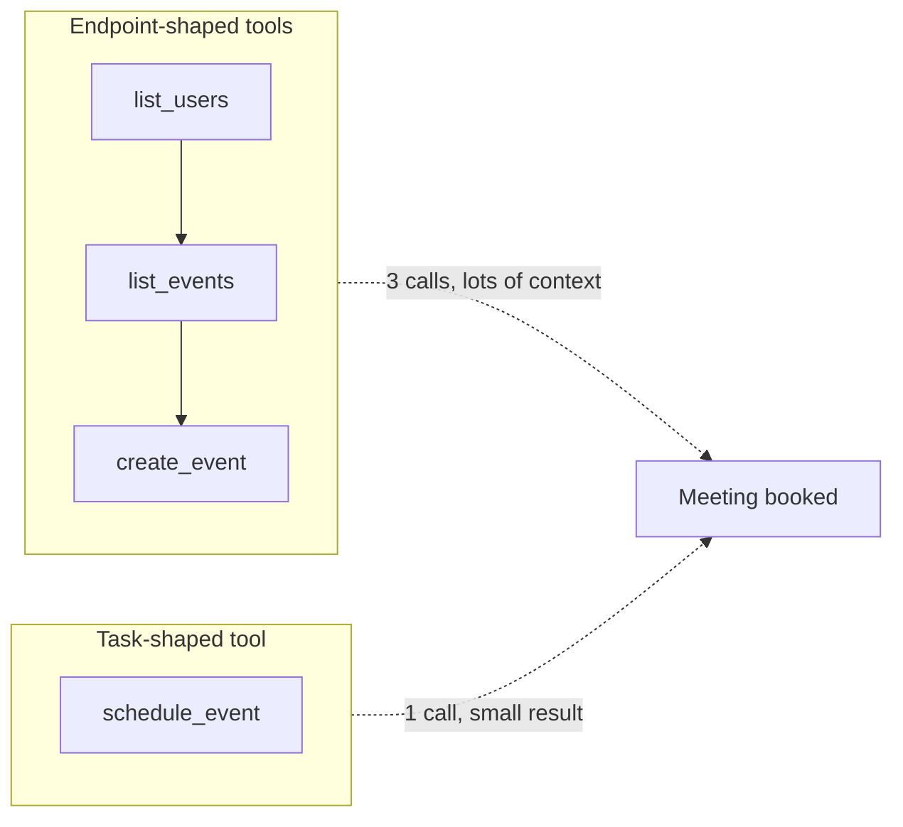
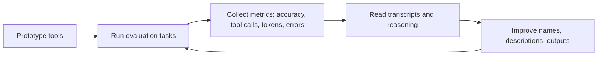

# Tool Design Principles

## Introduction

Most developers' first instinct when building an agent is to wrap their existing API: one tool per endpoint, return whatever the endpoint returns. It works in a demo. In production, the agent burns through its context window on huge JSON payloads, picks the wrong one of three similar tools, chains five calls where one would do, and passes UUIDs around until it mixes two of them up.

The problem is that APIs are designed for **programs**, which have unlimited memory, read every field, and never get confused. Agents are different. They have a limited context window, read everything you return (and pay for it in tokens), and make decisions based on natural-language descriptions.

Anthropic's engineering post [Writing effective tools for agents](https://www.anthropic.com/engineering/writing-tools-for-agents) describes tools as **a contract between deterministic systems and non-deterministic agents**, and recommends designing them for how agents actually perceive and use them. This page turns that guidance into concrete principles with examples.

## The Principles at a Glance

| Principle | In one sentence |
| --- | --- |
| 1. Choose the right tools | Build fewer, task-shaped tools instead of wrapping every endpoint. |
| 2. Namespace clearly | Prefix related tools by service or resource so selection is unambiguous. |
| 3. Return meaningful context | Return the fields the agent needs, in human-readable form. |
| 4. Be token-efficient | Paginate, filter, and truncate with sensible defaults and helpful hints. |
| 5. Prompt-engineer descriptions | Write tool descriptions like onboarding docs for a new teammate. |
| 6. Iterate with evaluations | Measure real tasks, read transcripts, and improve the tools. |

## Principle 1: Choose the Right Tools

More tools do not mean better agents. Each tool adds tokens to every request and another option the model must choose between. Anthropic's advice is to build a few thoughtful tools that target **high-impact workflows**, and to consolidate multi-step operations into single tools when an agent would otherwise chain them.

### Targeted beats generic

A `list_contacts` tool that returns every contact forces the agent to read thousands of records to find one person. A person would never do that; they would search. Give the agent the same affordance:

| Instead of | Build |
| --- | --- |
| `list_contacts` | `search_contacts` (or `message_contact`) |
| `list_users`, `list_events`, `create_event` | `schedule_event` that finds availability and books it |
| `read_logs` | `search_logs` that returns only matching lines plus surrounding context |
| `get_customer`, `get_transactions`, `get_notes` | `get_customer_context` that compiles the relevant recent information |



Consolidation reduces round trips, keeps intermediate data out of the context window, and removes chances for the agent to make a mistake between steps.

### Keep purposes distinct

If two tools could plausibly answer the same request, the agent will sometimes pick the wrong one. Merge them, or make the boundary explicit in both descriptions ("For past orders use `orders_search`; this tool only covers open carts").

### Bash or dedicated tools?

A shell tool can do almost anything, which makes it a great **breadth** tool. But to your harness every shell call looks the same: an opaque command string. Anthropic's agent-design guidance suggests starting with bash for breadth and **promoting an action to a dedicated tool** when you need to:

- **Gate it**: a `send_email` tool is easy to put behind approval; `curl -X POST ...` is not.
- **Enforce invariants**: a dedicated `edit_file` tool can refuse to write if the file changed since the agent read it.
- **Render it**: a dedicated `ask_user` tool can appear as a dialog in your UI.
- **Parallelize it**: a read-only `grep` tool can be marked parallel-safe; arbitrary shell commands cannot.

See [Bash and File Editing Tools](./9-agents-bash-and-file-tools.mdx) for the shell side of this trade-off.

## Principle 2: Namespace Clearly

When an agent has tools from several services, prefix names by service and resource: `asana_search`, `asana_projects_search`, `jira_issues_search`. Namespacing:

- Makes the right tool obvious when two services have similar operations.
- Helps tool search find a whole group of tools with one query (see [Working with Large Toolsets](./10-agents-large-toolsets.mdx)).
- Makes logs and metrics easier to group.

Anthropic notes that prefix-based and suffix-based naming can have measurably different effects depending on the model, so pick a scheme and validate it with your own evaluations.

## Principle 3: Return Meaningful Context

Return **high-signal** information and leave out low-level technical identifiers the agent does not need.

- Prefer `name`, `title`, `status`, `file_type` over `uuid`, `mime_type`, `256px_image_url`.
- Natural-language identifiers work better than cryptic ones. Anthropic reports that resolving arbitrary alphanumeric UUIDs into more semantically meaningful language (or even a simple 0-indexed scheme) significantly improved precision and reduced hallucinations in retrieval tasks.
- When the agent **does** need an ID to chain calls (look up a user, then message them by ID), let it ask for one.

### The response_format pattern

A simple way to support both cases is a `response_format` parameter with `"concise"` and `"detailed"` options. In Anthropic's Slack example, a detailed response used 206 tokens while a concise one used 72, about a third.

Here is a well-designed CRM search tool that applies Principles 1, 3, and 4:

```python
import json
from typing import Literal

from anthropic import beta_tool

# Imagine 50,000 contacts in a CRM. Each raw record has ~30 fields.
CONTACTS = [
    {"uuid": "9f1c2a7e-0b1d-4c55-9a43-1f6e2d8b7c10", "name": "Jane Park",
     "email": "jane.park@acme.example", "company": "Acme Corp", "title": "VP Engineering",
     "owner": "Sam Lee", "last_contacted": "2026-09-30", "mime_avatar": "image/png"},
    {"uuid": "4be0d7a1-63a2-4f0e-b2e1-7c9a0d3f5e21", "name": "Janet Ortiz",
     "email": "janet@globex.example", "company": "Globex", "title": "Procurement Lead",
     "owner": "Ana Ruiz", "last_contacted": "2026-08-12", "mime_avatar": "image/jpeg"},
]

MAX_RESULTS = 20


@beta_tool
def crm_search_contacts(
    query: str,
    company: str | None = None,
    limit: int = 5,
    response_format: Literal["concise", "detailed"] = "concise",
) -> str:
    """Search CRM contacts by name or email fragment.

    Use this to find a specific person before emailing, scheduling, or logging
    activity. Prefer narrow queries (full name, or name plus company). Returns
    at most 20 matches. Use response_format='concise' (default) to find the right
    person, and 'detailed' only when you need the contact_id for another tool.

    Args:
        query: Name or email fragment, e.g. 'jane park' or '@acme'.
        company: Optional company name to narrow results, e.g. 'Acme Corp'.
        limit: Number of results to return, 1 to 20. Defaults to 5.
        response_format: 'concise' for name/company/title, 'detailed' to also get
            contact_id, email, owner, and last_contacted.
    """
    q = query.lower()
    matches = [c for c in CONTACTS
               if q in c["name"].lower() or q in c["email"].lower()]
    if company:
        matches = [c for c in matches if c["company"].lower() == company.lower()]

    if not matches:
        return (f"No contacts match '{query}'. Try a shorter fragment (last name only) "
                "or remove the company filter.")

    limit = max(1, min(limit, MAX_RESULTS))
    shown = matches[:limit]
    if response_format == "concise":
        rows = [{"name": c["name"], "company": c["company"], "title": c["title"]} for c in shown]
    else:
        rows = [{"contact_id": c["uuid"], "name": c["name"], "email": c["email"],
                 "company": c["company"], "title": c["title"], "owner": c["owner"],
                 "last_contacted": c["last_contacted"]} for c in shown]

    result = {"results": rows}
    if len(matches) > len(shown):
        result["note"] = (f"Showing {len(shown)} of {len(matches)} matches. "
                          "Add the company filter or a fuller name to narrow results.")
    return json.dumps(result)
```

Trying it with a vague query, a precise one, and a miss:

```python
print(crm_search_contacts.call({"query": "jan", "limit": 1}))
print(crm_search_contacts.call({"query": "jane park", "response_format": "detailed"}))
print(crm_search_contacts.call({"query": "zed"}))
```

Output:

```text
{"results": [{"name": "Jane Park", "company": "Acme Corp", "title": "VP Engineering"}], "note": "Showing 1 of 2 matches. Add the company filter or a fuller name to narrow results."}
{"results": [{"contact_id": "9f1c2a7e-0b1d-4c55-9a43-1f6e2d8b7c10", "name": "Jane Park", "email": "jane.park@acme.example", "company": "Acme Corp", "title": "VP Engineering", "owner": "Sam Lee", "last_contacted": "2026-09-30"}]}
No contacts match 'zed'. Try a shorter fragment (last name only) or remove the company filter.
```

Notice the details:

- The default is **concise**: name, company, title. Enough to identify the person.
- Internal fields such as `mime_avatar` are never returned.
- The UUID appears only in detailed mode, labeled clearly as `contact_id`.
- Truncation is **announced** with a note that tells the agent how to narrow the search.
- An empty result explains how to try again.

## Principle 4: Be Token-Efficient

Everything a tool returns goes into the context window and is paid for on every later turn of the conversation. For any tool that could return a lot of data:

- **Paginate** with a cursor or page number.
- **Filter** with parameters (status, date range, owner).
- **Select ranges** (lines 100 to 200 of a file, the last 50 log lines).
- **Truncate** with a sensible default limit.

When you truncate, **say so and say how to get more**. Anthropic mentions that Claude Code limits tool responses to 25,000 tokens by default, and suggests steering agents toward many small, targeted searches instead of one broad one.

```python
def truncate_for_agent(text: str, max_chars: int = 8000) -> str:
    """Cap tool output and tell the agent how to see the rest."""
    if len(text) <= max_chars:
        return text
    omitted = len(text) - max_chars
    return (
        text[:max_chars]
        + f"\n\n[Output truncated: {omitted} more characters omitted. "
        "Use a narrower query, a filter, or the offset parameter to see more.]"
    )
```

Error messages are part of this too: an actionable error is cheaper than a stack trace and leads to a better next call. See [Handling Tool Errors](./6-agents-tool-errors.mdx).

## Principle 5: Prompt-Engineer Descriptions

Write tool descriptions the way you would explain the tool to a new teammate on their first day. Make implicit knowledge explicit:

- Specialized query formats ("Use Lucene syntax: `status:open AND owner:me`").
- Definitions of niche terms ("A 'workspace' is a team; a 'space' is a folder inside it").
- Relationships between tools ("Call `crm_search_contacts` first to get a `contact_id`").
- Unambiguous parameter names (`user_id`, not `user`).

Small changes here have outsized effects. Anthropic reports that precise refinements to tool descriptions helped Claude reach state-of-the-art results on the SWE-bench Verified coding benchmark, and gives the example of a web search tool where the model kept appending "2025" to queries until the description was fixed.

## Principle 6: Iterate with Evaluations

You cannot design great tools on paper. Anthropic's process is a loop: prototype quickly, test on realistic tasks, read the transcripts, and improve.



Practical tips from the post:

- **Use realistic tasks** that need several tool calls, not trivial ones. "Schedule a meeting with Jane next week to discuss the Acme project, attach the planning notes, and book a room" is a far better test than "Schedule a meeting with jane@acme.example".
- **Pair each task with a verifiable outcome**, checked by code or an LLM judge, without being so strict that correct answers with different formatting fail.
- **Track more than accuracy**: number of tool calls, total tokens, runtime, and tool errors. Many redundant calls suggest you need pagination or better filters; many invalid-parameter errors suggest unclear descriptions.
- **Read what the agent says and what it leaves out.** Transcripts reveal confusion that metrics hide.
- **Use agents to help.** Paste transcripts into a coding agent and ask it to refine descriptions and implementations, then confirm the gains on held-out tasks.

A minimal metrics loop around the agent from [Building a Manual Agent Loop](./3-agents-manual-agent-loop.mdx) might look like this:

```python
from dataclasses import dataclass
from typing import Callable


@dataclass
class EvalTask:
    prompt: str
    check: Callable[[str], bool]  # takes the final answer, returns True if correct


def evaluate(tasks: list[EvalTask], run) -> dict:
    """run(prompt) must return (answer, stats) where stats has tool_calls, errors, tokens."""
    passed, tool_calls, errors, tokens = 0, 0, 0, 0
    for task in tasks:
        answer, stats = run(task.prompt)
        passed += task.check(answer)
        tool_calls += stats["tool_calls"]
        errors += stats["errors"]
        tokens += stats["tokens"]
    n = len(tasks)
    return {
        "accuracy": passed / n,
        "avg_tool_calls": tool_calls / n,
        "avg_tool_errors": errors / n,
        "avg_tokens": tokens / n,
    }
```

The section [Agent Evaluation Introduction](../11-agents-evaluation-and-testing/0-agents-evaluation-introduction.mdx) goes much deeper into datasets, graders, and trajectory evaluation.

## A Tool Design Checklist

Before shipping a tool, run through these questions:

| Question | Good sign |
| --- | --- |
| Does it match a task a user would describe in one sentence? | "Find a contact", "Book a meeting", not "GET /v2/objects" |
| Could another tool answer the same request? | No, or the boundary is written in both descriptions |
| Does the name say what it does, with a namespace? | `crm_search_contacts` |
| Does the description say when to call it and what it does not do? | Trigger conditions and caveats are present |
| Are parameter names unambiguous, with formats and examples? | `start_utc` with an ISO 8601 example |
| Is the default output small and human-readable? | Concise mode by default; IDs on request |
| Is large output paginated or truncated with a hint? | "Showing 20 of 4,812; add a filter" |
| Are errors actionable and free of internals? | Names the field, gives the fix, says whether to retry |
| Is it safe to run twice, or is it gated? | Idempotent, or behind approval |
| Is it covered by at least one realistic evaluation task? | Yes, with a verifiable outcome |

If you answer "no" to several of these, the tool is probably endpoint-shaped rather than agent-shaped.

## Real-World Scenario

A B2B SaaS company builds a sales-assistant agent on top of its CRM. Version 1 exposes 14 tools generated from the REST API: `list_contacts`, `get_contact`, `list_deals`, `get_deal`, `list_activities`, `create_activity`, and so on. Evaluation runs show mediocre task success, long chains of tool calls for simple questions, and context overflows on accounts with many contacts.

### The Solution

1. **Consolidate.** Replace the list/get pairs with `crm_search_contacts`, `crm_search_deals`, and `crm_get_account_context` (which compiles an account's open deals, last five activities, and key contacts into one summary).
2. **Namespace.** Prefix every tool with `crm_`.
3. **Shape responses.** Default to concise output with readable names; add `response_format="detailed"` for IDs.
4. **Cap and explain.** Limit search results to 20 with a "showing X of Y" note.
5. **Rewrite descriptions** with trigger conditions and relationships between tools.
6. **Re-run the same evaluation suite** and compare accuracy, tool calls, and tokens.

The team then iterates on the remaining failures by reading transcripts, rather than guessing.

### Why This Approach

The agent's bottleneck was not intelligence; it was a tool surface designed for a different kind of client. Task-shaped tools match the questions salespeople actually ask, and concise responses keep the context window for reasoning instead of raw JSON.

### When to Use It and When Not To

Apply these principles to any tool that an agent will call repeatedly in production. For a quick internal prototype, wrapping endpoints directly is a fine way to learn what users ask for; just plan to redesign once you have transcripts. Do not over-consolidate: a single `do_everything` tool with 20 optional parameters is as hard for an agent as 20 tiny tools.

### Alternatives and Trade-offs

| Approach | Pros | Cons | Best for |
| --- | --- | --- | --- |
| One tool per API endpoint | Fast to generate; mirrors docs | Many calls, large outputs, selection confusion | Early prototypes |
| Task-shaped, consolidated tools | Fewer calls; smaller context; easier to gate | Design effort; backend work to compile data | Production agents |
| Generic shell or SQL tool | Maximum flexibility | Hard to secure, audit, or parallelize | Expert users in sandboxes |
| Programmatic tool calling | Agent composes many calls in code; intermediate data stays out of context | Requires code execution; less transparent | Fan-out and large data processing |

## Common Mistakes

- **Mirroring your API one-to-one.** Agents need tools shaped like tasks, not like endpoints.
- **Returning everything.** Every unused field is wasted tokens on every later turn.
- **Silent truncation.** If you cut results, say how many were omitted and how to narrow the query.
- **Opaque identifiers everywhere.** Use names by default; return IDs when they are needed to chain calls.
- **Overlapping tools.** If two tools can answer the same question, merge them or clarify the boundary.
- **Designing without evaluation.** You will not know which description works best until you test it on real tasks.

## Summary

- Design tools for agents, not for programs: limited context, natural-language selection, token costs.
- Build a few task-shaped tools that consolidate common workflows.
- Namespace tools by service or resource.
- Return high-signal, human-readable fields; offer a detailed mode for IDs.
- Paginate, filter, and truncate with clear hints; write actionable errors.
- Treat descriptions as onboarding documentation.
- Improve tools with an evaluation loop: realistic tasks, metrics, and transcript review.

## Exercises

1. Take three endpoints from an API you know (for example GitHub's issues API) and design one or two task-shaped tools to replace them. Write full descriptions.
2. Add a `cursor` parameter to `crm_search_contacts` for pagination and update the truncation note to mention it.
3. Build five realistic evaluation tasks for the support agent from earlier pages, including at least two that need multiple tool calls. Record accuracy and tool calls per task before and after rewriting one tool description.

**Next:** [Server-Side Tools: Web Search and Code Execution](./8-agents-server-tools.mdx) covers tools the API provider runs for you.
