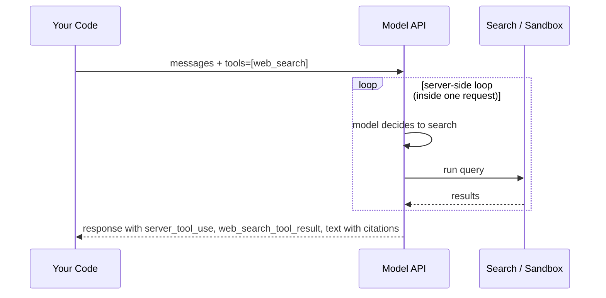

# Server-Side Tools: Web Search and Code Execution

## Introduction

So far, every tool in this section ran in **your** code. The model asked for a call, you executed it, and you sent back a `tool_result`. That is a **client tool**.

Some capabilities are so common that the API provider runs them for you. These are **server tools** (also called built-in or hosted tools). You declare them in the `tools` list by `type`, and the provider executes them on its own infrastructure, inside the same API request. There is no function to write and no `tool_result` to send.

The most useful server tools for agents are:

| Tool | Type string (Anthropic, at the time of writing) | What it does |
| --- | --- | --- |
| Web search | `web_search_20260209` | Searches the web and returns results with citations |
| Web fetch | `web_fetch_20260209` | Retrieves the content of a specific URL |
| Code execution | `code_execution_20260120` | Runs Python and shell commands in a sandboxed container |
| Tool search | `tool_search_tool_regex_20251119` / `..._bm25_...` | Finds relevant tools in a large catalog (see [Working with Large Toolsets](./10-agents-large-toolsets.mdx)) |

Tool type strings are **date-versioned**. New versions appear over time (for example, there is already a newer `web_search_20260318` that adds a response-inclusion option), and older versions keep working. Check the official tool reference for the current list.

Other providers offer similar hosted tools: OpenAI's Responses API includes web search, file search, and a code interpreter; Google Gemini offers grounding with Google Search and code execution. The concepts on this page carry over, but the type names and response shapes differ.

## How Server Tools Work



Compared with client tools:

| | Client tools | Server tools |
| --- | --- | --- |
| Who executes | Your application | The API provider |
| Response block for the call | `tool_use` (id starts with `toolu_`) | `server_tool_use` (id starts with `srvtoolu_`) |
| Who produces the result | You, in a `tool_result` | The API, in a block such as `web_search_tool_result` |
| `stop_reason` when the model calls it | `tool_use` | Usually `end_turn` (the loop ran server-side) or `pause_turn` |
| Billing | Tokens only | Tokens plus a per-use or per-time fee for some tools |

## Web Search

Add the tool to `tools` and ask a question that needs current information:

```python
from anthropic import Anthropic

client = Anthropic()

MODEL = "claude-opus-5-5"
MAX_CONTINUATIONS = 5

WEB_TOOLS = [
    {
        "type": "web_search_20260209",
        "name": "web_search",
        "max_uses": 5,  # hard cap on searches per request
        "allowed_domains": ["python.org", "docs.python.org", "peps.python.org"],
    },
    {"type": "web_fetch_20260209", "name": "web_fetch", "max_uses": 3},
]


def ask_with_server_tools(question: str, tools: list) -> object:
    """Run one request that uses server tools, resuming if the server pauses."""
    messages = [{"role": "user", "content": question}]
    for _ in range(MAX_CONTINUATIONS + 1):
        response = client.messages.create(
            model=MODEL,
            max_tokens=16000,
            tools=tools,  # keep the same tools on every continuation
            messages=messages,
        )
        if response.stop_reason != "pause_turn":
            return response
        # Send the paused turn back unchanged; the server resumes where it stopped.
        messages.append({"role": "assistant", "content": response.content})
    raise RuntimeError("Turn still paused after MAX_CONTINUATIONS continuations.")


def print_answer_with_sources(response) -> None:
    sources = {}
    for block in response.content:
        if block.type == "server_tool_use":
            print(f"[{block.name}] {block.input}")
        elif block.type == "text":
            print(block.text, end="")
            for citation in block.citations or []:
                if citation.type == "web_search_result_location":
                    sources[citation.url] = citation.title
    print("\n\nSources:")
    for url, title in sources.items():
        print(f"- {title}: {url}")
    print("Searches used:", response.usage.server_tool_use.web_search_requests
          if response.usage.server_tool_use else 0)


if __name__ == "__main__":
    answer = ask_with_server_tools(
        "What changed about the GIL in the latest Python release? Cite sources.", WEB_TOOLS
    )
    print_answer_with_sources(answer)
```

Example output:

```text
[web_search] {'query': 'latest Python release GIL free-threading changes'}
[web_fetch] {'url': 'https://docs.python.org/3/whatsnew/'}
The most recent release continues the work on the optional free-threaded build ...

Sources:
- What's New in Python: https://docs.python.org/3/whatsnew/
- (other python.org pages the model cited)
Searches used: 1
```

(The exact content depends on what is published when you run it.)

### Useful Web Search Options

| Option | Purpose |
| --- | --- |
| `max_uses` | Hard cap on searches in one request. Exceeding it returns a `max_uses_exceeded` error inside the result block. |
| `allowed_domains` | Only search these domains (no `https://` prefix). Subdomains are included. |
| `blocked_domains` | Never use these domains. You cannot combine it with `allowed_domains`. |
| `user_location` | Approximate location (`city`, `region`, `country`, `timezone`) to localize results. |

### Reading the Response

A web search response interleaves several block types:

- `text`: the model's prose, possibly with a `citations` list on each text block.
- `server_tool_use`: what the model searched for (`input.query`) or fetched (`input.url`).
- `web_search_tool_result`: the results, each with `url`, `title`, `page_age`, and an `encrypted_content` field.

When you continue the conversation, pass the assistant content back **exactly as you received it**. The API needs the `encrypted_content` and `encrypted_index` fields to restore the search results on later turns; if you strip or modify them, the request fails.

:::note Displaying results
Anthropic's terms require that when you show web-search-based output to end users, you include the citations to the original sources. Keep the citation list visible in your UI.
:::

### Dynamic Filtering

With the `_20260209` and later versions of web search and web fetch, Claude can write and run code that **filters search results before they enter the context window**. For example, it can pull just the relevant table from a long page. This is automatic: you do not need to add the code execution tool yourself. It keeps token usage down on search-heavy tasks.

Dynamic filtering uses code execution internally, so these versions are not eligible for Zero Data Retention by default. If you need that, set `"allowed_callers": ["direct"]` on the tool to disable dynamic filtering, or use the older `web_search_20250305` version.

## Web Fetch

Web search finds pages; **web fetch** reads a specific page (or PDF) the user or the search results point to. It is useful when the user pastes a link ("Summarize https://example.com/changelog") or when the model wants the full text of a search hit.

```python
response = client.messages.create(
    model="claude-opus-5-5",
    max_tokens=16000,
    tools=[{"type": "web_fetch_20260209", "name": "web_fetch", "max_uses": 3}],
    messages=[{
        "role": "user",
        "content": "Summarize the breaking changes listed at https://example.com/changelog",
    }],
)
for block in response.content:
    if block.type == "server_tool_use":
        print("fetched:", block.input.get("url"))
    elif block.type == "text":
        print(block.text, end="")
```

A few points to keep in mind:

- Web fetch also accepts `allowed_domains` and `blocked_domains`. For fetch, entries match on the domain only, not on paths.
- Fetched content becomes input tokens. Very long pages are expensive; dynamic filtering helps here too.
- A fetch can fail (page not found, blocked domain, too large). The error arrives inside the result block, and the model usually explains it or tries another source. Unlike client tools, you do not set `is_error` yourself.

### Web Search or Web Fetch?

| Situation | Use |
| --- | --- |
| The user asks an open question about current events or facts | Web search (plus fetch for depth) |
| The user provides a URL | Web fetch only |
| You want answers from a fixed set of sites | Web search with `allowed_domains` |
| You need the complete text of one document | Web fetch |

## Handling pause_turn

Server tools run in a **server-side loop** inside your single request. If that loop runs long (many searches, a long code run), the API may stop early and return `stop_reason: "pause_turn"`. The `ask_with_server_tools` helper above handles this:

1. Append the paused assistant content to `messages`, unchanged.
2. Send the request again with the **same tools**.
3. Do **not** add a "please continue" user message. The API sees the unfinished turn and resumes it.
4. Cap the number of continuations, as you would any retry loop.

If you use server tools inside the agent loop from [Building a Manual Agent Loop](./3-agents-manual-agent-loop.mdx), its `pause_turn` branch already does steps 1 and 2.

## Mixing Server and Client Tools

You can offer both kinds in one request, for example web search plus your own `lookup_order`. If the model calls a client tool and a server tool in the same turn, the API **does not run the server tool yet**. It returns `stop_reason: "tool_use"` with a `server_tool_use` block that has no result. You then:

- Run your client tools as usual.
- Reply with a `user` message that contains **only** `tool_result` blocks (no extra text).
- Send the same `tools` list.

The API attaches your results, runs the pending server tool, and continues. Your normal agent loop already does this correctly, as long as it never adds text to a tool-results message and never answers a `srvtoolu_` ID with a `tool_result`.

## Code Execution

The code execution tool gives the model a sandboxed Linux container where it can run Python and shell commands, create files, and analyze data.

```python
from anthropic import Anthropic

client = Anthropic()

response = client.messages.create(
    model="claude-opus-5-5",
    max_tokens=16000,
    tools=[{"type": "code_execution_20260120", "name": "code_execution"}],
    messages=[{
        "role": "user",
        "content": "Calculate the mean and standard deviation of "
                   "[12, 15, 9, 21, 18, 14, 11, 16]. Show the code you ran.",
    }],
)

for block in response.content:
    if block.type == "text":
        print(block.text)
    elif block.type == "server_tool_use":
        print(f"[running {block.name}]")
    elif block.type == "bash_code_execution_tool_result":
        result = block.content
        if result.type == "bash_code_execution_result":
            print("stdout:", result.stdout.strip())
```

Example output:

```text
I'll compute these with Python.
[running bash_code_execution]
stdout: mean=14.5 std=3.89
The mean is 14.5 and the sample standard deviation is about 3.89.
```

Key facts (check the official docs, as limits change):

- The container is **isolated with no internet access**.
- Python comes with common data libraries preinstalled (pandas, numpy, matplotlib, scikit-learn, and others).
- The model gets two sub-tools automatically: one for shell commands and one for creating and editing files.
- **Containers can be reused.** The response includes `response.container.id`; pass `container=<that id>` on the next request to keep files and installed packages.
- You can upload files for analysis with the Files API and reference them with a `container_upload` content block, and download files the model creates.

### Analyzing an Uploaded File

```python
uploaded = client.beta.files.upload(file=open("sales_q3.csv", "rb"))

response = client.messages.create(
    model="claude-opus-5-5",
    max_tokens=16000,
    tools=[{"type": "code_execution_20260120", "name": "code_execution"}],
    messages=[{
        "role": "user",
        "content": [
            {"type": "text", "text": "Which region grew fastest month over month? Show a table."},
            {"type": "container_upload", "file_id": uploaded.id},
        ],
    }],
)
container_id = response.container.id  # reuse for follow-up questions
```

When saving files the model produced, always sanitize the filename (for example with `os.path.basename`) before writing to disk, so a crafted name cannot write outside your output folder.

## Costs

Server tools add costs on top of tokens. At the time of writing, Anthropic lists web search at $10 per 1,000 searches, and code execution is billed by container time beyond a free monthly allowance (free when used only through the web tools' dynamic filtering). Search results also count as input tokens on later turns. Prices change, so check the [official pricing page](https://platform.claude.com/docs/en/about-claude/pricing) and use `max_uses` to cap spend. The `usage.server_tool_use` field on each response reports how many searches and fetches ran.

## Real-World Scenario

A product marketing team wants an assistant that answers "What are our three main competitors charging for their team plans this month?" and produces a comparison table with sources. The data changes often and lives on public pricing pages.

### The Solution

- Offer `web_search` with `max_uses: 8` and `web_fetch` with `max_uses: 6`.
- Restrict `allowed_domains` to the competitors' official sites, so the agent does not rely on outdated third-party blogs.
- Add `code_execution` only if the team also wants charts; otherwise dynamic filtering already handles extracting tables from pages.
- Handle `pause_turn` with a capped continuation loop.
- Render the citations under the table in the UI.
- Treat fetched page content as untrusted: the system prompt tells the model that instructions found on web pages are data, not commands.

### Why This Approach

The provider already runs search infrastructure, handles fetching and parsing, and returns citations. Building and maintaining your own scraper for this would cost far more than the per-search fee, and the server-side loop avoids a model round trip per search.

### When to Use It and When Not To

Use server tools when you need general web access or a throwaway sandbox and do not need fine control over the backend. Build your own client tool instead when you need a specific search provider, access to private or authenticated sources, strict data residency, custom caching, or deterministic results for testing. Note that server tools are not available on every platform (for example, some cloud marketplaces support only a subset), so check availability for your deployment.

### Alternatives and Trade-offs

| Approach | Pros | Cons | Best for |
| --- | --- | --- | --- |
| Server web search/fetch | No infrastructure; citations built in; dynamic filtering | Per-search fee; less control over sources | General research and current events |
| Your own search tool (e.g. a search API behind a client tool) | Full control; private sources; caching | You build and maintain it | Internal knowledge, regulated data |
| Server code execution | Instant sandbox; data libraries included | No internet in the sandbox; container-time billing | Data analysis, file generation |
| Your own sandbox (Docker, Firecracker) + bash tool | Full control over environment and network | Security and ops burden | Coding agents on your own repos |
| RAG over a curated index | Fast, cheap per query, predictable | Not live; needs ingestion pipeline | Stable document sets; see [RAG Introduction](../5-agents-rag/0-agents-rag-introduction.mdx) |

## Common Mistakes

- **Sending a `tool_result` for a `srvtoolu_` ID.** Server tool calls are answered by the API, not by you.
- **Dropping `encrypted_content` or citations** when you store and replay the conversation.
- **Adding "continue" after `pause_turn`.** Re-send the paused turn as-is.
- **Changing `tools` on a continuation request.** Keep the same tool list, or the paused server tool cannot resume.
- **No `max_uses` cap.** A broad research question can trigger many searches.
- **Including the standalone code execution tool alongside the `_20260209` web tools when you do not need it.** That creates a second execution environment that can confuse the model.
- **Trusting web content.** Pages can contain prompt injection attempts. See [Tool Security Basics](./11-agents-tool-security-basics.mdx).

## Summary

- Server tools are declared by `type` and executed by the provider within your request.
- Web search and web fetch provide live information with citations; dynamic filtering trims results before they reach the context window.
- Web fetch reads a specific URL; use domain filters and `max_uses` to keep it focused.
- Code execution provides a sandboxed container for running code and analyzing files.
- Server tool failures arrive inside their result blocks; the model handles them, and you never send `is_error` for them.
- Pass assistant content back unchanged on later turns, including encrypted fields and citations.
- Handle `pause_turn` by re-sending the paused turn with the same tools, with a continuation cap.
- When server and client tools are mixed in one turn, return only `tool_result` blocks for the client calls.
- Server tools cost extra; cap usage and check current pricing.

## Exercises

1. Run the web search example with and without `allowed_domains` and compare the sources cited.
2. Add `web_search` to the support agent from [Building a Manual Agent Loop](./3-agents-manual-agent-loop.mdx) so it can answer "Is there a carrier delay in Denver today?" Verify that your loop handles the mixed client/server turn.
3. Upload a small CSV to the code execution tool, ask for a chart, and download the resulting image file safely.

**Next:** [Bash and File Editing Tools](./9-agents-bash-and-file-tools.mdx) covers the opposite case: powerful tools that run on **your** machine.
