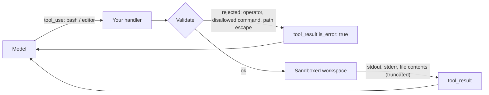

# Bash and File Editing Tools

## Introduction

Coding agents such as Claude Code, Cursor's agent mode, or OpenAI Codex can read files, edit code, and run tests. Under the hood, most of them rely on two very general tools:

- A **shell tool** that runs commands like `pytest`, `git status`, or `ls`.
- A **file editing tool** that views, creates, and edits text files.

Anthropic provides both as **Anthropic-schema client tools**. Their input schemas are built into the model (the model has been trained to use them well), but they are **client tools**: your application executes every command and file operation. That gives you full control, and full responsibility.

This page shows how to:

- Declare the bash and text editor tools
- Implement their handlers with real safety controls
- Build a small coding agent that finds and fixes a failing test
- Decide when to use a general shell versus dedicated tools

:::warning These tools run model-generated commands on your machine
Treat every command and path as **untrusted input**. Run these tools inside an isolated environment (a container or VM, as a low-privilege user, with no secrets and limited network). The code on this page adds useful guardrails, but guardrails in your handler are not a substitute for a sandbox. See [Sandboxing Agent Execution](../12-agents-safety-and-security/3-agents-sandboxing.mdx).
:::

## Declaring the Tools

These tools are declared by `type` and `name` only. **Do not** pass an `input_schema`, and do not create your own custom tool named `bash`; that would be an ordinary user-defined tool without the trained behavior.

```python
TOOLS = [
    {"type": "bash_20250124", "name": "bash"},
    {"type": "text_editor_20250728", "name": "str_replace_based_edit_tool"},
]
```

The type strings are date-versioned; these are current at the time of writing. The text editor also accepts an optional `max_characters` field to cap how much of a file `view` returns. Each tool adds a fixed number of input tokens to every request (a few hundred for bash, around a thousand for the editor on recent models), so only include them when the agent needs them.

### What the Model Sends

| Tool | `input` fields | Meaning |
| --- | --- | --- |
| `bash` | `command` | Run this shell command |
| `bash` | `restart: true` | Restart the shell session |
| editor | `command: "view"`, `path`, optional `view_range` | Show a file (with line numbers) or list a directory |
| editor | `command: "create"`, `path`, `file_text` | Create or overwrite a file |
| editor | `command: "str_replace"`, `path`, `old_str`, `new_str` | Replace exactly one occurrence of `old_str` |
| editor | `command: "insert"`, `path`, `insert_line`, `insert_text` | Insert text after a line (0 means the top of the file) |



## Implementing the Handlers

The module below implements both tools with these protections:

- **Command allowlist.** Only a few executables may run. Anthropic's guidance is explicit: a blocklist is not sufficient.
- **No shell operators.** `&&`, `|`, `;`, redirects, and subshells are rejected, and commands run without a shell (`shlex.split` + `subprocess.run` with an argument list).
- **Path confinement.** Every editor path is resolved (following `..` and symlinks) and must stay inside the workspace. Bash arguments may not be absolute paths or contain `..`.
- **Timeouts and output limits.** A hanging command cannot block the agent, and huge outputs are truncated.
- **Exact-match edits.** `str_replace` fails if `old_str` matches zero or several places, which prevents accidental edits.

```python
import shlex
import subprocess
from pathlib import Path

WORKSPACE = Path("./workspace").resolve()  # the ONLY directory the agent may touch
ALLOWED_COMMANDS = {"ls", "cat", "grep", "python", "pytest", "git"}
FORBIDDEN_TOKENS = ["&&", "||", ";", "|", "`", "$(", ">", "<"]
COMMAND_TIMEOUT = 30  # seconds
MAX_OUTPUT_CHARS = 10_000

TOOLS = [
    {"type": "bash_20250124", "name": "bash"},
    {"type": "text_editor_20250728", "name": "str_replace_based_edit_tool"},
]


class ToolInputError(Exception):
    """Raised for requests we refuse; the message goes back to the model."""


def truncate(text: str) -> str:
    if len(text) <= MAX_OUTPUT_CHARS:
        return text
    return text[:MAX_OUTPUT_CHARS] + f"\n[truncated {len(text) - MAX_OUTPUT_CHARS} chars]"


# ---------------- bash ----------------

def run_bash(tool_input: dict) -> str:
    if tool_input.get("restart"):
        return "Shell session restarted."  # each command already runs in a fresh process
    command = tool_input.get("command", "")
    if any(token in command for token in FORBIDDEN_TOKENS):
        raise ToolInputError("Shell operators (&&, |, ;, redirects, subshells) are not allowed. "
                             "Run one simple command per call.")
    try:
        argv = shlex.split(command)
    except ValueError as exc:
        raise ToolInputError(f"Could not parse command: {exc}")
    if not argv or argv[0] not in ALLOWED_COMMANDS:
        raise ToolInputError(f"Command not allowed. Allowed: {', '.join(sorted(ALLOWED_COMMANDS))}.")
    if any(arg.startswith(("/", "~")) or ".." in arg for arg in argv[1:]):
        raise ToolInputError("Use relative paths inside the workspace only.")
    try:
        proc = subprocess.run(argv, cwd=WORKSPACE, capture_output=True, text=True,
                              timeout=COMMAND_TIMEOUT)
    except subprocess.TimeoutExpired:
        raise ToolInputError(f"Command did not finish within {COMMAND_TIMEOUT} seconds.")
    output = (proc.stdout + proc.stderr).strip() or "(no output)"
    return truncate(f"exit code {proc.returncode}\n{output}")


# ---------------- text editor ----------------

def safe_path(raw_path: str) -> Path:
    """Resolve a model-supplied path and refuse anything outside WORKSPACE."""
    candidate = (WORKSPACE / raw_path).resolve()  # also resolves symlinks and '..'
    if not candidate.is_relative_to(WORKSPACE):
        raise ToolInputError(f"Path '{raw_path}' is outside the workspace.")
    return candidate


def run_editor(tool_input: dict) -> str:
    command = tool_input["command"]
    path = safe_path(tool_input["path"])

    if command == "view":
        if path.is_dir():
            return "\n".join(sorted(p.name for p in path.iterdir()))
        if not path.exists():
            raise ToolInputError(f"File not found: {tool_input['path']}")
        lines = path.read_text().splitlines()
        start, end = tool_input.get("view_range") or [1, len(lines)]
        end = len(lines) if end == -1 else end
        return truncate("\n".join(f"{i}: {lines[i - 1]}" for i in range(start, end + 1)))

    if command == "create":
        path.parent.mkdir(parents=True, exist_ok=True)
        path.write_text(tool_input["file_text"])
        return f"Created {tool_input['path']}."

    if command == "str_replace":
        if not path.exists():
            raise ToolInputError(f"File not found: {tool_input['path']}")
        text = path.read_text()
        count = text.count(tool_input["old_str"])
        if count == 0:
            raise ToolInputError("old_str not found. View the file and copy the exact text, "
                                 "including whitespace.")
        if count > 1:
            raise ToolInputError(f"old_str matches {count} places. Include more surrounding "
                                 "lines so it matches exactly once.")
        path.write_text(text.replace(tool_input["old_str"], tool_input.get("new_str", ""), 1))
        return f"Edited {tool_input['path']}."

    if command == "insert":
        lines = path.read_text().splitlines(keepends=True)
        line_no = tool_input["insert_line"]
        if not 0 <= line_no <= len(lines):
            raise ToolInputError(f"insert_line must be between 0 and {len(lines)}.")
        new_text = tool_input["insert_text"]
        if not new_text.endswith("\n"):
            new_text += "\n"
        lines.insert(line_no, new_text)
        path.write_text("".join(lines))
        return f"Inserted text after line {line_no} in {tool_input['path']}."

    raise ToolInputError(f"Unknown editor command '{command}'.")


HANDLERS = {"bash": run_bash, "str_replace_based_edit_tool": run_editor}


def execute_dev_tool(name: str, tool_input: dict) -> tuple[str, bool]:
    handler = HANDLERS.get(name)
    if handler is None:
        return f"Unknown tool '{name}'.", True
    try:
        return handler(tool_input), False
    except ToolInputError as exc:
        return str(exc), True
    except (KeyError, OSError, UnicodeDecodeError) as exc:
        return f"{type(exc).__name__}: {exc}", True
```

Save it as `devtools.py`. It needs Python 3.9 or newer for `Path.is_relative_to`.

### Testing the Handlers Without a Model

Always test tool handlers directly before letting a model call them. Create a tiny project with a bug:

```bash
mkdir -p workspace
printf 'def add(a, b):\n    return a - b\n' > workspace/calc.py
printf 'from calc import add\n\n\ndef test_add():\n    assert add(2, 3) == 5\n' > workspace/test_calc.py
```

Then exercise the guardrails:

```python
from devtools import execute_dev_tool as run

print(run("bash", {"command": "ls"}))
print(run("bash", {"command": "rm -rf /"}))
print(run("bash", {"command": "cat calc.py && cat /etc/passwd"}))
print(run("bash", {"command": "cat /etc/passwd"}))
print(run("str_replace_based_edit_tool", {"command": "view", "path": "../../etc/passwd"}))
print(run("str_replace_based_edit_tool", {"command": "view", "path": "calc.py"}))
```

Output:

```text
('exit code 0\ncalc.py\ntest_calc.py', False)
('Command not allowed. Allowed: cat, git, grep, ls, pytest, python.', True)
('Shell operators (&&, |, ;, redirects, subshells) are not allowed. Run one simple command per call.', True)
('Use relative paths inside the workspace only.', True)
("Path '../../etc/passwd' is outside the workspace.", True)
('1: def add(a, b):\n2:     return a - b', False)
```

Every rejection returns an error message the model can act on, as described in [Handling Tool Errors](./6-agents-tool-errors.mdx).

:::warning An allowlist is not a sandbox
`python` is on the allowlist so the agent can run scripts, but `python` can execute arbitrary code, including code that reads files anywhere or opens network connections. `git` can run hooks. The handler checks reduce mistakes; only an isolated environment (container, VM, restricted user, no credentials, restricted network) contains a misbehaving or manipulated agent.
:::

### A Note on Persistent Shell Sessions

Anthropic's reference design keeps **one bash process alive** across calls, so `cd` and environment variables persist between commands, and `restart: true` kills and replaces that process. The handler above runs each command as a fresh process in the workspace directory, which is simpler and easier to secure, but means `cd` does not persist. For many coding tasks that is fine, because the agent can pass relative paths. If you need a persistent session, use a long-running shell in your sandbox with a per-command timeout, and on timeout kill the process group and start a new session.

## A Small Coding Agent

With the handlers in place, the agent loop is the same pattern you built in [Building a Manual Agent Loop](./3-agents-manual-agent-loop.mdx):

```python
from anthropic import Anthropic

from devtools import TOOLS, execute_dev_tool

client = Anthropic()

SYSTEM_PROMPT = (
    "You are a careful coding agent working in a small Python project. "
    "Use str_replace_based_edit_tool to view and edit files, and the bash tool to run "
    "commands such as 'pytest -q'. Run one simple command per bash call. "
    "Make the smallest change that fixes the problem, then run the tests to confirm."
)


def run_coding_agent(task: str, max_iterations: int = 20) -> str:
    messages = [{"role": "user", "content": task}]
    for step in range(1, max_iterations + 1):
        response = client.messages.create(
            model="claude-opus-5-5",
            max_tokens=16000,
            system=SYSTEM_PROMPT,
            tools=TOOLS,
            messages=messages,
        )
        messages.append({"role": "assistant", "content": response.content})

        if response.stop_reason == "max_tokens":
            raise RuntimeError("Output truncated; not executing a partial tool call.")
        if response.stop_reason != "tool_use":
            return "".join(b.text for b in response.content if b.type == "text")

        results = []
        for block in response.content:
            if block.type != "tool_use":
                continue
            content, is_error = execute_dev_tool(block.name, block.input)
            label = block.input.get("command") if block.name == "bash" else (
                f"{block.input.get('command')} {block.input.get('path')}")
            print(f"[step {step}] {block.name}: {label} -> {'ERROR' if is_error else 'ok'}")
            results.append({"type": "tool_result", "tool_use_id": block.id,
                            "content": content, "is_error": is_error})
        messages.append({"role": "user", "content": results})

    raise RuntimeError(f"Coding agent did not finish within {max_iterations} steps.")


if __name__ == "__main__":
    print(run_coding_agent("The test in test_calc.py is failing. Find the bug and fix it."))
```

Example output:

```text
[step 1] str_replace_based_edit_tool: view test_calc.py -> ok
[step 1] str_replace_based_edit_tool: view calc.py -> ok
[step 2] str_replace_based_edit_tool: str_replace calc.py -> ok
[step 3] bash: pytest -q -> ok
The bug was in calc.py: add() subtracted instead of adding. I changed `return a - b`
to `return a + b`, and the test now passes (1 passed).
```

The model viewed both files in parallel, made one targeted edit, and verified the fix by running the tests. That "edit, then verify" habit is something you should reinforce in the system prompt for any coding agent.

## Bash vs Dedicated Tools

A shell is the ultimate general-purpose tool, which is both its strength and its weakness. Anthropic's agent-design guidance summarizes the trade-off: bash gives the model broad leverage, but it gives your harness only an opaque command string, the same shape for every action. Promoting an action to a dedicated tool gives the harness a typed, action-specific hook it can intercept, gate, render, or audit.

| Need | Bash | Dedicated tool |
| --- | --- | --- |
| Breadth (run anything the project needs) | Excellent | Poor |
| Gate risky actions behind approval | Hard: you must parse arbitrary commands | Easy: gate `deploy` or `send_email` by name |
| Enforce invariants (e.g. "file changed since you read it") | Not possible | Natural |
| Mark as parallel-safe | No: `grep` and `git push` look alike | Yes: read-only tools can run concurrently |
| Render nicely in a UI | Text only | Custom UI per tool |

A practical rule of thumb: **start with bash for breadth, and promote actions to dedicated tools when you need to gate, render, audit, or parallelize them.** Many production coding agents do exactly this: a shell for builds and tests, plus dedicated `read_file`, `edit_file`, `grep`, and `ask_user` tools.

## Bash Tool vs Code Execution Tool

Both let the model run code, but they are very different:

| | Bash tool (client) | Code execution tool (server) |
| --- | --- | --- |
| Where it runs | Your machine or sandbox | The provider's container |
| Access to your repo and services | Yes, whatever you allow | No; upload files explicitly |
| Network | Whatever your sandbox allows | No internet access |
| Security responsibility | Yours | Mostly the provider's |
| Best for | Coding agents on your codebase, DevOps tasks | Data analysis, file generation |

If you enable both, the model has two separate environments that do not share files. Tell it in the system prompt which one to use for what. See [Server-Side Tools](./8-agents-server-tools.mdx).

## Real-World Scenario

A platform team wants an agent that fixes simple lint and test failures on pull requests in CI. When a PR fails `ruff` or `pytest`, the agent should attempt a minimal fix, push it to a branch, and comment on the PR. A human reviews before merging.

### The Solution

- Run the agent inside the CI job's **ephemeral container**, checked out to the PR's branch, as a non-root user, with no production credentials.
- Use the text editor tool for edits and the bash tool with an allowlist of `ruff`, `pytest`, `git diff`, `git status`, `ls`, `cat`, and `grep`.
- Do **not** give the agent `git push`. Instead, after the loop finishes, the CI script itself inspects `git diff`, enforces a size limit (for example, under 50 changed lines), and pushes to a separate `agent-fix/...` branch.
- Cap the run at 25 iterations and a 10-minute job timeout.
- Log every command and edit as a CI artifact.

### Why This Approach

The agent gets broad leverage to explore and fix code, while the most dangerous action (publishing changes) is performed by deterministic code with its own checks. The ephemeral container contains any damage, and a human still approves the merge. This mirrors the "promote risky actions out of bash" principle.

### When to Use It and When Not To

Use bash plus editor tools for coding and DevOps agents that need to work across arbitrary files and commands. Avoid them for customer-facing agents that only need a few well-defined operations; dedicated tools are safer and easier to test there. Never run these tools directly on a developer laptop or production host without isolation.

### Alternatives and Trade-offs

| Approach | Pros | Cons | Best for |
| --- | --- | --- | --- |
| Bash + text editor in a sandbox | Maximum flexibility; trained tool behavior | Must build isolation and auditing | Coding and ops agents |
| Dedicated tools only (`run_tests`, `edit_file`, `search_code`) | Easy to gate, audit, parallelize | Less flexible; more tools to build | Narrow, high-trust workflows |
| Hybrid: bash for read/test, dedicated tools for writes and publishing | Good balance of power and control | More design work | Most production coding agents |
| Managed coding agent (e.g. Claude Code, Claude Agent SDK) | Mature harness, permissions, and tooling | Less control over internals | Teams that want a ready-made harness; see [Claude Agent SDK](../9-agents-frameworks/2-agents-claude-agent-sdk.mdx) |

## Common Mistakes

- **Passing an `input_schema` for the bash or editor tool**, or defining a custom tool named `bash`.
- **Using `shell=True`** with model-generated commands. Run argument lists instead.
- **Blocklisting dangerous commands** instead of allowlisting safe ones.
- **Opening `path` directly** without resolving it and checking it stays inside the workspace.
- **No timeouts.** A command waiting for input (like an interactive prompt) hangs forever.
- **Returning unlimited output.** A 50 MB log will blow the context window; the API does not truncate tool results for you.
- **Leaking secrets in output.** Redact tokens and passwords before returning command output.
- **Running on the host.** Always use a container, VM, or restricted user.

## Summary

- The bash and text editor tools are Anthropic-schema **client** tools: declared by `type`, executed by you.
- Implement handlers with an allowlist, no shell operators, path confinement, timeouts, and output limits.
- Return actionable error results for every rejected request.
- A coding agent is the standard agent loop with these two tools and a good system prompt.
- Start with bash for breadth; promote risky or frequent actions to dedicated tools.
- Handler checks reduce mistakes, but only a sandbox provides real containment.

## Exercises

1. Add a "staleness check" to the editor: record each file's modification time when the model views it, and reject `str_replace` if the file changed since. Explain why bash cannot enforce this.
2. Implement a persistent bash session with `subprocess.Popen` and a per-command timeout, and handle `restart: true` by killing and recreating the process.
3. Run the coding agent inside a Docker container with `--network none` and a read-only mount of everything except the workspace. Document which commands stop working.

**Next:** [Working with Large Toolsets](./10-agents-large-toolsets.mdx) covers what to do when your agent has dozens or hundreds of tools.
