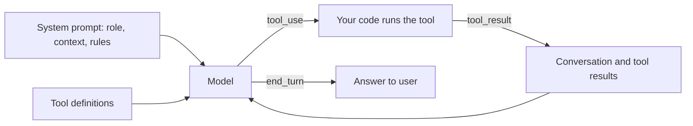
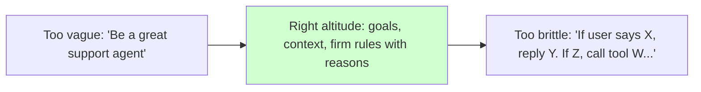

# Designing Agent System Prompts

## Introduction

The system prompt is the closest thing an agent has to a job description. Every turn of the agent loop starts by reading it. It shapes which tools the agent reaches for, when it stops to ask a question, how it talks to users, and what it treats as off limits.

For a chatbot, a weak system prompt gives you a bland answer. For an agent, it gives you wrong actions: a refund issued that should have been escalated, a file deleted that should have been kept, or ten tool calls where one would do. Agents act, so prompt mistakes compound across steps.

A useful analogy: imagine onboarding a capable new hire who has never seen your company. You would not hand them a single sentence ("You are a helpful support agent") and walk away. You also would not hand them a 40-page flowchart for every possible conversation. You would explain who the customers are, what good work looks like, which rules are firm and why, and which tools they have. Then you would trust their judgment. That is the target for an agent system prompt.

In this page you will learn:

- What a system prompt does in an agent, and what it should not try to do
- The building blocks of a good agent system prompt
- How to structure prompts with XML-tagged sections
- How to pitch instructions at the "right altitude"
- How to assemble the prompt in code so it stays maintainable and cache-friendly

:::note
This page assumes you know how to send a system prompt through an API. If not, read [System Prompts](../1-agents-llm-apis/3-agents-system-prompts.mdx) first. The following pages in this section go deeper on each building block.
:::

## What the System Prompt Does in an Agent

In a single API call the system prompt sets the scene for one response. In an agent it does more work, because the same prompt is re-read on every iteration of the loop.



The model sees three kinds of input on every step:

1. **The system prompt**: stable instructions and context that apply to the whole session.
2. **Tool definitions**: what actions exist and what each one does.
3. **The message history**: the user's request plus every tool call and result so far.

Because the system prompt is stable, it is the right home for things that should hold across the whole task: who the agent serves, the quality bar, firm constraints and the reasons for them, and the format of the final answer. Things that change per request (the user's question, a retrieved document, today's ticket) belong in the messages.

:::tip
A good test for any sentence in your system prompt: "Would this still be true and useful on step 15 of a long task?" If not, it probably belongs in a user message or a tool result instead.
:::

## The Building Blocks

Most strong agent system prompts contain some version of these sections. Not every agent needs all of them, and the order can vary.

| Section | What it answers | Example content |
|---|---|---|
| Role | Who is the agent working for, in one line? | "You are the support agent for Acme's invoicing product." |
| Context | What does the agent need to know that it cannot discover? | Audience, product facts, environment, today's date |
| Goals and quality bar | What does a good outcome look like? | "A resolved ticket, or a clean hand-off to a human with a summary." |
| Instructions and constraints | What rules apply, and why? | "Refunds above $200 need a human, because finance audits them." |
| Tool guidance | When are tools appropriate, and how do they fit together? | "Look up the account before answering billing questions." |
| Output format | What should the final answer look like? | Tone, length, structure, or a JSON schema |
| Examples (optional) | What does good look like concretely? | Two or three varied sample interactions |

Each block has its own page later in this section:

- Role and context: [Giving Agents Context and a Role](./1-agents-context-and-roles.mdx)
- Rules: [Writing Instructions and Constraints](./2-agents-instructions-and-constraints.mdx)
- Examples: [Few-Shot Examples for Agents](./3-agents-few-shot-examples.mdx)
- Tool guidance: [Prompting for Better Tool Use](./4-agents-prompting-for-tool-use.mdx)

### What usually does not belong

Some content looks helpful but tends to hurt agents built on current models:

- **Generic virtues** like "be accurate, helpful, and thorough." The model already tries to do this. These lines add noise without changing behavior.
- **A list of every tool by name.** The tool definitions already carry that. If you disable a tool later, a stale mention in the prompt points the model at something that no longer exists.
- **Step-by-step scripts for judgment tasks.** Current models usually plan better than a hand-written script, and rigid steps break on cases the author did not foresee.
- **Shouted rules** ("CRITICAL!!! NEVER…"). Modern models follow instructions closely, so emphasis makes them over-apply the rule. See [Prompt Anti-Patterns](./9-agents-prompt-anti-patterns.mdx).

## Structuring with XML Tags

When a prompt mixes instructions, background, examples, and data, the model has to work out which part is which. XML-style tags remove that guesswork. Anthropic's prompting guide recommends wrapping each kind of content in its own descriptive tag, and OpenAI's and Google's guides give similar advice (Markdown headers or XML tags, used consistently).

```text
You are the support agent for Acme Invoicing, a billing tool for small businesses.

<context>
Our customers are owners of businesses with 1-50 employees. Most are not accountants.
Plans: Starter ($15/month), Growth ($49/month), Scale ($149/month).
Billing runs on the 1st of each month. Refunds go back to the original card in 5-10 business days.
</context>

<goals>
Resolve the customer's issue in this conversation when you can. When you cannot,
hand off to a human with a summary so the customer never has to repeat themselves.
</goals>

<rules>
Refunds above $200 need human approval, because finance reviews large refunds for fraud.
Use the issue_refund tool for amounts up to $200 once you have confirmed the charge.

Do not quote features or prices that are not listed in this prompt or returned by a tool.
Customers act on what you say, and an invented price becomes a billing dispute.
</rules>

<output_format>
Write in plain, friendly language a non-accountant can follow. Keep replies short:
answer the question, say what you did, and say what happens next.
</output_format>
```

A few conventions make tags work well:

- **Use descriptive, consistent names.** `context`, `rules`, `output_format` are clearer than `section1`. Reuse the same names across your prompts so your team learns them.
- **Refer to tags in instructions.** "Use the facts in the context section" or "follow the rules in the `rules` tags" lets the model connect instructions to the right block.
- **Nest when content has hierarchy.** For example, multiple documents go inside a `documents` tag, each in its own `document` tag with a `source` field.
- **There are no magic tag names.** The model is not trained on a special `rules` tag. Tags help because they mark boundaries, not because of the specific word.

:::info
Markdown headings (`## Rules`) also work as section markers. Pick one style and use it consistently. XML tags have an extra advantage: they make it unambiguous where untrusted data (a customer email, a web page) starts and ends, which matters for prompt injection defenses. See [Prompt Injection](../12-agents-safety-and-security/1-agents-prompt-injection.mdx).
:::

## Finding the Right Altitude

Anthropic's post on context engineering describes two failure modes for system prompts:

- **Too low (brittle):** the prompt hardcodes if-else logic for every situation. It is long, fragile, and fails on any case the author did not anticipate.
- **Too high (vague):** the prompt gives lofty goals with no concrete signal. The model fills the gaps with generic defaults.

The goal is the zone in between: specific enough to guide behavior, flexible enough to let the model use judgment.



Here is the same instruction at three altitudes:

| Altitude | Instruction | Problem |
|---|---|---|
| Too vague | "Handle refunds appropriately." | What counts as appropriate? The model guesses. |
| Too brittle | "If the user says 'refund', ask for the order ID. Then call get_order. If amount is less than 200, call issue_refund. If the user says 'money back', do the same..." | Breaks on "I was double charged" or "cancel and reimburse me." |
| Right | "You can refund up to $200 after confirming the charge exists on the account. Larger refunds need a human because finance reviews them for fraud." | States the policy and the reason. The model can apply it to any wording. |

The right-altitude version is not shorter than the vague one. It contains the information only you know: the limit, the precondition, and the reason. "Minimal" in the context engineering sense means the smallest set of information that fully defines the behavior, not the fewest words.

## Before and After: A Full Rewrite

Here is a realistic first draft of a system prompt for a DevOps helper agent. It has several common problems.

**Before:**

```text
You are a helpful AI assistant. You are an expert DevOps engineer.

IMPORTANT: You MUST ALWAYS be accurate and thorough!!!

STEP 1: Read the user's question.
STEP 2: Think step by step.
STEP 3: Use the run_kubectl tool, the search_runbooks tool, or the get_metrics tool.
STEP 4: Answer.

NEVER delete anything. NEVER restart pods. NEVER make things up.
Do not be lazy. Do not stop early.
```

Problems with this draft:

- The role is generic and there is no context: which cluster, which team, which users?
- "Accurate and thorough" in capitals adds pressure without information.
- The numbered steps script a judgment task, and "think step by step" is redundant on models with built-in thinking. See [Prompting for Reasoning](./6-agents-reasoning-prompts.mdx).
- Tools are named in the prompt, duplicating the tool definitions.
- "NEVER restart pods" has no reason, so the model cannot tell whether restarting a crash-looping pod in a dev namespace is fine.
- "Do not be lazy" fixes a problem current models do not have.

**After:**

```text
You help the platform team at Northwind investigate production issues in our
Kubernetes clusters. The people asking are on-call engineers, usually under time
pressure, who know Kubernetes well.

<environment>
Clusters: prod-us (customer traffic), prod-eu (customer traffic), staging (internal).
Runbooks for common alerts are searchable. Metrics come from Prometheus.
</environment>

<goals>
Find the most likely cause of the issue and the evidence for it. A good answer names
the cause, shows the logs or metrics that support it, and suggests the next action.
If the evidence is inconclusive, say what you ruled out and what to check next.
</goals>

<rules>
In prod-us and prod-eu, only use read-only commands (get, describe, logs, top).
Changes to production go through our deploy pipeline so they are reviewed and
can be rolled back, so suggest the change instead of making it.
In staging you may restart pods or scale deployments if it helps confirm a cause.

Base conclusions on what you observed from tools. If you are inferring something
you did not observe, say so.
</rules>

<output_format>
Lead with the likely cause in one sentence. Then the evidence, then the suggested
next step. On-call engineers skim, so keep it tight.
</output_format>
```

What changed:

- The role line is still there, but it now names the team, the audience, and the situation.
- An `environment` block gives facts the model could not discover on its own.
- The goal describes what a good result looks like instead of a fixed script.
- Each rule carries its reason, so the model can apply it sensibly (read-only in prod, freedom in staging).
- No tool names, no shouting, no "think step by step."

The rule about read-only commands should also be **enforced in code**, for example by having the `run_kubectl` tool reject mutating verbs on production clusters. The prompt explains the policy; the code guarantees it. See [Least Privilege for Agent Tools](../12-agents-safety-and-security/2-agents-least-privilege.mdx).

## Assembling the System Prompt in Code

In real applications the system prompt is rarely one hardcoded string. Some parts are fixed, some depend on the deployment (which clusters exist), and some depend on the user or session. Building it from named sections keeps it readable and testable.

```python
from dataclasses import dataclass, field


@dataclass
class PromptSection:
    tag: str
    body: str

    def render(self) -> str:
        return f"<{self.tag}>\n{self.body.strip()}\n</{self.tag}>"


@dataclass
class SystemPrompt:
    role: str
    sections: list[PromptSection] = field(default_factory=list)

    def add(self, tag: str, body: str) -> "SystemPrompt":
        self.sections.append(PromptSection(tag, body))
        return self

    def render(self) -> str:
        parts = [self.role.strip()] + [s.render() for s in self.sections]
        return "\n\n".join(parts)


prompt = (
    SystemPrompt(
        role="You help the platform team at Northwind investigate production issues "
        "in our Kubernetes clusters."
    )
    .add("environment", "Clusters: prod-us, prod-eu (customer traffic), staging (internal).")
    .add(
        "rules",
        "In prod clusters, only use read-only commands. Production changes go through "
        "the deploy pipeline so they are reviewed and can be rolled back.",
    )
    .add("output_format", "Lead with the likely cause, then evidence, then next step.")
)

print(prompt.render())
```

Output:

```text
You help the platform team at Northwind investigate production issues in our Kubernetes clusters.

<environment>
Clusters: prod-us, prod-eu (customer traffic), staging (internal).
</environment>

<rules>
In prod clusters, only use read-only commands. Production changes go through the deploy pipeline so they are reviewed and can be rolled back.
</rules>

<output_format>
Lead with the likely cause, then evidence, then next step.
</output_format>
```

Now send it with the API. This example uses the Anthropic Python SDK; OpenAI (`instructions` or a developer message), Google Gemini (`system_instruction`), and open-source models served with Ollama or vLLM (a `system` role message) all have an equivalent slot.

```python
from anthropic import Anthropic

client = Anthropic()  # reads ANTHROPIC_API_KEY from the environment

SYSTEM_PROMPT = """You help the platform team at Northwind investigate production issues.

<rules>
In prod clusters, only use read-only commands. Production changes go through the
deploy pipeline so they are reviewed and can be rolled back.
</rules>"""

response = client.messages.create(
    model="claude-opus-5-5",
    max_tokens=16000,
    system=SYSTEM_PROMPT,
    messages=[
        {"role": "user", "content": "checkout-api in prod-us is returning 503s. What's going on?"}
    ],
)

for block in response.content:
    if block.type == "text":
        print(block.text)
```

Example output (abridged; a real agent would call tools first):

```text
I can't see the cluster yet, so here is where I'd start: 503s from checkout-api usually
mean no ready endpoints behind the Service. Check `kubectl get endpoints checkout-api -n checkout`
and `kubectl describe deploy checkout-api` for failing readiness probes...
```

### Order sections for caching

Put the stable parts of the prompt first and the parts that change per session last. Prompt caching works on exact prefixes, so a timestamp or user name near the top of the system prompt changes the prefix on every request and prevents cache hits. Keep per-user details in a final section or in the first user message. See [Prompt Caching](../4-agents-memory-and-context/4-agents-prompt-caching.mdx).

```python
def build_system_prompt(static_prompt: str, user_name: str, today: str) -> str:
    # Stable, cacheable content first; per-session details last.
    session = f"<session>\nUser: {user_name}\nToday's date: {today}\n</session>"
    return static_prompt + "\n\n" + session


print(build_system_prompt("You help Northwind's platform team...", "Priya", "2026-10-10"))
```

Output:

```text
You help Northwind's platform team...

<session>
User: Priya
Today's date: 2026-10-10
</session>
```

## Real-World Scenario

Your team runs a SaaS helpdesk product. You are adding an agent that answers customer questions about invoices and can issue small refunds. The first prototype used a one-line prompt: "You are a helpful billing assistant." In testing, the agent:

- Promised a refund of $450 without checking policy
- Explained a "Pro" plan that does not exist
- Gave a long, formatted essay to a customer who asked a yes/no question

### The solution

You rewrite the prompt with the building blocks from this page:

```text
You are the billing assistant for Helply, a helpdesk tool used by small support teams.

<context>
Plans: Basic ($12/agent/month), Team ($29/agent/month). There are no other plans.
Invoices are issued on the signup anniversary each month.
Customers are support team leads; they are busy and want quick, concrete answers.
</context>

<goals>
Answer billing questions and fix billing problems in this conversation when you can.
If you cannot, create a hand-off ticket with a summary so a human can pick it up
without asking the customer to repeat anything.
</goals>

<rules>
You can refund up to $100 per invoice after confirming the charge with the account
lookup. Larger refunds need a human because finance reviews them for chargebacks.
Only describe plans and prices listed above or returned by a tool; customers act
on what you say, so an invented price becomes a dispute.
</rules>

<output_format>
Match the length of the reply to the question. A yes/no question gets a direct
answer and one line of explanation.
</output_format>
```

You also make the refund tool itself reject amounts over $100, so the limit holds even if the model makes a mistake.

### Why this approach

- The **context** block removes the reason the agent invented a plan: it did not know the real list.
- The **rule with a reason** lets the agent handle phrasing you did not foresee ("I was charged twice") while staying inside policy.
- The **output format** describes the desired behavior positively instead of saying "don't be verbose."
- **Code enforcement** of the refund cap means a prompt failure cannot cost real money.

### When to use it / when not to

Use a sectioned, reasoned system prompt for any agent that takes actions or serves real users. For a throwaway script that classifies 50 strings once, a one-line instruction in the user message is fine. If your "agent" always follows the same fixed sequence, consider a workflow in code instead; see [Agents vs Workflows](../0-agents-fundamentals/3-agents-vs-workflows.mdx).

### Alternatives and trade-offs

| Approach | Pros | Cons | Best for |
|---|---|---|---|
| One-line role prompt | Fast to write | Model fills gaps with generic defaults | Prototypes, trivial tasks |
| Sectioned prompt with reasons (this page) | Clear, adaptable, easy to review | Takes effort to write and maintain | Most production agents |
| Exhaustive rulebook / decision tree | Feels controlled | Brittle, long, fails on unforeseen cases | Rarely; prefer code for fixed logic |
| Hard rules in code + short prompt | Guarantees for critical limits | Needs engineering per rule | Money, data deletion, security limits |
| Fine-tuning | Bakes behavior into weights | Costly, slow to change, provider-specific | High volume, very stable behavior |

## Best Practices

- **Write for a smart newcomer.** Anthropic's "golden rule": show the prompt to a colleague with no context. If they would be confused, the model will be too.
- **Explain the why.** A rule with a reason generalizes to cases the rule did not list.
- **Say it once, in the right section.** Repeating a rule in three places makes the model reconcile slightly different wordings.
- **Describe what to do, not only what to avoid.** "Write in short plain paragraphs" works better than "don't use markdown."
- **Keep stable content first.** It improves caching and keeps the prompt readable.
- **Enforce critical limits in code.** Treat the prompt as guidance and the tool layer as the guarantee.
- **Version and test your prompt.** A system prompt is code that ships behavior. See [Versioning and Managing Prompts](./8-agents-prompt-versioning.mdx) and [Iterating on Prompts with Evidence](./10-agents-prompt-iteration.mdx).

## Common Mistakes

| Mistake | Why it hurts | Fix |
|---|---|---|
| Identity stub as the only context ("You are a helpful assistant") | Model falls back on generic behavior | Add audience, product, environment, and quality bar |
| Capitalized MUST/NEVER everywhere | Over-triggering and rigid behavior on current models | State the rule plainly with its reason |
| Step-by-step scripts for open-ended work | Model follows the script even when it does not fit | Describe the goal and how to verify success |
| Listing tool names in the prompt | Stale references when tools change | Put usage guidance in tool descriptions |
| Dynamic values at the top | Breaks prompt caching | Put per-session data last |
| Prompt-only enforcement of money or data limits | One mistake has real cost | Enforce in the tool code as well |

## Summary

- The system prompt is the agent's job description, re-read on every step of the loop.
- Good agent prompts include a short role, context only you know, goals and a quality bar, rules with reasons, tool guidance, and an output format.
- XML tags (or consistent Markdown headings) separate sections and mark where data begins and ends.
- Aim for the "right altitude": specific enough to guide, flexible enough to generalize. Minimal means "no unnecessary information," not "short."
- Build prompts from named sections in code, keep stable content first, and enforce critical rules in code too.

## Exercises

1. Take a system prompt you have written (or the "before" DevOps prompt above) and label every sentence as role, context, goal, rule, tool guidance, or format. Delete or rewrite sentences that fit none of these.
2. Extend the `SystemPrompt` class with an `examples` section that renders several `example` blocks inside an `examples` tag.
3. Write a system prompt for an agent that books meeting rooms. Include at least one rule with a reason, and decide which part of that rule should also be enforced in code.
4. Measure the effect of your rewrite: run the same five test requests against the "before" and "after" prompts and compare the answers. [Iterating on Prompts with Evidence](./10-agents-prompt-iteration.mdx) shows how to make this systematic.

## Further Learning

- [Giving Agents Context and a Role](./1-agents-context-and-roles.mdx)
- [Writing Instructions and Constraints](./2-agents-instructions-and-constraints.mdx)
- [Prompt Templates](./7-agents-prompt-templates.mdx)
- [Context Engineering](../4-agents-memory-and-context/0-agents-context-engineering.mdx)
- Anthropic: [Prompting best practices](https://platform.claude.com/docs/en/build-with-claude/prompt-engineering/claude-prompting-best-practices) and [Effective context engineering for AI agents](https://www.anthropic.com/engineering/effective-context-engineering-for-ai-agents)
- OpenAI: [Prompt engineering guide](https://developers.openai.com/api/docs/guides/prompt-engineering)
- Google: [Gemini prompting strategies](https://ai.google.dev/gemini-api/docs/prompting-strategies)
