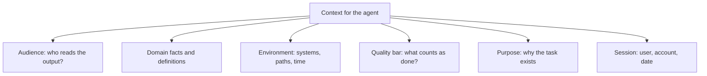
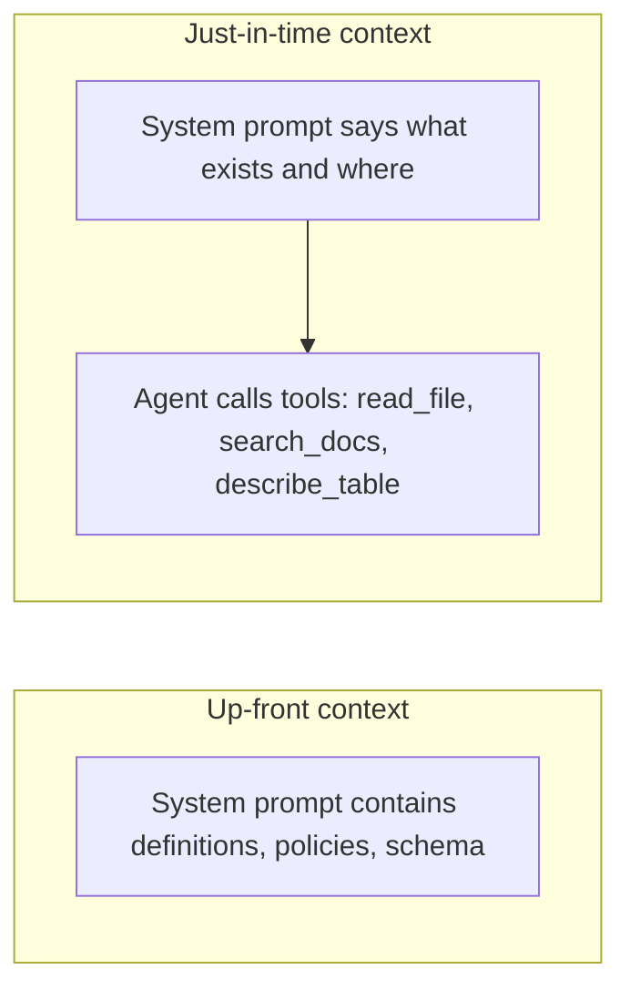

# Giving Agents Context and a Role

## Introduction

Ask a brilliant contractor to "fix the report" on their first day and you will get something, but probably not what you wanted. They do not know which report, who reads it, what "fixed" means at your company, or that the finance team defines "active customer" differently from the product team. Their skill is not the problem. Their missing context is.

Language models are in the same position. They know a lot about the world in general and nothing about *your* world: your customers, your systems, your definitions, today's date, or why the task matters. When that information is missing, the model fills the gap with safe, generic defaults. For an agent, generic defaults lead to plausible but wrong actions.

This page covers two related tools:

- **A role**: a short statement that focuses the model on a job and a point of view.
- **Context**: the facts, definitions, documents, and situation details that only you can supply.

Anthropic's prompt audit guidance puts the priority bluntly: context is never cruft. Too-short prompts produce generic output because the model fills gaps with safe defaults. A role line is useful, but it is the context that does most of the work.

## What a Role Does (and Does Not Do)

Setting a role in the system prompt focuses tone and behavior. Anthropic's guide notes that even a single sentence makes a difference:

```text
You are a senior Python reviewer for a fintech company's payments team.
```

That one line shifts the vocabulary, the level of detail, and what the model pays attention to (money-handling bugs, for example). It is cheap and worth including.

What a role cannot do is supply facts. "You are an expert on our product" does not teach the model your product. "You are a world-class data analyst" does not tell it that the `orders` table includes test orders you must filter out.

| Role line alone | Role line plus context |
|---|---|
| "You are an expert support agent for Acme." | "You are the support agent for Acme Invoicing. Customers are small business owners, mostly not accountants. Plans are Starter, Growth and Scale..." |
| The model guesses plans, audience, tone | The model works from real facts |

:::tip
Prefer a **specific role** over a superlative one. "You review pull requests for the payments team" says more than "You are a world-class 10x engineer." Superlatives add no information about the job.
:::

### Roles for agents are about responsibility

For agents, a role is most useful when it defines what the agent is responsible for and who it works for:

```text
You are the on-call assistant for Northwind's platform team. You investigate
alerts and propose fixes; humans approve and apply production changes.
```

This line tells the model its scope (investigate and propose) and where its authority stops (humans apply changes). That boundary is far more useful than any adjective.

## The Context Only You Know

Think about what a new team member would need to ask before doing the job well. That is your context checklist.



### Audience

Who will read the agent's output changes everything about how it should write.

```text
<audience>
Answers go to warehouse managers reading on a phone between tasks. They know
our inventory codes but not SQL. One short paragraph is ideal.
</audience>
```

### Domain facts and definitions

Business terms are the most common source of silent errors. "Revenue," "active user," and "churn" each have several reasonable definitions. The model will pick one, and it may not be yours.

```text
<definitions>
Active customer: has at least one paid invoice in the last 90 days. Trials do
not count.
Revenue: invoice totals excluding tax and excluding refunds, in USD.
Orders with is_test = true are internal test data and must be excluded from
every metric, because they would inflate every count.
</definitions>
```

### Environment

For agents that use tools, describe the world the tools operate in: which systems exist, what is safe to touch, and any facts the model would otherwise have to guess.

```text
<environment>
You are working in a monorepo. Services live in services/<name>, shared code in libs/.
Tests run with `make test SERVICE=<name>`. The main branch is protected.
</environment>
```

### Quality bar

What does "done" mean? Without this, one model run stops at a quick fix and another rewrites half the module.

```text
<quality_bar>
A change is done when the existing tests pass, new behavior has a test, and the
diff touches only what the task needs. Reviewers reject unrelated refactors.
</quality_bar>
```

### Purpose

Telling the model *why* the task exists helps it make sensible trade-offs.

```text
This summary goes into the weekly report for the CFO, who uses it to decide
whether to extend the pilot. Accuracy of the numbers matters more than style.
```

### Session details

Information about this user and this moment: the account, the user's role, their timezone, and the current date. Models do not know today's date unless you tell them, and agents that schedule, compare dates, or search for "recent" information need it.

## Putting Context into Code

Let's build a small helper that assembles role, static context, and per-session details. Static context goes first so it can be cached; session details go last.

```python
from datetime import date


ROLE = (
    "You are the analytics assistant for Brightcart's sales team. You answer "
    "questions using the data warehouse and explain results in plain language."
)

STATIC_CONTEXT = """<definitions>
Active customer: at least one paid invoice in the last 90 days. Trials do not count.
Revenue: invoice totals excluding tax and refunds, in USD.
Rows with is_test = true are internal test data; exclude them from every metric.
</definitions>

<audience>
Sales managers. They know the business well but do not read SQL, so explain
results in words and show the query only if asked.
</audience>"""


def session_context(user_name: str, region: str, today: date) -> str:
    return (
        "<session>\n"
        f"User: {user_name} (sales manager, {region} region)\n"
        f"Today's date: {today.isoformat()}\n"
        "</session>"
    )


def build_system_prompt(user_name: str, region: str, today: date) -> str:
    return "\n\n".join([ROLE, STATIC_CONTEXT, session_context(user_name, region, today)])


print(build_system_prompt("Dana", "EMEA", date(2026, 10, 10)))
```

Output:

```text
You are the analytics assistant for Brightcart's sales team. You answer questions using the data warehouse and explain results in plain language.

<definitions>
Active customer: at least one paid invoice in the last 90 days. Trials do not count.
Revenue: invoice totals excluding tax and refunds, in USD.
Rows with is_test = true are internal test data; exclude them from every metric.
</definitions>

<audience>
Sales managers. They know the business well but do not read SQL, so explain
results in words and show the query only if asked.
</audience>

<session>
User: Dana (sales manager, EMEA region)
Today's date: 2026-10-10
</session>
```

## Supplying Documents as Context

Agents often need reference material: a policy, a runbook, a contract, search results. How you place it in the prompt matters.

Anthropic's long-context guidance recommends:

1. **Put long documents near the top**, above the question and instructions. Anthropic reports that putting the query at the end can noticeably improve quality on complex, multi-document inputs. Google's Gemini guide gives the same advice: place specific instructions or questions at the very end of a long prompt.
2. **Wrap each document in tags with metadata**, such as a `source` and an index, so the model can tell documents apart and cite them.
3. **For long documents, ask the model to find relevant quotes first** before answering, which helps it focus on the parts that matter.

```python
from html import escape


def format_documents(docs: list[dict]) -> str:
    """Render documents in a tagged structure the model can cite."""
    parts = ["<documents>"]
    for i, doc in enumerate(docs, start=1):
        parts.append(
            f'<document index="{i}">\n'
            f"<source>{escape(doc['source'])}</source>\n"
            f"<document_content>\n{escape(doc['text'])}\n</document_content>\n"
            "</document>"
        )
    parts.append("</documents>")
    return "\n".join(parts)


docs = [
    {"source": "refund-policy.md", "text": "Refunds within 30 days of purchase are automatic."},
    {"source": "enterprise-terms.md", "text": "Enterprise contracts follow the signed order form."},
]

user_message = (
    format_documents(docs)
    + "\n\nA Growth-plan customer bought 45 days ago and wants a refund. "
    "Which policy applies? Cite the document you used."
)
print(user_message)
```

Output:

```text
<documents>
<document index="1">
<source>refund-policy.md</source>
<document_content>
Refunds within 30 days of purchase are automatic.
</document_content>
</document>
<document index="2">
<source>enterprise-terms.md</source>
<document_content>
Enterprise contracts follow the signed order form.
</document_content>
</document>
</documents>

A Growth-plan customer bought 45 days ago and wants a refund. Which policy applies? Cite the document you used.
```

Notice that the code **escapes** the document text. If a document contains text like `</document_content>`, escaping stops it from breaking your structure. This is not a complete defense against prompt injection, but clear boundaries make it easier for the model to treat document content as data rather than instructions. See [Prompt Injection](../12-agents-safety-and-security/1-agents-prompt-injection.mdx).

:::note
Documents usually belong in the **user message** or in **tool results**, not in the system prompt. They change per request, and keeping them out of the system prompt keeps the stable prefix cacheable.
:::

## Up-Front Context vs Just-in-Time Context

You do not have to put everything in the prompt. Agents can fetch context on demand through tools. Anthropic's context engineering post calls this "just-in-time" context: the agent keeps lightweight references (file paths, IDs, saved queries) and loads the data when it needs it.



| | Up-front | Just-in-time |
|---|---|---|
| Speed | Fast, no extra tool calls | Extra round trips |
| Token cost | Paid on every request (reduced by caching) | Paid only when needed |
| Freshness | Can go stale | Always current |
| Risk | Context window bloat, distracting detail | Agent may not look when it should |
| Best for | Small, always-relevant facts (definitions, rules) | Large or changing data (docs, code, tables) |

Most production agents use a **hybrid**: a small set of always-relevant facts up front, plus tools and a short "map" of where to find the rest.

```text
<where_to_find_things>
Table schemas: use describe_table. Metric definitions not listed above live in the
metrics catalog; search it with search_docs before inventing a definition.
</where_to_find_things>
```

That last clause is the important part. It tells the agent *when* to look, which prevents it from guessing a definition that already exists. [Context Engineering](../4-agents-memory-and-context/0-agents-context-engineering.mdx) covers this trade-off in depth.

## Before and After

**Before:**

```text
You are a world-class data analyst AI. Answer the user's questions about our data
accurately. Be precise!
```

Asked "How many active customers did we have last month in EMEA?", an agent with this prompt will write a query that counts any customer with any order, includes test accounts, and assumes "last month" relative to its training data.

**After:**

```text
You are the analytics assistant for Brightcart's sales team. You answer questions
using the data warehouse and explain results in plain language.

<definitions>
Active customer: at least one paid invoice in the last 90 days. Trials do not count.
Rows with is_test = true are internal test data; exclude them from every metric.
</definitions>

<where_to_find_things>
Use describe_table to check columns before writing a query. If a question uses a
business term not defined here, search the metrics catalog first, and if it is not
there, say which definition you assumed.
</where_to_find_things>

<session>
User: Dana (sales manager, EMEA region)
Today's date: 2026-10-10
</session>
```

Now "active," "last month," and "EMEA" all resolve to the right thing, and the agent knows what to do when it meets an undefined term.

## Real-World Scenario

Your company has an internal HR policy assistant. Employees in three countries ask questions like "How much parental leave do I get?" The first version had the role "You are a helpful HR assistant" and a search tool over the policy wiki. Employees complained that answers mixed up countries and quoted a policy that was replaced last quarter.

### The solution

1. **Session context**: the app already knows the employee's country, employment type, and start date from the login. Inject them in a `session` block at the end of the system prompt.
2. **Domain context**: add a short `definitions` block explaining that policies are country-specific and that the wiki marks superseded pages with a "Superseded" banner.
3. **Documents with metadata**: when the search tool returns pages, include `country`, `effective_date`, and `status` alongside the text so the model can pick the current, matching one.
4. **Quality bar**: "Quote the policy section you used and name the page, so employees can verify it."

```text
<session>
Employee country: Germany
Employment type: full-time
Start date: 2023-04-01
Today's date: 2026-10-10
</session>
```

### Why this approach

The failures came from missing context, not from a weak model. The model could not know the employee's country, and search results without dates gave it no way to prefer the current policy. Supplying both fixes the root cause rather than adding rules like "ALWAYS check the country."

### When to use it / when not to

Inject session context whenever your application already knows facts about the user that affect the answer. Do not inject sensitive data the task does not need (salary, health information) just because it is available: it widens what a prompt injection could leak. See [Data Privacy and PII](../12-agents-safety-and-security/5-agents-data-privacy.mdx).

### Alternatives and trade-offs

| Approach | Pros | Cons | Best for |
|---|---|---|---|
| Ask the user for missing context each time | No integration needed | Annoying, error-prone | Prototypes |
| Inject session context from the app | Accurate, invisible to the user | Requires plumbing, privacy review | Logged-in products |
| Give the agent a profile lookup tool | Fetches only when needed | Agent may forget to call it | Large or rarely-needed profiles |
| Put all policies in the prompt | Simple, no retrieval | Large, stale, mixes countries | Very small policy sets |
| Retrieval with metadata (RAG) | Scales, stays current | Needs a pipeline | Real knowledge bases; see [RAG Introduction](../5-agents-rag/0-agents-rag-introduction.mdx) |

## Common Mistakes

- **Relying on the role line alone.** "Expert" does not equal "informed." Add the facts.
- **Using superlatives instead of specifics.** "World-class" adds nothing; "reviews payments code for money-handling bugs" adds focus.
- **Forgetting the date.** Agents that reason about time need today's date, and so do search queries for recent information.
- **Leaving business terms undefined.** Write down the definitions your team argues about.
- **Dumping every document into the system prompt.** Put changing documents in messages or tool results, and fetch large material on demand.
- **Putting the question above a long document.** Put long material first and the question last.
- **No boundaries around untrusted text.** Wrap documents in tags and escape them so data is clearly separated from instructions.

## Summary

- A short, specific role focuses the model; it does not supply facts.
- Context is what only you know: audience, definitions, environment, quality bar, purpose, and session details.
- Put long documents near the top of the message and the question at the end, wrapped in tags with metadata.
- Mix up-front context (small, stable facts) with just-in-time context (tools that fetch large or changing data), and tell the agent when to look.
- Place stable context first for caching, and per-session details last.

## Exercises

1. Write a `definitions` block for three business terms from a project you know. Ask two colleagues what each term means first. If their answers differ, you have found context the model needs.
2. Extend `format_documents` to include an `effective_date` and `status` field, and write a user message asking the model to prefer current documents.
3. Take an agent you have built and list every fact it guessed wrong in testing. For each, decide whether it belongs in up-front context, in a tool, or in session data.
4. Compare answers to the "active customers last month" question with and without the `session` block, and note what changes.

## Further Learning

- [Designing Agent System Prompts](./0-agents-system-prompt-design.mdx)
- [Writing Instructions and Constraints](./2-agents-instructions-and-constraints.mdx)
- [Context Engineering](../4-agents-memory-and-context/0-agents-context-engineering.mdx)
- [Citations and Grounding](../5-agents-rag/7-agents-citations-and-grounding.mdx)
- Anthropic: [Prompting best practices: give Claude a role and long context prompting](https://platform.claude.com/docs/en/build-with-claude/prompt-engineering/claude-prompting-best-practices)
- Anthropic: [Effective context engineering for AI agents](https://www.anthropic.com/engineering/effective-context-engineering-for-ai-agents)
