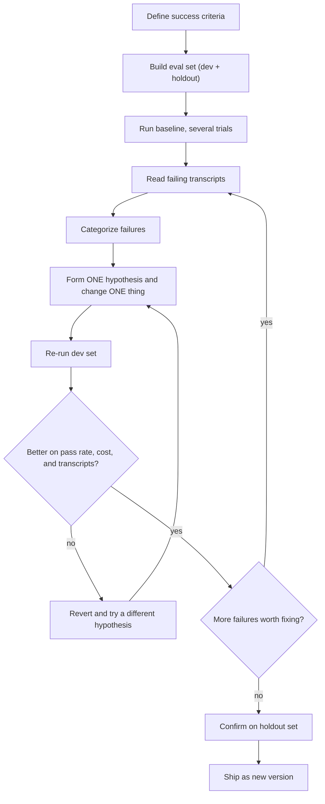

# Iterating on Prompts with Evidence

## Introduction

Here is how most people improve a prompt: try three inputs in a playground, see one bad answer, add a sentence, try the same three inputs, see that it looks better, and ship. A week later a different kind of input breaks, so they add another sentence. After a few months the prompt is a pile of patches, and nobody knows which of them help.

This is called **vibe-based prompting**. It has three problems:

1. **Three examples are not a sample.** A change that fixes one case can quietly break five others.
2. **Models are not deterministic.** The same prompt can pass on one run and fail on the next, so a single "it looks better" proves very little.
3. **Nothing is written down.** You can't tell later whether a line helped, so you can never safely delete it.

**Evidence-based iteration** replaces the vibes with a small, repeatable experiment. You define what success means, collect a set of test cases, measure the current prompt, change one thing, measure again, and keep the change only if the numbers (and the transcripts) say it helped. Anthropic's, OpenAI's, and Google's prompting guides all recommend the same thing in different words: build evals before you change prompts.

:::tip Analogy
This is test-driven development for prompts. The eval set is your test suite. A prompt change without an eval run is like a code change without running the tests: it might be fine, but you don't know.
:::

This page focuses on the day-to-day loop of improving one prompt. The [Evaluation, Testing and Observability](../11-agents-evaluation-and-testing/0-agents-evaluation-introduction.mdx) section goes deeper into datasets, graders, and regression testing at scale.

## The Iteration Loop



Each step is cheap once it is set up. The setup is what most teams skip.

## Step 1: Define Success Criteria

"The agent should give good answers" can't be measured. Turn it into criteria that are **specific** and, where possible, **checkable by code**.

For a support-ticket triage agent, that could be:

| Criterion | How to check | Target |
| --- | --- | --- |
| Routes the ticket to the right category | Exact match against a label | 95% or more |
| Escalates refunds over 200 USD and compliance requests | Boolean check | 100% |
| Doesn't escalate routine tickets | Boolean check | 95% or more |
| Doesn't call tools for small talk | Count tool calls | 100% |
| Reply is polite and answers the question | LLM judge with a rubric | 90% or more |
| Cost | Average output tokens | Not more than the current version |

Notice the mix. Most criteria are hard checks. Only one needs a judge. Also notice that **cost is a criterion**. A prompt that gains 2 points of accuracy while doubling tokens might not be an improvement for your product.

## Step 2: Build a Small Eval Set

You don't need thousands of cases to start. Twenty to fifty well-chosen cases catch most regressions in a single prompt. Good sources:

- **Real traffic.** Sample actual tickets or user requests, with personal data removed.
- **Known failures.** Every bug report becomes a test case.
- **Edge cases.** Small talk, ambiguous requests, requests near a policy limit, very long inputs, other languages.
- **The cases that matter most.** Anything with money, compliance, or safety attached.

Split the set in two:

- A **dev set** you iterate against.
- A **holdout set** you only look at before shipping. If you tune the prompt against every case you have, you will overfit: the prompt will learn your test cases rather than the task.

```python
from collections import Counter
from dataclasses import dataclass, field
import statistics
from typing import Callable


@dataclass
class Case:
    id: str
    ticket: str
    expected_category: str
    must_escalate: bool
    tags: list = field(default_factory=list)
    split: str = "dev"  # "dev" for iterating, "holdout" for final checks


@dataclass
class AgentResult:
    category: str
    escalated: bool
    reply: str
    tool_calls: int
    output_tokens: int


CASES = [
    Case("c01", "I was charged twice for October.", "billing", False, ["common"]),
    Case("c02", "How do I export invoices to CSV?", "how_to", False, ["common"]),
    Case("c03", "Refund 450 USD for the duplicate charge please.", "billing", True, ["refund_limit"]),
    Case("c04", "The PDF export button does nothing in Safari.", "bug", False, ["common"]),
    Case("c05", "thanks, that fixed it!", "other", False, ["small_talk"]),
    Case("c06", "Please delete my account and all data (GDPR).", "account", True, ["compliance"]),
    Case("c07", "Can I get 30 USD back for the late invoice?", "billing", False, ["refund_limit"], "holdout"),
    Case("c08", "Our SSO login loops forever since this morning.", "bug", False, ["common"], "holdout"),
]
```

In a real project, store cases in a JSONL file in the repo next to the prompt, so the dataset is versioned too. [Building Evaluation Datasets](../11-agents-evaluation-and-testing/1-agents-building-eval-sets.mdx) covers this in depth.

## Step 3: Graders, Code First

Use **code-based graders** wherever the answer can be checked mechanically. They are fast, free, and deterministic. Each grader returns a *failure label*, not just pass or fail, because the labels drive error analysis later.

```python
def grade(case: Case, result: AgentResult) -> list:
    """Code-based graders. Returns a list of failure labels (empty = pass)."""
    failures = []
    if result.category != case.expected_category:
        failures.append("wrong_category")
    if case.must_escalate and not result.escalated:
        failures.append("missed_escalation")
    if not case.must_escalate and result.escalated:
        failures.append("unneeded_escalation")
    if "small_talk" in case.tags and result.tool_calls > 0:
        failures.append("tool_overuse")
    return failures
```

### An LLM judge for the fuzzy parts

Some criteria, like "the reply is polite and actually answers the question," need judgment. Use a cheaper model as a judge, give it a clear rubric, and use **structured outputs** so its verdict is easy to parse.

```python
from anthropic import Anthropic
from pydantic import BaseModel

JUDGE_PROMPT = """You are grading a customer support reply.

<rubric>
Pass if the reply directly addresses the customer's question, is polite,
and does not promise anything the policy forbids (refunds over 200 USD
need human approval). Fail otherwise. Judge only the reply, not the
customer's message.
</rubric>

<ticket>
{ticket}
</ticket>

<reply>
{reply}
</reply>"""


class Verdict(BaseModel):
    passed: bool
    reason: str  # one short sentence explaining the verdict


def judge_reply(client: Anthropic, ticket: str, reply: str) -> Verdict:
    response = client.messages.parse(
        model="claude-haiku-5-5",
        max_tokens=2000,
        output_config={"effort": "low"},
        messages=[{"role": "user", "content": JUDGE_PROMPT.format(ticket=ticket, reply=reply)}],
        output_format=Verdict,
    )
    return response.parsed_output
```

A judge is itself a prompt, so check it before you trust it. Grade 20 or so replies by hand and compare with the judge's verdicts. If they disagree often, fix the rubric first. [Grading Methods](../11-agents-evaluation-and-testing/2-agents-grading-methods.mdx) covers judge calibration.

## Step 4: The Harness, With Trials

The harness runs every case several times. Because model outputs vary, one run of each case can make a lucky prompt look better than it is. Running several **trials** shows you the spread as well as the average.

The agent is passed in as a function. That keeps the harness testable offline: you can plug in a fake agent for development and a real model-backed agent for actual measurements.

```python
def run_eval(agent: Callable, cases: list, trials: int = 5) -> dict:
    """Run every case several times; models are not deterministic."""
    per_trial_rates, failure_counts, tokens = [], Counter(), []
    for t in range(trials):
        passed = 0
        for case in cases:
            result = agent(case.ticket, seed=f"{case.id}:{t}")
            failures = grade(case, result)
            failure_counts.update(failures)
            tokens.append(result.output_tokens)
            passed += not failures
        per_trial_rates.append(passed / len(cases))
    return {
        "pass_rate": statistics.mean(per_trial_rates),
        "spread": (min(per_trial_rates), max(per_trial_rates)),
        "avg_output_tokens": statistics.mean(tokens),
        "failures": failure_counts,
    }
```

The real agent function wraps your model call. It uses structured outputs so the harness gets typed fields back:

```python
from typing import Literal
from anthropic import Anthropic
from pydantic import BaseModel


class Triage(BaseModel):
    category: Literal["billing", "how_to", "bug", "account", "other"]
    escalate: bool
    reply: str


def make_agent(client: Anthropic, system_prompt: str, effort: str = "medium"):
    def agent(ticket: str, seed: str = "") -> AgentResult:
        # seed is ignored here; real models vary on their own
        response = client.messages.parse(
            model="claude-opus-5-5",
            max_tokens=16000,
            system=system_prompt,
            output_config={"effort": effort},
            messages=[{"role": "user", "content": ticket}],
            output_format=Triage,
        )
        triage = response.parsed_output
        return AgentResult(
            category=triage.category,
            escalated=triage.escalate,
            reply=triage.reply,
            tool_calls=0,  # count tool_use blocks here if your agent has tools
            output_tokens=response.usage.output_tokens,
        )
    return agent
```

To keep this page runnable without an API key, here are two **fake** agents that imitate two prompt versions. Prompt v1 contains "You MUST ALWAYS search first" and nothing about refund limits. Prompt v2 replaces the shouting with a plain rule for when to search and adds the refund policy with its reason.

```python
import random

KEYWORDS = {"charged": "billing", "refund": "billing", "back": "billing",
            "export": "how_to", "delete my account": "account", "thanks": "other"}


def classify(ticket):
    text = ticket.lower()
    if "button" in text or "loops" in text:
        return "bug"
    for word, category in KEYWORDS.items():
        if word in text:
            return category
    return "other"


def fake_agent_v1(ticket, seed="0"):
    """Imitates prompt v1: 'You MUST ALWAYS search first', no refund-limit context."""
    rng = random.Random(seed)
    category = classify(ticket)
    escalated = "gdpr" in ticket.lower() and rng.random() < 0.8
    return AgentResult(category, escalated, "...", tool_calls=1,
                       output_tokens=rng.randint(380, 520))


def fake_agent_v2(ticket, seed="0"):
    """Imitates prompt v2: plain search guidance plus the refund rule with its reason."""
    rng = random.Random(seed)
    category = classify(ticket)
    text = ticket.lower()
    escalated = ("gdpr" in text and rng.random() < 0.8) or ("450" in text and rng.random() < 0.7)
    tool_calls = 0 if category == "other" else 1
    return AgentResult(category, escalated, "...", tool_calls=tool_calls,
                       output_tokens=rng.randint(300, 420))


dev = [c for c in CASES if c.split == "dev"]

for name, agent in [("v1 (baseline)", fake_agent_v1), ("v2 (candidate)", fake_agent_v2)]:
    report = run_eval(agent, dev, trials=10)
    low, high = report["spread"]
    print(f"{name}: pass={report['pass_rate']:.0%} "
          f"(trials {low:.0%}-{high:.0%}), "
          f"avg_out_tokens={report['avg_output_tokens']:.0f}")
    for label, count in report["failures"].most_common():
        print(f"    {label}: {count}")
```

Output:

```text
v1 (baseline): pass=67% (trials 67%-67%), avg_out_tokens=443
    missed_escalation: 10
    tool_overuse: 10
v2 (candidate): pass=98% (trials 83%-100%), avg_out_tokens=359
    missed_escalation: 1
```

Read the output carefully:

- v2 fixes both failure categories and uses fewer tokens.
- v2 still missed one escalation in ten trials. The 83% to 100% spread shows a single run could have given either number. If you had run each prompt once, you might have picked the wrong winner, or missed the remaining problem.
- `missed_escalation` is a 100%-target criterion. One miss in ten trials is not good enough for a money rule. That suggests a next step: enforce the refund limit in code (the refund tool rejects amounts over 200 USD without approval) instead of relying on the prompt alone.

## Step 5: Read Transcripts and Categorize Failures

Numbers tell you *that* something fails. Transcripts tell you *why*. For every failing case, read the full transcript: the prompt, the model's tool calls, the tool results, and the final answer. Then group the failures by cause, not by symptom:

| Failure label | Likely cause | Kind of fix |
| --- | --- | --- |
| `missed_escalation` | The prompt never states the 200 USD limit | Add context with the reason |
| `tool_overuse` | "ALWAYS search first" applies to small talk too | Replace with a rule for when to search |
| `wrong_category` | Two categories overlap ("refund" could be billing or account) | Clarify the category definitions or add varied examples |
| Hallucinated settings | The knowledge-base search returns nothing useful | Fix the tool or its description, not the prompt |

The last row is important. **Many "prompt problems" are not prompt problems.** A bad tool description, a tool that returns noise, or missing data in the context will not be fixed by rewording instructions. Anthropic's [Writing tools for agents](https://www.anthropic.com/engineering/writing-tools-for-agents) post describes the same practice for tools: read the transcripts, look for redundant calls and invalid parameters, and fix the tool design.

Sort the categories by frequency and impact, and fix the biggest one first.

## Step 6: Change One Thing at a Time

When you change three lines at once and the score goes up, you don't know which line helped. One may have helped while another hurt. Change one thing, re-run, and record the result:

```text
exp  change                                         dev pass  tokens  keep?
---  ---------------------------------------------  --------  ------  -----
v1   baseline                                        67%       443     -
v1a  replace "MUST ALWAYS search" with when-to-rule  83%       431     yes
v1b  + refund limit with reason                      98%       359     yes
v1c  + "Be thorough and accurate."                   97%       371     no
```

Experiment `v1c` added a generic virtue. It made no difference beyond noise and cost tokens, so it was dropped.

### Removals are hypotheses too

Deleting a line is also a change, and it needs the same evidence. This is how you clean up a prompt after a model upgrade. Remove one suspect line (for example, an old "think step by step" or an emphatic tool rule), re-run, and keep the removal only if the scores hold. If a removal causes a regression, add the instruction back **in a simpler form** rather than restoring the verbose original. [Prompt Anti-Patterns](./9-agents-prompt-anti-patterns.mdx) lists the usual suspects.

## Step 7: Confirm on the Holdout Set, Then Ship

When the dev set looks good, run the holdout set **once**:

```python
holdout = [c for c in CASES if c.split == "holdout"]
final = run_eval(fake_agent_v2, holdout, trials=10)
print(f"v2 on holdout: pass={final['pass_rate']:.0%}")
```

Output:

```text
v2 on holdout: pass=100%
```

If the holdout score is much lower than the dev score, you have overfit to the dev cases. Go back and look for a more general fix. If it holds up, ship the change as a new version with the eval results in the changelog, as described in [Versioning and Managing Prompts](./8-agents-prompt-versioning.mdx). Then add the new release to your [regression tests](../11-agents-evaluation-and-testing/6-agents-regression-testing.mdx).

## Real-World Scenario

**Your team runs an AI assistant that drafts replies to sales leads for a project-management SaaS.** Sales reps complain that drafts are "too long and too pushy." The product manager suggests adding "Be concise. Don't be pushy." to the prompt and shipping that afternoon.

### The evidence-based approach

1. **Define success.** With the sales lead, turn "too long and pushy" into criteria: the draft answers the lead's actual question (judge), is under the length reps would send (rough code check on paragraphs, as a guide rather than a hard cap), mentions a meeting at most once (code check), and doesn't invent discounts (code check against the price list).
2. **Build the set.** Pull 40 real leads from the CRM with the reps' final edited replies as references. Hold out 10.
3. **Baseline.** Run the current prompt for 5 trials. Result: 58% pass. The dominant failure is "meeting pushed 2 or more times" (60% of failures). Next is "didn't answer the question" (25%).
4. **Read transcripts.** The repeated meeting pushes trace back to a line from last year: "IMPORTANT: Every reply MUST drive toward booking a demo!" The unanswered questions happen when the lead asks about integrations, and the prompt has no integration information.
5. **Change one thing.** Replace the demo line with: "Offer a demo once, near the end, when the lead seems to be evaluating tools. Reps follow up personally, so the first reply should mainly answer the question." Pass rate goes to 76%.
6. **Change the next thing.** Give the agent a `search_integrations` tool instead of pasting the integration list into the prompt. Pass rate goes to 88%. Tokens go up 6%, which the team accepts.
7. **Test the PM's idea too.** Adding "Be concise. Don't be pushy." on top changes nothing measurable, so it isn't added.
8. **Holdout.** 86% on the holdout set, close to the dev set. Ship as v8 behind a 20% flag, then ramp up.

### Why this approach

The obvious fix ("be concise, don't be pushy") targeted the symptom. The evidence showed the cause was an old emphatic instruction and a missing tool. Without transcripts the team would have added a patch that fights the old line instead of removing it.

### When to use it, and when not

Use this loop for any prompt that runs in production or at volume, and always around model upgrades. For a one-off script or a quick prototype, a few manual tries are fine. Building a 40-case set for a prompt you will run ten times is not worth it. Grow the eval set as the stakes grow: start with 10 cases on day one and add every bug report.

### Alternatives and trade-offs

| Approach | Pros | Cons | Best for |
| --- | --- | --- | --- |
| Playground spot checks | Instant, no setup | Tiny sample; ignores variance; no record | Early exploration |
| Offline eval loop (this page) | Repeatable; catches regressions; finds causes | Needs labeled cases and some code | Any production prompt |
| Online A/B test | Measures real user outcomes | Slow; users see the worse version; needs traffic | Validating after offline evals pass |
| Automated prompt optimizers | Searches many variants | Overfits easily; opaque results; needs a good eval set anyway | Large eval sets, narrow tasks |

All the rigorous approaches need the same foundation: clear success criteria and a representative eval set.

## Common Mistakes

- **Running each case once.** Variance hides real differences and creates fake ones. Use several trials and look at the spread.
- **Tuning on every case you have.** Keep a holdout set, or you will overfit.
- **Changing several things at once.** You lose track of what helped.
- **Looking only at the pass rate.** Read the transcripts. A higher score with a new kind of failure might be worse.
- **Ignoring cost and latency.** Track tokens alongside quality.
- **Trusting an unvalidated LLM judge.** Check the judge against human labels first.
- **Fixing tool or data problems with prompt text.** If the context is missing or the tool is confusing, fix that.
- **Treating "the model said it would help" as evidence.** Asking a model whether it needs an instruction is not a measurement. Run the eval.

## Summary

- Replace vibe-based prompting with a small experiment: success criteria, eval set, baseline, one change, re-measure.
- Prefer code-based graders. Use a cheap LLM judge (such as `claude-haiku-5-5` with structured outputs) only for fuzzy criteria, and validate it.
- Run several trials per case. Report the spread, not just the average.
- Read failing transcripts and group failures by cause. Many failures are tool or context problems, not wording problems.
- Change one thing at a time. Treat removals as hypotheses that also need evidence.
- Confirm on a holdout set, then ship as a new version with the evidence recorded.

## Exercises

1. **Add a judge.** Wire `judge_reply` into `grade` as an optional check that runs only when a client is passed in. Keep the offline path working.
2. **Measure variance.** Change `fake_agent_v2` so the refund escalation succeeds 90% of the time. How many trials do you need before the spread is under 10 points?
3. **Error analysis.** Add three new edge cases to the dev set (for example, a refund of exactly 200 USD, a ticket in Spanish, and a ticket with two requests). Predict which failure labels they will produce, then run the harness to check.
4. **Removal experiment.** Write a fake agent that imitates removing the "search first" line entirely. Show with the harness whether the removal is safe.

## Further Learning

- [Agent Evaluation Introduction](../11-agents-evaluation-and-testing/0-agents-evaluation-introduction.mdx): the bigger picture of agent evals.
- [Building Evaluation Datasets](../11-agents-evaluation-and-testing/1-agents-building-eval-sets.mdx): sourcing and labeling cases.
- [Grading Methods: Code, Rubrics and LLM Judges](../11-agents-evaluation-and-testing/2-agents-grading-methods.mdx): designing and calibrating graders.
- [Regression Testing for Agents](../11-agents-evaluation-and-testing/6-agents-regression-testing.mdx): running these evals in CI.
- [Prompt Anti-Patterns](./9-agents-prompt-anti-patterns.mdx): candidate changes worth testing.
- [Versioning and Managing Prompts](./8-agents-prompt-versioning.mdx): record each change and its evidence.
