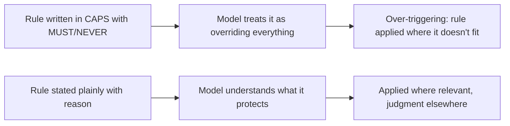
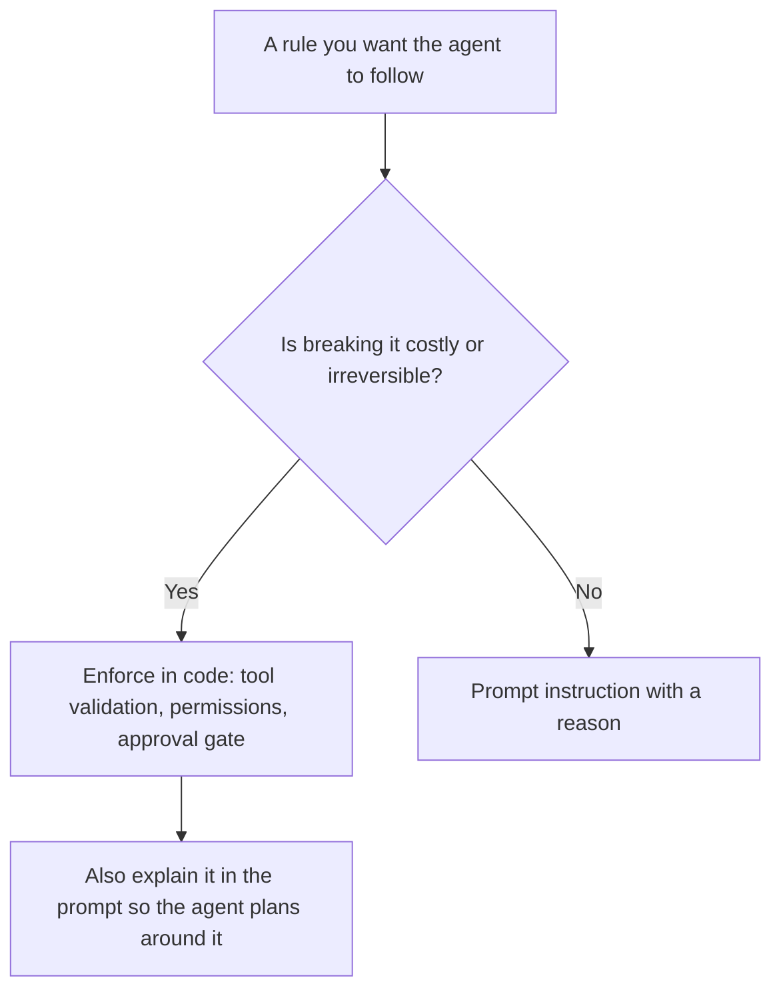

# Writing Instructions and Constraints

## Introduction

Instructions are the part of a prompt that tells the agent what to do and what not to do. They are also where most prompts go wrong.

Older language models often ignored instructions, so prompt writers learned to shout: `IMPORTANT`, `You MUST`, `NEVER EVER`. They added long lists of prohibitions and step-by-step scripts because the models could not be trusted to plan. Many prompts you will find online still look like this.

Current models are different. Anthropic's guidance describes them as following instructions more closely and more literally than earlier generations. That is good news, but it changes how you should write:

- Shouted rules now get **over-applied**. A model told "NEVER use the delete tool" may refuse to delete a temp file it just created.
- Hedged requirements now get **under-delivered**. "Try to include a summary if possible" reads as optional, because it says so.
- Rigid scripts now get **followed even when they do not fit**, which is worse than letting the model plan.

Think of the difference between a nervous manager who writes rules in red capital letters and an experienced lead who says, calmly, "We never deploy on Fridays, because nobody is around to fix things over the weekend." The second rule is easier to follow well, because you know what it is protecting.

This page shows how to write instructions and constraints that current models follow precisely, with before/after rewrites.

## Principle 1: Be Clear and Direct

Anthropic's "golden rule" for prompts: show your prompt to a colleague with minimal context and ask them to follow it. If they would be confused, the model will be too.

Being direct also means asking for what you actually want. Current models do what the words say.

| Less effective | More effective | Why |
|---|---|---|
| "Can you suggest some changes to this function?" | "Change this function to improve its performance." | The first asks for suggestions, so a literal model gives suggestions instead of editing. |
| "Try to add tests if possible." | "Add tests for the new behavior." | The hedge makes a requirement sound optional. |
| "Create a dashboard." | "Create a dashboard with filters by date and region, and a chart of weekly revenue." | Specific requests get specific results. |

## Principle 2: Explain the Why

The single most useful habit in prompt writing is attaching a reason to each rule. Anthropic's guide gives a simple example:

**Less effective:**

```text
NEVER use ellipses
```

**More effective:**

```text
Your response will be read aloud by a text-to-speech engine, so never use
ellipses, since the text-to-speech engine will not know how to pronounce them.
```

The second version does more than ban ellipses. The model can now generalize: it will also avoid other things a speech engine cannot pronounce, like emoji, tables, or "e.g." written as an abbreviation. A bare rule covers one case. A reason covers the whole family.

Reasons also tell the model where the edges of a rule are:

```text
Don't modify files under migrations/, because those have already run in
production and editing them would make our schema history inconsistent.
To change the schema, add a new migration instead.
```

From this the model can infer that reading migration files is fine, that creating a new migration is the right path, and that the rule is about history, not about the folder name.

## Principle 3: Normal Volume, Not ALL CAPS



Anthropic's guidance for current models: where you might have said "CRITICAL: You MUST use this tool when...", use normal prompting like "Use this tool when...". Prompts tuned to push older, under-triggering models now cause over-triggering.

There is a second cost. When several rules are each marked critical, the markers stop carrying information, and the prompt's anxious register leaks into the output: an anxious prompt tends to produce a cautious, hedging agent.

**Before:**

```text
CRITICAL!!! You MUST ALWAYS verify the customer's identity. NEVER EVER share
account details without verification. THIS IS EXTREMELY IMPORTANT.
```

**After:**

```text
Verify the customer's identity with the verify_identity tool before sharing
any account details. Account details include billing address, payment method,
and invoice history; sharing them with the wrong person is a privacy breach.
```

The "after" version is calmer and more useful: it defines what "account details" means and why it matters.

:::note
Emphasis is not banned. If testing shows one specific instruction is still being underweighted, a targeted emphasis on that single line is a reasonable, tested fix. It should be the exception you add after measuring, not the tone of your first draft.
:::

## Principle 4: Say What To Do, Not Only What To Avoid

Prohibitions have two problems. They describe the failure rather than the success, and a prohibition against a mistake the model was not going to make can actually draw attention to it.

| Prohibition | Positive instruction |
|---|---|
| "Do not use markdown." | "Write in smoothly flowing prose paragraphs." |
| "Don't be too verbose." | "Keep responses to the length the question needs." |
| "Don't start with 'Certainly!'" | "Start with the answer." |
| "Don't make things up." | "Base answers on tool results and the documents provided. If they don't cover the question, say so." |

Keep prohibitions that encode **real constraints**: legal requirements, money limits, data rules, promises the business must not make. Even then, add the reason.

## Principle 5: Describe Goals, Not Choreography

For judgment tasks, describe the outcome you want, the constraints, and how to check success. Let the model plan the route.

**Before:**

```text
STEP 1: Read the bug report.
STEP 2: Search the codebase for the error message.
STEP 3: Open the file with the error.
STEP 4: Write a fix.
STEP 5: Run the tests.
STEP 6: Write a summary.
```

What happens when the bug report has no error message? Or the bug is in a config file? A literal model follows the script anyway.

**After:**

```text
Fix the bug described in the report. A fix is complete when the existing tests
pass and a new test reproduces the bug and now passes. Keep the change focused
on the bug; reviewers reject unrelated refactors. Finish with a short summary
of the cause and the fix.
```

The "after" prompt is shorter and stronger. It states what done means and lets the model decide how to get there.

### Match specificity to fragility

Exact steps are still right where only one sequence is safe. Anthropic's audit guidance calls these "narrow bridges": destructive commands, authentication flows, compliance steps.

```text
To rotate a database credential, run exactly these commands in order and do
not modify them, because the old credential must stay valid until every
service has picked up the new one:
1. ./scripts/creds create --db orders
2. ./scripts/creds rollout --db orders --wait
3. ./scripts/creds revoke-previous --db orders
```

Use open-ended instructions for open-ended work and exact scripts for narrow, risky operations.

## Principle 6: Hard Limits Belong in Code Too

A prompt is guidance. A model can misread, a user can manipulate, and a long session can drift. For anything with real cost (money, data deletion, security, compliance), enforce the limit in your tool code and use the prompt to explain it.



Here is a refund tool that enforces the limit and returns a helpful error the agent can act on:

```python
REFUND_LIMIT_USD = 200


def issue_refund(invoice_id: str, amount_usd: float) -> dict:
    """Tool implementation. The prompt explains the limit; this code enforces it."""
    if amount_usd <= 0:
        return {"is_error": True, "content": "Amount must be positive."}
    if amount_usd > REFUND_LIMIT_USD:
        return {
            "is_error": True,
            "content": (
                f"Refunds above ${REFUND_LIMIT_USD} need human approval. "
                "Create a handoff ticket with create_handoff instead, "
                "including the invoice ID and the reason for the refund."
            ),
        }
    # ... call the payments API here ...
    return {"is_error": False, "content": f"Refunded ${amount_usd:.2f} on {invoice_id}."}


print(issue_refund("INV-1001", 45.00))
print(issue_refund("INV-1002", 450.00))
```

Output:

```text
{'is_error': False, 'content': 'Refunded $45.00 on INV-1001.'}
{'is_error': True, 'content': 'Refunds above $200 need human approval. Create a handoff ticket with create_handoff instead, including the invoice ID and the reason for the refund.'}
```

The error message is written for the agent: it says what went wrong and what to do next. See [Handling Tool Errors](../2-agents-tool-use/6-agents-tool-errors.mdx) and [Human Approval Gates](../12-agents-safety-and-security/7-agents-approval-gates.mdx).

## Keeping Rules Honest: Rules with Reasons in Code

When a team edits a prompt over months, rules pile up without reasons, and nobody remembers why a line exists. One lightweight fix is to keep rules as data, so each one must carry its reason and note whether code enforces it.

```python
from dataclasses import dataclass


@dataclass(frozen=True)
class Rule:
    text: str
    reason: str
    enforced_in_code: bool = False


RULES = [
    Rule(
        text="Refund up to $200 after confirming the charge with lookup_invoice.",
        reason="Finance reviews larger refunds for fraud.",
        enforced_in_code=True,
    ),
    Rule(
        text="Only describe plans and prices listed in the context or returned by a tool.",
        reason="Customers act on what you say, so an invented price becomes a dispute.",
    ),
]


def render_rules(rules: list[Rule]) -> str:
    missing = [r.text for r in rules if not r.reason.strip()]
    if missing:
        raise ValueError(f"Rules without a reason: {missing}")
    lines = [f"{r.text} {r.reason}" for r in rules]
    return "<rules>\n" + "\n\n".join(lines) + "\n</rules>"


print(render_rules(RULES))
```

Output:

```text
<rules>
Refund up to $200 after confirming the charge with lookup_invoice. Finance reviews larger refunds for fraud.

Only describe plans and prices listed in the context or returned by a tool. Customers act on what you say, so an invented price becomes a dispute.
</rules>
```

The `enforced_in_code` flag is for humans reviewing the prompt: it shows which rules are backed by a guarantee and which rely on the model alone.

## Defaults for Action, Ambiguity, and Risk

Agents constantly decide whether to act, ask, or stop. Tell them your preference, because it varies by product.

### Act or suggest?

Anthropic's guide offers two opposite defaults, depending on what you want:

```text
<default_to_action>
By default, implement changes rather than only suggesting them. If the user's
intent is unclear, infer the most useful likely action and proceed, using tools
to discover any missing details instead of guessing.
</default_to_action>
```

```text
<do_not_act_before_instructions>
Do not change files unless clearly instructed to make changes. When the user's
intent is ambiguous, default to providing information, doing research, and
providing recommendations rather than taking action.
</do_not_act_before_instructions>
```

A coding agent inside an IDE usually wants the first; an agent with access to a production system usually wants the second.

### Reversibility

A good general rule for agents with real side effects, adapted from Anthropic's guide:

```text
Consider the reversibility and impact of your actions. Take local, reversible
actions like reading files or running tests freely. For actions that are hard
to reverse, affect shared systems, or are visible to others (deleting data,
force-pushing, sending messages), ask the user before proceeding.
```

This one paragraph replaces a long list of "NEVER do X" lines, and it covers actions you did not think to list.

### When rules conflict

If two instructions can pull in different directions, say which wins:

```text
Customer satisfaction matters, but the refund limit takes priority: if a
customer is upset and asks for more than the limit, apologize, explain that a
specialist will review it, and create a handoff ticket.
```

## Real-World Scenario

Your IT team is building an agent that handles access requests in Slack: "Give me access to the analytics database," "Add Sam to the design-team group." The first prompt was a wall of prohibitions:

```text
You are an IT assistant. NEVER grant admin access. NEVER grant access without
approval. NEVER add users to groups they shouldn't be in. ALWAYS be secure.
ALWAYS follow policy. DO NOT make mistakes.
```

In testing, the agent refused harmless requests ("add me to the #lunch channel group") because "access without approval" seemed to cover everything, and it never explained to users what would happen next.

### The solution

```text
You handle access requests from employees at Lumen in Slack.

<context>
Access levels: "standard" groups (team channels, shared drives) can be granted on
request. "Restricted" groups (production databases, finance systems, admin roles)
need approval from the resource owner. The access_catalog tool returns each
group's level and owner.
</context>

<rules>
Grant standard access directly with grant_access, because these groups are
low-risk and waiting for approval slows people down.

For restricted access, call request_approval with the owner from the catalog and
tell the requester who is reviewing it. Restricted systems hold customer and
financial data, and audits require a named approver.

Admin roles are only granted through the security team's quarterly review, so
for admin requests explain that process instead of requesting approval.
</rules>

<output_format>
Reply in one or two sentences: what you did and what happens next.
</output_format>
```

In code, `grant_access` rejects any group whose catalog level is not `standard`, and admin groups are not grantable by the agent at all.

### Why this approach

- The **context** defines the categories the old prohibitions only hinted at.
- Each **rule has a reason**, so the agent can handle a group it has not seen before by checking its level.
- **Positive instructions** ("grant standard access directly") fix the over-refusal.
- **Code enforcement** means a manipulated or confused agent still cannot grant restricted access.

### When to use it / when not to

This style fits any agent that applies a policy to varied requests. If every request truly follows one fixed path with no judgment (for example, a nightly job), a deterministic workflow in code is simpler and safer than an agent. See [Agents vs Workflows](../0-agents-fundamentals/3-agents-vs-workflows.mdx).

### Alternatives and trade-offs

| Approach | Pros | Cons | Best for |
|---|---|---|---|
| Prohibition list in caps | Quick to write | Over-refusal, no generalization | Nothing in current models |
| Rules with reasons (this page) | Generalizes, readable | Requires thinking through the policy | Most agent policies |
| Exact scripts | Predictable | Brittle outside the script | Narrow, risky operations |
| Code enforcement only | Strong guarantee | Agent cannot plan around limits it does not know | Combine with prompt explanation |
| Policy engine (for example OPA) called by tools | Central, auditable | More infrastructure | Large organizations with many agents |

## Common Mistakes

| Mistake | Fix |
|---|---|
| Rules without reasons | Add the "because" so the model knows what the rule protects |
| ALL CAPS and repeated "critical" markers | State rules plainly; add emphasis only for a measured, specific problem |
| Hedges on real requirements ("try to", "if possible") | State requirements directly |
| Prohibition lists for style | Describe the desired style positively |
| Step-by-step scripts for judgment work | Describe the outcome and how to verify it |
| Money, data, or security limits only in the prompt | Enforce in tool code and explain in the prompt |
| Two rules that conflict with no tie-breaker | Say which one wins |
| Trait claims ("You tend to be too verbose") | Describe the desired behavior instead |

## Summary

- Current models follow instructions closely and literally, so write exactly what you mean at a normal volume.
- Attach a reason to every rule; reasons let the model generalize and find the rule's edges.
- Prefer positive instructions and goal descriptions; keep exact scripts for narrow, risky operations.
- Enforce costly limits in code and explain them in the prompt, with error messages that tell the agent what to do instead.
- State defaults for acting vs asking, and say which rule wins when two conflict.

## Exercises

1. Rewrite this rule with a reason and a positive framing: "NEVER EVER respond in more than 3 sentences!!!"
2. Find a prompt with at least three "never" lines. For each, decide: real constraint (keep, add reason), style preference (rewrite positively), or unnecessary (delete).
3. Extend the `Rule` class with an `owner` field (who asked for this rule) and make `render_rules` skip rules marked as `deprecated`.
4. Write the `grant_access` tool from the scenario so it rejects non-standard groups with an error message that tells the agent to call `request_approval`.

## Further Learning

- [Designing Agent System Prompts](./0-agents-system-prompt-design.mdx)
- [Prompting for Better Tool Use](./4-agents-prompting-for-tool-use.mdx)
- [Prompt Anti-Patterns](./9-agents-prompt-anti-patterns.mdx)
- [Input and Output Guardrails](../12-agents-safety-and-security/6-agents-guardrails.mdx)
- [Least Privilege for Agent Tools](../12-agents-safety-and-security/2-agents-least-privilege.mdx)
- Anthropic: [Prompting best practices](https://platform.claude.com/docs/en/build-with-claude/prompt-engineering/claude-prompting-best-practices)
