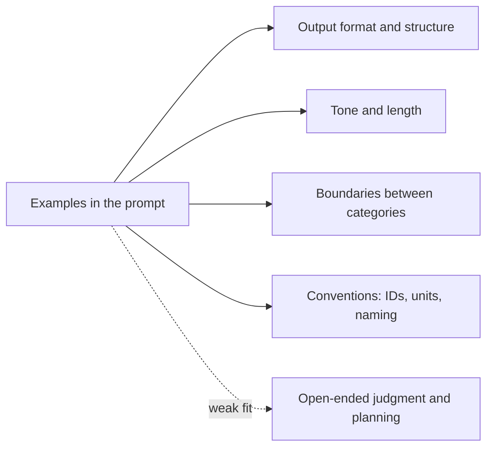
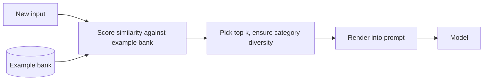

# Few-Shot Examples for Agents

## Introduction

If you have ever trained a new teammate, you know that one good example can replace a page of explanation. "Write release notes like these three" is clearer than a style guide.

Language models work the same way. **Few-shot prompting** (also called multishot prompting) means including a few input and output examples in the prompt so the model can pick up the pattern. Anthropic's prompting guide calls examples "one of the most reliable ways to steer Claude's output format, tone, and structure." Google's Gemini guide goes further and recommends including few-shot examples in prompts as a default.

Examples are powerful in both directions, though. The model copies what it sees: the length, tone, structure, and even quirks of your examples. A single example will often be reproduced almost exactly. An outdated example freezes old behavior into a new model. For agents, an example of a tool sequence can turn into a script the agent follows even when it does not fit.

This page covers:

- What examples are good for in agents, and what they are not
- How to write and structure a small, diverse example set
- How to select examples dynamically for each request
- How to avoid the common traps of over-indexing and stale examples

## What Examples Are Good For



Examples work best when the thing you want is **easier to show than to describe**:

| Good use | Why examples help |
|---|---|
| A specific output shape (a ticket summary, a commit message style) | Easier to show than to specify |
| Category boundaries ("billing" vs "account" tickets) | Edge cases teach where the line is |
| Tone and length for a particular audience | Model matches what it sees |
| Domain conventions (how you write IDs, dates, severity labels) | Concrete beats abstract |

They are a weaker fit for:

- **Open-ended planning.** An example of "first search, then read, then edit" becomes a script. Describe the goal instead; see [Prompting for Planning](./5-agents-prompting-for-planning.mdx).
- **Judgment the model already has.** If the model already writes good summaries, an example only narrows it to one style.
- **Strict machine-readable output.** If you need guaranteed JSON, use structured outputs, which enforce a schema. Examples can still show *content* conventions within that schema. See [Structured Outputs](../1-agents-llm-apis/6-agents-structured-outputs.mdx).

## Writing a Good Example Set

Anthropic's guide recommends examples that are:

- **Relevant**: they mirror your real use case closely.
- **Diverse**: they cover edge cases and vary enough that the model does not pick up unintended patterns.
- **Structured**: each wrapped in an `example` tag, with the set wrapped in an `examples` tag, so the model can tell examples apart from instructions.

It suggests 3 to 5 examples as a starting point. Google's guide adds a caution in the other direction: too many examples can cause the model to overfit to them. Anthropic's context engineering post makes the same point about curating a few diverse, canonical examples rather than stuffing in every edge case.

### Diversity matters more than count

Suppose every example ticket summary you include happens to be three bullet points long and starts with "Customer reports". The model will learn that every summary is three bullets starting with "Customer reports", even though you never said so. Vary the things you do not care about, and keep consistent the things you do.

| Keep consistent (you want it copied) | Vary (you do not want it copied) |
|---|---|
| Field order and labels | Length of the input |
| Tone and level of detail | Topic and product area |
| How IDs and dates are written | Customer tone (calm, angry, confused) |
| | Which category is the answer |

### Structure

```text
<examples>
<example>
<ticket>I was charged twice for October. Card ending 4242.</ticket>
<triage>
category: billing
priority: high
summary: Duplicate charge for October on card ending 4242.
</triage>
</example>

<example>
<ticket>how do i change the logo on my invoices??</ticket>
<triage>
category: how-to
priority: low
summary: Wants to change the logo shown on invoices.
</triage>
</example>

<example>
<ticket>Since this morning none of our team can log in. We have a client demo at 2pm.</ticket>
<triage>
category: outage
priority: urgent
summary: Whole team unable to log in since this morning; client demo at 2pm.
</triage>
</example>
</examples>

These examples are illustrative. Match their format and level of detail, not their topics.
```

Notice the final line. Telling the model the examples are illustrative, and what to copy from them, reduces over-indexing.

## Explaining the Examples

Examples show *what*; a short note can show *why*. When an example captures a boundary case, say what makes it that category:

```text
<example>
<ticket>I can't download last month's invoice PDF, the button does nothing.</ticket>
<triage>
category: bug
priority: medium
summary: Invoice PDF download button does nothing for last month's invoice.
</triage>
<note>This is a bug, not billing: nothing is wrong with the charge itself,
the product feature is broken.</note>
</example>
```

This is the same principle as [explaining the why behind rules](./2-agents-instructions-and-constraints.mdx): the model generalizes from the reason, not just the instance.

## Examples and Built-In Thinking

Current models with built-in thinking still benefit from examples. Anthropic's guide notes that worked examples shape how the model approaches similar problems in its own thinking. For reasoning-heavy tasks, present each example as **the problem, the method to apply, and the expected answer**, rather than only the final answer.

```text
<example>
<problem>A customer on the Growth plan ($49/month) upgraded to Scale ($149/month)
on day 10 of a 30-day billing cycle. What is the prorated charge?</problem>
<method>Charge the price difference for the remaining days of the cycle:
(149 - 49) * (20 / 30).</method>
<answer>$66.67</answer>
</example>
```

See [Prompting for Reasoning](./6-agents-reasoning-prompts.mdx) for more on how prompting interacts with built-in thinking.

## Building Examples in Code

Keep your examples as data, not as a hand-edited block of text. That makes them easy to test, review, and swap.

```python
from dataclasses import dataclass
from html import escape


@dataclass(frozen=True)
class TriageExample:
    ticket: str
    category: str
    priority: str
    summary: str
    note: str = ""


def render_examples(examples: list[TriageExample]) -> str:
    blocks = []
    for ex in examples:
        body = (
            f"<ticket>{escape(ex.ticket)}</ticket>\n"
            "<triage>\n"
            f"category: {ex.category}\n"
            f"priority: {ex.priority}\n"
            f"summary: {ex.summary}\n"
            "</triage>"
        )
        if ex.note:
            body += f"\n<note>{ex.note}</note>"
        blocks.append(f"<example>\n{body}\n</example>")
    return (
        "<examples>\n" + "\n\n".join(blocks) + "\n</examples>\n\n"
        "These examples are illustrative. Match their format and level of detail, "
        "not their topics."
    )


EXAMPLES = [
    TriageExample("I was charged twice for October.", "billing", "high",
                  "Duplicate charge for October."),
    TriageExample("how do i change the logo on my invoices??", "how-to", "low",
                  "Wants to change the invoice logo."),
]

print(render_examples(EXAMPLES))
```

Output:

```text
<examples>
<example>
<ticket>I was charged twice for October.</ticket>
<triage>
category: billing
priority: high
summary: Duplicate charge for October.
</triage>
</example>

<example>
<ticket>how do i change the logo on my invoices??</ticket>
<triage>
category: how-to
priority: low
summary: Wants to change the invoice logo.
</triage>
</example>
</examples>

These examples are illustrative. Match their format and level of detail, not their topics.
```

## Dynamic Example Selection

A fixed set of examples is the same for every request. If your agent handles many different kinds of input, you can keep a larger **example bank** and pick the few most similar to the current input. This gives relevant examples without bloating every prompt.



The similarity function can be simple word overlap for a prototype, or embeddings for production (see [Embeddings](../5-agents-rag/1-agents-embeddings.mdx)). Here is a dependency-free version that also makes sure the selected examples cover different categories, so the model does not see three "billing" examples and assume the answer is "billing".

```python
import re


def tokens(text: str) -> set[str]:
    return set(re.findall(r"[a-z0-9]+", text.lower()))


def similarity(a: str, b: str) -> float:
    ta, tb = tokens(a), tokens(b)
    if not ta or not tb:
        return 0.0
    return len(ta & tb) / len(ta | tb)  # Jaccard similarity


def select_examples(query: str, bank: list[dict], k: int = 3) -> list[dict]:
    ranked = sorted(bank, key=lambda ex: similarity(query, ex["ticket"]), reverse=True)
    chosen, seen_categories = [], set()
    # First pass: best match per category, for diversity.
    for ex in ranked:
        if ex["category"] not in seen_categories:
            chosen.append(ex)
            seen_categories.add(ex["category"])
        if len(chosen) == k:
            return chosen
    # Second pass: fill remaining slots with the next best matches.
    for ex in ranked:
        if ex not in chosen:
            chosen.append(ex)
        if len(chosen) == k:
            break
    return chosen


BANK = [
    {"ticket": "Charged twice for my October invoice", "category": "billing"},
    {"ticket": "Invoice PDF download button does nothing", "category": "bug"},
    {"ticket": "How do I add a teammate to my account", "category": "how-to"},
    {"ticket": "Refund for the annual plan please", "category": "billing"},
    {"ticket": "Nobody on the team can log in", "category": "outage"},
]

for ex in select_examples("my invoice download is broken and I was charged twice", BANK):
    print(ex["category"], "|", ex["ticket"])
```

Output:

```text
billing | Charged twice for my October invoice
bug | Invoice PDF download button does nothing
how-to | How do I add a teammate to my account
```

:::caution
Dynamic examples change the prompt on every request, which affects prompt caching. Put the selected examples **after** the stable part of the system prompt, or in the user message, so the stable prefix still caches. See [Prompt Caching](../4-agents-memory-and-context/4-agents-prompt-caching.mdx).
:::

## Examples as Conversation Turns

Another way to give examples is as earlier turns in the conversation: a user message with an example input, then an assistant message with the example output, repeated, followed by the real user message.

```python
few_shot_messages = [
    {"role": "user", "content": "Ticket: I was charged twice for October."},
    {"role": "assistant", "content": "category: billing\npriority: high"},
    {"role": "user", "content": "Ticket: how do i change my invoice logo?"},
    {"role": "assistant", "content": "category: how-to\npriority: low"},
    # The real input must be the final message, and it must be a user turn.
    {"role": "user", "content": "Ticket: Nobody on our team can log in since 9am."},
]
print(few_shot_messages[-1]["role"])
```

Output:

```text
user
```

This works, but two cautions apply on current Claude models:

- **The last message must be a user turn.** A trailing assistant message is a "prefill," which returns a 400 error on current models. Earlier assistant turns are fine.
- **Fake history can confuse agents.** In a multi-turn agent, invented turns look like real past conversation. Examples in an `examples` block in the system prompt are clearer about what they are.

## Where Examples Should Not Go: Tool Descriptions

It is tempting to put example calls inside a tool's description. Anthropic's audit guidance recommends against it: tool descriptions should describe the contract (what the tool does, when to use it, what each parameter means, what it returns), while worked examples and fake dialogues constrain how the model explores and cost tokens on every request. Make parameters self-explanatory instead, for example with clear names and enums. See [Prompting for Better Tool Use](./4-agents-prompting-for-tool-use.mdx) and [Tool Design Principles](../2-agents-tool-use/7-agents-tool-design-principles.mdx).

## Real-World Scenario

Your company runs a project management SaaS. You are building an agent that triages incoming support tickets: assign a category, a priority, and a one-line summary, then route the ticket. A zero-shot prompt with category definitions gets most tickets right, but reviewers keep correcting two things:

- Tickets about broken invoice features get labeled "billing" instead of "bug"
- Summaries vary wildly in length and style, which makes the queue hard to scan

### The solution

1. Keep the category definitions in the system prompt; they are still the primary signal.
2. Build an example bank of about 30 real (anonymized) tickets that reviewers labeled, deliberately including the billing-versus-bug boundary cases with a `note` explaining each.
3. For each new ticket, select 3 examples with `select_examples`, ensuring category diversity.
4. Add the line "These examples are illustrative. Match their format and level of detail, not their topics."
5. Measure the change on a held-out set of labeled tickets before and after. See [Iterating on Prompts with Evidence](./10-agents-prompt-iteration.mdx).

### Why this approach

The two problems are exactly what examples fix well: a **boundary** that is easier to show than define, and an **output style** that is easier to show than describe. Dynamic selection keeps each prompt small while giving the model the most relevant boundary cases.

### When to use it / when not to

Use examples when the desired output has a consistent shape or when category boundaries are subtle. Skip them when the model already produces what you want zero-shot; adding examples then only narrows its behavior. Avoid examples that script multi-step agent behavior.

### Alternatives and trade-offs

| Approach | Pros | Cons | Best for |
|---|---|---|---|
| Zero-shot with clear definitions | Simple, no over-indexing | Subtle boundaries may be missed | Tasks the model already does well |
| Fixed few-shot set (3 to 5) | Easy, cacheable | Same examples for every input | Narrow, uniform tasks |
| Dynamic example selection | Relevant examples per input | Needs a labeled bank and retrieval | Varied inputs with subtle boundaries |
| Structured outputs | Guarantees the schema | Does not teach content conventions | Machine-read output |
| Fine-tuning on many examples | Pattern baked into the model | Cost, slower iteration | Very high volume, stable tasks |

## Common Mistakes

| Mistake | What happens | Fix |
|---|---|---|
| A single "gold" example | Model copies it closely, including its length and topic | Use several varied examples, labeled illustrative |
| All examples look alike | Model learns unintended patterns | Vary what you do not care about |
| Examples contradict instructions | Model usually follows the examples | Fix the examples first; they are the stronger signal |
| Stale examples from an older model or old product | Old behavior gets frozen in | Review examples when the model or product changes |
| Example tool sequences | Agent follows the script even when it does not fit | Describe the goal; let the model plan |
| Examples inside tool descriptions | Narrows exploration, costs tokens every call | Keep descriptions to the contract |
| Trailing assistant turn as an example | 400 error on current Claude models | End with the real user message |

## Summary

- Examples are one of the strongest signals in a prompt; the model copies their format, length, and tone.
- Use 3 to 5 relevant, diverse examples wrapped in `example` tags, and label them as illustrative.
- Vary what you do not want copied; keep consistent what you do.
- Explain boundary cases with a short note, and present reasoning examples as problem, method, and answer.
- Select examples dynamically when inputs vary, and place them after the stable prompt prefix.
- Keep examples out of tool descriptions and away from scripting multi-step behavior.

## Exercises

1. Take three examples you have used in a prompt and list everything they have in common. Which of those patterns do you actually want copied?
2. Extend `select_examples` to accept a `min_similarity` threshold and fall back to a default set when nothing in the bank is similar enough.
3. Replace the Jaccard similarity with embeddings (see [Embeddings](../5-agents-rag/1-agents-embeddings.mdx)) and compare which examples get selected for five test tickets.
4. Run a small experiment: classify 20 labeled tickets with zero examples, with one example, and with three diverse examples. Record accuracy and how often the summaries copy the example wording.

## Further Learning

- [Writing Instructions and Constraints](./2-agents-instructions-and-constraints.mdx)
- [Prompt Templates](./7-agents-prompt-templates.mdx)
- [Prompt Anti-Patterns](./9-agents-prompt-anti-patterns.mdx)
- [Building Evaluation Datasets](../11-agents-evaluation-and-testing/1-agents-building-eval-sets.mdx)
- Anthropic: [Prompting best practices: use examples effectively](https://platform.claude.com/docs/en/build-with-claude/prompt-engineering/claude-prompting-best-practices)
- Google: [Gemini prompting strategies: few-shot examples](https://ai.google.dev/gemini-api/docs/prompting-strategies)
