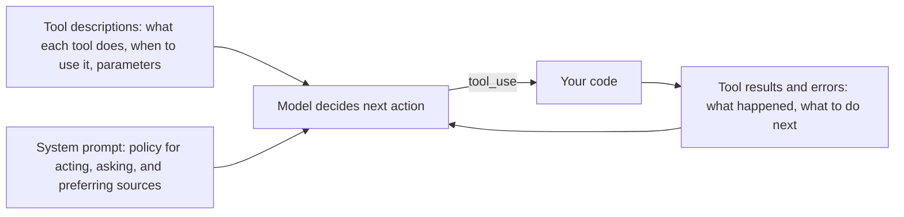

# Prompting for Better Tool Use

## Introduction

An agent is only as good as its decisions about tools: which one to call, when, with what arguments, and when to stop calling tools and answer. Most "the agent did something dumb" bug reports come down to one of these:

- It answered from memory when it should have searched.
- It called a tool when the answer was already in the conversation.
- It picked the wrong one of two similar tools.
- It passed a malformed argument, got an error, and gave up.
- It made ten sequential calls that could have been three parallel ones.

You steer these decisions with text in three places: the **tool definitions**, the **system prompt**, and the **tool results** you send back. This page shows what belongs in each, how to calibrate tool triggering on current models (which are more responsive than older ones, so old "you MUST use this tool" prompts now over-trigger), and how to handle the cases where you need a tool call to happen.

:::note
This page is about the *prompting* side of tool use. For defining tools, schemas, and the agent loop itself, see [Defining Tools](../2-agents-tool-use/1-agents-defining-tools.mdx), [Tool Input Schemas](../2-agents-tool-use/2-agents-tool-input-schemas.mdx), and [Tool Design Principles](../2-agents-tool-use/7-agents-tool-design-principles.mdx).
:::

## Three Places to Steer Tool Use



| Place | What belongs there | What does not |
|---|---|---|
| Tool description | The contract: purpose, when to use and not use, parameter meanings, limits, what it returns | Behavioral rules about the conversation, worked examples, shouting |
| System prompt | Cross-tool policy: act vs suggest, which sources to prefer, what needs confirmation | A list of every tool, duplicated descriptions |
| Tool result | What happened, in high-signal form; on error, how to fix it | Raw stack traces, huge payloads, cryptic codes |

## Tool Descriptions Are the Main Lever

Anthropic's guidance is clear that detailed descriptions are the most important factor in tool performance, and that the most common failure is *under*-description. A description is like a man page: what the tool does, when to use it (and when not to), what each parameter means, caveats, and what it does not return. Aim for at least three or four sentences. Anthropic's post on writing tools for agents suggests describing each tool the way you would explain it to a new hire on your team.

**Before:**

```python
search_tool_before = {
    "name": "search",
    "description": "Searches for stuff.",
    "input_schema": {
        "type": "object",
        "properties": {"q": {"type": "string"}},
        "required": ["q"],
    },
}
```

**After:**

```python
search_docs = {
    "name": "search_docs",
    "description": (
        "Full-text search over Acme's internal documentation: product specs, "
        "runbooks, and policy pages. Use it for questions about how Acme's products, "
        "processes, or policies work, since these change often and differ from public "
        "information. Do not use it for customer account data; use lookup_account for "
        "that. Returns up to `limit` results, each with a title, URL, last-updated "
        "date, and a 300-character snippet. It does not return full page text; call "
        "read_doc with the URL to read a page."
    ),
    "input_schema": {
        "type": "object",
        "properties": {
            "query": {
                "type": "string",
                "description": "Keywords or a short question. Product names work best "
                "spelled as in the UI, for example 'Smart Invoices'.",
            },
            "limit": {
                "type": "integer",
                "description": "Maximum results to return, 1 to 20. Default 5.",
                "minimum": 1,
                "maximum": 20,
            },
        },
        "required": ["query"],
        "additionalProperties": False,
    },
}
print(search_docs["name"], len(search_docs["description"].split()), "words")
```

Output:

```text
search_docs 77 words
```

What changed:

- A **specific name** (`search_docs`, not `search`) that says what it searches.
- **When to use and when not to**, including which other tool covers the neighboring case.
- **Parameter descriptions** with a hint about what works well.
- **What it returns and what it does not**, so the model knows a follow-up `read_doc` call is needed.

:::tip
Small wording changes can have large effects. Anthropic's tools post describes Claude appending the current year to web search queries, biasing results, until the tool description was revised. When a tool misbehaves, read its description as if you were the model before changing anything else.
:::

### Keep descriptions as contracts

Tool descriptions are sent on every request, and the model reads them as a statement of what the tool does. Two things tend to creep in and cause trouble:

- **Behavior smuggling**: "After showing results, always recommend our premium plan." That is a conversational instruction, not a fact about the tool. Put it in the system prompt if you want it at all.
- **Scolding cross-references**: "ALWAYS use this tool, NEVER use search for this!" Put the preference for a tool in that tool's own description ("Use this for X") rather than scattering warnings across its rivals.

## The System Prompt: Policy, Not a Tool List

The system prompt is where you set **policy that spans tools**: when to act versus suggest, which sources to trust, and what needs confirmation.

### Act, or suggest?

Current models do what the words say. Anthropic's guide notes that "Can you suggest some changes?" tends to get suggestions, while "Change this function" gets edits. If you want the agent to act by default, say so in the system prompt:

```text
By default, implement changes rather than only suggesting them. If the user's
intent is unclear, infer the most useful likely action and proceed, using tools
to discover missing details instead of guessing.
```

If you want the opposite (for example an agent with access to production), say that instead. See [Writing Instructions and Constraints](./2-agents-instructions-and-constraints.mdx) for both versions.

### Say when to check sources

A common failure is an agent answering from its training data when your internal sources would give a better or more current answer. The tempting fix is "ALWAYS search before answering," which over-triggers: now the agent searches for "thanks!" too.

Instead, describe **when** looking things up improves the answer:

```text
Questions about Acme products, pricing, and policies should be answered from
search_docs results, because these change monthly and your general knowledge
of them is likely out of date. General programming or writing questions can
be answered directly.
```

Anthropic's audit guidance also flags the opposite problem. Lines like "only use tools when strictly necessary" or "minimize tool calls" are followed literally by current models, which then answer from memory when a tool would have served better. If cost or latency is the concern, lower the `effort` setting instead: lower effort makes fewer, more consolidated tool calls without a prompt telling the model to avoid tools.

### Calibrating trigger strength

| Old-style instruction | Problem on current models | Better |
|---|---|---|
| "CRITICAL: You MUST use search_docs when..." | Over-triggering | "Use search_docs when..." |
| "If in doubt, use search_docs." | Searches for everything | "Use search_docs when the answer depends on Acme-specific information." |
| "Only use tools when strictly necessary." | Answers from memory | Remove; lower effort if cost is the concern |
| "Default to search_docs." | Blanket default | Say what it improves and when |

### Parallel calls

Current models already call independent tools in parallel quite often. You can push it further, or turn it down, with a prompt. Anthropic's guide gives this version:

```text
<use_parallel_tool_calls>
If you intend to call multiple tools and there are no dependencies between the
calls, make all of the independent calls in parallel. For example, when reading
3 files, run 3 tool calls in parallel. If some calls depend on previous results
to fill in their parameters, call them sequentially instead. Never use
placeholders or guess missing parameters.
</use_parallel_tool_calls>
```

Your loop must handle several `tool_use` blocks in one response and return all the results together. See [Parallel Tool Calls](../2-agents-tool-use/5-agents-parallel-tool-calls.mdx).

## Tool Results Are Prompts Too

Everything a tool returns goes into the model's context and shapes its next move. Treat tool output as part of your prompt design.

### Return high-signal content

Anthropic's tools post recommends returning meaningful fields (names, titles, file types) instead of low-level identifiers like UUIDs and MIME types, and keeping responses token-efficient with pagination, filtering, and truncation. When you truncate, say so and say how to get more:

```python
def format_search_results(results: list[dict], limit: int) -> str:
    lines = []
    for r in results[:limit]:
        lines.append(f"- {r['title']} ({r['url']}, updated {r['updated']}): {r['snippet']}")
    if len(results) > limit:
        lines.append(
            f"[{len(results) - limit} more results not shown. Narrow the query "
            "or raise `limit` to see more.]"
        )
    return "\n".join(lines) if lines else "No results. Try different keywords or a product name."


results = [
    {"title": "Smart Invoices overview", "url": "/docs/smart-invoices", "updated": "2026-09-30",
     "snippet": "Smart Invoices send reminders automatically..."},
    {"title": "Invoice reminders FAQ", "url": "/docs/reminders-faq", "updated": "2026-08-12",
     "snippet": "Reminders go out 3 days before the due date..."},
    {"title": "Legacy invoices", "url": "/docs/legacy", "updated": "2024-02-01",
     "snippet": "Deprecated invoice templates..."},
]
print(format_search_results(results, limit=2))
```

Output:

```text
- Smart Invoices overview (/docs/smart-invoices, updated 2026-09-30): Smart Invoices send reminders automatically...
- Invoice reminders FAQ (/docs/reminders-faq, updated 2026-08-12): Reminders go out 3 days before the due date...
[1 more results not shown. Narrow the query or raise `limit` to see more.]
```

### Write errors for the agent

An error is a chance to teach. "Error 422" teaches nothing. "The `date` parameter must be YYYY-MM-DD, for example 2026-10-10" lets the agent fix its call immediately. Mark failures with `is_error` so the model knows the call did not succeed. See [Handling Tool Errors](../2-agents-tool-use/6-agents-tool-errors.mdx).

```python
from datetime import date


def get_bookings(day: str) -> dict:
    try:
        parsed = date.fromisoformat(day)
    except ValueError:
        return {
            "type": "tool_result",
            "is_error": True,
            "content": (
                f"'{day}' is not a valid date. Use YYYY-MM-DD, for example 2026-10-10. "
                "If the user said a relative date like 'tomorrow', compute it from "
                "today's date in the session context."
            ),
        }
    return {"type": "tool_result", "content": f"No bookings on {parsed.isoformat()}."}


print(get_bookings("next tuesday")["content"])
```

Output:

```text
'next tuesday' is not a valid date. Use YYYY-MM-DD, for example 2026-10-10. If the user said a relative date like 'tomorrow', compute it from today's date in the session context.
```

(In a real loop you would also set `tool_use_id` on each result to match the call.)

## When You Need a Tool Call to Happen

Sometimes you need the model to call a specific tool, for example to extract data into a schema. On older APIs you could force this with `tool_choice`. On current Claude models, forced tool choice (`{"type": "any"}` or `{"type": "tool", "name": ...}`) returns a 400 error. The current approaches are:

1. **For extraction into a fixed shape**, use structured outputs instead of a tool. See [Structured Outputs](../1-agents-llm-apis/6-agents-structured-outputs.mdx).
2. **For steering toward an action**, keep `tool_choice` on `auto`, name the tool in the user instruction, and set `strict: True` on the tool so any call matches the schema exactly.
3. **Check the response** for a `tool_use` block and re-prompt if none came back, because `auto` does not guarantee a call.

```python
from anthropic import Anthropic

client = Anthropic()

create_ticket = {
    "name": "create_ticket",
    "description": (
        "Create a support ticket in the helpdesk. Use it when the user reports a "
        "problem that needs follow-up by the support team. Returns the ticket ID."
    ),
    "strict": True,  # tool inputs must match the schema exactly
    "input_schema": {
        "type": "object",
        "properties": {
            "title": {"type": "string", "description": "One-line summary of the problem."},
            "severity": {"type": "string", "enum": ["low", "medium", "high"]},
        },
        "required": ["title", "severity"],
        "additionalProperties": False,
    },
}

messages = [{
    "role": "user",
    "content": "Our exports have been failing since 8am. Please file a ticket with create_ticket.",
}]

response = client.messages.create(
    model="claude-opus-5-5",
    max_tokens=16000,
    tools=[create_ticket],
    messages=messages,
)

tool_calls = [b for b in response.content if b.type == "tool_use"]
if not tool_calls:
    # auto does not guarantee a call: add the reply and ask again, plainly.
    messages.append({"role": "assistant", "content": response.content})
    messages.append({"role": "user", "content": "Please create the ticket now with create_ticket."})
else:
    print(tool_calls[0].name, tool_calls[0].input)
```

Example output:

```text
create_ticket {'title': 'Exports failing since 8am', 'severity': 'high'}
```

Other providers have their own equivalents: OpenAI and Gemini support function calling with modes for requiring a call, and open-source servers such as vLLM and Ollama support tool calling for models trained for it. Check each provider's current docs, since support for forcing a call varies by model.

## Real-World Scenario

Your company has an internal "ask engineering" agent in Slack with three tools: `search_docs` (internal wiki), `search_code` (the monorepo), and `lookup_service` (service ownership and on-call). Engineers report two problems:

1. Asked "What's the retry policy for the payments service?", the agent answered with generic advice about exponential backoff instead of looking at the code.
2. After someone added "ALWAYS search before answering" to fix problem 1, the agent started searching the wiki for "thanks!" and "lol", and answers got slower.

### The solution

1. **Remove the blanket rule** and replace it with a when-to-check policy:

```text
Questions about our services, code, and processes should be answered from our
own sources (docs, code, service catalog), because our setup differs from common
practice and changes often. If the sources do not cover it, say so before giving
general advice. Casual messages and general programming questions need no lookup.
```

2. **Fix the tool descriptions.** `search_docs` and `search_code` both said "Search for information." Rewrite each to say what it covers, when to prefer it, and that code is the source of truth for runtime behavior like retry policies.
3. **Improve results.** `search_code` returned raw file blobs. Change it to return file paths, line numbers, and a few lines of context, with a note on how to read more.
4. **Measure** on a set of 30 real questions (some needing lookups, some not) before and after, counting correct answers and unnecessary tool calls.

### Why this approach

Problem 1 was a missing policy and unclear descriptions; problem 2 was an over-strong fix. A when-to-check policy fixes both, because it tells the model what lookups are *for*. Better descriptions resolve the overlap between the two search tools, which a human engineer would also have found ambiguous.

### When to use it / when not to

Use prompt and description tuning first whenever tool selection is wrong; it is cheap and fast to test. If an agent has dozens of tools and keeps confusing them, prompting has limits: reduce or merge tools, or use tool search to load only relevant ones. See [Working with Large Toolsets](../2-agents-tool-use/10-agents-large-toolsets.mdx).

### Alternatives and trade-offs

| Approach | Pros | Cons | Best for |
|---|---|---|---|
| Better tool descriptions | Biggest lever, cheap | Needs care per tool | Any wrong-tool or wrong-argument issue |
| System prompt "when to check" policy | Fixes answer-from-memory | Must be phrased carefully to avoid over-triggering | Knowledge agents |
| Forced tool choice | Guarantees a call | 400 on current Claude models | Older models only |
| Structured outputs | Guaranteed schema | Not for choosing actions | Extraction tasks |
| Fewer, merged tools | Less confusion | Redesign work | Overlapping toolsets |
| Lower effort | Fewer, consolidated calls | Some quality cost | Cost- or latency-sensitive routes |

## Common Mistakes

- **One-line tool descriptions.** Under-description is the most common tool problem; write the contract in full.
- **Shouting in descriptions or prompts.** "You MUST use X" causes over-triggering on current models.
- **Discouraging tools to save cost.** Use effort instead; prose discouragement makes agents answer from memory.
- **Listing tools in the system prompt.** It duplicates the definitions and goes stale when tools change.
- **Worked examples inside descriptions.** They narrow exploration and cost tokens on every call.
- **Raw, huge tool results.** Return high-signal fields and say how to get more.
- **Cryptic errors.** Say what was wrong and how to fix it, with `is_error` set.
- **Relying on forced tool choice.** Use `auto` with clear instructions, `strict`, and a check for a missing call.

## Summary

- You steer tool use through tool descriptions, the system prompt, and tool results.
- Descriptions are the main lever: purpose, when (not) to use, parameters, limits, and what is returned.
- The system prompt sets cross-tool policy: act vs suggest, when to consult sources, what needs confirmation.
- Calibrate trigger strength with plain language; use effort, not prose, to reduce tool calls.
- Tool results and errors are prompts: make them concise, high-signal, and actionable.
- On current Claude models, forced tool choice returns a 400; use `auto`, `strict`, structured outputs, and a re-prompt check.

## Exercises

1. Pick a tool you have written and rewrite its description to cover purpose, when to use, when not to use, each parameter, and what it does not return. Compare behavior on five test requests.
2. Write a when-to-check policy for an agent that can search a company's HR policies, and test it with both policy questions and small talk.
3. Change `format_search_results` to support a `response_format` argument with `"concise"` and `"detailed"` options, as suggested in Anthropic's tools post.
4. Build a tiny eval: 10 requests that need a tool and 10 that do not. Count false positives (unneeded calls) and false negatives (missed calls) for two versions of your system prompt.

## Further Learning

- [Tool Design Principles](../2-agents-tool-use/7-agents-tool-design-principles.mdx)
- [Handling Tool Errors](../2-agents-tool-use/6-agents-tool-errors.mdx)
- [Working with Large Toolsets](../2-agents-tool-use/10-agents-large-toolsets.mdx)
- [Prompting for Planning](./5-agents-prompting-for-planning.mdx)
- [Evaluating Agent Trajectories](../11-agents-evaluation-and-testing/3-agents-trajectory-evaluation.mdx)
- Anthropic: [Writing effective tools for agents](https://www.anthropic.com/engineering/writing-tools-for-agents)
- Anthropic: [Prompting best practices: tool use](https://platform.claude.com/docs/en/build-with-claude/prompt-engineering/claude-prompting-best-practices)
