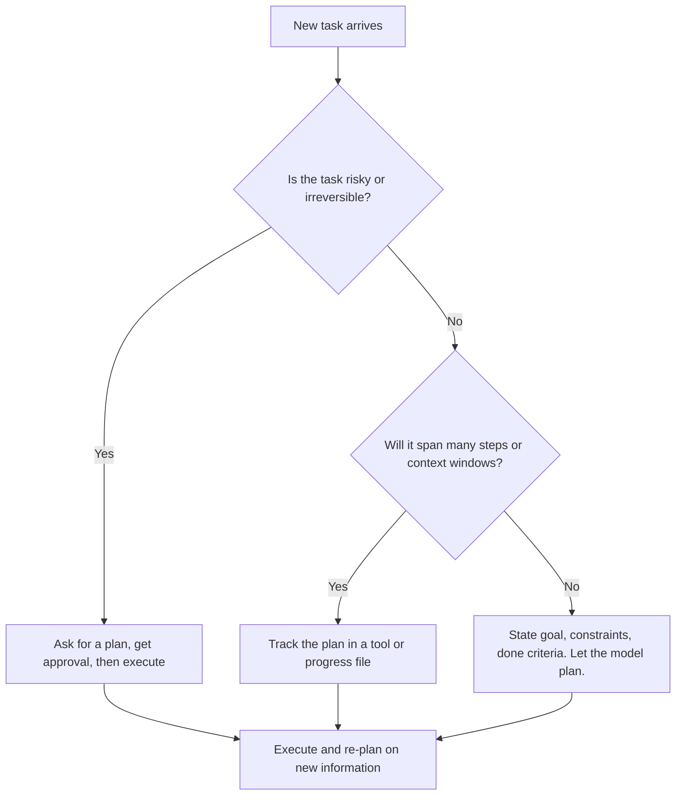
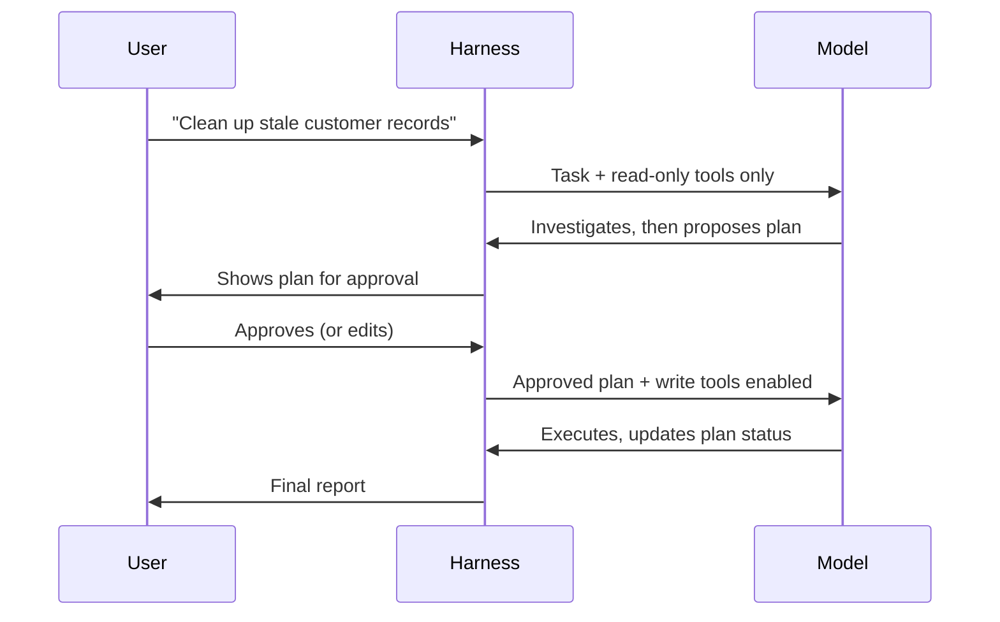

# Prompting for Planning

## Introduction

Every agent plans in some sense. Before it calls a tool, the model has to decide what to do first, what comes next, and when the job is done. The question for you, the person writing the prompt, is **how much of that planning you should spell out**.

A few years ago the answer was "a lot". Prompts were full of lines like `STEP 1: Read the file. STEP 2: Find the bug. STEP 3: ...` and "Always make a plan before acting." Older models needed that scaffolding because they lost track of multi-step work.

Current models (Claude Opus 5.5, GPT-5-class models, Gemini 3) plan natively. They have built-in thinking, they decompose tasks on their own, and they re-plan when a tool result surprises them. Hand-written step lists now often make results **worse**: the model follows your script even when its own plan would have been better, and "plan before every action" instructions cause over-planning, extra tokens and slower agents.

So this page is about a different skill: knowing **when an explicit plan earns its place**, and how to ask for one so that it helps you (the developer and the user) rather than just constraining the model.

A good analogy is managing a senior engineer. You don't hand them a 12-step checklist for fixing a bug. You tell them the goal, the constraints, and what "done" looks like. But you *do* ask for a written plan before they migrate the production database, because you want to review it first, and you *do* expect them to keep notes on a multi-week project so someone else can pick it up.



## What Changed: Models Plan Natively

When you send a task to a modern model with thinking enabled, it reasons before (and between) tool calls. Anthropic's prompting guide describes the interleaved pattern: after each tool result, the model reflects on it and decides on the next action. You do not need to ask for that. Anthropic's own prompt-audit guidance lists "Use the think tool to plan" and "plan before acting" as dated scaffolds that "cause over-planning", with the advice: if behavior is still too aggressive after removing them, **lower `effort` rather than adding prose**.

Here is a typical over-specified prompt written for an older model:

```text
You are a coding agent.

STEP 1: Before doing anything, write a detailed plan with at least 5 steps.
STEP 2: Read every file in the repository.
STEP 3: Identify the bug.
STEP 4: Write the fix.
STEP 5: Run the tests.
STEP 6: Write a summary of every step you took.

ALWAYS plan before EVERY tool call. NEVER skip planning.
```

Problems with this prompt:

- "At least 5 steps" forces padding on a one-line fix.
- "Read every file" wastes tokens; the model would normally search for the relevant files.
- "Plan before EVERY tool call" adds narration the model would otherwise skip, and costs latency.
- It scripts the *method* instead of describing the *outcome*.

Here is the same prompt rewritten around goals, constraints and verification:

```text
You are a coding agent working in a Python repository for a billing service.

<goal>
Fix the bug the user describes. A fix is done when the existing test suite passes
and there is a new test that fails without your change and passes with it.
</goal>

<constraints>
Keep changes minimal and inside the src/ and tests/ directories. The public API
of billing.invoice is used by other teams, so do not change function signatures there.
</constraints>

When you finish, tell the user what was wrong, what you changed, and how you verified it.
```

The model still plans. It just plans its own way, and you get the parts you actually care about: a clear goal, real constraints with reasons, and a verifiable definition of done.

:::tip
If an agent explores too much or plans too long, reach for the `effort` parameter first (for example `output_config={"effort": "low"}` on Claude, `reasoning_effort` on OpenAI reasoning models). It is a calibrated control. Prose like "don't overthink" is wording-sensitive and less reliable. See [Prompting for Reasoning](./6-agents-reasoning-prompts.mdx).
:::

## When an Explicit Plan Still Pays Off

Native planning does not mean plans are useless. It means the plan should exist **for a reason you can name**. Four reasons come up again and again.

### 1. A human needs to approve before risky work

If the agent is about to delete data, migrate a database, send emails to customers or change infrastructure, you want to see the plan *before* anything happens. Here the plan is not a thinking aid for the model. It is an **artifact for the human**.

```text
<planning>
Before you make any change that modifies data, infrastructure, or anything other
people can see, first investigate with read-only tools, then present a short plan:
what you will change, in what order, and how you will roll back if something fails.
Wait for the user to approve the plan before you run any write operation. Read-only
investigation (listing, searching, reading logs) does not need approval.
</planning>
```

Notice that the rule explains *which* actions need a plan and *why* (other people are affected, rollback matters). The model can generalize from that to actions you did not list.

### 2. The task is long-horizon

Tasks that run for hours, or across several context windows, need state that survives. A plan written down in a file or a tool lets the agent (or a fresh agent after compaction) pick up where it left off. Anthropic's best-practices guide recommends exactly this for multi-context-window work: keep structured state such as `tests.json`, free-form notes in `progress.txt`, and use git as a log and checkpoint.

### 3. The user wants visibility

In a chat UI or IDE, users like to see a checklist of what the agent is doing. A plan tool whose calls your harness renders as a live to-do list gives that visibility without asking the model to narrate every step in prose.

### 4. You need to enforce structure in code

Sometimes the plan is a contract between components: an orchestrator writes a plan, workers execute items, a checker marks them done. In that case the plan should be **structured data**, not free text. That is the territory of [Plan-and-Execute](../6-agents-planning-and-reasoning/4-agents-plan-and-execute.mdx) and [Task Decomposition](../6-agents-planning-and-reasoning/5-agents-task-decomposition.mdx).

## A Plan Tool the Harness Can Render

The cleanest way to get a visible, structured plan is to give the agent a tool for it. Coding agents such as Claude Code use a to-do tool for this. Here is a minimal version.

```python
from typing import Any

UPDATE_PLAN_TOOL = {
    "name": "update_plan",
    "description": (
        "Record or update your plan for the current task as a short checklist. "
        "The user sees this checklist live in the UI, so keep each item to one line "
        "in plain language. Call it when you first understand a multi-step task, and "
        "again whenever an item's status changes or new information changes the plan. "
        "Skip it for tasks that take only one or two actions. "
        "Each call replaces the whole plan, so always send every item."
    ),
    "input_schema": {
        "type": "object",
        "properties": {
            "items": {
                "type": "array",
                "items": {
                    "type": "object",
                    "properties": {
                        "content": {"type": "string", "description": "One-line description of the step."},
                        "status": {
                            "type": "string",
                            "enum": ["pending", "in_progress", "completed", "dropped"],
                            "description": "Use 'dropped' when new information makes a step unnecessary.",
                        },
                    },
                    "required": ["content", "status"],
                    "additionalProperties": False,
                },
            }
        },
        "required": ["items"],
        "additionalProperties": False,
    },
}


def render_plan(items: list[dict[str, Any]]) -> str:
    """Turn the plan into a checklist the UI (or terminal) can show."""
    icons = {"pending": "[ ]", "in_progress": "[>]", "completed": "[x]", "dropped": "[-]"}
    return "\n".join(f"{icons[item['status']]} {item['content']}" for item in items)


def handle_update_plan(tool_input: dict[str, Any], state: dict[str, Any]) -> str:
    """Tool handler: store the plan in harness state and return a short confirmation."""
    items = tool_input["items"]
    in_progress = [i for i in items if i["status"] == "in_progress"]
    if len(in_progress) > 1:
        # Tell the model how to fix it instead of failing silently.
        return "Error: mark only one item as in_progress at a time, then call update_plan again."
    state["plan"] = items
    print(render_plan(items))
    return "Plan updated."


if __name__ == "__main__":
    state: dict[str, Any] = {}
    fake_call = {
        "items": [
            {"content": "Reproduce the failing invoice test", "status": "completed"},
            {"content": "Find where tax is rounded", "status": "in_progress"},
            {"content": "Fix rounding and add a regression test", "status": "pending"},
            {"content": "Run the full test suite", "status": "pending"},
        ]
    }
    print(handle_update_plan(fake_call, state))
```

Output:

```text
[x] Reproduce the failing invoice test
[>] Find where tax is rounded
[ ] Fix rounding and add a regression test
[ ] Run the full test suite
Plan updated.
```

A few design choices are worth pointing out:

- **The description says when to use the tool and when not to** ("Skip it for tasks that take only one or two actions"). That prevents the agent from writing a four-item plan for "rename this variable".
- **The `dropped` status makes re-planning a first-class action.** Without it, the model has nowhere to put a step that new information made pointless.
- **The handler returns an actionable error** instead of crashing, as covered in [Handling Tool Errors](../2-agents-tool-use/6-agents-tool-errors.mdx).
- **The plan lives in harness state.** Your UI, logs and evaluations can read it. That is something a plan buried in free text can never give you.

### Wiring it into a request

The system prompt does not need to repeat the tool's description. It only adds the context the model cannot get elsewhere: who sees the plan and why it matters.

```python
from anthropic import Anthropic

client = Anthropic()

SYSTEM_PROMPT = """You are a coding agent for the billing-service repository.
Developers watch your progress in an IDE side panel.

<planning>
For multi-step tasks, keep the checklist in the side panel accurate, because
developers use it to decide whether to interrupt you. When a tool result changes
what needs doing, update the checklist rather than silently changing course.
</planning>
"""


def run_turn(messages: list[dict]) -> object:
    """One model call; the full agent loop is covered in the Tool Use section."""
    return client.messages.create(
        model="claude-opus-5-5",
        max_tokens=16000,
        system=SYSTEM_PROMPT,
        tools=[UPDATE_PLAN_TOOL],  # defined in the previous example
        messages=messages,
    )
```

The loop around `run_turn` is the standard one from [Building a Manual Agent Loop](../2-agents-tool-use/3-agents-manual-agent-loop.mdx): keep calling while `stop_reason == "tool_use"`, run `handle_update_plan` for `update_plan` calls, and return all `tool_result` blocks in one user message.

## Plan-Then-Confirm

For risky work, split the run into two phases with a hard boundary that **your code** enforces, not just the prompt.



The key idea: during the planning phase the model simply **does not have** the write tools. The prompt explains the process, and the harness guarantees it.

```python
READ_ONLY_TOOLS = ["search_customers", "count_records", "read_audit_log"]
WRITE_TOOLS = ["archive_records", "delete_records"]


def tools_for_phase(phase: str, all_tools: dict[str, dict]) -> list[dict]:
    """Expose write tools only after a human approved the plan."""
    names = READ_ONLY_TOOLS if phase == "planning" else READ_ONLY_TOOLS + WRITE_TOOLS
    return [all_tools[name] for name in names]


PLANNING_INSTRUCTIONS = """<phase>
You are in the planning phase. You have read-only tools. Investigate the request,
then reply with a plan: which records are affected (with counts), what you will do
to them, and how to undo it. A human will review the plan before any change is made,
so call out anything surprising you found, such as records that look active.
</phase>"""

EXECUTION_INSTRUCTIONS = """<phase>
The plan below was approved by a human. Carry it out. If you discover something
the plan did not anticipate, such as far more records than expected, stop and
report instead of improvising, because the approval only covers the plan as written.
</phase>"""

if __name__ == "__main__":
    fake_tools = {name: {"name": name} for name in READ_ONLY_TOOLS + WRITE_TOOLS}
    print([t["name"] for t in tools_for_phase("planning", fake_tools)])
    print([t["name"] for t in tools_for_phase("execution", fake_tools)])
```

Output:

```text
['search_customers', 'count_records', 'read_audit_log']
['search_customers', 'count_records', 'read_audit_log', 'archive_records', 'delete_records']
```

:::caution
Changing the `tools` array between requests in the **same** conversation invalidates the prompt cache, and on some models it interacts with preserved thinking. A common pattern is to make the planning phase and execution phase two separate conversations: the second one starts with the approved plan as its input. See [Human-in-the-Loop](../6-agents-planning-and-reasoning/9-agents-human-in-the-loop.mdx) and [Human Approval Gates](../12-agents-safety-and-security/7-agents-approval-gates.mdx).
:::

## Planning Across Context Windows

Long tasks outlive a single context window. When the context is compacted or a fresh session starts, the model's in-head plan is gone. External state fixes this. Anthropic's guide suggests three complementary forms:

| State | Format | Good for |
| --- | --- | --- |
| `tests.json` or a task list | Structured JSON | Status of many items, easy to check in code |
| `progress.txt` | Free-form notes | What was tried, what's next, gotchas |
| git history | Commits | A log of finished work and restore points |

A system prompt section for this might look like:

```text
<long_running_work>
This task will likely take several sessions, and your context may be reset between
them. Keep the plan in tasks.json (one entry per feature, with a status field) and
write short notes in progress.txt about what you tried and what you plan next.
Commit after each completed feature.

At the start of a session, read progress.txt, tasks.json and the recent git log
before doing anything else, so you continue the existing plan instead of starting over.
Do not delete or rewrite entries in tasks.json to make progress look better; mark
them dropped with a reason if they are no longer needed.
</long_running_work>
```

Here the instructions *are* fairly prescriptive. That is fine: resuming from saved state is a fragile operation where one sequence is clearly right, and the prompt-audit guidance explicitly keeps exact steps "where order truly matters". The contrast with the first bad example is that this text covers coordination the model cannot infer, not reasoning it already does well.

A tiny helper the harness can use to inject a progress summary at the start of a session:

```python
import json
from pathlib import Path


def session_briefing(workdir: Path) -> str:
    """Summarize saved plan state so a fresh session can resume quickly."""
    tasks = json.loads((workdir / "tasks.json").read_text())
    done = sum(1 for t in tasks if t["status"] == "completed")
    remaining = [t["name"] for t in tasks if t["status"] in ("pending", "in_progress")]
    notes = (workdir / "progress.txt").read_text().strip().splitlines()[-3:]
    return (
        f"<resume>\nCompleted {done} of {len(tasks)} tasks.\n"
        f"Next up: {', '.join(remaining[:3])}\n"
        "Latest notes:\n" + "\n".join(notes) + "\n</resume>"
    )


if __name__ == "__main__":
    import tempfile

    with tempfile.TemporaryDirectory() as d:
        p = Path(d)
        (p / "tasks.json").write_text(json.dumps([
            {"name": "auth flow", "status": "completed"},
            {"name": "user management", "status": "in_progress"},
            {"name": "api endpoints", "status": "pending"},
        ]))
        (p / "progress.txt").write_text(
            "Session 2: fixed token validation\nuser_management test #2 fails on email casing\nNext: normalize emails\n"
        )
        print(session_briefing(p))
```

Output:

```text
<resume>
Completed 1 of 3 tasks.
Next up: user management, api endpoints
Latest notes:
Session 2: fixed token validation
user_management test #2 fails on email casing
Next: normalize emails
</resume>
```

For deeper coverage of saving state, see [Agent State Management](../4-agents-memory-and-context/9-agents-state-management.mdx) and [File-Based Memory Tools](../4-agents-memory-and-context/6-agents-memory-tool.mdx).

## Re-Planning on New Information

A plan is a hypothesis. The most common planning failure in production agents is not a bad first plan. It is **sticking to the plan after the evidence changed**: the migration script assumes 500 rows and finds 50,000, but keeps going.

You can encourage healthy re-planning by describing the situations where the plan should change and what to do then:

```text
Treat your plan as a working draft. If a tool result contradicts an assumption the
plan relied on (for example, far more affected records than expected, or a file that
does not exist), update the plan and tell the user what changed and why before you
continue.
```

What you should *not* do is the opposite extreme. Anthropic's guidance notes that some models can over-deliberate, and offers a counterweight for that case:

```text
When you're deciding how to approach a problem, choose an approach and commit to it.
Avoid revisiting decisions unless you encounter new information that directly
contradicts your reasoning.
```

Use one or the other based on what you **observe** in transcripts, not both by default. Pair re-planning with real limits from [Stopping Conditions and Budgets](../6-agents-planning-and-reasoning/10-agents-stopping-conditions.mdx) so a confused agent cannot re-plan forever.

## Real-World Scenario

Your team runs a SaaS helpdesk product. You are building an internal **data-cleanup agent** that support engineers use to fix customer accounts: merging duplicate contacts, archiving stale tickets, and correcting bad imports. Early versions used a prompt with a 10-step script. Engineers complained that the agent was slow on simple requests ("merge these two contacts" took 40 seconds of narrated planning) and, worse, it once archived 3,000 tickets because step 6 said "archive matching tickets" and nobody saw the plan.

**The redesign:**

1. Remove the step script. Describe the goal, the data model, and what counts as a correct cleanup.
2. Split work into a **read-only planning phase** and an **execution phase**. The harness only exposes write tools after approval.
3. Require a plan only for operations that change data. Read-only questions ("how many duplicates does Acme have?") are answered directly.
4. Add the `update_plan` tool so engineers see a live checklist during execution.
5. Tell the model to stop and report if the actual counts differ substantially from the approved plan.
6. Set `effort` to `medium` for routine requests and let the team bump it for complex merges.

**Why this approach:** the risk in this domain is irreversible data changes, so the plan exists for the human reviewer, and code (not prose) enforces the boundary. Simple requests stay fast because nothing forces the model to plan them.

**When to use it:** any agent that takes destructive or externally visible actions, where a reviewer can realistically read a plan in under a minute.

**When not to use it:** high-volume, low-risk automation (tagging tickets, drafting replies) where approval would become rubber-stamping. Use guardrails and sampling-based review instead.

| Approach | Pros | Cons | Best for |
| --- | --- | --- | --- |
| Let the model plan internally | Fast, no prompt overhead, uses native planning | No reviewable artifact | Low-risk, short tasks |
| Plan tool rendered in UI | Visible progress, structured data for logs and evals | Extra tool calls | Interactive agents, IDEs, long tasks |
| Plan-then-confirm with tool gating | Human control over risky actions, enforced in code | Slower, needs a reviewer | Data changes, infra, customer-visible actions |
| Hard-coded workflow (prompt chain) | Predictable, testable, cheap | Rigid, breaks on unusual inputs | Repetitive tasks with a fixed shape |
| Step-by-step script in the prompt | Feels controlled | Overrides better model plans, over-planning, costly | Rarely; only fragile fixed sequences |

## Common Mistakes

1. **Scripting judgment tasks step by step.** Describe the outcome and how to verify it. Keep numbered steps only for sequences where order is genuinely fragile (resuming state, auth flows, compliance steps).
2. **"Always plan before acting."** This forces planning on trivial work. If the agent is too eager, lower `effort` before adding prose.
3. **Plans that only exist in prose.** If the plan matters to your UI, logs or reviewers, make it structured: a tool call or a file.
4. **Trusting the prompt to stop risky actions.** "Wait for approval" is a request. Removing write tools until approval is a guarantee.
5. **No re-planning path.** Give the model a way to drop or change steps (a `dropped` status, an instruction to report changes), or it will push through a stale plan.
6. **Requiring a minimum plan length.** "At least 5 steps" produces filler steps.
7. **Losing the plan across context resets.** For long tasks, persist plan and notes outside the context window.

## Summary

- Current models plan natively with built-in thinking. Hand-written step scripts and "plan before every action" instructions usually hurt quality and cost.
- Write prompts around **goal, constraints, and done criteria**, and let the model choose its method.
- Ask for explicit plans when there is a concrete reason: **human approval**, **long-horizon state**, **user visibility**, or **structured coordination** between components.
- A plan tool such as `update_plan` turns the plan into data your harness can render, log and evaluate.
- Enforce plan-then-confirm in code by gating write tools, not just with prompt text.
- Persist plans in files like `tasks.json` and `progress.txt` (plus git) for multi-session work.
- Encourage re-planning when evidence contradicts the plan, and use effort or explicit "commit to an approach" guidance if the agent over-deliberates.

## Exercises

1. **Rewrite a scripted prompt.** Take the "STEP 1 ... STEP 6" coding-agent prompt from this page and rewrite it for a documentation-writing agent. Keep only goal, constraints, and done criteria. Compare outputs from both versions on three tasks of different sizes.
2. **Build the plan tool into a loop.** Add `update_plan` to the agent loop from [Building a Manual Agent Loop](../2-agents-tool-use/3-agents-manual-agent-loop.mdx). Log how often the model calls it on one-step versus ten-step tasks.
3. **Gate a write tool.** Implement plan-then-confirm for a toy "delete files older than N days" agent, with the planning and execution phases as separate conversations.
4. **Resume after a reset.** Run a multi-feature task, kill the process halfway, and start a new session using `session_briefing`. Did the agent continue the existing plan?

**Related pages:**

- [Plan-and-Execute](../6-agents-planning-and-reasoning/4-agents-plan-and-execute.mdx)
- [Task Decomposition](../6-agents-planning-and-reasoning/5-agents-task-decomposition.mdx)
- [Stopping Conditions and Budgets](../6-agents-planning-and-reasoning/10-agents-stopping-conditions.mdx)
- [Prompting for Reasoning](./6-agents-reasoning-prompts.mdx)
- [Writing Instructions and Constraints](./2-agents-instructions-and-constraints.mdx)
