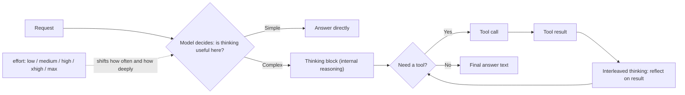

# Prompting for Reasoning

## Introduction

"Let's think step by step" is probably the most famous prompt in the history of LLMs. Around 2022, researchers found that simply asking a model to reason out loud before answering made it noticeably better at math and logic. For years, prompts were full of variations: "think carefully", "show your work", "write your reasoning in `<scratchpad>` tags first".

Then the models changed. Today's frontier models have **built-in thinking**: they reason internally before they answer, and between tool calls, without being asked. On Claude this is called *adaptive thinking*; OpenAI's reasoning models expose a `reasoning_effort` setting; Gemini 2.5 and 3 models think internally and expose thinking controls. The reasoning is trained into the model and controlled by **API parameters**, not by magic phrases.

That makes the old incantations redundant at best. On some current models, the old habit of asking the model to *write its reasoning into the answer* can even trigger a refusal.

This page explains:

- how built-in thinking and the `effort` parameter work, and why they replace most reasoning prompts;
- when manual reasoning prompts **still help**;
- what kinds of reasoning guidance are still valuable (guiding *what* to consider, self-checks, worked examples);
- how to see the model's reasoning without asking for it in the output.

An analogy: you used to have to tell a junior colleague "talk me through it before you answer". Now you work with someone who always thinks before answering. Telling them to "think step by step" adds nothing. Telling them **what to pay attention to** ("check whether the logs cover the full outage window") still helps a lot. And deciding **how much time** they should spend on a question is your call: that is the effort setting.

## How Built-In Thinking Works



Key facts for Claude (current as of this writing; check the [official thinking docs](https://platform.claude.com/docs/en/build-with-claude/adaptive-thinking) because details change between models):

- **Adaptive thinking** means the model decides per request whether to think and how much. A trivial question may get no thinking block at all.
- On **Claude Opus 5.5**, thinking is **always on**. You can omit the `thinking` parameter or send `{"type": "adaptive"}`; both mean the same. Sending `{"type": "disabled"}` returns an error.
- **Effort** (`output_config={"effort": ...}`) is the main control: `low`, `medium`, `high`, `xhigh`, `max`. It is a behavioral signal, not a strict token budget. On Claude Opus 5.5 the default is `medium`; on most other models it is `high`.
- Effort affects **all** output tokens: thinking, response text, and tool calls. Lower effort means fewer, more consolidated tool calls and less preamble.
- Thinking is **interleaved** with tool use automatically: the model can reflect on each tool result before choosing the next action.
- Thinking tokens are billed as output tokens and **count toward `max_tokens`**. A `max_tokens` sized for a short answer may cut off a response once thinking kicks in.
- The old `budget_tokens` setting is rejected on current models. Use `effort`.

Other providers have equivalent controls: OpenAI reasoning models take a `reasoning_effort` (or `reasoning.effort`) setting, and Gemini models expose a thinking level or budget. The principle is the same everywhere: **choose reasoning depth with a parameter**.

### Setting effort in code

```python
from anthropic import Anthropic

client = Anthropic()


def ask(question: str, effort: str = "medium") -> str:
    response = client.messages.create(
        model="claude-opus-5-5",
        max_tokens=16000,  # leave room for thinking plus the answer
        output_config={"effort": effort},
        messages=[{"role": "user", "content": question}],
    )
    if response.stop_reason == "max_tokens":
        raise RuntimeError("Ran out of tokens: raise max_tokens or lower effort.")
    # Select blocks by type: a response may start with a thinking block.
    return "".join(block.text for block in response.content if block.type == "text")


if __name__ == "__main__":
    print(ask("Classify this ticket as billing, bug or feature: 'I was charged twice'", effort="low"))
```

Example output:

```text
billing
```

Note the `block.type == "text"` filter. Code that reads `response.content[0].text` breaks as soon as the first block is a thinking block.

## Before and After: Removing Reasoning Scaffolds

Here is a system prompt for an incident-analysis agent written in the old style:

```text
You are an expert SRE. Think step by step. Take a deep breath.

Before answering, ALWAYS write out your full reasoning inside <thinking> tags.
Think about every possibility. Then think again. Then give your answer in
<answer> tags. Do not skip the thinking step under any circumstances.
```

What is wrong with it on a current thinking model:

| Line | Problem |
| --- | --- |
| "Think step by step. Take a deep breath." | Redundant: the model already reasons internally. |
| "write out your full reasoning inside `<thinking>` tags" | Duplicates built-in thinking in the visible output, doubling cost. On several current Claude models, instructions to reproduce reasoning in the response may be declined as a `reasoning_extraction` refusal. |
| "Think about every possibility. Then think again." | Steers depth with prose. Effort does this more reliably. Can cause over-thinking. |
| "under any circumstances" | Shouting adds rigidity, not quality. |

The rewrite keeps what only you know (the domain, what a good analysis looks like) and moves depth control into the API call:

```text
You are helping on-call engineers at a payments company understand incidents.
Engineers read your analysis during an active incident, so lead with the most
likely cause and the evidence for it, then list other causes you could not rule out.

When you look at logs or metrics, check that they actually cover the incident
window before drawing conclusions from them; partial data has misled us before.

End with a short explanation of why you ranked the causes the way you did.
```

```python
response = client.messages.create(
    model="claude-opus-5-5",
    max_tokens=32000,
    system=INCIDENT_PROMPT,
    output_config={"effort": "high"},  # incidents are high-stakes: spend more reasoning
    tools=INCIDENT_TOOLS,
    messages=messages,
)
```

The new prompt still shapes reasoning. It just shapes **what** the model considers (coverage of the incident window, ranking by evidence) instead of **whether** it thinks.

:::note
"A short explanation of why you ranked the causes" is fine to ask for. That is a user-facing explanation of the answer, which is different from asking the model to dump its internal reasoning into the output.
:::

## When Manual Reasoning Prompts Still Help

"Think step by step matters less" is not "reasoning prompts are dead". There are clear cases where prompt text about reasoning is still worth writing.

### 1. The model has no built-in thinking

Not every model you deploy is a frontier thinking model:

- older models still in production;
- small open-source models served with Ollama or vLLM for cost or privacy reasons;
- routes where thinking is turned off for latency (some models allow this, for example via `{"type": "disabled"}` at lower effort on Claude Haiku 5.5).

For these, classic chain-of-thought prompting still works. Ask the model to reason first and to put the final answer in tags you can parse:

```python
import re

COT_SUFFIX = (
    "\n\nWork through the problem before answering. "
    "Then give only the final answer inside <answer></answer> tags."
)


def extract_answer(text: str) -> str | None:
    match = re.search(r"<answer>(.*?)</answer>", text, re.DOTALL)
    return match.group(1).strip() if match else None


if __name__ == "__main__":
    # Simulated output from a small local model without built-in thinking
    raw = (
        "The order total is 3 items at $12 = $36. Shipping is free above $30, "
        "so shipping is $0. Total $36.\n<answer>36</answer>"
    )
    print(extract_answer(raw))
```

Output:

```text
36
```

The reasoning here is visible text you pay for and must strip before showing users. That is the trade-off of manual chain of thought, and why built-in thinking replaced it where available.

### 2. Guiding *what* to think about

Built-in thinking decides *how* to reason. You still know things about the domain the model doesn't. Anthropic's guide gives an example of guiding interleaved thinking in agent loops:

```text
After receiving tool results, carefully reflect on their quality and determine
optimal next steps before proceeding.
```

More useful still are domain-specific pointers: "a 200 status in these logs does not mean success; check the `result` field", or "dates in the CRM are UTC, dates in the ticket system are the customer's local time". These are context, and context is never cruft.

### 3. Self-checks against concrete criteria

Asking the model to verify its work catches errors, especially in coding and math:

```text
Before you finish, run the test suite and confirm the new test fails without your
change and passes with it.
```

The important word is **concrete**. "Double-check your answer" is vague. "Verify that every number in the summary matches the query results" is checkable. Be aware that some models already verify thoroughly, and verification instructions carried over from older prompts can cause over-verification (Anthropic calls this out for Claude Opus 5). Measure before keeping them.

### 4. Worked examples

Examples in your prompt shape how the model approaches similar problems, including inside its thinking. A worked example works best as: the problem, the method to apply, and the expected answer. See [Few-Shot Examples for Agents](./3-agents-few-shot-examples.mdx).

### 5. Per-message steering

Sometimes only some turns deserve deep reasoning. Anthropic's steering docs describe phrases you can append per message:

- to encourage: "This task involves multistep reasoning. Think carefully before responding."
- to discourage: "Answer directly without deliberating."

An agent harness might append the first on planning turns and the second on routine confirmations. The docs also note that on some models (Claude Sonnet 5.5, Claude Haiku 5.5) prompt text asking for *less* thinking has little effect, and lowering effort works better. As always: verify on your workload.

```python
def user_turn(text: str, needs_deep_reasoning: bool) -> dict:
    """Build a user message, optionally nudging how much the model deliberates."""
    if needs_deep_reasoning:
        text += "\n\nThis task involves multistep reasoning. Think carefully before responding."
    return {"role": "user", "content": text}


if __name__ == "__main__":
    print(user_turn("Plan the schema migration for the orders table.", True)["content"])
```

Output:

```text
Plan the schema migration for the orders table.

This task involves multistep reasoning. Think carefully before responding.
```

## Seeing the Model's Reasoning Without Asking for It

Developers often want the reasoning for debugging, audits, or showing users "how the agent decided". The old approach was a `reasoning` field in JSON output or a `<thinking>` section in the response. On current models, do this instead:

1. **Read thinking blocks from the API.** On Claude, request summarized thinking with `thinking={"type": "adaptive", "display": "summarized"}`. On several current models the default display is `omitted`, which returns thinking blocks with empty text.
2. **Ask for a short explanation of the answer** if users need one. That is a normal output, not a reasoning dump.

Anthropic's docs warn that on several current models (Claude Fable 5.x, Claude Opus 5 and 5.5, Claude Sonnet 5.5), instructions to reproduce reasoning in the response may trigger a refusal with `stop_reason == "refusal"` and `stop_details.category == "reasoning_extraction"`.

```python
from anthropic import Anthropic

client = Anthropic()

response = client.messages.create(
    model="claude-opus-5-5",
    max_tokens=16000,
    thinking={"type": "adaptive", "display": "summarized"},
    output_config={"effort": "high"},
    messages=[{
        "role": "user",
        "content": "Our p95 latency doubled after Tuesday's deploy. The deploy added "
                   "a cache layer and upgraded the DB driver. What should we check first?",
    }],
)

if response.stop_reason == "refusal":
    print("Refused:", response.stop_details.category if response.stop_details else None)
else:
    for block in response.content:
        if block.type == "thinking":
            print("[reasoning summary]", block.thinking[:200])
        elif block.type == "text":
            print("[answer]", block.text)
```

Example output (abridged):

```text
[reasoning summary] Two changes: cache layer and DB driver. A cache usually lowers latency unless misses are slow or there is a cold-start effect. A driver upgrade could change connection pooling defaults...
[answer] Check the DB driver's connection pool settings first. Driver upgrades often change pool defaults...
```

Log the thinking summaries in your traces (see [Tracing Agent Runs](../11-agents-evaluation-and-testing/8-agents-tracing.mdx)). They are excellent for debugging, and you get them without changing the prompt.

:::warning
When you send conversation history back in an agent loop, pass thinking blocks back **unchanged**, as part of `response.content`. Editing or dropping them can break the request or degrade the model's tool-use reasoning. See [Building a Manual Agent Loop](../2-agents-tool-use/3-agents-manual-agent-loop.mdx).
:::

## Choosing Effort Instead of Writing Prose

A practical rule of thumb from Anthropic's docs: **lower effort before you reach for prompt-based steering**, because effort is calibrated and prompt steering is wording-sensitive.

| Situation | First lever | Prompt text, if still needed |
| --- | --- | --- |
| Agent too slow on simple requests | Lower effort (`low` or `medium`) | "When in doubt, respond directly." |
| Shallow answers on hard problems | Raise effort (`high`, `xhigh`) | "This task involves multistep reasoning..." |
| Runs hit `max_tokens` | Raise `max_tokens` or lower effort | None |
| Agent ignores a domain subtlety | Not an effort problem | Explain the subtlety and why it matters |
| Wrong answers that a check would catch | Not an effort problem | Concrete self-check criteria |

A cheap way to choose effort is a small sweep on your own eval cases:

```python
from collections.abc import Callable

EFFORT_LEVELS = ["low", "medium", "high"]


def effort_sweep(cases: list[dict], run: Callable[[str, str], str]) -> dict[str, float]:
    """Return accuracy per effort level. `run(question, effort)` calls the model."""
    scores: dict[str, float] = {}
    for effort in EFFORT_LEVELS:
        correct = sum(run(c["question"], effort).strip() == c["expected"] for c in cases)
        scores[effort] = correct / len(cases)
    return scores


if __name__ == "__main__":
    cases = [{"question": "2+2", "expected": "4"}, {"question": "17*3", "expected": "51"}]
    fake_run = lambda q, effort: str(eval(q))  # stand-in for a real model call
    print(effort_sweep(cases, fake_run))
```

Output:

```text
{'low': 1.0, 'medium': 1.0, 'high': 1.0}
```

In real runs, also record latency and output tokens per level, then pick the lowest effort that meets your quality bar. More on this in [Iterating on Prompts with Evidence](./10-agents-prompt-iteration.mdx).

## Real-World Scenario

Your team runs a SaaS helpdesk and has an agent that answers customer questions about invoices and, when needed, looks up billing data with tools. The original prompt was written two model generations ago and contains: "Think step by step", "ALWAYS reason inside `<scratchpad>` tags before answering", and a JSON output schema with a `reasoning` field that the UI hides. After upgrading to a current model you see three problems: responses cost noticeably more than expected, simple questions are slow, and a small share of requests come back as refusals with category `reasoning_extraction`.

**The fix:**

1. Remove "think step by step" and the `<scratchpad>` instruction. The model already thinks.
2. Remove the `reasoning` field from the JSON schema. Use structured outputs for the fields the UI actually needs.
3. Turn on `display: "summarized"` and log thinking summaries to the tracing system for support engineers who debug odd answers.
4. Keep the domain guidance that matters: "Refunds over $500 need a human, because finance must approve them" and "invoice dates are in the customer's billing timezone".
5. Run an effort sweep on 100 real questions. Simple FAQ routes run at `low`; disputed-charge investigations at `high`.

**Why this approach:** the scaffolds were compensating for a weakness the model no longer has, while costing tokens and triggering refusals. The domain guidance was the valuable part all along.

**When to use it:** any time you migrate prompts to a model with built-in thinking, or inherit a prompt full of reasoning incantations.

**When not to use it:** if a route uses a model without thinking (a small local model for PII-sensitive classification, for example), keep explicit chain of thought there.

| Approach | Pros | Cons | Best for |
| --- | --- | --- | --- |
| Built-in thinking + effort | Calibrated, no prompt text, reasoning not in output | Less fine control over exactly what is reasoned | Frontier models, agent loops |
| Manual chain of thought ("reason, then answer in tags") | Works on any model, reasoning is visible | Costs output tokens, must parse and strip | Models without thinking |
| Guidance on *what* to consider | Adds real domain knowledge | Needs upkeep as the domain changes | All models |
| Self-check instructions | Catches concrete errors | Can cause over-verification on some models | Coding, math, data reports |
| Per-message steering phrases | Fine-grained per turn, cache-friendly | Wording-sensitive, weaker than effort on some models | Mixed workloads in one conversation |

## Common Mistakes

1. **Leaving "think step by step" in prompts for thinking models.** It is redundant at best. Control depth with effort.
2. **Requiring reasoning in the visible output** (a `reasoning` JSON field, `<thinking>` tags in the answer). Read thinking blocks instead; on some models this can trigger `reasoning_extraction` refusals.
3. **Steering depth with prose** ("think harder", "don't overthink") instead of the effort parameter.
4. **Forgetting that thinking counts toward `max_tokens`.** Watch for `stop_reason == "max_tokens"` and size the limit with room for reasoning.
5. **Reading `content[0]` blindly.** The first block may be a thinking block. Filter by `block.type`.
6. **Dropping thinking blocks in agent loops.** Append the full `response.content` back to the history.
7. **Removing domain guidance along with the incantations.** "Check that logs cover the incident window" is valuable context, not a reasoning scaffold.
8. **Assuming every model thinks.** Check the model you actually deploy on each route.

## Summary

- Modern models have built-in, adaptive thinking that runs before answers and between tool calls.
- Use the **effort** parameter (`low` to `max`) to trade quality for latency and cost. On Claude Opus 5.5 thinking is always on and the default effort is `medium`. OpenAI and Gemini have equivalent controls.
- Manual "think step by step" prompts matter much less now. They still help on models **without** thinking.
- Reasoning guidance that still pays off: what to pay attention to, concrete self-check criteria, worked examples, and per-message steering when evals show it helps.
- Do not ask models to reproduce their reasoning in the output. Read summarized thinking blocks, or ask for a short explanation of the answer.
- Size `max_tokens` with room for thinking, and filter response blocks by type.

## Exercises

1. **Audit a prompt.** Find a prompt (yours or an open-source agent's) that contains "think step by step", scratchpad tags, or a `reasoning` output field. Rewrite it following this page and list what you kept and why.
2. **Effort sweep.** Pick 20 questions with known answers. Run them at `low`, `medium` and `high` effort and record accuracy, latency and output tokens. Which level would you ship?
3. **Thinking vs no thinking.** Run the same math word problems on a small local model (via Ollama) with and without the chain-of-thought suffix from this page. Then run them on a thinking model without it. Compare.
4. **Log reasoning summaries.** Add `display: "summarized"` to an agent loop and write thinking summaries to a trace file. Use them to explain one wrong answer.

**Related pages:**

- [Reasoning, Thinking and Effort](../1-agents-llm-apis/7-agents-thinking-and-effort.mdx)
- [Prompting for Planning](./5-agents-prompting-for-planning.mdx)
- [Reflection and Self-Critique](../6-agents-planning-and-reasoning/6-agents-reflection.mdx)
- [Prompt Anti-Patterns](./9-agents-prompt-anti-patterns.mdx)
- [Choosing the Right Model](../1-agents-llm-apis/10-agents-model-selection.mdx)
