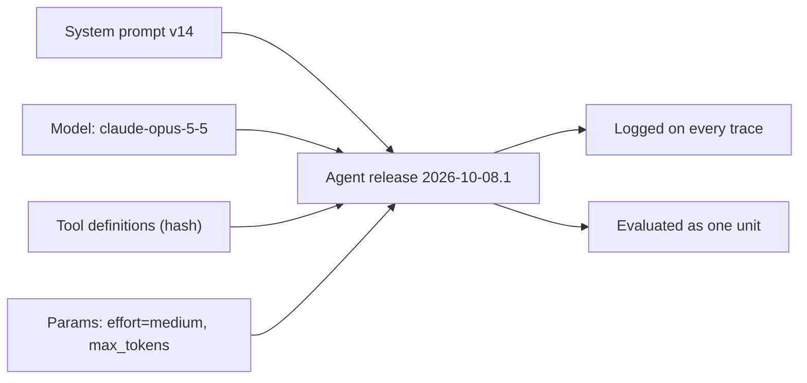
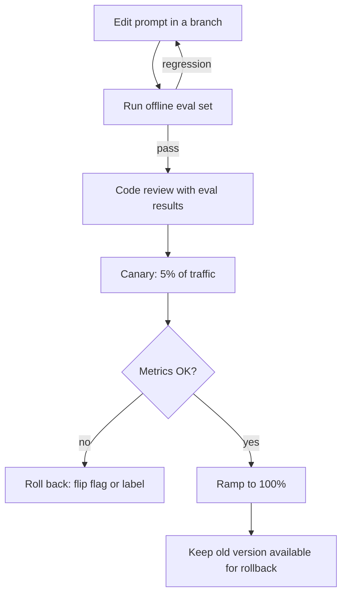

# Versioning and Managing Prompts

## Introduction

A system prompt starts as a string in your code. A few weeks later the agent is in production. Someone has changed the prompt five times, the model has been upgraded once, and a new tool has appeared. Then a customer reports that the agent "got worse on Tuesday." Can you answer these questions?

- Which exact prompt was running on Tuesday?
- What changed, who changed it, and why?
- Was the change in the prompt, the model, the tool definitions, or the sampling settings?
- How fast can you go back to the version that worked?

If you can't answer them, your prompts are not managed. They just exist.

**Prompt versioning** means handling prompts with the same discipline you use for code and database migrations. Every version has an identity, every change has a reason, and every production request records which version produced it. This page shows you how to set that up, from a git-only approach for small teams to dedicated prompt registries. It also covers how to roll prompt changes out safely.

:::tip Analogy
A prompt is closer to a config file than to documentation. If you would not edit `nginx.conf` on a production box without a commit and a rollback plan, don't edit a production system prompt that way either.
:::

## Why Prompts Need Versioning

Prompts are unusual software artifacts:

1. **Small edits have large effects.** Changing one sentence can shift tool-call rates, output length, or refusal behavior across thousands of requests.
2. **The behavior depends on more than the text.** The same prompt behaves differently on a different model, with a different tool list, or at a different effort level.
3. **Nothing fails to compile.** A broken prompt still returns a 200 response. The regression shows up later as worse answers.
4. **Reasons get lost.** Prompts pile up lines like "Never mention competitors" or "Always call `search_kb` first." Six months later nobody remembers which incident each line fixed, so nobody dares to delete it.

The fourth point matters more than it seems. As [Prompt Anti-Patterns](./9-agents-prompt-anti-patterns.mdx) explains, many prompt problems are old workarounds for failures that the current model no longer has. You can only remove them safely if you know why they were added.

## The Release Unit: Prompt + Model + Tools + Parameters

The most important idea on this page: **a prompt version on its own is not enough to reproduce behavior.** What you ship is a bundle.



Treat these four parts as a single **release unit**:

| Component | Why it belongs in the unit |
| --- | --- |
| System prompt and templates | The obvious part |
| Model ID | Prompts are tuned per model. A line that helps one generation can hurt the next |
| Tool definitions | Tool descriptions are prompt text too, and they steer behavior heavily |
| Request parameters | `effort`, `max_tokens`, thinking display, structured output schema |

If you version only the prompt string, a silent model upgrade or a tool-description edit can change behavior while your "prompt version" stays the same. That makes debugging much harder.

## Approach 1: Prompts as Code in Git

For most teams, the simplest durable approach is to keep prompts as files in the repository, next to the code that uses them.

```text
agent/
├── prompts/
│   ├── support_agent.system.md
│   ├── support_agent.CHANGELOG.md
│   └── triage_router.system.md
├── tools/
│   └── definitions.json
├── release.json
└── agent.py
```

You get a lot from git for free:

- **History and blame.** `git blame prompts/support_agent.system.md` shows who added each line and in which commit.
- **Code review.** Prompt changes go through pull requests like any other change.
- **Atomic releases.** The prompt, tool definitions, and model ID change together in one commit.
- **Rollback.** `git revert` works on prompts too.

### Keep a changelog of reasons

Git records *what* changed. It does not record *why* very well. A short changelog next to each prompt fills that gap:

```text
# support_agent.system.md changelog

## v14 (2026-10-08)
- Added context about refund policy limits (refunds over 200 USD need a human).
  Reason: agent promised a 450 USD refund in ticket #8812.
- Removed "IMPORTANT: ALWAYS use search_kb before answering".
  Reason: after the upgrade to claude-opus-5-5 the agent searched even for
  "thanks!". Eval set v3: tool over-use dropped sharply, accuracy unchanged (see eval report).

## v13 (2026-09-20)
- Model changed from claude-opus-5 to claude-opus-5-5. No prompt text changes.
```

Each entry names the failure that motivated it and the evidence behind it. When the next model comes out, you can re-test each line: does that failure still happen?

## Approach 2: A Tiny File-Based Prompt Registry

Git gives you history. At runtime you also need to know *which* version is running, and you need to log it. Here is a small registry that loads prompts from disk, computes a content hash, and builds a release manifest.

```python
import hashlib
import json
from dataclasses import dataclass, asdict
from pathlib import Path


def content_hash(text: str) -> str:
    """Short, stable fingerprint of any prompt or definition text."""
    return hashlib.sha256(text.encode("utf-8")).hexdigest()[:12]


@dataclass(frozen=True)
class AgentRelease:
    name: str
    model: str
    effort: str
    max_tokens: int
    system_prompt: str
    tools: list

    @property
    def prompt_hash(self) -> str:
        return content_hash(self.system_prompt)

    @property
    def tools_hash(self) -> str:
        return content_hash(json.dumps(self.tools, sort_keys=True))

    @property
    def release_id(self) -> str:
        """One ID that changes if ANY part of the release unit changes."""
        parts = [self.model, self.effort, str(self.max_tokens),
                 self.prompt_hash, self.tools_hash]
        return content_hash("|".join(parts))

    def manifest(self) -> dict:
        return {
            "name": self.name,
            "release_id": self.release_id,
            "model": self.model,
            "effort": self.effort,
            "max_tokens": self.max_tokens,
            "prompt_hash": self.prompt_hash,
            "tools_hash": self.tools_hash,
        }


def load_release(root: Path, name: str) -> AgentRelease:
    config = json.loads((root / "release.json").read_text())[name]
    system_prompt = (root / "prompts" / config["prompt_file"]).read_text()
    tools = json.loads((root / "tools" / config["tools_file"]).read_text())
    return AgentRelease(
        name=name,
        model=config["model"],
        effort=config["effort"],
        max_tokens=config["max_tokens"],
        system_prompt=system_prompt,
        tools=tools,
    )


if __name__ == "__main__":
    import tempfile

    # Build a throwaway project layout so the example runs anywhere.
    root = Path(tempfile.mkdtemp())
    (root / "prompts").mkdir()
    (root / "tools").mkdir()
    (root / "prompts" / "support.system.md").write_text(
        "You are the support agent for Acme Billing.\n"
        "Refunds over 200 USD need human approval because finance audits them.\n"
    )
    (root / "tools" / "support.json").write_text(json.dumps([
        {"name": "search_kb", "description": "Search the help center."}
    ]))
    (root / "release.json").write_text(json.dumps({
        "support_agent": {
            "prompt_file": "support.system.md",
            "tools_file": "support.json",
            "model": "claude-opus-5-5",
            "effort": "medium",
            "max_tokens": 16000,
        }
    }))

    release = load_release(root, "support_agent")
    print(json.dumps(release.manifest(), indent=2))
```

Example output (hashes depend on the exact text):

```text
{
  "name": "support_agent",
  "release_id": "16f7b547ebbb",
  "model": "claude-opus-5-5",
  "effort": "medium",
  "max_tokens": 16000,
  "prompt_hash": "61ff7835cae9",
  "tools_hash": "e49b72afd1bd"
}
```

Why hash the content instead of trusting a hand-typed `version: 14` field? Someone will forget to bump the number. A hash never forgets: if one byte of the prompt changes, the hash changes.

### Log the release on every request

The manifest is only useful if it follows each request into your logs and traces:

```python
import logging
from anthropic import Anthropic

logger = logging.getLogger("agent")


def run_turn(client: Anthropic, release, messages: list):
    response = client.messages.create(
        model=release.model,
        max_tokens=release.max_tokens,
        system=release.system_prompt,
        tools=release.tools,
        output_config={"effort": release.effort},
        messages=messages,
    )
    logger.info(
        "agent_turn",
        extra={
            "release_id": release.release_id,
            "prompt_hash": release.prompt_hash,
            "tools_hash": release.tools_hash,
            "model": release.model,
            "stop_reason": response.stop_reason,
            "input_tokens": response.usage.input_tokens,
            "output_tokens": response.usage.output_tokens,
        },
    )
    return response
```

Now "the agent got worse on Tuesday" becomes a query: group the bad conversations by `release_id` and see whether they started with a new release. If you use OpenTelemetry, put the same fields on the span as attributes. See [Tracing Agent Runs](../11-agents-evaluation-and-testing/8-agents-tracing.mdx).

## Approach 3: Prompt Registries and Management Platforms

When non-engineers (support leads, domain experts, content designers) need to edit prompts, or you run many prompts across many services, a **prompt registry** can help. Tools in this space include Langfuse, PromptLayer, Braintrust, and the prompt features in several observability platforms.

They share a common model. Langfuse is a good concrete example. According to its documentation:

- Each saved prompt gets a new **immutable version** number.
- **Labels** such as `production` and `staging` point at a specific version. Your code asks for "the `production` version" rather than a number.
- Promoting or rolling back means moving a label to a different version. You don't need to redeploy code.
- The SDK fetches a prompt (Python: `get_prompt`) and fills its variables (`compile`). It caches prompts on the client so a fetch doesn't add latency to every request.

The shape of the code looks like this (check the [Langfuse prompt management docs](https://langfuse.com/docs/prompts) for the current SDK API before you copy it):

```python
from langfuse import get_client

langfuse = get_client()

# Fetch whichever version currently carries the "production" label
prompt = langfuse.get_prompt("support-agent-system", label="production")
system_text = prompt.compile(company_name="Acme Billing")
```

:::caution Hosted prompt objects can disappear
Prompt storage that lives inside a provider's platform ties your prompts to that platform's roadmap. For example, OpenAI's prompt engineering guide now recommends storing production prompts in application code. It says reusable prompt objects are being de-emphasized and that the `v1/prompts` endpoint is scheduled to shut down on November 30, 2026. Dates like this can change, so check the [OpenAI guide](https://developers.openai.com/api/docs/guides/prompt-engineering) for the current status. Whatever platform you pick, make sure you can export your prompts and their history.
:::

### Git vs registry: who owns the change?

The real question is not "which tool?" but "who changes prompts, and how do changes get tested?"

| Approach | Pros | Cons | Best for |
| --- | --- | --- | --- |
| Prompts in git | Free; atomic with code and tools; PR review; works offline | Every change needs a deploy; harder for non-engineers | Most engineering-led teams |
| Registry with labels | Instant promote and rollback; non-engineers can edit; built-in diff UI | Prompt can drift away from the code and tools it was tested with; extra runtime dependency | Many prompts, domain experts editing copy |
| Provider-hosted prompt objects | Zero setup | Vendor lock-in; tied to provider deprecation schedule | Prototypes only |
| Hybrid: author in registry, export to git in CI | Expert-friendly editing plus a reviewed, versioned artifact | More plumbing | Larger teams with strict review needs |

If you choose a registry, keep the release-unit idea. A registry label that points to "prompt v22" but not the model and tools it was tested with will eventually mislead you.

## Rolling Out Prompt Changes Safely

A prompt change is a behavior change in production. Roll it out like one.



### Feature flags for prompt versions

The simplest canary routes a stable fraction of users to the new release:

```python
import hashlib


def pick_release(user_id: str, stable, candidate, candidate_percent: int):
    """Deterministically route a user to the stable or candidate release.

    The same user always gets the same release, so a conversation never
    switches prompts halfway through.
    """
    bucket = int(hashlib.sha256(user_id.encode()).hexdigest(), 16) % 100
    return candidate if bucket < candidate_percent else stable


if __name__ == "__main__":
    counts = {"stable": 0, "candidate": 0}
    for i in range(10_000):
        choice = pick_release(f"user-{i}", "stable", "candidate", 10)
        counts[choice] += 1
    print(counts)
```

Output (exact numbers vary slightly with the hash):

```text
{'stable': 9002, 'candidate': 998}
```

Two details matter here:

1. **Sticky assignment.** Hashing the user ID keeps each user (and each conversation) on one release. Switching prompts in the middle of a conversation mixes two behaviors. It also changes the cached prompt prefix, which costs money (see [Prompt Caching](../4-agents-memory-and-context/4-agents-prompt-caching.mdx)).
2. **Compare like with like.** During the canary, log the `release_id` and compare task success, escalation rate, tool errors, token use, and user feedback between the two groups.

### Rollback should be boring

Decide before you ship what "bad" looks like (for example, escalation rate up more than 3 points, or tool error rate doubled) and how you will roll back. With git, that means reverting and redeploying. With a registry, you move the `production` label back. With flags, you set the candidate percentage to 0. Practice it once so the first rollback is not during an incident.

## Re-Audit Prompts at Every Model Release

Prompts are tuned to a specific model. When you upgrade the model, the whole release unit changes. Lines that were load-bearing on the old model can become harmful on the new one. A classic example is emphatic "you MUST use this tool" text written for a model that under-used tools: on a newer, more responsive model it causes over-use.

Make the model upgrade a planned event:

1. Run your eval set on the new model with the **current** prompt to get a baseline.
2. Walk the changelog. For each line added as a workaround, test whether the old failure still happens without it.
3. Remove what no longer earns its place, one change at a time, re-running evals each time.
4. Ship the new model and cleaned prompt together as one new release.

[Migrating to a New Model](../13-agents-production/8-agents-model-migration.mdx) covers the wider migration process. [Iterating on Prompts with Evidence](./10-agents-prompt-iteration.mdx) shows how to run the evals.

## Real-World Scenario

**Your team runs an AI support agent for a B2B invoicing SaaS.** Three people edit the system prompt: two engineers and the head of support, who writes the policy sections. Last month a policy edit in the hosted playground went straight to production and the agent started promising refunds it was not allowed to give. Nobody could tell when the change happened or what the previous text was.

### The solution

1. **Move the prompt into git** as `prompts/support_agent.system.md`, with a `CHANGELOG.md` that records the reason for each change.
2. **Create `release.json`** that pins the prompt file, tool definitions file, model (`claude-opus-5-5`), and `effort` together.
3. **Compute a `release_id`** with the registry code above and log it on every request and trace span.
4. **Add a CI job** that runs the 60-case eval set on any PR that touches `prompts/`, `tools/`, or `release.json`, and posts the pass rate to the PR.
5. **Give the head of support a path in.** They edit policy text through a PR in the web editor. CI runs evals, an engineer approves, and the merge ships it.
6. **Roll out through a flag** at 10% for a day, comparing escalation rate and refund-promise violations (a code-based check on transcripts), then ramp to 100%.

### Why this approach

- The incident happened because one change skipped review and left no trace. Git plus CI makes both automatic.
- Logging `release_id` turns "it got worse" into a measurable before-and-after comparison.
- Pinning model and tools with the prompt prevents the confusing case where the "same prompt" behaves differently.

### When to use it, and when not

Use this setup once a prompt runs in production, more than one person edits it, or failures cost money or trust. For a weekend prototype or a one-off script, a string in the code is fine. Add versioning when the first person other than you depends on the agent.

If many non-engineers edit dozens of prompts every day, a registry with labels plus an export-to-git step may fit better than PRs for every copy change.

### Alternatives and trade-offs

| Approach | Pros | Cons | Best for |
| --- | --- | --- | --- |
| Git + CI evals + flags (chosen) | Full history, reviewed, reproducible | Copy edits need a PR | Small to mid-size teams |
| Registry labels + online evals | Fast iteration, easy rollback | Prompt and code can drift apart | Many prompts, expert editors |
| Edit in playground, paste to prod | Fastest | No history, no review, no rollback | Never in production |

## Best Practices

- **Version the bundle, not just the string.** Prompt, model, tools, and parameters ship and roll back together.
- **Hash content.** Derive version IDs from content so they cannot drift from what actually runs.
- **Log the release ID everywhere.** Every request, trace, and eval result should say which release produced it.
- **Write down the reason for each change.** Name the failure and the evidence. This is what lets you delete lines safely later.
- **Gate changes on evals.** No prompt change merges without an eval run attached.
- **Keep conversations on one version.** Use sticky routing during canaries.
- **Plan rollback before rollout.** Define the "bad" metrics and the rollback command ahead of time.
- **Re-test the prompt at every model upgrade.** Treat it as a new release, not a config tweak.

## Common Mistakes

- **Hand-maintained version numbers** that nobody bumps.
- **Changing the model without changing the version**, then wondering why "v14" behaves differently.
- **Interpolating timestamps or user data into the top of the system prompt**, so every request looks like a new version and prompt caching breaks. Put dynamic data later; see [Prompt Templates](./7-agents-prompt-templates.mdx).
- **Keeping prompts only in a vendor dashboard**, with no export.
- **Changelogs that say "improved prompt"** instead of naming the failure fixed.

## Summary

- Prompts change behavior as much as code does, but they fail silently, so they need explicit versioning.
- The unit you version and ship is **prompt + model + tools + parameters**.
- Git with a reason-based changelog covers most teams. Registries with labels help when many non-engineers edit prompts.
- Hash prompt content, build a `release_id`, and log it on every request and trace.
- Roll out with sticky feature flags or canaries, compare metrics, and keep rollback one step away.
- Hosted prompt features can be deprecated; keep an exportable copy, ideally in your repo.
- Re-audit prompts whenever the model changes.

## Exercises

1. **Build the registry.** Extend `AgentRelease` to include the structured output schema (if any) in the `release_id`. Verify that changing one field in the schema changes the ID.
2. **Write a changelog.** Take a prompt you have written and annotate each instruction with the failure it prevents. Mark any line where you can't name one.
3. **Canary analysis.** Simulate two releases with different success rates (for example 82% and 86%) over 500 conversations each. How often does the worse release look better by chance? What does that tell you about canary size?
4. **Rollback drill.** Write a script that sets the candidate percentage to 0 and prints the active release ID. Time how long a rollback takes in your setup.

## Further Learning

- [Prompt Templates](./7-agents-prompt-templates.mdx): structure prompts so the stable part can be versioned and cached.
- [Prompt Anti-Patterns](./9-agents-prompt-anti-patterns.mdx): what to look for when you re-audit a prompt.
- [Iterating on Prompts with Evidence](./10-agents-prompt-iteration.mdx): the eval loop that gates each version.
- [Versioning Prompts, Tools and Models](../13-agents-production/7-agents-versioning.mdx): versioning across a full production system.
- [Regression Testing for Agents](../11-agents-evaluation-and-testing/6-agents-regression-testing.mdx): catching behavior regressions in CI.
