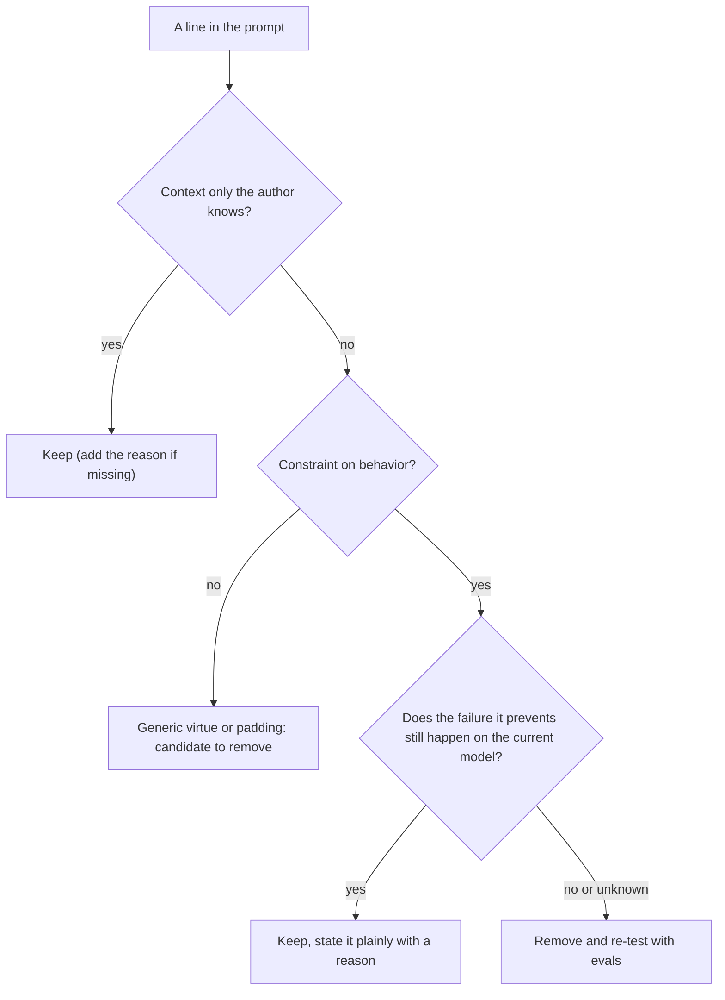

# Prompt Anti-Patterns

## Introduction

Prompts collect cruft. A line goes in after an incident, a capital-letters warning goes in because an older model ignored something, a "think step by step" goes in because a blog post said so. Each addition made sense at the time. A year and two model upgrades later, the system prompt is 3,000 words long, half of it is in capital letters, and the agent behaves strangely: it calls tools when it doesn't need to, plans endlessly before trivial tasks, and refuses to format anything.

This page catalogs the most common **prompt anti-patterns** in agent systems, explains *why* each one hurts on current models, and shows how to fix it. It draws heavily on Anthropic's prompt-audit guidance, published in the claude-api skill and in the [Claude prompting best practices](https://platform.claude.com/docs/en/build-with-claude/prompt-engineering/claude-prompting-best-practices). Most of the ideas apply to any modern model, and OpenAI's and Google's prompting guides make several of the same points.

The central idea:

> Current models follow instructions more closely and more literally than the models many prompts were written for. Leftover workarounds are not just wasted tokens; they actively change behavior.

The goal is **not** to make prompts short. The goal is to make every line earn its place. A long prompt full of useful context is fine. A short prompt full of shouting is not.

## The Deletion Rule: Could the Model Already Know This?

Before the catalog, here is the one question to ask about every line in a prompt:

**Could the model already know this?**

- **Keep what only you know.** The audience and product, environment facts, the quality bar, tool contracts, genuinely hard judgment calls, and the *reasons* behind constraints. This is context, and context is never cruft.
- **Question everything else.** Restatements of trained defaults ("be accurate and helpful"), behavior the model already does on its own (planning, being thorough, using tools), and workarounds for failures the current model no longer has.



Note the last box: **removal is a hypothesis.** You confirm it with evals, as shown in [Iterating on Prompts with Evidence](./10-agents-prompt-iteration.mdx).

## Group 1: Pressure Language

### Shouting

```text
CRITICAL: You MUST ALWAYS use the search_kb tool before answering!!
IMPORTANT: NEVER mention pricing.
IMPORTANT: NEVER make up information.
```

Older, less steerable models sometimes needed this. Current models are very responsive to the system prompt, so the same text **over-applies**. The agent calls `search_kb` for "thanks, bye!" and treats any question near pricing as forbidden. When everything is marked critical, the markers carry no information. The prompt's tone also leaks into the output: an anxious prompt produces a cautious, hedging agent.

**Fix:** say exactly what you mean, at normal volume, with the reason.

```text
Use search_kb when a question is about product behavior, settings, or
billing rules, because the help center changes weekly and your training
data may be out of date.

Don't quote prices. Prices vary by contract, so point the customer to
their account manager instead.
```

### The opposite problem: hedging real requirements

```text
Try to include the ticket ID in your reply if possible.
```

Current models read "try to" and "if possible" literally, as permission to skip the requirement. If it is required, say so: "Include the ticket ID in your reply."

**Signals to grep for:** many `MUST|NEVER|ALWAYS|CRITICAL|IMPORTANT` in caps, `!!`, emphasis with no "because" nearby, `try to|if possible|ideally` attached to actual requirements, and trait claims like "you tend to be verbose."

:::note Emphasis is not banned
Emphasis is a tested fix for **one** instruction that evals show is under-weighted. It should not be the default tone of your first draft.
:::

## Group 2: Scaffolds That API Features Replaced

Some prompt techniques existed to work around missing API features. The features exist now, so swap the scaffold for the feature instead of rewording the scaffold.

| Scaffold in the prompt or code | Replace with |
| --- | --- |
| "Think step by step", instructions to reason in `scratchpad` or `thinking` tags | Built-in thinking. Control depth with the `effort` parameter, not prose |
| "Plan before acting", "use the think tool to plan" | Delete. Current models plan unprompted, and this causes over-planning. Lower `effort` if behavior is still too aggressive |
| "Show your reasoning" sections or a `reasoning` field in JSON output | Read thinking blocks from the API, or ask for a short explanation of the answer |
| Assistant-turn prefill like a trailing `{"role": "assistant", "content": "{"}` | Structured outputs. Prefill returns a 400 error on current Claude models |
| "Output ONLY valid JSON" plus stop sequences, regex extraction, and retry-on-parse loops | Structured outputs (`output_config.format` or `client.messages.parse`) |
| Forced tool use with `tool_choice` set to `any` or a named tool | `tool_choice` auto plus a clear instruction, `strict: True` on the tool, or structured outputs. Forced tool choice returns a 400 on current Claude models |
| `budget_tokens` for thinking | `effort`. `budget_tokens` is rejected on current models |
| Arithmetic rubrics or lookup tables the model must compute | Do the arithmetic in code; give the model data through tools |

See [Prompting for Reasoning](./6-agents-reasoning-prompts.mdx) and [Structured Outputs](../1-agents-llm-apis/6-agents-structured-outputs.mdx) for the replacements in detail.

:::caution Reasoning in the output can be refused
On several current Claude models, instructing the model to reproduce its internal reasoning in the response text can trigger a refusal (category `reasoning_extraction`). If you need visibility into reasoning, request summarized thinking blocks through the API instead. Asking for a short explanation of *the answer* is fine.
:::

Here is the JSON-forcing stack, before and after:

```python
# BEFORE: dated pattern (the trailing assistant turn now returns a 400)
messages = [
    {"role": "user", "content": "Classify this ticket: 'My invoice is wrong'"},
    {"role": "assistant", "content": "{"},  # prefill
]
# ...plus stop_sequences, json.loads in a retry loop, "ONLY output JSON" in the prompt
```

```python
# AFTER: structured outputs
from typing import Literal
from anthropic import Anthropic
from pydantic import BaseModel


class TicketLabel(BaseModel):
    category: Literal["billing", "bug", "how_to", "account"]
    urgent: bool


client = Anthropic()
response = client.messages.parse(
    model="claude-opus-5-5",
    max_tokens=16000,
    messages=[{"role": "user", "content": "Classify this ticket: 'My invoice is wrong'"}],
    output_format=TicketLabel,
)
print(response.parsed_output)
```

Example output:

```text
category='billing' urgent=False
```

Removing the scaffold also removes the code that served it: the stop sequences, the regex, and the retry-on-parse loop.

## Group 3: Over-Specification

Over-specification means describing the *method* when you should describe the *goal*.

### Step-by-step choreography for judgment tasks

```text
STEP 1: Read the ticket.
STEP 2: Identify the customer's intent.
STEP 3: Search the knowledge base.
STEP 4: Draft a reply.
STEP 5: Review the reply.
```

For judgment work, the model's own plan usually beats a hand-written script, and a rigid script makes it perform every step even when step 3 is pointless. **Fix:** state the outcome, the constraints, and how to check the work. Keep numbered steps only where order truly matters, such as a database migration or an auth flow.

### Prohibition lists

```text
Do not be rude. Do not use slang. Never insult the customer.
Avoid sarcasm. Do not argue. Never use profanity.
```

Describing success works better than listing failures. Worse, a prohibition against a failure the model was not going to make can **anchor** it toward that failure. Replace the list with one positive line: "Write in a calm, friendly, professional tone, like an experienced support rep."

### One gold example

Examples are the strongest signal in a prompt. The model copies their length, tone, and structure. A single example gets copied too closely. Use several deliberately varied examples labeled as illustrative. See [Few-Shot Examples for Agents](./3-agents-few-shot-examples.mdx).

### Bullet walls

Twenty bullets of behavioral rules flatten priority and separate each rule from its reason. Formatting in the prompt also leaks into the output format. Use structure (tables, lists, XML sections) for **reference data**, and prose for **behavior**, so each rule can carry its "because."

### Padding, grader talk, and strategy coaching

- **Generic virtues:** "Be accurate, thorough, clear, and helpful." The model already tries to be. These lines add nothing, and they increase the tokens spent on adaptive thinking.
- **Repetition as reinforcement:** stating a rule three times in three wordings makes the model reconcile them. Say it once, in the right place. A single short recap of key constraints at the end is fine.
- **Grader vocabulary:** "You will be graded on..." or "hidden tests check..." describes the scoring setup, not the requirement. State the requirement.
- **Strategy coaching:** "It's usually best to start with the largest file." If deleting a sentence wouldn't change what is allowed or how success is measured, it is strategy. Your heuristic is wrong in some cases and the model's plan is usually better, so delete it.

## Group 4: Fossils

Fossils are lines that outlived the model they were written for.

| Fossil | Why it hurts now | Fix |
| --- | --- | --- |
| Model-version workarounds ("known issue with model X") | Prompts collect every generation's patches | Trace each to its model; if retired, remove and re-test |
| Tool discouragement ("only use tools when strictly necessary") | Followed literally; the agent answers from memory when a search would help | Say *when* to use the tool instead |
| Update suppressors ("don't narrate", "hold all findings for the end") | Written for chatty models; current ones go silent | Remove; if needed, say when updates are wanted |
| Anti-formatting rules ("never use bullets") | Strips formatting the reader needed | Say when formatting is appropriate |
| Reminders re-inserted every few turns | Current models keep instructions; repeats cost tokens and cache | Remove the repetition |
| Identity stub as the only context ("You are a helpful assistant.") | The model fills the gap with generic defaults | Add audience, product, and quality bar |
| Migration-relative phrasing ("X now works differently") | The model never saw the old prompt | Write as if the current rules always existed |
| Patch accretion (many narrow special cases from incidents) | The model navigates a maze instead of a principle | Generalize the principle or fix the underlying context |
| Unenforced rules nobody checks | If nothing checks it and nobody noticed, it is not doing anything | Enforce in code (validators, allowlists) or delete |

A one-line role statement is fine. The anti-pattern is a role line *standing in for* real context. See [Giving Agents Context and a Role](./1-agents-context-and-roles.mdx).

## Group 5: Tool Description Anti-Patterns

Here the instinct to trim usually points the wrong way. **The most common tool-description failure is under-description.** Anthropic's [Writing tools for agents](https://www.anthropic.com/engineering/writing-tools-for-agents) post recommends writing descriptions as you would explain the tool to a new hire.

| Pattern | Direction | Fix |
| --- | --- | --- |
| One-line descriptions, parameters without descriptions, no "when not to use" | Under-described: **add** | Several sentences: what it does, when to use it and when not to, what each parameter means, limits, what it does not return |
| `CRITICAL: You MUST use this tool when...` | Over-steered | "Use this tool when..." |
| Worked examples, fake dialogue, numbered workflows inside the description | Misplaced | Move teaching material elsewhere; make parameters expressive (clear names, enums) |
| "ALWAYS use X, NEVER use Y" scattered across rivals | Misplaced | Put the preference for X in X's own description |
| Tool names listed in the system prompt | Duplicated | Let the tool list speak for itself, so disabling a tool never leaves a dangling reference |

```python
# BEFORE
weak_tool = {
    "name": "lookup",
    "description": "Looks up stuff. CRITICAL: ALWAYS use this!",
    "input_schema": {"type": "object", "properties": {"q": {"type": "string"}}},
}

# AFTER
strong_tool = {
    "name": "search_orders",
    "description": (
        "Search a customer's orders by order number, email, or date range. "
        "Use this when the customer asks about an order's status, contents, or "
        "shipping. Returns at most 20 orders, newest first, with status and "
        "tracking number. Does not return payment card details. For refunds, "
        "use issue_refund instead."
    ),
    "input_schema": {
        "type": "object",
        "properties": {
            "customer_email": {"type": "string", "description": "Customer's account email."},
            "order_number": {"type": "string", "description": "Exact order number, e.g. 'A-10293'."},
            "since": {"type": "string", "format": "date", "description": "Only orders on or after this date."},
        },
        "required": ["customer_email"],
    },
}
```

More on this in [Prompting for Better Tool Use](./4-agents-prompting-for-tool-use.mdx) and [Tool Design Principles](../2-agents-tool-use/7-agents-tool-design-principles.mdx).

## The Keep List: What Not to Remove

An anti-pattern hunt that only deletes things will hurt you. These stay, even when a grep matches them:

1. **Context is never cruft.** Audience, product, environment facts, quality bar, constraints, and their reasons. Too-short prompts produce generic output.
2. **Cruft is not the same as length.** Never delete a line only because the prompt is long.
3. **Fragile operations keep exact scripts.** Where exactly one sequence is safe (destructive commands, auth flows, compliance steps), prescriptive steps are correct.
4. **Tool contract details stay and often grow.**
5. **Prohibitions against current, demonstrated failures stay**, ideally with their reason. "Refunds over 200 USD need a human because finance audits them" is a business rule, not cruft.
6. **A one-line role statement is fine.**
7. **Format-pinning examples for format-sensitive output stay.**
8. **One deliberate end-of-prompt recap is fine.**

## A Tiny Prompt Linter

You can automate the first pass. This linter flags signals for a human to review. It does not decide anything by itself.

```python
import re
from dataclasses import dataclass

RULES = [
    ("pressure", r"\b(MUST|NEVER|ALWAYS|CRITICAL|IMPORTANT)\b", "Shouted emphasis; state plainly with a reason"),
    ("pressure", r"!!", "Double exclamation marks"),
    ("hedge", r"\b(try to|if possible|ideally)\b", "Hedge; is this actually required?"),
    ("scaffold", r"think step[- ]by[- ]step|take a deep breath", "Use built-in thinking and effort"),
    ("scaffold", r"<(scratchpad|thinking)>", "Reasoning tags; use thinking blocks"),
    ("scaffold", r"only (output|return|respond with) (valid )?json", "Use structured outputs"),
    ("overspec", r"^\s*STEP \d+", "Step choreography; describe the goal instead"),
    ("padding", r"\bbe (accurate|thorough|helpful|clear)\b", "Generic virtue"),
    ("grader", r"\b(graded|grader|hidden tests?)\b", "Grader vocabulary; state the requirement"),
    ("fossil", r"don'?t narrate|no interim|hold all (findings|results)", "Update suppressor"),
    ("fossil", r"never use (bullets|headers|bold)", "Anti-formatting rule"),
    ("fossil", r"only use tools when (strictly )?necessary|minimi[sz]e tool calls", "Tool discouragement"),
    ("fossil", r"^you are an? (helpful|expert) [a-z ]*\.?$", "Identity stub; is there real context?"),
]


@dataclass
class Finding:
    line_no: int
    group: str
    message: str
    text: str


def lint_prompt(prompt: str) -> list:
    findings = []
    for i, line in enumerate(prompt.splitlines(), start=1):
        for group, pattern, message in RULES:
            # Caps rules are case-sensitive; the others are not.
            flags = 0 if group == "pressure" else re.IGNORECASE | re.MULTILINE
            if re.search(pattern, line, flags):
                findings.append(Finding(i, group, message, line.strip()))
    return findings


if __name__ == "__main__":
    old_prompt = """You are a helpful assistant.
IMPORTANT: You MUST ALWAYS use search_kb before answering!!
Think step by step inside <scratchpad> tags.
Try to include the ticket ID if possible.
Only output valid JSON.
Never use bullets."""

    for f in lint_prompt(old_prompt):
        print(f"line {f.line_no} [{f.group}] {f.message}: {f.text[:45]}")
```

Output:

```text
line 1 [fossil] Identity stub; is there real context?: You are a helpful assistant.
line 2 [pressure] Shouted emphasis; state plainly with a reason: IMPORTANT: You MUST ALWAYS use search_kb befo
line 2 [pressure] Double exclamation marks: IMPORTANT: You MUST ALWAYS use search_kb befo
line 3 [scaffold] Use built-in thinking and effort: Think step by step inside <scratchpad> tags.
line 3 [scaffold] Reasoning tags; use thinking blocks: Think step by step inside <scratchpad> tags.
line 4 [hedge] Hedge; is this actually required?: Try to include the ticket ID if possible.
line 5 [scaffold] Use structured outputs: Only output valid JSON.
line 6 [fossil] Anti-formatting rule: Never use bullets.
```

Run it in CI as a **warning**, not a blocker. A match is a question ("why is this here?"), not a verdict.

## Real-World Scenario

**Your company's internal IT helpdesk agent was built 18 months ago on an older model.** It has just been moved to `claude-opus-5-5`. Users complain that it runs a knowledge-base search for every message (even "ok thanks"), writes long numbered plans before resetting a password, and never formats answers, even step-by-step setup guides. Here is the system prompt:

```text
You are a helpful IT assistant.

IMPORTANT: You MUST ALWAYS call search_kb before answering ANY question!!
CRITICAL: NEVER make up information.

STEP 1: Think step by step in <scratchpad> tags about the user's problem.
STEP 2: Write a plan.
STEP 3: Search the knowledge base.
STEP 4: Answer.

Be accurate, thorough, clear, and helpful.
Never use bullets or headers.
Try to escalate to a human if the issue involves hardware, if possible.
Do not reset passwords for admin accounts.
Remember: ALWAYS search first!
```

### The rewrite

```text
You are the IT helpdesk assistant for Northwind's 400 employees. Most
questions are about laptops (macOS and Windows), VPN, Okta sign-in, and
Google Workspace.

<context>
Internal setup details change often and differ from public docs, so use
search_kb for any question about how something is configured at Northwind.
Small talk and thank-yous don't need a search. If the knowledge base
doesn't cover something, say so rather than guessing, because employees
act on your instructions directly.
</context>

<boundaries>
Hardware problems (broken screens, dead batteries, damaged devices) go to
the human IT team through create_ticket, because they need a physical
repair or a replacement device.

You can reset passwords for standard accounts. Admin accounts are
excluded: those resets need identity verification that only the security
team can do, so open a ticket for them instead.
</boundaries>

<formatting>
Use numbered steps for setup or troubleshooting procedures, since people
follow them while working. For short answers, reply in a sentence or two.
</formatting>
```

### What changed and why

| Original line | Pattern | Action |
| --- | --- | --- |
| "You are a helpful IT assistant." as the only context | Identity stub | Replaced with audience and environment |
| "You MUST ALWAYS call search_kb..!!" and the repeated reminder | Pressure language, repetition | Plain rule with reason and an exception for small talk |
| "NEVER make up information." | No-reason prohibition | Replaced with what to do when the KB lacks an answer, and why |
| STEP 1 to 4 with scratchpad tags | Scaffold, choreography | Deleted; built-in thinking handles it |
| "Be accurate, thorough..." | Padding | Deleted |
| "Never use bullets or headers." | Anti-formatting fossil | Replaced with when to format |
| "Try to escalate... if possible" | Hedge on a real requirement | Firm rule with reason |
| "Do not reset passwords for admin accounts." | Real business rule | **Kept**, with its reason |

Then the team ran its 40-case eval set before and after, one change at a time, as described in [Iterating on Prompts with Evidence](./10-agents-prompt-iteration.mdx).

### Why this approach

The symptoms matched the patterns exactly: "ALWAYS search" caused over-searching, the STEP script caused over-planning, and the bullet ban stripped formatting from guides. Fixing root causes worked better than adding new lines like "don't search for thank-yous" on top of the old ones.

### When to use it, and when not

Run an anti-pattern review at every model upgrade, when a prompt grows past what one person can read in one sitting, or when behavior is "too much" of something. Don't strip a prompt that is passing its evals just because it looks old-fashioned. An audit that finds nothing should change nothing.

### Alternatives and trade-offs

| Approach | Pros | Cons | Best for |
| --- | --- | --- | --- |
| Targeted audit plus evals (chosen) | Fixes root causes; keeps context | Needs an eval set | Production prompts |
| Add more patch lines on top | Fast | Makes the maze worse | Never as a long-term fix |
| Rewrite from scratch | Clean slate | Loses hard-won context and business rules | Small prompts with no history |
| Lower `effort` only | One-line change | Doesn't fix shouting or bad rules | Over-thinking alone |

## Summary

- Current models follow prompts closely, so outdated workarounds now cause problems: over-triggering, over-planning, rigid behavior.
- Ask of every line: could the model already know this? Keep context and reasons; question everything else.
- Replace shouting with plain statements plus reasons, and replace hedges on real requirements with firm statements.
- Swap scaffolds for API features: built-in thinking and `effort`, structured outputs, `strict` tools.
- Describe goals, not choreography. Prefer positive descriptions over prohibition lists. Use varied examples.
- Hunt fossils: version workarounds, tool discouragement, update suppressors, formatting bans, reminder repetition.
- In tool descriptions, under-description is the usual problem. Add contract detail; remove steering and examples.
- Respect the keep list, and verify every removal with evals.

## Exercises

1. **Lint your own prompt.** Run the linter on a real system prompt. For each finding, write down the failure it was meant to prevent and whether that failure still happens.
2. **Rewrite a prohibition list.** Turn "Don't be rude. Don't use slang. Don't argue." into one positive sentence that keeps the intent.
3. **Extend the linter.** Add a rule that flags a "Remember:" or "As stated above" line, and a rule that flags any tool description shorter than three sentences.
4. **Prefill migration.** Find (or write) code that uses an assistant prefill to force JSON. Replace it with `client.messages.parse` and delete the code that only existed to support the old approach.

## Further Learning

- [Writing Instructions and Constraints](./2-agents-instructions-and-constraints.mdx): how to write rules with reasons.
- [Prompting for Reasoning](./6-agents-reasoning-prompts.mdx): what replaced "think step by step."
- [Versioning and Managing Prompts](./8-agents-prompt-versioning.mdx): keep the reason for each line so you can audit it later.
- [Iterating on Prompts with Evidence](./10-agents-prompt-iteration.mdx): test each removal.
- [Migrating to a New Model](../13-agents-production/8-agents-model-migration.mdx): the right time to run this audit.
- Anthropic's [prompting best practices](https://platform.claude.com/docs/en/build-with-claude/prompt-engineering/claude-prompting-best-practices).
