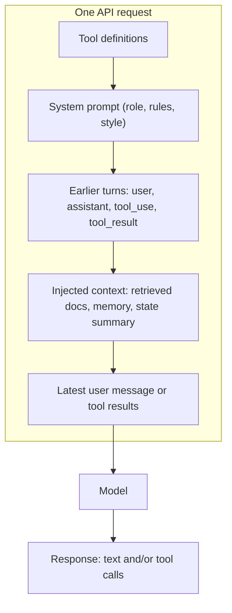
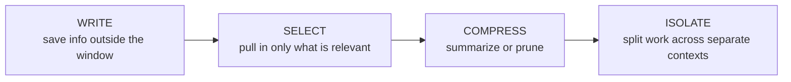
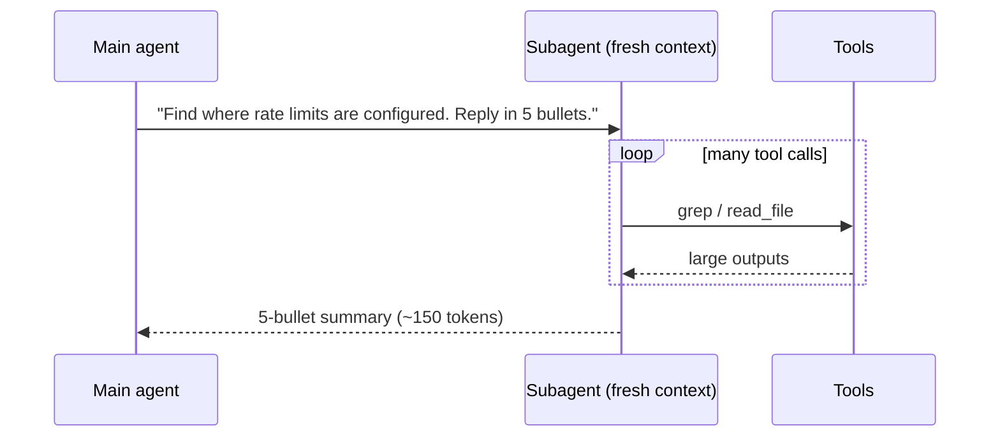

# Context Engineering

## Introduction

Every time your agent calls a language model, it sends one big bundle of text: the system prompt, the tool definitions, the conversation so far, tool results, retrieved documents, and maybe some notes from earlier sessions. That bundle is the **context**. The model sees nothing else. It has no hidden memory of your user, your codebase or what happened five minutes ago unless that information is in the context of *this* request.

**Context engineering** is the practice of deciding what goes into that bundle, in what order, and what gets left out or removed as the agent works. It's the bigger sibling of prompt engineering. Prompt engineering is mostly about *writing* good instructions. Context engineering is about *curating everything the model sees* on every turn of a long-running loop.

A useful analogy is a chef's workstation. A good chef doesn't pile every ingredient in the kitchen onto the counter. They keep the few things they need for the current dish within reach, put the rest in the fridge, and clear the counter between courses. An agent's context window is that counter. It's limited, it gets cluttered quickly, and the quality of the work depends on keeping it organized.

This section of the tutorial covers the tools for managing that counter:

| Page | Problem it solves |
| --- | --- |
| [Short-Term Memory](./1-agents-short-term-memory.mdx) | Keeping the current conversation within budget |
| [Compaction and Summarization](./2-agents-compaction-and-summarization.mdx) | Replacing old turns with a summary |
| [Context Editing](./3-agents-context-editing.mdx) | Pruning stale tool results and thinking blocks |
| [Prompt Caching](./4-agents-prompt-caching.mdx) | Paying less for the parts that don't change |
| [Long-Term Memory](./5-agents-long-term-memory.mdx) | Remembering across sessions |
| [File-Based Memory Tools](./6-agents-memory-tool.mdx) | Letting the agent keep its own notes |
| [Vector-Based Memory](./7-agents-vector-memory.mdx) | Recalling by meaning instead of by key |
| [Episodic, Semantic and Procedural Memory](./8-agents-memory-types.mdx) | Organizing memory by kind |
| [Agent State Management](./9-agents-state-management.mdx) | Tracking structured progress outside the transcript |
| [Session Persistence](./10-agents-session-persistence.mdx) | Saving and resuming conversations |

This page gives you the mental model that ties them together.

## Why Context Is a Scarce Resource

You might think a large context window (hundreds of thousands of tokens, or more) makes this problem go away. It doesn't, for three reasons.

### 1. Quality degrades as context grows

Models don't attend equally well to every token. As the context fills up, recall of specific details gets worse and the model is more easily distracted by irrelevant material. Anthropic's engineering team calls this **context rot** and describes context as an **attention budget**: every token you add spends a little of the model's attention. The decline is gradual, not a cliff, which makes it easy to miss until an agent starts forgetting instructions it followed perfectly an hour ago.

### 2. Cost and latency scale with input size

LLM APIs bill per input token, and agents resend the whole conversation on every step. A 40-step agent run with a context that grows to 100K tokens sends millions of input tokens in total. Time-to-first-token also grows with input length. (See [Understanding API Costs](../1-agents-llm-apis/11-agents-api-cost-basics.mdx) for the arithmetic.)

### 3. The window is still finite

Long-running agents that read files, browse the web or run tests can produce more text than any window holds. When a request exceeds the window, it fails. Your agent needs a plan for that *before* it happens.

:::info
Context engineering is not only about fitting under the limit. An agent at 30% of its window with a cluttered context can perform worse than one at 10% with a focused context.
:::

## The Anatomy of an Agent's Context

Here's what a typical request from an agent loop looks like, in the order the API renders it:



Each layer has a different lifetime:

| Layer | Changes how often? | Typical size | Main technique |
| --- | --- | --- | --- |
| Tool definitions | Rarely (per deploy) | 1K to 20K+ tokens | Tool design, tool search, caching |
| System prompt | Rarely (per deploy) | 500 to 5K tokens | Prompt design, caching |
| Conversation history | Every turn | Grows without bound | Windowing, compaction, context editing |
| Tool results | Every step | Often the largest part | Truncation at the source, context editing |
| Retrieved knowledge | Per task or per turn | Variable | RAG, just-in-time retrieval |
| Long-term memory | Per session | Small if curated | Memory tools, profiles |

The order matters for two reasons. First, the model treats the system prompt as its standing instructions. Second, **prompt caching is a prefix match**: stable layers at the top can be cached and reused cheaply, while anything that changes invalidates the cache for everything after it. Putting a timestamp at the top of your system prompt silently makes every request full price. [Prompt Caching](./4-agents-prompt-caching.mdx) covers this in depth.

## The Four Core Moves

Most context-engineering techniques fall into one of four moves. Learn these names and you'll recognize them in every framework.



### Write: save information outside the context window

The agent writes notes, progress logs, or facts to a file, a database or a memory store so they survive after they leave the window. Examples: a `progress.md` file, the Anthropic memory tool, a `user_preferences` table.

### Select: bring in only what's relevant now

Instead of preloading everything, the agent retrieves what it needs **just in time**. It keeps lightweight references (file paths, record IDs, URLs) and loads the details only when it needs them. RAG, memory lookups, and tools like `read_file` are all forms of selection.

### Compress: shrink what's already there

When history grows, replace old turns with a summary (**compaction**) or remove content that's no longer useful, such as a 10,000-line log from 30 steps ago (**context editing**).

### Isolate: give sub-tasks their own context

A subagent can explore a large codebase in its own fresh context and return a 200-word summary. The main agent never sees the raw exploration. See [Subagents and Context Isolation](../8-agents-multi-agent-systems/8-agents-subagents-and-context-isolation.mdx).

## A Context Budget in Code

The simplest way to start is to measure. The snippet below estimates how many tokens each layer of a request uses, so you can see where your budget goes. It uses a rough characters-per-token heuristic so it runs offline. For exact numbers, use your provider's token-counting endpoint (shown afterwards).

```python
import json

def rough_tokens(text: str) -> int:
    """Very rough estimate: about 4 characters per token for English text."""
    return max(1, len(text) // 4)

def context_report(system: str, tools: list, messages: list) -> dict:
    """Estimate the token cost of each layer of an agent request."""
    report = {
        "tools": rough_tokens(json.dumps(tools)),
        "system": rough_tokens(system),
        "messages": 0,
        "tool_results": 0,
    }
    for msg in messages:
        content = msg["content"]
        if isinstance(content, str):
            report["messages"] += rough_tokens(content)
            continue
        for block in content:
            size = rough_tokens(json.dumps(block))
            if block.get("type") == "tool_result":
                report["tool_results"] += size
            else:
                report["messages"] += size
    report["total"] = sum(report.values())
    return report

system = "You are a support agent for Acme Cloud. Be concise and cite docs."
tools = [{
    "name": "search_logs",
    "description": "Search service logs by query string.",
    "input_schema": {"type": "object", "properties": {"query": {"type": "string"}},
                     "required": ["query"]},
}]
messages = [
    {"role": "user", "content": "Why did my deploy fail last night?"},
    {"role": "assistant", "content": [
        {"type": "tool_use", "id": "t1", "name": "search_logs", "input": {"query": "deploy error"}},
    ]},
    {"role": "user", "content": [
        {"type": "tool_result", "tool_use_id": "t1", "content": "ERROR timeout ... " * 2000},
    ]},
]

for layer, tokens in context_report(system, tools, messages).items():
    print(f"{layer:>13}: {tokens:>6} tokens")
```

Example output:

```text
        tools:     46 tokens
       system:     16 tokens
     messages:     30 tokens
 tool_results:   9014 tokens
        total:   9106 tokens
```

One tool call that dumped raw logs uses 99% of the budget. That's the most common pattern in real agents: **tool results, not instructions, are what blow up context.** The cheapest fix is usually at the source: make the tool return less.

For exact counts with the Anthropic SDK, call the token-counting endpoint with the same arguments you'd send to `messages.create`:

```python
from anthropic import Anthropic

client = Anthropic()  # reads ANTHROPIC_API_KEY from the environment

count = client.messages.count_tokens(
    model="claude-opus-5-5",
    system="You are a support agent for Acme Cloud.",
    messages=[{"role": "user", "content": "Why did my deploy fail last night?"}],
)
print(count.input_tokens)
```

Other providers have equivalents (for example, tokenizer libraries such as `tiktoken` for OpenAI models, or a `count_tokens` method in the Gemini SDK).

## Technique 1: Make Tools Return Less

Before reaching for summarization, trim tool output at the source. A tool that returns everything forces the model to read everything.

```python
def search_logs(query: str, logs: list[str], limit: int = 20, max_chars: int = 4000) -> str:
    """Return only matching lines, capped by count and size, with a hint if truncated."""
    hits = [line for line in logs if query.lower() in line.lower()]
    shown = hits[:limit]
    text = "\n".join(shown)
    if len(text) > max_chars:
        text = text[:max_chars] + "\n...[truncated]"
    if len(hits) > limit:
        text += f"\n[{len(hits) - limit} more matches. Refine the query or raise 'limit'.]"
    return text or "No matches."

logs = [f"2026-10-09T02:{i:02d}:00 INFO request ok" for i in range(60)]
logs += ["2026-10-09T02:31:07 ERROR deploy: health check timeout on web-3",
         "2026-10-09T02:31:09 ERROR deploy: rollback started"]

print(search_logs("error", logs))
```

Output:

```text
2026-10-09T02:31:07 ERROR deploy: health check timeout on web-3
2026-10-09T02:31:09 ERROR deploy: rollback started
```

Notice the "refine the query" hint. When a tool truncates, tell the model *how* to get more. Otherwise it may assume the truncated output is complete. [Tool Design Principles](../2-agents-tool-use/7-agents-tool-design-principles.mdx) covers this further.

## Technique 2: Just-in-Time Retrieval

Instead of stuffing a whole knowledge base into the system prompt, give the agent a cheap index plus a tool to load details.

```python
DOCS = {
    "billing/refunds.md": "Refunds are issued within 14 days of purchase ...",
    "billing/invoices.md": "Invoices are emailed on the 1st of each month ...",
    "deploy/rollbacks.md": "To roll back, run `acme deploy rollback <id>` ...",
}

def doc_index() -> str:
    """A tiny table of contents: cheap to include in every request."""
    return "\n".join(f"- {path} ({len(text)} chars)" for path, text in DOCS.items())

def read_doc(path: str) -> str:
    """Tool: load one document only when the agent asks for it."""
    return DOCS.get(path, f"No document at {path}. Available:\n{doc_index()}")

system_prompt = (
    "You are Acme's support agent.\n"
    "Available docs (call read_doc to open one):\n" + doc_index()
)
print(system_prompt)
```

Output:

```text
You are Acme's support agent.
Available docs (call read_doc to open one):
- billing/refunds.md (49 chars)
- billing/invoices.md (49 chars)
- deploy/rollbacks.md (49 chars)
```

The index costs a few dozen tokens. The model opens a document only when the question needs it. File names, sizes and folder structure help the model judge relevance, just as they help you. The trade-off is extra round trips: just-in-time retrieval is slower than preloading, so a hybrid works well. Preload the small, always-needed facts and fetch the rest on demand.

## Technique 3: Manage the Growing History

Once an agent runs for many turns, you need a policy for old messages. The main options, each covered on its own page:

| Approach | What happens to old turns | Covered in |
| --- | --- | --- |
| Sliding window | Dropped | [Short-Term Memory](./1-agents-short-term-memory.mdx) |
| Summarize / compact | Replaced by a summary | [Compaction and Summarization](./2-agents-compaction-and-summarization.mdx) |
| Context editing | Bulky tool results or thinking cleared, structure kept | [Context Editing](./3-agents-context-editing.mdx) |
| External memory | Important facts written out, re-read later | [File-Based Memory Tools](./6-agents-memory-tool.mdx) |

:::caution
On recent Claude models with **preserved thinking** (Claude Opus 5.5, Sonnet 5.5, Haiku 5.5 and Fable 5.1 at the time of writing), each thinking block is tied to the exact conversation that produced it. If your code rewrites or deletes *earlier* turns between requests, the API rejects or drops the thinking blocks after the edit. Prefer append-only histories plus the API's server-side compaction and context editing, which don't count as edits. The next pages show the safe patterns.
:::

## Technique 4: Keep the Prefix Stable

Because caching is a prefix match, a well-engineered context puts stable content first and volatile content last.

```python
from datetime import datetime, timezone

STABLE_SYSTEM = "You are Acme's support agent. Follow the refund policy exactly."

# Bad: the timestamp changes every request, so nothing after it can be cached.
bad_system = f"Current time: {datetime.now(timezone.utc).isoformat()}\n{STABLE_SYSTEM}"

# Better: keep the system prompt frozen and put volatile facts in the latest user turn.
def build_messages(history: list, user_text: str) -> list:
    now = datetime.now(timezone.utc).strftime("%Y-%m-%d %H:%M UTC")
    return history + [{"role": "user", "content": f"[now: {now}]\n{user_text}"}]

msgs = build_messages([], "Can I still get a refund for last week's order?")
print(msgs[-1]["content"].splitlines()[1])
```

Output:

```text
Can I still get a refund for last week's order?
```

## Technique 5: Isolate Heavy Work

When a sub-task needs a lot of raw material (scanning 200 files, reading 30 web pages), run it in a separate model call with its own context and bring back only the conclusion.



The main agent's context grows by about 150 tokens instead of tens of thousands. The cost is an extra model call and the risk that the summary leaves out something the main agent needed.

## Real-World Scenario

Your team runs a SaaS helpdesk. You've built a support agent that can search tickets, read knowledge-base articles and query a customer's account. In testing, short conversations go well. In production, conversations that run past 25 or 30 turns go wrong: the agent forgets the customer's plan tier, repeats lookups it already did, and occasionally ignores the "never promise refunds over $500" rule from the system prompt. Your monthly API bill is also three times the estimate.

You instrument the agent with a context report like the one above and find:

- Each `search_tickets` call returns full ticket threads, often 8K to 15K tokens.
- Old ticket searches stay in the history for the rest of the conversation.
- The system prompt starts with `Today is <date>, agent shift: <name>`, so caching never hits.
- The customer's plan tier was mentioned once in turn 2 and is now buried under 120K tokens.

**The fix, in order of effort:**

1. **Trim at the source.** `search_tickets` returns ticket ID, subject, status and a 300-character snippet, plus a `get_ticket(id)` tool for full threads (select).
2. **Freeze the prefix.** Move the date and shift name out of the system prompt into the latest user message. Add prompt caching (see [Prompt Caching](./4-agents-prompt-caching.mdx)).
3. **Pin key facts.** Keep a small structured "case file" (customer ID, plan tier, open issue, actions taken) in your code and append an up-to-date copy as context each turn, instead of hoping the model finds it in turn 2 (write + select). See [Agent State Management](./9-agents-state-management.mdx).
4. **Prune stale results.** Turn on server-side context editing so old ticket bodies are cleared after a threshold (compress). See [Context Editing](./3-agents-context-editing.mdx).
5. **Compact very long sessions.** For the rare 100-turn escalation, compact the history into a summary (compress).

### Why this approach

The problem wasn't the model's capability. The model was being asked to find a needle in a haystack you built. Each step removes hay or moves the needle to where the model looks first. The changes are cheap, measurable, and independent, so you can ship them one at a time and watch the metrics.

### When to use it, and when not

Use deliberate context engineering for any agent that runs more than a handful of tool calls, handles long conversations, or calls tools that return large outputs. For a single-turn classifier or a short Q&A bot, a clean system prompt is usually enough. Don't add summarizers and memory stores before you have evidence that context is the problem.

### Alternatives and trade-offs

| Approach | Pros | Cons | Best for |
| --- | --- | --- | --- |
| Just use a bigger context window | No engineering | Cost, latency and context rot all grow | Prototypes, short sessions |
| Trim tool outputs at the source | Cheap, no information loss you didn't choose | Requires tool redesign | Every agent, first step |
| Sliding window | Simple, predictable | Forgets early facts | Chatbots with short-lived topics |
| Summarization / compaction | Keeps the gist of long histories | Lossy, costs an extra call, resets cache | Long tasks and conversations |
| Context editing | Keeps structure, removes bulk | Breaks cache when it fires | Tool-heavy agents |
| External memory + retrieval | Unlimited capacity, survives sessions | Retrieval can miss, more moving parts | Cross-session personalization, knowledge |
| Subagents | Clean contexts for heavy work | Extra calls, summary may drop details | Research, codebase exploration |

## Common Mistakes

1. **Treating the context window as free storage.** Just because 200K tokens fit doesn't mean they help. Measure what each layer contributes.
2. **Dumping raw tool output.** Return structured, filtered, size-capped results with hints for getting more.
3. **Putting volatile data at the top.** Timestamps, request IDs or per-user data in the system prompt break caching for everything after them.
4. **Rewriting history carelessly.** Deleting or editing earlier turns client-side can break caching and, on models with preserved thinking, invalidate thinking blocks. Prefer append-only histories and server-side context management.
5. **Relying on the model to "remember" a fact from turn 2.** If a fact matters for the whole session, pin it: keep it in structured state and restate it near the end of the context.
6. **Adding memory systems before measuring.** Start with a token report. Fix the biggest layer first.

## Summary

- The **context** is everything the model sees on a request. Context engineering is curating it on every step of an agent loop.
- Context is limited by window size, cost, latency and **context rot**: quality degrades as irrelevant material accumulates.
- The four core moves are **write** (save outside the window), **select** (retrieve just in time), **compress** (summarize or prune) and **isolate** (subagents).
- Tool results are usually the biggest consumer of context. Trim them at the source first.
- Order matters: stable content first (cacheable), volatile content last.
- The rest of this section covers each technique in depth, with both do-it-yourself and API-native options.

## Exercises

1. Take an agent you've built (or the loop from [Building a Manual Agent Loop](../2-agents-tool-use/3-agents-manual-agent-loop.mdx)) and add a `context_report` call before every request. Which layer grows fastest?
2. Rewrite one of your tools so it returns at most 2,000 characters and tells the model how to fetch more. Compare the number of steps and total tokens on the same task.
3. Find every dynamic value in your system prompt (dates, names, IDs). Move each one to the latest user message and check `usage.cache_read_input_tokens` before and after.
4. Design a "case file" for your agent's domain: the five to ten facts that must never be forgotten during a session.

**Related pages:**

- [Tokens and Context Windows](../1-agents-llm-apis/8-agents-tokens-and-context.mdx)
- [Short-Term Memory](./1-agents-short-term-memory.mdx)
- [Working with Large Toolsets](../2-agents-tool-use/10-agents-large-toolsets.mdx)
- [RAG vs Long Context](../5-agents-rag/9-agents-rag-vs-long-context.mdx)
- Anthropic engineering: [Effective context engineering for AI agents](https://www.anthropic.com/engineering/effective-context-engineering-for-ai-agents)
