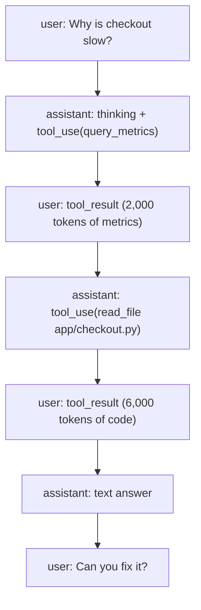
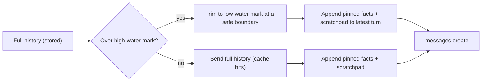

# Short-Term Memory

## Introduction

LLM APIs are **stateless**. The model doesn't remember your previous request. When a chatbot seems to "remember" that you said your name was Alice three messages ago, it's because the application sent those three messages again as part of the new request.

**Short-term memory** is everything your agent knows about the *current* session: the conversation so far, the tool calls it has made, their results, and any scratch notes it is keeping for the current task. In practice, for most agents, short-term memory *is* the `messages` list you send to the API, plus a bit of structured state in your own code.

Think of it like a whiteboard in a meeting room. Everything said in the meeting gets written on it, so everyone can refer back. But the whiteboard has a fixed size. Eventually you have to erase something, take a photo and summarize it, or move to a bigger board. This page covers the simplest strategies for managing the whiteboard: keeping everything, keeping only the recent part, and keeping within a token budget. The next pages cover summarizing ([Compaction and Summarization](./2-agents-compaction-and-summarization.mdx)) and selective erasing ([Context Editing](./3-agents-context-editing.mdx)).

## The Conversation Buffer

The baseline is an unbounded buffer: append every message and send the whole list each time.

```python
from anthropic import Anthropic

client = Anthropic()  # reads ANTHROPIC_API_KEY from the environment
MODEL = "claude-opus-5-5"

class ChatSession:
    """Short-term memory as a plain, append-only list of messages."""

    def __init__(self, system: str):
        self.system = system
        self.messages: list[dict] = []

    def send(self, text: str) -> str:
        self.messages.append({"role": "user", "content": text})
        response = client.messages.create(
            model=MODEL,
            max_tokens=16000,
            system=self.system,
            messages=self.messages,
        )
        # Append the full content blocks, not just the text, so nothing is lost.
        self.messages.append({"role": "assistant", "content": response.content})
        return "".join(b.text for b in response.content if b.type == "text")

chat = ChatSession("You are a friendly travel assistant. Keep answers short.")
print(chat.send("Hi, I'm Alice and I'm planning a trip to Lisbon in May."))
print(chat.send("What's my name, and where am I going?"))
```

Example output:

```text
Hi Alice! Lisbon in May is lovely: warm days, few crowds, and the start of festival season. What would you like help with first?
Your name is Alice and you're going to Lisbon in May.
```

This is the right choice more often than people expect. It's simple, it loses nothing, and it's **append-only**, which plays well with prompt caching and with models that preserve thinking across turns. The downsides only show up as sessions get long:

- Every request resends everything, so cost and latency grow with each turn.
- Eventually the request exceeds the context window and fails.
- Quality degrades as old, irrelevant turns pile up (see [Context Engineering](./0-agents-context-engineering.mdx)).

:::tip
Append `response.content` (the list of content blocks), not just the extracted text. Agents produce `tool_use` blocks, thinking blocks and (with some features) `compaction` blocks that must be sent back exactly as returned.
:::

## What Lives in Short-Term Memory

For an agent (as opposed to a chatbot), the message list contains more than chat:



Two rules shape how you can trim this list:

1. **`tool_use` and `tool_result` travel together.** Every `tool_result` must answer a `tool_use` in the immediately preceding assistant message. If you cut between them, the API returns a 400 error.
2. **The first message must be from the user.** If trimming leaves an assistant message (or an orphaned tool result) at the front, the request fails.

So you can't just do `messages[-10:]`. You need to cut at a **safe boundary**: a user message that contains plain text, not tool results.

## Strategy 1: Sliding Window by Turns

A sliding window keeps the last N "turns" and drops the rest. Here's a version that respects the rules above by only cutting at user messages that start a new exchange.

```python
def is_turn_start(msg: dict) -> bool:
    """True for a user message that is a fresh prompt, not a batch of tool results."""
    if msg["role"] != "user":
        return False
    content = msg["content"]
    if isinstance(content, str):
        return True
    return not any(block.get("type") == "tool_result" for block in content)

def sliding_window(messages: list[dict], max_turns: int) -> list[dict]:
    """Keep the last `max_turns` exchanges, cutting only at safe boundaries."""
    starts = [i for i, m in enumerate(messages) if is_turn_start(m)]
    if len(starts) <= max_turns:
        return messages
    cut = starts[-max_turns]
    return messages[cut:]

history = [
    {"role": "user", "content": "My order number is A-1001."},
    {"role": "assistant", "content": "Thanks, I've noted order A-1001."},
    {"role": "user", "content": "Where is it?"},
    {"role": "assistant", "content": [
        {"type": "tool_use", "id": "t1", "name": "track", "input": {"order": "A-1001"}}]},
    {"role": "user", "content": [
        {"type": "tool_result", "tool_use_id": "t1", "content": "In transit, ETA Oct 12"}]},
    {"role": "assistant", "content": "It's in transit and should arrive Oct 12."},
    {"role": "user", "content": "Can I change the delivery address?"},
]

window = sliding_window(history, max_turns=2)
for m in window:
    kind = m["content"] if isinstance(m["content"], str) else m["content"][0]["type"]
    print(f"{m['role']:>9}: {kind}")
```

Output:

```text
     user: Where is it?
assistant: tool_use
     user: tool_result
assistant: It's in transit and should arrive Oct 12.
     user: Can I change the delivery address?
```

The window kept the tool round intact. It also dropped the order number, which is the classic weakness of a sliding window: **facts from early in the conversation disappear**. If the user now asks "what was my order number again?", the agent can't answer.

## Strategy 2: Token-Budget Window

Turn counts are a poor proxy for size. One turn with a 20K-token tool result costs more than 50 chat turns. A better rule is "keep as many recent turns as fit in a budget."

```python
import json

def estimate_tokens(msg: dict) -> int:
    """Rough estimate (~4 chars/token). Use the token-counting API for accuracy."""
    content = msg["content"]
    text = content if isinstance(content, str) else json.dumps(content)
    return max(1, len(text) // 4)

def token_window(messages: list[dict], budget: int) -> list[dict]:
    """Keep the newest exchanges that fit within `budget` tokens."""
    starts = [i for i, m in enumerate(messages) if is_turn_start(m)]
    kept_from = len(messages)
    for start in reversed(starts):
        size = sum(estimate_tokens(m) for m in messages[start:])
        if size > budget:
            break
        kept_from = start
    if kept_from == len(messages) and starts:
        kept_from = starts[-1]  # always keep at least the latest exchange
    return messages[kept_from:]

big_history = history + [
    {"role": "assistant", "content": [
        {"type": "tool_use", "id": "t2", "name": "get_policy", "input": {"topic": "address"}}]},
    {"role": "user", "content": [
        {"type": "tool_result", "tool_use_id": "t2", "content": "Policy text ... " * 300}]},
]

for budget in (2000, 500):
    kept = token_window(big_history, budget)
    print(f"budget={budget}: kept {len(kept)} of {len(big_history)} messages")
```

Output:

```text
budget=2000: kept 9 of 9 messages
budget=500: kept 3 of 9 messages
```

When even the latest exchange is over budget, this function still keeps it. Dropping the turn the model is currently working on would break the agent. Oversized single turns are a sign the *tool* needs fixing (see [Context Engineering](./0-agents-context-engineering.mdx)) or that you need [Context Editing](./3-agents-context-editing.mdx).

For exact numbers, the Anthropic SDK has `client.messages.count_tokens(...)`, which takes the same `model`, `system`, `tools` and `messages` arguments as `messages.create`. Counting costs a request, so many agents count exactly once per turn and use estimates in between.

## Strategy 3: Pinned Facts plus a Window

To fix the "forgot the order number" problem, keep the facts that must survive in structured state, outside the message list, and restate them at the end of the context on each turn.

```python
from dataclasses import dataclass, field

@dataclass
class SessionFacts:
    """Facts that must survive trimming. Updated by your code or by a tool."""
    values: dict[str, str] = field(default_factory=dict)

    def note(self, key: str, value: str) -> None:
        self.values[key] = value

    def render(self) -> str:
        lines = [f"- {k}: {v}" for k, v in sorted(self.values.items())]
        return "Session facts (authoritative):\n" + "\n".join(lines)

def build_request_messages(window: list[dict], facts: SessionFacts) -> list[dict]:
    """Attach the pinned facts to the latest user turn, after the trimmed history."""
    *earlier, last = window
    if isinstance(last["content"], str):
        content = [{"type": "text", "text": last["content"]}]
    else:
        content = list(last["content"])
    content.append({"type": "text", "text": facts.render()})
    return earlier + [{"role": "user", "content": content}]

facts = SessionFacts()
facts.note("order_number", "A-1001")
facts.note("customer_name", "Alice")

request = build_request_messages(sliding_window(history, max_turns=1), facts)
print(request[-1]["content"][-1]["text"])
```

Output:

```text
Session facts (authoritative):
- customer_name: Alice
- order_number: A-1001
```

You can update `facts` from your own code (for example, after a `lookup_customer` tool returns) or give the model a `note_fact` tool. Placing the facts near the end of the context also helps with recall, since content near the latest turn tends to get more attention than content buried in the middle.

## The Hidden Costs of Trimming

Trimming looks free, but it interacts with two API features.

### Prompt caching

Caching works on an exact **prefix**. Each time a sliding window moves forward by one turn, the beginning of `messages` changes and the cache for the conversation misses. If you trim on every request, you pay full price on every request, and you can end up paying *more* than an untrimmed, cached conversation.

The usual fix is to **trim in large, infrequent jumps**: let the history grow to a high-water mark (say 120K tokens), then cut back to a low-water mark (say 60K) in one step. You take one cache miss per jump instead of one per turn. See [Prompt Caching](./4-agents-prompt-caching.mdx).

### Preserved thinking

On recent Claude models with preserved thinking (Claude Opus 5.5, Sonnet 5.5, Haiku 5.5 and Fable 5.1 at the time of writing), each thinking block carries a signature bound to the conversation that came before it. If you drop earlier turns client-side and resend later turns that contain thinking blocks, the API sees a different prefix and rejects or drops those blocks. Options:

- Run without extended thinking on agents that use client-side windows, or strip `thinking` blocks from the turns you keep (text and tool calls can stay).
- Use the "simple compaction" shape: replace the whole history with one summary message plus the new turn (see [Compaction and Summarization](./2-agents-compaction-and-summarization.mdx)).
- Use the API's server-side compaction or context editing, which don't count as client edits.

```python
def strip_thinking(messages: list[dict]) -> list[dict]:
    """Remove thinking blocks from kept turns before resending a trimmed window."""
    cleaned = []
    for m in messages:
        if m["role"] == "assistant" and isinstance(m["content"], list):
            blocks = [b for b in m["content"]
                      if b.get("type") not in ("thinking", "redacted_thinking")]
            cleaned.append({"role": "assistant", "content": blocks or "(no text)"})
        else:
            cleaned.append(m)
    return cleaned

turn = [{"role": "assistant", "content": [
    {"type": "thinking", "thinking": "Order is in transit...", "signature": "abc"},
    {"type": "text", "text": "It's in transit."}]}]
print([b["type"] for b in strip_thinking(turn)[0]["content"]])
```

Output:

```text
['text']
```

:::note
These helpers work on plain dictionaries. If your history holds SDK objects (from `response.content`), convert them first with `block.model_dump(exclude_none=True)`, or keep your history as dictionaries from the start.
:::

## Working Memory: Scratchpads Inside the Session

Not all short-term memory is conversation. During a multi-step task, an agent benefits from a **scratchpad**: a running plan or todo list it can update. You can implement this as a tool whose state lives in your code.

```python
import json

class Scratchpad:
    """A tiny todo list the agent manages through a tool during one session."""

    def __init__(self):
        self.items: list[dict] = []

    def handle(self, action: str, text: str = "", index: int = -1) -> str:
        if action == "add":
            self.items.append({"text": text, "done": False})
        elif action == "done" and 0 <= index < len(self.items):
            self.items[index]["done"] = True
        return self.render()

    def render(self) -> str:
        if not self.items:
            return "(scratchpad empty)"
        return "\n".join(f"{i}. [{'x' if it['done'] else ' '}] {it['text']}"
                         for i, it in enumerate(self.items))

SCRATCHPAD_TOOL = {
    "name": "scratchpad",
    "description": "Keep a short todo list for the current task. "
                   "action='add' with text, or action='done' with index. Returns the list.",
    "input_schema": {
        "type": "object",
        "properties": {
            "action": {"type": "string", "enum": ["add", "done"]},
            "text": {"type": "string"},
            "index": {"type": "integer"},
        },
        "required": ["action"],
    },
}

pad = Scratchpad()
pad.handle("add", "Check order status")
pad.handle("add", "Look up address-change policy")
print(pad.handle("done", index=0))
print(json.dumps(SCRATCHPAD_TOOL["input_schema"]["required"]))
```

Output:

```text
0. [x] Check order status
1. [ ] Look up address-change policy
["action"]
```

Because the scratchpad lives in your code, it survives trimming. You can render it into the context each turn the same way as pinned facts. [Agent State Management](./9-agents-state-management.mdx) develops this idea further.

## Putting It Together



Note that the *stored* history stays complete. You trim only the copy you send. That keeps an audit trail, lets you change strategies later, and lets you persist and resume sessions (see [Session Persistence](./10-agents-session-persistence.mdx)).

## Real-World Scenario

Your team runs a food-delivery app with an in-app support chat agent. Typical chats last 5 to 15 turns, but some users keep a chat open all evening across several orders, reaching 80+ turns. Those long chats hit the context limit and fail, and the agent sometimes confuses the current order with an earlier one.

**Solution:**

- Keep the full history in your database for auditing.
- Send the full history while it's under 50K tokens (most chats never reach this, and caching keeps them cheap).
- Above 50K, trim back to 20K tokens in one jump at a safe boundary, so the cache misses once rather than every turn.
- Pin `customer_id`, `current_order_id`, `delivery_address` and `open_issue` as session facts updated by your order-lookup tools, and append them to the latest user turn.
- Run the support agent without extended thinking (or strip thinking from kept turns) so client-side trimming doesn't conflict with preserved thinking.

### Why this approach

Most sessions are short, so the common case stays simple and fully cached. The rare long session degrades gracefully: it loses old small talk, but never the facts that matter, because those live in structured state rather than in turn 3 of the transcript.

### When to use it, and when not

A window plus pinned facts suits chat-style agents where old turns rarely matter once the topic moves on. It's a poor fit when the agent must reason over the *whole* history (for example, a coding agent that needs to remember which files it changed an hour ago). There, summarizing or server-side compaction keeps more of the meaning.

### Alternatives and trade-offs

| Approach | Pros | Cons | Best for |
| --- | --- | --- | --- |
| Unbounded buffer | Simple, lossless, cache-friendly | Fails at the window limit, cost grows | Short sessions |
| Sliding window (turns) | Predictable, no extra calls | Forgets early facts, breaks cache when it moves | Casual chat |
| Token-budget window | Respects real size | Same forgetting problem, needs counting | Mixed tool/chat sessions |
| Window + pinned facts | Keeps critical facts cheaply | You must decide what to pin | Support and transactional agents |
| Summarization / compaction | Keeps the gist of everything | Extra call, lossy, resets cache | Long tasks |
| Server-side context editing | No client edits, keeps structure | Beta, provider-specific | Tool-heavy Claude agents |

## Common Mistakes

1. **Slicing with `messages[-N:]`.** This can split a `tool_use` from its `tool_result` or start the list with an assistant message. Cut only at user messages that start a new exchange.
2. **Appending only text.** Storing `response.content[0].text` loses tool calls and thinking blocks, which breaks the next request in an agent loop.
3. **Trimming on every turn.** Each move of the window breaks the prompt cache. Trim in large, infrequent jumps.
4. **Trimming the stored history.** Trim the copy you send, not the record you keep.
5. **Forgetting preserved thinking.** On models that bind thinking to the conversation, client-side trimming invalidates thinking in the turns you keep. Strip it, or use server-side compaction or editing.
6. **Pinning too much.** A "facts" block that grows to 5K tokens recreates the problem. Keep it to the few things that truly must survive.

## Summary

- LLM APIs are stateless. Short-term memory is the message list you resend, plus any working state your code keeps.
- An append-only buffer is the simplest and often the best choice for short sessions.
- Sliding windows and token budgets cap size but forget early facts. Always cut at safe boundaries.
- Pin critical facts in structured state and restate them near the end of the context.
- Trimming interacts with prompt caching (trim in big jumps) and preserved thinking (strip thinking or use server-side features).
- Keep the full history in storage, and trim only what you send.

## Exercises

1. Extend `token_window` to use `client.messages.count_tokens` once per turn and the 4-characters heuristic in between. How far off is the heuristic for code-heavy tool results?
2. Add a `note_fact` tool that lets the model record a fact into `SessionFacts`. Test whether the agent can answer "what was my order number?" after the window has dropped turn 1.
3. Implement high-water and low-water trimming (trim from 50K to 20K tokens). Log `usage.cache_read_input_tokens` and count how many requests miss the cache over a 60-turn session.
4. Write a test that feeds random histories through `sliding_window` and asserts the result never starts with an assistant message or an orphaned `tool_result`.

**Related pages:**

- [Multi-Turn Conversations](../1-agents-llm-apis/4-agents-multi-turn-conversations.mdx)
- [Building a Manual Agent Loop](../2-agents-tool-use/3-agents-manual-agent-loop.mdx)
- [Compaction and Summarization](./2-agents-compaction-and-summarization.mdx)
- [Context Editing](./3-agents-context-editing.mdx)
- [Agent State Management](./9-agents-state-management.mdx)
