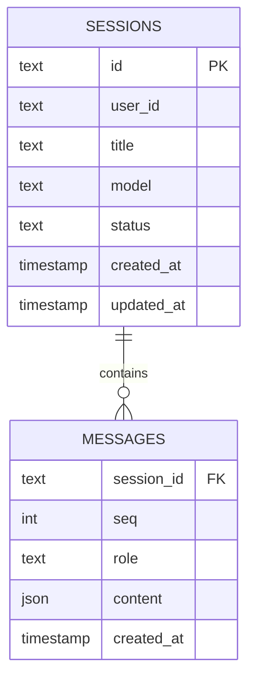
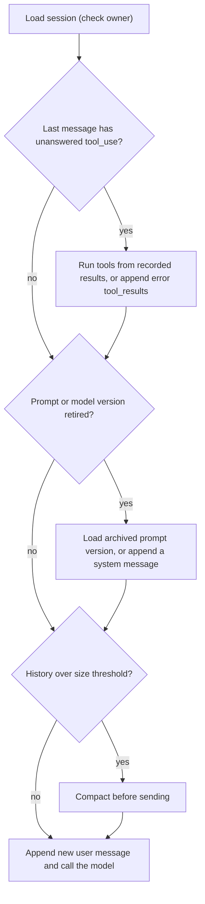

# Session Persistence

## Introduction

A user chats with your agent on their laptop, closes the tab, and comes back the next morning on their phone. They expect to see the conversation and pick up where they left off. Your server restarted twice overnight and the request landed on a different machine. None of that should matter.

The Anthropic Messages API, like most chat-completion APIs, is **stateless**: it keeps no conversation for you. Every request carries the full history. So if you want sessions to outlive a process, **you** have to store the message history and load it back. That's **session persistence**.

It sounds like "save some JSON to a database," and mostly it is. But agent transcripts have a few properties that trip people up:

- They contain structured **content blocks** (text, tool calls, tool results, thinking, compaction summaries) that must be sent back exactly as returned.
- They can be **interrupted mid tool round**, leaving a tool call with no result.
- They can grow large, contain personal data, and be written by two browser tabs at once.

This page builds a persistence layer step by step: a schema, a working SQLite version, Postgres and Redis variants, a backend-agnostic interface, and the resume logic that handles the tricky cases.

:::info
Session persistence is about **one conversation** surviving restarts. Remembering things **across** conversations (preferences, facts about a user) is long-term memory, covered in [Long-Term Memory](./5-agents-long-term-memory.mdx).
:::

## What Needs to Be Stored



**Sessions** hold metadata: who owns the conversation, which model it uses, its status, and timestamps. **Messages** hold the transcript, one row per message, ordered by `seq`.

Why one row per message rather than one big JSON blob per session?

- **Appends are cheap.** Adding a turn is an `INSERT`, not a rewrite of a growing document.
- **Ordering is explicit.** `seq` is the source of truth for order, and it doubles as a concurrency check.
- **Partial loads are possible.** A UI can page through the last 50 messages without loading 5,000.

Store the system prompt and tool definitions **by version** (for example, `prompt_version = "support-v12"`), not copied into every session. When you resume, you need the same system prompt and tools the session started with, or you'll lose prompt-cache hits and, on models with preserved thinking, invalidate earlier thinking blocks.

## Storing Content Blocks Exactly

The content of an assistant message is a list of blocks. Store them in exactly the form you'll send back:

```python
import json

def blocks_to_json(content) -> str:
    """Serialize message content (a string, dicts, or SDK block objects) for storage."""
    if isinstance(content, str):
        return json.dumps(content)
    out = []
    for block in content:
        if hasattr(block, "model_dump"):
            out.append(block.model_dump(exclude_none=True))  # SDK object -> dict, no nulls
        else:
            out.append(block)
    return json.dumps(out)

example = [
    {"type": "text", "text": "Let me check that order."},
    {"type": "tool_use", "id": "toolu_01", "name": "lookup_order", "input": {"id": "A-1001"}},
]
print(blocks_to_json(example))
```

Output:

```text
[{"type": "text", "text": "Let me check that order."}, {"type": "tool_use", "id": "toolu_01", "name": "lookup_order", "input": {"id": "A-1001"}}]
```

Rules for exact storage:

- **Keep every block type.** Thinking blocks (with their `signature`), `tool_use`, `tool_result`, server-tool results and `compaction` blocks all need to go back to the API.
- **Use `model_dump(exclude_none=True)`** (or `to_dict()`). A plain `model_dump()` adds `null` fields that the API can reject when you send them back, notably on `compaction` blocks.
- **Don't re-render or "clean up"** stored content. If your UI needs a pretty version, derive it at display time.

## A Working SQLite Store

SQLite is a perfect starting point: zero setup, a single file, and transactions. Many production apps with modest traffic never need more.

```python
import json
import sqlite3
import uuid

class SQLiteSessionStore:
    def __init__(self, path: str = "sessions.db"):
        self.db = sqlite3.connect(path)
        self.db.execute("PRAGMA foreign_keys = ON")
        self.db.executescript("""
            CREATE TABLE IF NOT EXISTS sessions (
                id TEXT PRIMARY KEY,
                user_id TEXT NOT NULL,
                model TEXT NOT NULL,
                prompt_version TEXT NOT NULL,
                status TEXT NOT NULL DEFAULT 'active',
                created_at TEXT DEFAULT CURRENT_TIMESTAMP,
                updated_at TEXT DEFAULT CURRENT_TIMESTAMP
            );
            CREATE TABLE IF NOT EXISTS messages (
                session_id TEXT NOT NULL REFERENCES sessions(id) ON DELETE CASCADE,
                seq INTEGER NOT NULL,
                role TEXT NOT NULL,
                content TEXT NOT NULL,
                created_at TEXT DEFAULT CURRENT_TIMESTAMP,
                PRIMARY KEY (session_id, seq)
            );
            CREATE INDEX IF NOT EXISTS idx_sessions_user ON sessions(user_id, updated_at);
        """)

    def create(self, user_id: str, model: str, prompt_version: str) -> str:
        sid = uuid.uuid4().hex
        self.db.execute(
            "INSERT INTO sessions (id, user_id, model, prompt_version) VALUES (?, ?, ?, ?)",
            (sid, user_id, model, prompt_version))
        self.db.commit()
        return sid

    def append(self, session_id: str, messages: list[dict], expected_seq: int) -> int:
        """Append messages atomically. `expected_seq` is the next seq the caller thinks is free."""
        with self.db:  # one transaction
            row = self.db.execute(
                "SELECT COALESCE(MAX(seq) + 1, 0) FROM messages WHERE session_id = ?",
                (session_id,)).fetchone()
            if row[0] != expected_seq:
                raise RuntimeError(f"Conflict: expected seq {expected_seq}, found {row[0]}")
            for offset, m in enumerate(messages):
                self.db.execute(
                    "INSERT INTO messages (session_id, seq, role, content) VALUES (?, ?, ?, ?)",
                    (session_id, expected_seq + offset, m["role"], blocks_to_json(m["content"])))
            self.db.execute("UPDATE sessions SET updated_at = CURRENT_TIMESTAMP WHERE id = ?",
                            (session_id,))
        return expected_seq + len(messages)

    def load(self, session_id: str, user_id: str) -> list[dict]:
        owner = self.db.execute("SELECT user_id FROM sessions WHERE id = ?",
                                (session_id,)).fetchone()
        if owner is None or owner[0] != user_id:
            raise PermissionError("Session not found")  # same error for both: don't leak existence
        rows = self.db.execute(
            "SELECT role, content FROM messages WHERE session_id = ? ORDER BY seq",
            (session_id,)).fetchall()
        return [{"role": r, "content": json.loads(c)} for r, c in rows]

    def delete(self, session_id: str, user_id: str) -> None:
        with self.db:
            self.db.execute("DELETE FROM sessions WHERE id = ? AND user_id = ?",
                            (session_id, user_id))

store = SQLiteSessionStore(":memory:")
sid = store.create("user-7", "claude-opus-5-5", "support-v12")
next_seq = store.append(sid, [{"role": "user", "content": "Where is order A-1001?"}], 0)
next_seq = store.append(sid, [{"role": "assistant", "content": example}], next_seq)
print(len(store.load(sid, "user-7")), "messages, next seq", next_seq)
try:
    store.append(sid, [{"role": "user", "content": "stale tab"}], 1)
except RuntimeError as e:
    print(e)
```

Output:

```text
2 messages, next seq 2
Conflict: expected seq 1, found 2
```

Notice two production details already built in:

- **Ownership checks on load and delete.** Every query filters by `user_id`. A session ID alone should never grant access. See [User Authentication and Agent Permissions](../10-agents-integration/5-agents-auth-and-permissions.mdx).
- **Optimistic concurrency with `expected_seq`.** If a user has two tabs open and both send a message, the second write fails instead of interleaving two conversations into one corrupted history. The caller reloads and retries (or tells the user).

## Using the Store in a Chat Turn

Here's a complete "handle one user message" function, the kind you'd call from a web endpoint. It loads the session, calls the model, and saves the new messages.

```python
from anthropic import Anthropic

client = Anthropic()
PROMPTS = {"support-v12": "You are Acme's order-support agent. Be concise."}

def handle_message(store: SQLiteSessionStore, session_id: str, user_id: str, text: str) -> str:
    history = store.load(session_id, user_id)
    next_seq = len(history)
    model, prompt_version = store.db.execute(
        "SELECT model, prompt_version FROM sessions WHERE id = ?", (session_id,)).fetchone()

    user_msg = {"role": "user", "content": text}
    response = client.messages.create(
        model=model,                        # the model the session started with
        max_tokens=16000,
        system=PROMPTS[prompt_version],     # the same system prompt version
        messages=history + [user_msg],
        cache_control={"type": "ephemeral"},  # automatic caching of the growing history
    )
    assistant_msg = {"role": "assistant",
                     "content": [b.model_dump(exclude_none=True) for b in response.content]}
    store.append(session_id, [user_msg, assistant_msg], next_seq)
    return "".join(b.text for b in response.content if b.type == "text")
```

Example output:

```text
Order A-1001 shipped yesterday and should arrive on Oct 12.
```

The user message and the assistant reply are saved **together** after the model responds. If the model call fails, nothing is written, and the user can retry. (An alternative is saving the user message first, so it's visible even if the model call fails. Then resume logic must handle a session that ends with an unanswered user message, which is easy: just call the model.)

For agents with tools, save after **each** step of the loop (assistant `tool_use` message, then user `tool_result` message), so a crash mid-run loses at most one step. [Agent State Management](./9-agents-state-management.mdx) shows that pattern with checkpoints.

## Resuming Safely

Most sessions resume trivially: load, append the new user message, call the model. Three situations need care.

### 1. An interrupted tool round

If the process died after saving an assistant message with `tool_use` blocks but before saving the results, the history ends with tool calls that have no answers. The API rejects a request where a `tool_use` isn't followed by its `tool_result`. You have two options: run the tools now (if they're safe to repeat, or you recorded their results), or close the round with error results.

```python
def repair_interrupted_round(history: list[dict]) -> list[dict]:
    """If the last message has unanswered tool_use blocks, append error tool_results."""
    if not history or history[-1]["role"] != "assistant":
        return []
    content = history[-1]["content"]
    if isinstance(content, str):
        return []
    pending = [b for b in content if b.get("type") == "tool_use"]
    if not pending:
        return []
    return [{"role": "user", "content": [
        {"type": "tool_result", "tool_use_id": b["id"], "is_error": True,
         "content": "This tool call was interrupted and did not complete. "
                    "Check the current state before retrying."}
        for b in pending]}]

broken = [{"role": "user", "content": "Refund A-1001"},
          {"role": "assistant", "content": [
              {"type": "tool_use", "id": "toolu_9", "name": "issue_refund",
               "input": {"order": "A-1001"}}]}]
fix = repair_interrupted_round(broken)
print(fix[0]["content"][0]["tool_use_id"], fix[0]["content"][0]["is_error"])
```

Output:

```text
toolu_9 True
```

The error message tells the model that the outcome is unknown, so it should *check* (for example, look up the refund status) before retrying a side-effecting action.

### 2. Changed prompts or models

If you deploy `support-v13` while sessions on `support-v12` are open, resuming an old session with the new prompt changes the prefix of the whole conversation. Options: keep old prompt versions available until their sessions expire, or announce the change by appending a mid-conversation system message rather than swapping the top-level system prompt. Switching models mid-session also loses the cache, and on some newer models earlier thinking blocks can't be read by a different model.

### 3. Very long sessions

A session that has been resumed many times can outgrow the context window. Store the full history, but send a compacted version. With server-side compaction, the `compaction` block is just another stored content block; with on-demand compaction you replace the summarized messages in what you send. See [Compaction and Summarization](./2-agents-compaction-and-summarization.mdx).



## A Backend-Agnostic Interface

Define a small interface so you can swap SQLite for Postgres or Redis without touching agent code.

```python
from typing import Protocol

class SessionStore(Protocol):
    def create(self, user_id: str, model: str, prompt_version: str) -> str: ...
    def append(self, session_id: str, messages: list[dict], expected_seq: int) -> int: ...
    def load(self, session_id: str, user_id: str) -> list[dict]: ...
    def delete(self, session_id: str, user_id: str) -> None: ...

def message_count(store: SessionStore, session_id: str, user_id: str) -> int:
    return len(store.load(session_id, user_id))

print(message_count(store, sid, "user-7"))
```

Output:

```text
2
```

## Postgres Variant

Postgres is the natural next step when you have multiple app servers. Use a `JSONB` column for content so you can query inside it (for example, to find sessions that used a certain tool). This example uses `psycopg` version 3.

```python
import psycopg
from psycopg.types.json import Jsonb

SCHEMA = """
CREATE TABLE IF NOT EXISTS sessions (
    id TEXT PRIMARY KEY,
    user_id TEXT NOT NULL,
    model TEXT NOT NULL,
    prompt_version TEXT NOT NULL,
    created_at TIMESTAMPTZ DEFAULT now(),
    updated_at TIMESTAMPTZ DEFAULT now()
);
CREATE TABLE IF NOT EXISTS messages (
    session_id TEXT NOT NULL REFERENCES sessions(id) ON DELETE CASCADE,
    seq INTEGER NOT NULL,
    role TEXT NOT NULL,
    content JSONB NOT NULL,
    created_at TIMESTAMPTZ DEFAULT now(),
    PRIMARY KEY (session_id, seq)
);
"""

class PostgresSessionStore:
    def __init__(self, dsn: str):
        self.conn = psycopg.connect(dsn)
        with self.conn.transaction():
            self.conn.execute(SCHEMA)

    def append(self, session_id: str, messages: list[dict], expected_seq: int) -> int:
        try:
            with self.conn.transaction():
                for offset, m in enumerate(messages):
                    self.conn.execute(
                        "INSERT INTO messages (session_id, seq, role, content) "
                        "VALUES (%s, %s, %s, %s)",
                        (session_id, expected_seq + offset, m["role"], Jsonb(m["content"])))
                self.conn.execute("UPDATE sessions SET updated_at = now() WHERE id = %s",
                                  (session_id,))
        except psycopg.errors.UniqueViolation as e:
            raise RuntimeError("Conflict: another writer appended first") from e
        return expected_seq + len(messages)

    def load(self, session_id: str, user_id: str) -> list[dict]:
        rows = self.conn.execute(
            "SELECT m.role, m.content FROM messages m JOIN sessions s ON s.id = m.session_id "
            "WHERE m.session_id = %s AND s.user_id = %s ORDER BY m.seq",
            (session_id, user_id)).fetchall()
        return [{"role": role, "content": content} for role, content in rows]
```

Here the `(session_id, seq)` primary key does the concurrency check for you: if two writers race for the same `seq`, one gets a unique-constraint violation. `content` must already be plain JSON-compatible data (convert SDK blocks first). In production, use a connection pool (`psycopg_pool`) rather than one connection.

## Redis Variant

Redis suits short-lived, high-traffic chat sessions where you want automatic expiry. Store each session as a list, one JSON message per element.

```python
import json
import redis

r = redis.Redis(host="localhost", port=6379, decode_responses=True)
SESSION_TTL = 60 * 60 * 24 * 7  # one week

def redis_append(session_id: str, messages: list[dict]) -> int:
    key = f"session:{session_id}:messages"
    pipe = r.pipeline()                       # MULTI/EXEC: both commands apply together
    for m in messages:
        pipe.rpush(key, json.dumps(m))
    pipe.expire(key, SESSION_TTL)             # sliding expiry on every write
    results = pipe.execute()
    return results[-2]                        # list length after the last RPUSH

def redis_load(session_id: str) -> list[dict]:
    raw = r.lrange(f"session:{session_id}:messages", 0, -1)
    return [json.loads(x) for x in raw]
```

Trade-offs to know:

- **Expiry is built in**, which is great for retention rules, and dangerous if users expect conversations to last forever.
- **Durability depends on configuration.** With default settings, a Redis crash can lose recent writes. Many teams use Redis as a hot cache in front of Postgres.
- **Ownership** must be enforced by storing the owner (for example, in a `session:<id>:meta` hash) and checking it on every load.
- **Concurrency**: for strict ordering, use `WATCH` on the key and check the list length before appending, mirroring the `expected_seq` check.

## Provider-Side and Framework Alternatives

You don't always have to build this yourself:

- **OpenAI's Responses API** can keep conversation state server-side: you pass `previous_response_id` (or use its Conversations API) instead of resending history. Convenient, but your transcript then lives with the provider, subject to their retention rules.
- **The OpenAI Agents SDK** has session classes such as `SQLiteSession` (`from agents import SQLiteSession`) and extensions like `RedisSession` and `SQLAlchemySession` in `agents.extensions.memory`.
- **LangGraph** persists conversation state through checkpointers keyed by `thread_id` (see [Agent State Management](./9-agents-state-management.mdx)).
- **Managed agent platforms**, including Anthropic's Managed Agents, host sessions for you. See [Managed Agent Platforms](../9-agents-frameworks/9-agents-managed-agent-platforms.mdx).

The Anthropic Messages API itself is stateless, which is why the examples here store history in your own database. Owning the transcript costs some code but gives you control over retention, portability between providers, analytics and debugging.

## Real-World Scenario

Your team builds a B2B analytics product with an "Ask your data" assistant in the sidebar. Customers use it across devices, sessions can last weeks (analysts return to the same investigation), and your enterprise contracts require deleting a customer's data within 30 days of a request. You run eight app servers behind a load balancer.

**Solution:**

1. Postgres as the system of record: `sessions` and `messages` tables as above, plus `tenant_id` on both, and row-level security so one tenant can never read another's sessions.
2. Exact storage of content blocks (`model_dump(exclude_none=True)`), with `prompt_version` and `model` saved per session.
3. Optimistic concurrency on `(session_id, seq)`. On conflict, the API returns 409 and the UI reloads the session.
4. Resume logic that repairs interrupted tool rounds and compacts sessions over 120K tokens before sending.
5. A retention job that hard-deletes sessions on request (`ON DELETE CASCADE` removes messages) and purges sessions inactive for a year. Backups follow the same retention.
6. Optional: Redis as a read-through cache of the last 50 messages for fast sidebar rendering.

### Why this approach

Multiple servers rule out in-memory storage. Postgres gives transactions, strong ownership checks and deletion guarantees that enterprise customers ask about. Keeping the transcript in your own database also keeps you free to switch models or providers later.

### When to use it, and when not

Persist sessions whenever conversations should outlive a single request or process, which is nearly every user-facing agent. Skip it for one-shot tasks (classify this ticket, summarize this document), where there's nothing to resume. Prefer provider-side state only when its convenience outweighs data-residency, retention and portability concerns.

### Alternatives and trade-offs

| Approach | Pros | Cons | Best for |
| --- | --- | --- | --- |
| In-memory dict | Zero setup | Lost on restart, single server only | Local prototypes |
| SQLite | Simple, transactional, one file | Single-writer, single machine | Small apps, desktop and CLI agents |
| Postgres (JSONB) | Durable, multi-server, queryable, RLS | Needs operations and pooling | Production SaaS |
| Redis lists | Very fast, built-in TTL | Durability and ownership need extra care | Short-lived chats, caching layer |
| Provider-side state | No storage code | Vendor lock-in, provider retention rules | Quick builds on one provider |
| Framework sessions/checkpointers | Batteries included | Tied to the framework's format | Apps already on that framework |

## Common Mistakes

1. **Storing only the text.** Tool calls, thinking and compaction blocks are needed to resume correctly. Store full content blocks.
2. **Plain `model_dump()`.** Extra `null` fields can make the API reject replayed blocks. Use `exclude_none=True`.
3. **Trusting the session ID.** Always check that the session belongs to the authenticated user (and tenant).
4. **Ignoring concurrent writers.** Two tabs can interleave messages and corrupt the order. Use a sequence check.
5. **Not handling interrupted tool rounds.** A dangling `tool_use` makes every later request fail. Repair it on load.
6. **Resuming with a different prompt or model by accident.** Save `prompt_version` and `model` per session.
7. **Keeping everything forever.** Transcripts contain personal data. Define retention, support deletion, and make backups follow the same rules. See [Data Privacy and PII](../12-agents-safety-and-security/5-agents-data-privacy.mdx).

## Summary

- The Messages API is stateless, so session persistence means storing the message history yourself and loading it on each turn.
- Use a `sessions` table plus a `messages` table with an ordered `seq`, storing content blocks exactly as the API returned them.
- SQLite is a great start, Postgres (JSONB) suits multi-server production, and Redis suits fast, expiring sessions or caching.
- Check ownership on every load, and use optimistic concurrency on `seq` to prevent interleaved writes.
- On resume, repair interrupted tool rounds, keep the session's prompt and model version, and compact very long histories before sending.
- Provider-side state, framework sessions and managed platforms are alternatives that trade control for convenience.

## Exercises

1. Add a `list_sessions(user_id, limit)` method to `SQLiteSessionStore` that returns recent sessions with a title derived from the first user message.
2. Simulate a crash between saving a `tool_use` message and its `tool_result`. Load the session, call `repair_interrupted_round`, and confirm the next API request is valid.
3. Implement `RedisSessionStore` with the full `SessionStore` protocol, including an owner check and a `WATCH`-based sequence check.
4. Write a retention job that deletes sessions not updated in N days, and a test proving their messages are deleted too.

**Related pages:**

- [Multi-Turn Conversations](../1-agents-llm-apis/4-agents-multi-turn-conversations.mdx)
- [Agent State Management](./9-agents-state-management.mdx)
- [Compaction and Summarization](./2-agents-compaction-and-summarization.mdx)
- [Exposing an Agent as an API Service](../10-agents-integration/1-agents-as-api-service.mdx)
- [Agents That Work with Your Database](../10-agents-integration/6-agents-with-databases.mdx)
