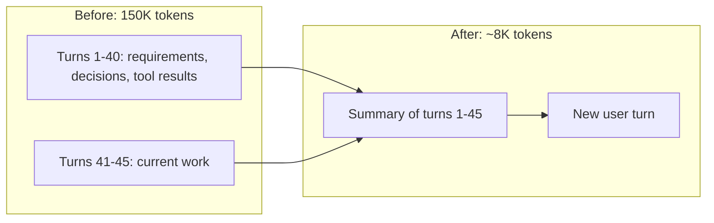
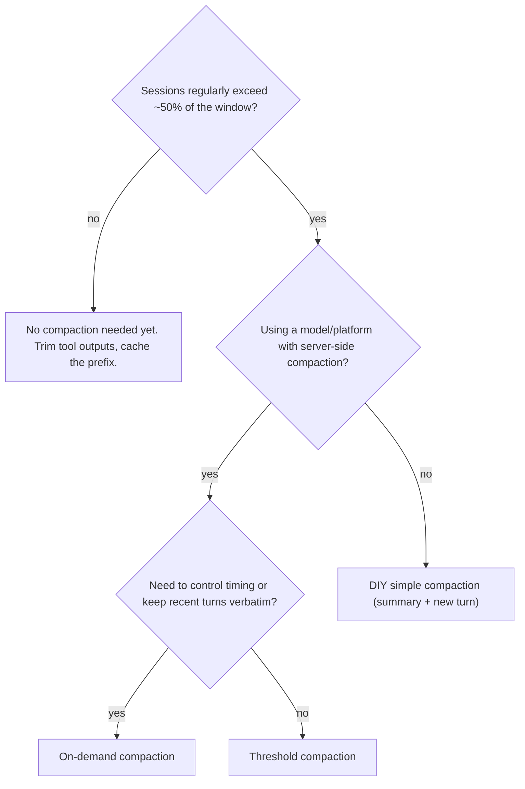

# Compaction and Summarization

## Introduction

A sliding window (see [Short-Term Memory](./1-agents-short-term-memory.mdx)) keeps an agent under its context limit by forgetting old turns. That works for casual chat, but it's a bad deal for an agent halfway through a two-hour coding task. The early turns contain the user's requirements, the decisions already made and the files already changed. Throwing them away means the agent repeats work or contradicts itself.

**Compaction** is the alternative: when the history gets too long, replace the old turns with a **summary** and continue from there. The agent loses the exact wording but keeps the meaning.

It's like a long project meeting. Nobody re-reads the full transcript of the first three hours. Someone writes up the minutes ("we decided X, Y is blocked, Z owns the migration"), and the meeting continues from the minutes.

There are two ways to do it:

1. **Do it yourself**: your code calls the model with a "summarize this conversation" prompt and rewrites the history.
2. **API-native compaction**: some providers can summarize server-side for you. Anthropic offers this as a beta in two forms, **threshold compaction** (the API compacts automatically when input passes a token count) and **on-demand compaction** (your code asks for a summary when it chooses).

This page builds the do-it-yourself version first, so you understand what's happening, then shows the API features and compares them.

## How Compaction Works



Every compaction scheme has to answer four questions:

| Question | Typical answers |
| --- | --- |
| **When** to compact? | When input tokens pass a threshold, at the end of a task phase, or on a schedule |
| **What** gets summarized? | Everything, or everything except the last few turns |
| **Who** writes the summary? | The same model, a cheaper model, or the API server-side |
| **What** must the summary keep? | Goals, decisions, constraints, IDs, file names, open tasks, errors seen |

The last question matters most. A summary that says "the user and assistant discussed the database" is useless. A good summary reads like a handover note to a colleague who will finish the job.

## Do-It-Yourself: Simple Compaction

The most robust client-side shape is called **simple compaction**: when the history gets too long, summarize *all* of it into one message and start the next request with just that summary plus the new user turn. Nothing older is replayed.

Here's a complete implementation.

```python
import json
from anthropic import Anthropic

client = Anthropic()
MODEL = "claude-opus-5-5"
SUMMARIZER_MODEL = "claude-haiku-5-5"  # a cheaper model is often fine for summaries

SUMMARY_PROMPT = """You are writing a handover note so another engineer can continue this
conversation without reading it. Write in plain prose and short bullet lists. Keep:
- The user's overall goal and any explicit requirements or constraints
- Decisions made and why
- Exact identifiers: file paths, function names, IDs, URLs, numbers
- What has been done, what is in progress, and what remains
- Errors encountered and how they were resolved
Drop greetings, small talk and raw tool output that is no longer needed.
Do not call tools. Reply with the summary only."""

def render_transcript(messages: list[dict]) -> str:
    """Flatten a message list (including tool calls) into readable text."""
    lines = []
    for m in messages:
        content = m["content"]
        if isinstance(content, str):
            lines.append(f"{m['role'].upper()}: {content}")
            continue
        for b in content:
            kind = b.get("type")
            if kind == "text":
                lines.append(f"{m['role'].upper()}: {b['text']}")
            elif kind == "tool_use":
                lines.append(f"TOOL CALL {b['name']}: {json.dumps(b['input'])}")
            elif kind == "tool_result":
                text = b["content"] if isinstance(b["content"], str) else json.dumps(b["content"])
                lines.append(f"TOOL RESULT: {text[:2000]}")
    return "\n".join(lines)

def summarize(messages: list[dict]) -> str:
    response = client.messages.create(
        model=SUMMARIZER_MODEL,
        max_tokens=4000,
        system=SUMMARY_PROMPT,
        messages=[{"role": "user", "content": render_transcript(messages)}],
    )
    return "".join(b.text for b in response.content if b.type == "text")

def compact(messages: list[dict], new_user_text: str) -> list[dict]:
    """Simple compaction: one summary message plus the new turn. Nothing older is replayed."""
    summary = summarize(messages)
    return [{
        "role": "user",
        "content": (
            "<conversation_summary>\n" + summary + "\n</conversation_summary>\n\n"
            + new_user_text
        ),
    }]
```

And here's how it fits into a chat loop with a token threshold:

```python
COMPACT_AT = 100_000  # compact when the conversation reaches about this many input tokens

def conversation_tokens(response) -> int:
    """Everything the next request will resend: input (cached or not) plus this reply."""
    u = response.usage
    return (u.input_tokens + (u.cache_read_input_tokens or 0)
            + (u.cache_creation_input_tokens or 0) + u.output_tokens)

class CompactingChat:
    def __init__(self, system: str):
        self.system = system
        self.messages: list[dict] = []
        self.last_size = 0

    def send(self, text: str) -> str:
        if self.last_size > COMPACT_AT:
            self.messages = compact(self.messages, text)
            print(f"[compacted {self.last_size} tokens into a summary]")
        else:
            self.messages.append({"role": "user", "content": text})

        response = client.messages.create(
            model=MODEL, max_tokens=16000, system=self.system, messages=self.messages,
        )
        self.messages.append({
            "role": "assistant",
            "content": [b.model_dump(exclude_none=True) for b in response.content],
        })
        self.last_size = conversation_tokens(response)
        return "".join(b.text for b in response.content if b.type == "text")
```

Example output (after a long session):

```text
[compacted 103412 tokens into a summary]
Picking up where we left off: the CSV importer in importer/csv_loader.py now handles quoted
fields. The remaining item from your list is the date-format validation. Shall I add it?
```

A few details worth noticing:

- **Compaction happens between turns**, never in the middle of a tool round. If the last assistant message has a `tool_use` waiting for its `tool_result`, finish the round first.
- **The summary goes in a user message.** It's context the user is giving the model, wrapped in tags so the model can tell it apart from the new question.
- **`model_dump(exclude_none=True)`** converts SDK blocks into plain dictionaries so `render_transcript` can read them and the history can be saved as JSON.

:::tip
Write the summarization prompt for **recall first, then precision**. It's better to keep a few unnecessary details than to drop the one file path the next step needs. Check the summaries by hand on real sessions before trusting them.
:::

## Keep-Recent-Turns Compaction

A popular variant summarizes only the *older* turns and keeps the last few turns word for word, so the model sees exactly what just happened.

```python
def compact_keep_tail(messages: list[dict], keep_last: int = 4) -> list[dict]:
    """Summarize everything except the last `keep_last` messages (cut at a safe boundary)."""
    cut = max(0, len(messages) - keep_last)
    # Move the cut back until the kept part starts with a plain user message.
    while cut > 0 and not (
        messages[cut]["role"] == "user" and isinstance(messages[cut]["content"], str)
    ):
        cut -= 1
    old, recent = messages[:cut], messages[cut:]
    if not old:
        return messages
    summary_msg = {"role": "user",
                   "content": f"<conversation_summary>\n{summarize(old)}\n</conversation_summary>"}
    ack = {"role": "assistant", "content": "Understood. Continuing from the summary."}
    return [summary_msg, ack] + recent
```

This feels more natural, but it has a catch on models with **preserved thinking** (Claude Opus 5.5, Sonnet 5.5, Haiku 5.5 and Fable 5.1 at the time of writing). Thinking blocks in the kept turns were produced with the full history in front of them. Replay them after a summary and the API sees a different prefix, so it rejects or drops them. If you use keep-tail compaction with those models, **strip the thinking blocks from the kept turns** (text and tool calls can stay), or use the API's on-demand compaction, which has a supported keep-recent-turns mode.

## Structured Summaries

Free-text summaries are easy to write and hard to check. For task-oriented agents, a structured summary is more reliable: you can validate it, store it and render it consistently. Use structured outputs so the response is guaranteed to match a schema.

```python
from pydantic import BaseModel

class Handover(BaseModel):
    goal: str
    constraints: list[str]
    decisions: list[str]
    done: list[str]
    in_progress: list[str]
    todo: list[str]
    key_identifiers: list[str]  # file paths, IDs, URLs

def structured_summary(messages: list[dict]) -> Handover:
    response = client.messages.parse(
        model=SUMMARIZER_MODEL,
        max_tokens=4000,
        system=SUMMARY_PROMPT,
        messages=[{"role": "user", "content": render_transcript(messages)}],
        output_format=Handover,
    )
    return response.parsed_output

def render_handover(h: Handover) -> str:
    def section(title: str, items: list[str]) -> str:
        return f"{title}:\n" + ("\n".join(f"- {i}" for i in items) or "- (none)")
    return "\n".join([
        f"Goal: {h.goal}",
        section("Constraints", h.constraints),
        section("Decisions", h.decisions),
        section("Done", h.done),
        section("In progress", h.in_progress),
        section("To do", h.todo),
        section("Key identifiers", h.key_identifiers),
    ])

example = Handover(
    goal="Add CSV import to the admin dashboard",
    constraints=["Max file size 10 MB", "No new dependencies"],
    decisions=["Use the stdlib csv module"],
    done=["Parser in importer/csv_loader.py"],
    in_progress=["Validation of date columns"],
    todo=["Write tests", "Update docs/admin.md"],
    key_identifiers=["importer/csv_loader.py", "ticket ADM-412"],
)
print(render_handover(example))
```

Output:

```text
Goal: Add CSV import to the admin dashboard
Constraints:
- Max file size 10 MB
- No new dependencies
Decisions:
- Use the stdlib csv module
Done:
- Parser in importer/csv_loader.py
In progress:
- Validation of date columns
To do:
- Write tests
- Update docs/admin.md
Key identifiers:
- importer/csv_loader.py
- ticket ADM-412
```

If your agent already keeps structured state (see [Agent State Management](./9-agents-state-management.mdx)), much of this "summary" can come straight from your code instead of from a model call.

## API-Native: Threshold Compaction

Writing and maintaining summarization code is real work. Anthropic's API can do it server-side. With **threshold compaction**, you add one parameter to your normal requests. When the input passes a trigger, the API summarizes the earlier context, returns a `compaction` block at the start of the response, and continues answering.

- Beta header: `compact-2026-01-12`
- Edit type: `compact_20260112`
- Supported on recent Claude models (check the docs for the current list)

```python
from anthropic import Anthropic

client = Anthropic()
messages: list = []

def chat(user_text: str) -> str:
    messages.append({"role": "user", "content": user_text})
    response = client.beta.messages.create(
        betas=["compact-2026-01-12"],
        model="claude-opus-5-5",
        max_tokens=16000,
        messages=messages,
        context_management={
            "edits": [{
                "type": "compact_20260112",
                "trigger": {"type": "input_tokens", "value": 120_000},
                # Optional: "instructions": "..." replaces the default summarization prompt.
            }]
        },
    )
    # Append the FULL content: the compaction block must be sent back on later requests.
    messages.append({"role": "assistant", "content": response.content})

    for block in response.content:
        if block.type == "compaction":
            print("[server compacted the earlier conversation]")
    return "".join(b.text for b in response.content if b.type == "text")
```

Key behaviors, from the compaction documentation:

- The default trigger is 150,000 input tokens, and the minimum is 50,000.
- `instructions` **replaces** the default summarization prompt entirely, so include everything the default would have kept.
- When the API sees a `compaction` block in your history, it ignores everything before it. You can keep the old messages in your list or drop them yourself.
- With `pause_after_compaction: True`, the response stops with `stop_reason == "compaction"` after writing the summary. That lets you inspect it or re-insert content before continuing.
- Usage is reported per step in `response.usage.iterations`. The top-level `input_tokens` and `output_tokens` exclude the compaction step, so sum the iterations to get the true billed total.

:::warning
Use `client.beta.messages` for compaction. If you serialize blocks yourself with a plain `model_dump()`, the `compaction` block gains `text: null` and `citations: null` fields and the API rejects it. Use `model_dump(exclude_none=True)` or `to_dict()`.
:::

## API-Native: On-Demand Compaction

**On-demand compaction** (beta header `compact-2026-09-04`) puts your code in charge of *when*. You send the conversation with a top-level `compaction` parameter, and the response is a single `compaction` block instead of a reply. You then replace the summarized messages with that block. Anthropic's docs recommend this form wherever it's available.

```python
from anthropic import Anthropic

client = Anthropic()
SYSTEM = "You help design a recipe app's data model. Keep answers short."
COMPACT_AT = 100_000
history: list = []

def turn(question: str) -> str:
    global history
    history.append({"role": "user", "content": question})
    response = client.beta.messages.create(
        model="claude-opus-5-5", max_tokens=16000, system=SYSTEM,
        betas=["compact-2026-09-04"], messages=history,
    )
    history.append({"role": "assistant", "content": response.content})

    u = response.usage
    size = (u.input_tokens + (u.cache_read_input_tokens or 0)
            + (u.cache_creation_input_tokens or 0) + u.output_tokens)
    if size > COMPACT_AT:
        summary = client.beta.messages.create(
            model="claude-opus-5-5", max_tokens=8000, system=SYSTEM,  # same system and tools
            betas=["compact-2026-09-04"], messages=history,
            compaction={"type": "summarize"},
        )
        if summary.stop_reason == "compaction":
            # The returned message REPLACES everything it summarized. It goes first from now on.
            history = [{"role": "assistant", "content": summary.content}]
    return "".join(b.text for b in response.content if b.type == "text")
```

Rules to follow:

- Send the beta header on the compaction request **and** on every later request that carries the block.
- Keep the block exactly as returned (including its `signature`), first in `messages`, exactly one per request.
- Check `stop_reason` before using the result. A `max_tokens`, `tool_use` or `refusal` stop means no summary was produced. Keep your history and try again later.
- Send the same `system` and `tools` as your normal requests. Don't combine `compaction` with `context_management` on the same request.
- Images, documents and fetched URLs inside the summarized range are gone afterwards. Re-supply anything a later turn needs.

If you use the SDK's tool runner, you can call `runner.compact_before_next_turn()` when you decide to compact. Create the runner with the `compact-2026-09-04` beta.

## Choosing an Approach



Other providers and frameworks offer similar tools. Some frameworks ship summarization helpers for conversation memory, and some hosted agent services manage history server-side. The concepts on this page (trigger, scope, summarizer, what to keep) apply to all of them.

## Real-World Scenario

Your team builds an internal coding agent that works through tickets in a monorepo. A typical ticket takes 60 to 150 tool calls: reading files, running tests, editing code. Around call 80, the context passes 180K tokens, requests slow down, and the agent starts re-reading files it already read and occasionally reverts its own earlier fix.

**Solution:**

1. Turn on **threshold compaction** with a trigger at 120K tokens and custom `instructions` that require the summary to keep: the ticket goal, acceptance criteria, every file modified and why, test commands and their latest results, and the next step.
2. Pair it with a **progress file** the agent writes through a memory or file tool (see [File-Based Memory Tools](./6-agents-memory-tool.mdx)), so critical state survives even a lossy summary.
3. Measure: total tokens per ticket from `usage.iterations`, tickets completed, and how often the agent repeats work after a compaction.

### Why this approach

The coding agent needs the *meaning* of its whole history (what it changed and why), not the raw text of 80 file reads. Summarization keeps that meaning at a fraction of the size. Server-side compaction avoids maintaining summarization code and handles thinking blocks correctly. The progress file is insurance against the summary dropping a detail.

### When to use it, and when not

Use compaction for long, single-goal tasks and long conversations where early context still matters. Skip it for short sessions (it adds a summarization call and resets the cache for no benefit), and avoid relying on it alone for facts that must be exact (account numbers, legal wording). Pin those in structured state or memory.

### Alternatives and trade-offs

| Approach | Pros | Cons | Best for |
| --- | --- | --- | --- |
| Sliding window | No extra calls, simple | Loses early context entirely | Casual chat |
| DIY simple compaction | Any provider, full control of the prompt | You maintain it; lossy; extra call | Multi-provider apps |
| DIY keep-tail compaction | Recent turns stay exact | Must strip thinking on preserved-thinking models | Chat UIs without extended thinking |
| Threshold compaction (API) | One parameter, server-side, thinking-safe | Beta, provider-specific, less timing control | Long agent runs on Claude |
| On-demand compaction (API) | You choose when; keep-recent and background modes | Beta, more code than threshold | Products that must control timing |
| Context editing | Removes bulk without summarizing | Doesn't shrink chat text, breaks cache when it fires | Tool-heavy loops |
| Subagents | Heavy work never enters main context | Extra calls, summary quality risk | Exploration and research |

## Common Mistakes

1. **Vague summarization prompts.** "Summarize the conversation" produces vague summaries. List exactly what must be kept, with examples from your domain.
2. **Compacting mid tool round.** An assistant `tool_use` must be followed by its `tool_result`. Compact only between complete turns.
3. **Appending only text after server-side compaction.** The `compaction` block must go back to the API. Append `response.content`.
4. **Ignoring cache effects.** Every compaction changes the prefix, so the next request is a cache miss. Compact rarely, at a high threshold, rather than every few turns.
5. **Using a different `system` or `tools` for the summary call.** For on-demand compaction, mismatched system or tools break thinking validity and caching. Reuse the exact same prefix.
6. **Assuming the summary is perfect.** Summaries lose detail. Keep anything that must be exact in structured state or a memory file, and spot-check summaries in your evaluations.
7. **Forgetting non-text content.** Images and documents in the compacted range are gone. Re-supply them if later steps need them.

## Summary

- Compaction replaces old turns with a summary, keeping the meaning while freeing context.
- **Simple compaction** (one summary plus the new turn) is the most robust client-side shape. Keep-tail variants need thinking blocks stripped on preserved-thinking models.
- Good summaries read like handover notes: goals, constraints, decisions, identifiers, progress and next steps. Structured summaries are easier to validate.
- Anthropic offers **threshold compaction** (`compact-2026-01-12`, edit type `compact_20260112`) and **on-demand compaction** (`compact-2026-09-04`, `compaction={"type": "summarize"}`), both in beta.
- Compaction costs an extra model call and resets the cache, so do it rarely and only for sessions that need it.
- Pair compaction with external memory or structured state for facts that must survive exactly.

## Exercises

1. Run the DIY `CompactingChat` with `COMPACT_AT` set very low (for example 3,000) and a scripted 15-turn conversation. Ask questions at the end that depend on turn 2. Which facts survive?
2. Replace the free-text summary with the `Handover` structured summary. Compare answer quality on the same scripted conversation.
3. Write a custom `instructions` string for threshold compaction aimed at a customer-support agent. What must it never drop?
4. Measure the cost of one compaction: compare `usage.iterations` totals for a session with and without compaction at the same number of turns.

**Related pages:**

- [Short-Term Memory](./1-agents-short-term-memory.mdx)
- [Context Editing](./3-agents-context-editing.mdx)
- [Prompt Caching](./4-agents-prompt-caching.mdx)
- [Structured Outputs](../1-agents-llm-apis/6-agents-structured-outputs.mdx)
- [Subagents and Context Isolation](../8-agents-multi-agent-systems/8-agents-subagents-and-context-isolation.mdx)
- Anthropic docs: [Compaction overview](https://platform.claude.com/docs/en/build-with-claude/compaction)
