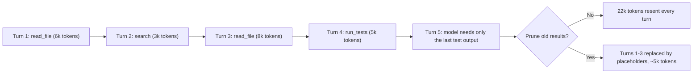
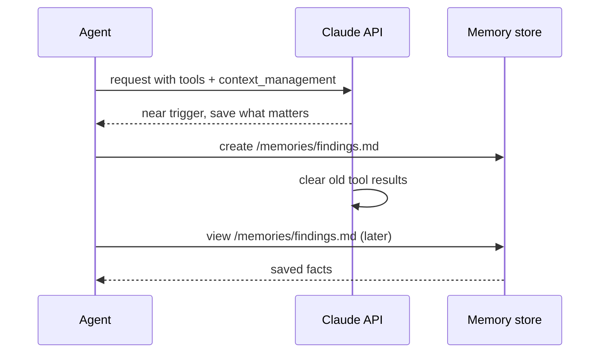

# Context Editing

## Introduction

A long-running agent collects a lot of baggage. Every file it reads, every search it runs, and every API response it fetches lands in the conversation as a `tool_result` block. Twenty steps later, most of that material is no longer useful: the agent already extracted what it needed from the log file it read at step 3, yet those 8,000 tokens are still sent on every request.

**Context editing** means removing that stale material from the transcript while keeping the structure of the conversation intact. Instead of summarizing the past (which is what [compaction](./2-agents-compaction-and-summarization.mdx) does), you **prune** it: old tool results are replaced with a short placeholder such as "content cleared", and the agent carries on.

Think of a detective's desk. While working a case, the detective pulls dozens of files from the archive. Once a file has been read and the useful fact written in the notebook, the file goes back to the archive. The desk stays clear, the notebook keeps the facts, and the detective can always request the file again if needed.

In this page you will learn:

- Why stale tool results hurt quality and cost
- How to prune old tool results yourself (client-side)
- How to use the Claude API's server-side context editing beta (`context-management-2025-06-27`)
- How context editing interacts with prompt caching and thinking blocks
- How to pair context editing with a memory tool so nothing important is lost

## Why Stale Context Is a Problem

Every request to a stateless LLM API sends the full conversation again (see [Tokens and Context Windows](../1-agents-llm-apis/8-agents-tokens-and-context.mdx)). In an agent loop, tool results usually dominate that payload. Three problems follow:

1. **Context window limits.** Eventually the transcript does not fit, and the request fails.
2. **Quality ("context rot").** Models recall information less reliably as the context fills. Anthropic's engineering team calls the context an "attention budget": every irrelevant token spends some of it.
3. **Cost and latency.** You pay for input tokens on every turn, even if most of them are cached.



## What Gets Edited

Context editing targets content that is **bulky and re-obtainable**:

| Content | Safe to clear? | Why |
|---|---|---|
| Old `tool_result` blocks (file contents, search hits, API payloads) | Usually yes | The agent can call the tool again if needed |
| Old `tool_use` inputs (large code being written) | Sometimes | Useful if inputs are huge, but the model loses the record of what it sent |
| Old thinking blocks | Often | Reasoning from finished steps is rarely needed later |
| User messages and final assistant answers | Rarely | These carry the task and decisions; prefer compaction instead |

The key property: the conversation **shape** stays the same. Every `tool_use` still has a matching `tool_result`; only the content inside is shortened. That keeps the API happy, because a `tool_use` without its `tool_result` is an error.

## Do-It-Yourself: Client-Side Pruning

The simplest form of context editing works with any provider. Before each request, walk the message list and replace the content of all but the last N tool results with a placeholder.

```python
import copy

PLACEHOLDER = "[Tool result cleared to save context. Call the tool again if you need this data.]"


def prune_tool_results(messages: list[dict], keep_last: int = 3) -> list[dict]:
    """Return a copy of messages where only the newest `keep_last` tool results keep their content."""
    pruned = copy.deepcopy(messages)

    # Collect the positions of every tool_result block, oldest first.
    positions = []
    for i, msg in enumerate(pruned):
        if msg["role"] != "user" or not isinstance(msg["content"], list):
            continue
        for j, block in enumerate(msg["content"]):
            if isinstance(block, dict) and block.get("type") == "tool_result":
                positions.append((i, j))

    # Clear everything except the newest `keep_last` results.
    for i, j in positions[: max(0, len(positions) - keep_last)]:
        pruned[i]["content"][j]["content"] = PLACEHOLDER

    return pruned


# A tiny fake transcript with five tool calls
history = [{"role": "user", "content": "Find the bug in the payment service."}]
for n in range(1, 6):
    history.append({
        "role": "assistant",
        "content": [{"type": "tool_use", "id": f"toolu_{n}", "name": "read_file",
                     "input": {"path": f"file_{n}.py"}}],
    })
    history.append({
        "role": "user",
        "content": [{"type": "tool_result", "tool_use_id": f"toolu_{n}",
                     "content": f"<contents of file_{n}.py, 4000 tokens>"}],
    })

for msg in prune_tool_results(history, keep_last=2):
    if msg["role"] == "user" and isinstance(msg["content"], list):
        print(msg["content"][0]["tool_use_id"], "->", msg["content"][0]["content"][:45])
```

Output:

```text
toolu_1 -> [Tool result cleared to save context. Call th
toolu_2 -> [Tool result cleared to save context. Call th
toolu_3 -> [Tool result cleared to save context. Call th
toolu_4 -> <contents of file_4.py, 4000 tokens>
toolu_5 -> <contents of file_5.py, 4000 tokens>
```

Notice that the function returns a **copy**. Keep the full transcript in your own storage (for logging, debugging and audits) and send the pruned version to the model.

### Excluding Important Tools

Some results should never be cleared, for example the output of a `get_task_spec` tool that defines the whole job. Add an exclusion list:

```python
import copy

PLACEHOLDER = "[cleared]"


def prune_tool_results(messages, keep_last=3, exclude_tools=()):
    pruned = copy.deepcopy(messages)

    # Map tool_use ids to tool names so we know which result came from which tool.
    id_to_name = {}
    for msg in pruned:
        if msg["role"] == "assistant" and isinstance(msg["content"], list):
            for block in msg["content"]:
                if isinstance(block, dict) and block.get("type") == "tool_use":
                    id_to_name[block["id"]] = block["name"]

    positions = []
    for i, msg in enumerate(pruned):
        if msg["role"] == "user" and isinstance(msg["content"], list):
            for j, block in enumerate(msg["content"]):
                if isinstance(block, dict) and block.get("type") == "tool_result":
                    if id_to_name.get(block["tool_use_id"]) not in exclude_tools:
                        positions.append((i, j))

    for i, j in positions[: max(0, len(positions) - keep_last)]:
        pruned[i]["content"][j]["content"] = PLACEHOLDER
    return pruned
```

### The Hidden Costs of Client-Side Pruning

Client-side pruning is easy, but it has two important side effects on modern APIs.

**1. It breaks the prompt cache.** [Prompt caching](./4-agents-prompt-caching.mdx) is a prefix match: if any byte early in the conversation changes, everything after it must be reprocessed at full price. If your pruning window slides forward every turn (always "keep the last 3"), you rewrite the prefix on every single request and the cache never gets a hit. Prune in **batches** instead: let the transcript grow untouched until it crosses a threshold, then clear a large chunk at once.

**2. It can invalidate thinking blocks.** On Claude models with *preserved thinking* (Claude Opus 5.5, Sonnet 5.5, Haiku 5.5 and Fable 5.1 at the time of writing), each thinking block is cryptographically bound to the conversation that produced it. If you edit earlier turns client-side and then replay later thinking blocks, the API either drops those blocks or returns a 400 error, depending on your settings. Server-side context editing and compaction do **not** count as edits, because the API checks the conversation as you sent it. This is the main reason to prefer the API-native feature on those models.

:::caution
If you use thinking with a preserved-thinking model and prune client-side, either strip the thinking blocks from the turns after the edit point or switch to server-side context editing. Check the "Preserved thinking" page in the Claude docs for the current model list.
:::

## API-Native Context Editing (Claude, Beta)

The Claude API can do the pruning on the server. You send the full, untouched transcript, and the API applies your clearing rules before the model sees it. Your client history stays append-only, which keeps thinking blocks valid.

The feature is in beta. Use `client.beta.messages.create(...)` with the beta flag `context-management-2025-06-27` and a `context_management` parameter that lists one or more **edit strategies**.

### Strategy 1: `clear_tool_uses_20250919`

This strategy clears old tool results once the conversation grows past a trigger.

| Field | Default | Meaning |
|---|---|---|
| `trigger` | 100,000 input tokens | When clearing starts. `{"type": "input_tokens", "value": N}` or `{"type": "tool_uses", "value": N}` |
| `keep` | 3 tool uses | How many of the most recent tool use/result pairs to leave intact |
| `clear_at_least` | none | Minimum tokens a clear must remove, otherwise it is skipped |
| `exclude_tools` | none | Tool names whose results are never cleared |
| `clear_tool_inputs` | `false` | Also clear the `tool_use` input parameters, not just results |

Defaults may change while the feature is in beta; check the [context editing docs](https://platform.claude.com/docs/en/build-with-claude/context-editing).

```python
from anthropic import Anthropic

client = Anthropic()

tools = [
    {
        "name": "read_file",
        "description": "Read a text file from the project and return its contents.",
        "input_schema": {
            "type": "object",
            "properties": {"path": {"type": "string"}},
            "required": ["path"],
        },
    },
    {
        "name": "get_task_spec",
        "description": "Return the specification for the current task.",
        "input_schema": {"type": "object", "properties": {}},
    },
]

context_management = {
    "edits": [
        {
            "type": "clear_tool_uses_20250919",
            # Start clearing once the request reaches 40k input tokens
            "trigger": {"type": "input_tokens", "value": 40000},
            # Keep the three most recent tool calls untouched
            "keep": {"type": "tool_uses", "value": 3},
            # Only clear if we free at least 10k tokens (protects the cache)
            "clear_at_least": {"type": "input_tokens", "value": 10000},
            # Never clear the task specification
            "exclude_tools": ["get_task_spec"],
        }
    ]
}

response = client.beta.messages.create(
    model="claude-opus-5-5",
    max_tokens=16000,
    betas=["context-management-2025-06-27"],
    tools=tools,
    context_management=context_management,
    messages=[{"role": "user", "content": "Review the files in src/ and list risky functions."}],
)
print(response.stop_reason)
```

### Strategy 2: `clear_thinking_20251015`

If you use extended or adaptive thinking, old thinking blocks can take a lot of space. This strategy keeps thinking only from the last N assistant turns:

```python
context_management = {
    "edits": [
        # clear_thinking must come FIRST when combined with other strategies
        {
            "type": "clear_thinking_20251015",
            "keep": {"type": "thinking_turns", "value": 2},
        },
        {
            "type": "clear_tool_uses_20250919",
            "trigger": {"type": "input_tokens", "value": 60000},
            "keep": {"type": "tool_uses", "value": 4},
        },
    ]
}
```

Two details matter here:

- When you combine strategies, `clear_thinking_20251015` **must be listed first** in the `edits` array.
- The default for `keep` differs by model (newer models keep all thinking by default). Set it explicitly if your code runs on several models.

### Reading What Was Cleared

The response tells you what the server removed in `context_management.applied_edits`. Log this; it is the easiest way to tune your trigger.

```python
def log_applied_edits(response) -> None:
    cm = getattr(response, "context_management", None)
    if not cm or not cm.applied_edits:
        print("No context edits applied this turn.")
        return
    for edit in cm.applied_edits:
        cleared = getattr(edit, "cleared_input_tokens", 0)
        if edit.type == "clear_tool_uses_20250919":
            print(f"Cleared {edit.cleared_tool_uses} tool uses ({cleared} tokens)")
        elif edit.type == "clear_thinking_20251015":
            print(f"Cleared {edit.cleared_thinking_turns} thinking turns ({cleared} tokens)")
```

Example output:

```text
Cleared 8 tool uses (50000 tokens)
```

### A Complete Agent Loop with Context Editing

Context editing plugs into the normal agent loop. You append `response.content` exactly as returned and send the whole history every time; the server does the clearing.

```python
import pathlib

from anthropic import Anthropic

client = Anthropic()

TOOLS = [
    {
        "name": "read_file",
        "description": "Read a UTF-8 text file under the project directory.",
        "input_schema": {
            "type": "object",
            "properties": {"path": {"type": "string"}},
            "required": ["path"],
        },
    }
]

CONTEXT_MANAGEMENT = {
    "edits": [
        {
            "type": "clear_tool_uses_20250919",
            "trigger": {"type": "input_tokens", "value": 50000},
            "keep": {"type": "tool_uses", "value": 3},
            "clear_at_least": {"type": "input_tokens", "value": 15000},
        }
    ]
}

PROJECT = pathlib.Path("./project").resolve()


def read_file(path: str) -> str:
    target = (PROJECT / path).resolve()
    if not target.is_relative_to(PROJECT):
        raise ValueError("Path is outside the project directory")
    return target.read_text(encoding="utf-8")[:20000]


def run_agent(task: str, max_turns: int = 30) -> str:
    messages = [{"role": "user", "content": task}]
    for _ in range(max_turns):
        response = client.beta.messages.create(
            model="claude-opus-5-5",
            max_tokens=16000,
            betas=["context-management-2025-06-27"],
            tools=TOOLS,
            context_management=CONTEXT_MANAGEMENT,
            messages=messages,
        )
        messages.append({"role": "assistant", "content": response.content})

        if response.context_management and response.context_management.applied_edits:
            print("Server cleared context:", response.context_management.applied_edits)

        if response.stop_reason != "tool_use":
            return "".join(b.text for b in response.content if b.type == "text")

        results = []
        for block in response.content:
            if block.type == "tool_use":
                try:
                    output = read_file(**block.input)
                    results.append({"type": "tool_result", "tool_use_id": block.id, "content": output})
                except Exception as exc:
                    results.append({"type": "tool_result", "tool_use_id": block.id,
                                    "content": f"Error: {exc}", "is_error": True})
        messages.append({"role": "user", "content": results})
    return "Stopped: turn limit reached."
```

Your local `messages` list keeps growing. That is fine: it is your full record. The server decides what the model actually sees.

## Pairing Context Editing with Memory

Pruning has an obvious risk: what if the agent needed something in a cleared result? The answer is to give it a place to write things down before they disappear. Claude's memory tool (`memory_20250818`) is designed for this. When the conversation approaches the clearing threshold, Claude receives a warning and can save important facts to memory files first.



```python
from anthropic import Anthropic

client = Anthropic()

response = client.beta.messages.create(
    model="claude-opus-5-5",
    max_tokens=16000,
    betas=["context-management-2025-06-27"],
    tools=[{"type": "memory_20250818", "name": "memory"}],
    context_management={"edits": [{"type": "clear_tool_uses_20250919"}]},
    messages=[{"role": "user", "content": "Audit our 40 config files for insecure defaults."}],
)
```

The memory tool is client-side: you implement the file operations. See [File-Based Memory Tools](./6-agents-memory-tool.mdx) for a full handler.

## Context Editing vs Compaction

Both features keep a long session inside the window, but they work differently.

| | Context editing | Compaction |
|---|---|---|
| What happens | Old tool results/thinking replaced by placeholders | Older turns replaced by a written summary |
| What is kept | Conversation structure, user turns, assistant text | Only what the summary captured |
| Information loss | Cleared data is gone (but re-fetchable) | Details not in the summary are gone |
| Extra model call | No | Yes, a summarization call |
| Best when | Tool outputs dominate the context | The whole conversation is long, including dialogue |

Many long-running agents use both: context editing to keep tool noise down, compaction as a backstop near the window limit, and a memory tool for facts that must survive. You cannot send the on-demand `compaction` parameter and `context_management` on the same request, so check the [compaction docs](https://platform.claude.com/docs/en/build-with-claude/compaction) for which combination fits your setup.

## Real-World Scenario

Your team runs an internal **log investigation agent** for on-call engineers. When an alert fires, the agent runs `query_logs`, `get_metrics`, and `read_runbook` tools, sometimes 40 or more times per incident. Each log query returns 3,000 to 10,000 tokens. Incidents regularly hit the context limit before the agent finishes, and engineers notice the agent "forgets" the runbook halfway through.

**Solution:**

1. Enable `clear_tool_uses_20250919` with `trigger` at 80,000 input tokens, `keep` at 5 tool uses, and `clear_at_least` at 20,000 tokens.
2. Put `read_runbook` in `exclude_tools`, since the runbook defines the procedure.
3. Add the memory tool, and tell the agent in the system prompt to record confirmed findings (timestamps, error codes, affected hosts) in `/memories/incident.md`.
4. Log `applied_edits` to your tracing system so you can see how often clears happen.

**Why this approach:** The context is dominated by raw log output that is only useful for a few steps. Pruning removes exactly that material while keeping the engineer's questions and the agent's conclusions verbatim. Running it server-side keeps the history append-only, so thinking blocks stay valid.

**When to use it:**

- Agents that make many tool calls with large outputs
- Tool results that can be fetched again if needed
- Sessions long enough that the window or cost is a real problem

**When not to use it:**

- Short loops (a few tool calls): the machinery adds nothing
- Workflows where old tool outputs are needed for the final answer (for example, a report that quotes every source); use retrieval or memory instead
- When you need maximum cache efficiency and the context still fits: every clear invalidates the cache from that point

**Alternatives and trade-offs:**

| Approach | Pros | Cons | Best for |
|---|---|---|---|
| Server-side context editing | No client code, keeps thinking valid, configurable | Beta, Claude-specific, each clear costs a cache write | Long tool-heavy Claude agents |
| Client-side pruning | Works with any provider, full control | Breaks cache if done every turn, invalidates preserved thinking | Non-Claude models, simple loops |
| Compaction | Handles long dialogue too | Extra summarization call, lossy summary | Conversations near the window limit |
| Truncating tool output at the source | Simplest, no later edits needed | Agent may miss data in the cut part | Tools with predictable, noisy output |
| Subagents | Heavy work stays in a separate context | More orchestration, no shared cache | Self-contained bulky subtasks |

## Best Practices

- **Bound tool output before it enters the context.** Truncate, paginate, or filter in the tool itself. Clearing is the second line of defense.
- **Set the trigger high and clear in batches.** Context editing is a context-window tool, not a savings lever. Anthropic's own cost guidance notes that frequent clears can cost more than they save because each one rewrites the cached prefix. Use `clear_at_least` so small clears are skipped.
- **Exclude definition-style tools.** Specs, schemas and runbooks belong in `exclude_tools`, or better, in the system prompt.
- **Give the agent a notebook.** Pair clearing with a memory tool or a scratchpad file so conclusions survive.
- **Write helpful placeholders.** If you prune client-side, tell the model the content was cleared and how to get it back.
- **Keep the full transcript yourself.** Store the unedited history for debugging and audit; only the model's view is pruned.
- **Set `keep` explicitly for thinking.** Model defaults differ.

## Common Mistakes

- **Deleting the `tool_result` block entirely.** Every `tool_use` needs a matching result. Replace the content, never remove the block.
- **Pruning on every turn with a sliding window.** This guarantees cache misses. Prune at thresholds.
- **Editing history client-side on a preserved-thinking model** and then wondering why requests fail with an invalid thinking signature error. Use server-side editing or strip later thinking blocks.
- **Ordering edits wrongly.** `clear_thinking_20251015` must be first in the `edits` list.
- **Assuming cleared data is still "known".** After a clear, the model genuinely no longer sees the content. If it needs it, it must call the tool again or read its memory.

## Summary

- Context editing **prunes** stale tool results and thinking blocks while keeping conversation structure.
- You can prune client-side with a few lines of code, but it breaks the prompt cache and can invalidate preserved thinking blocks.
- The Claude API offers server-side editing in beta (`context-management-2025-06-27`) with `clear_tool_uses_20250919` and `clear_thinking_20251015`.
- Tune with `trigger`, `keep`, `clear_at_least`, `exclude_tools` and `clear_tool_inputs`; inspect `applied_edits`.
- Pair clearing with a memory tool (`memory_20250818`) so important facts survive.
- Use compaction when the dialogue itself, not just tool output, is the problem.

## Exercises

1. Extend `prune_tool_results` so it only prunes when the estimated token count of tool results exceeds a threshold, and then clears down to `keep_last`. Count how many times the prefix changes over a 30-turn simulated session compared with the sliding-window version.
2. Build a fake tool that returns 5,000 tokens of random log lines. Run the complete agent loop with `trigger` set to 20,000 tokens and print `applied_edits` each turn.
3. Add `clear_tool_inputs: True` and compare what the model can still tell you about earlier tool calls.
4. Write a system prompt that instructs the agent to save findings to a notes file before results are cleared, and test whether it can answer a question about a cleared result.

**Related pages:**

- [Short-Term Memory](./1-agents-short-term-memory.mdx)
- [Compaction and Summarization](./2-agents-compaction-and-summarization.mdx)
- [Prompt Caching](./4-agents-prompt-caching.mdx)
- [File-Based Memory Tools](./6-agents-memory-tool.mdx)
- [Building a Manual Agent Loop](../2-agents-tool-use/3-agents-manual-agent-loop.mdx)
- [Subagents and Context Isolation](../8-agents-multi-agent-systems/8-agents-subagents-and-context-isolation.mdx)
