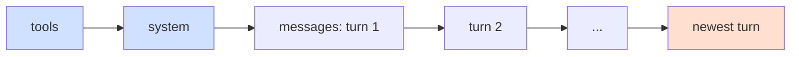

# Prompt Caching

## Introduction

An agent loop sends almost the same request over and over. Turn 12 contains everything from turn 11, plus one more tool call and its result. Without caching, the model provider reprocesses the entire prefix (tool definitions, system prompt, all earlier turns) on every request, and you pay full price for it every time.

**Prompt caching** lets the provider store the processed prefix and reuse it on the next request. Cached tokens are billed at a small fraction of the normal input price and are processed faster, which lowers both cost and time-to-first-token.

An analogy: imagine a translator who has to translate a 200-page contract and then answer questions about it. Without caching, they reread the whole contract before every question. With caching, they keep their notes from the first read and only read the new question. The catch: if you change a single word on page 1, their notes no longer match and they must start over.

That catch is the most important idea on this page.

In this page you will learn:

- The prefix-match rule that every caching decision follows from
- Automatic caching vs explicit cache breakpoints in the Claude API
- How TTLs and pricing work, and when caching pays off
- How to verify cache hits from the `usage` fields
- The "silent invalidators" that quietly destroy caching in real code
- Caching patterns for agent loops

## The One Rule: Caching Is a Prefix Match

The cache key is built from the exact bytes of the prompt up to a cache breakpoint. If **any** byte changes at position N, everything from N onward is a cache miss.

The Claude API renders a request in this fixed order:



So:

- A change in `tools` invalidates **everything**.
- A change in `system` invalidates the system prompt and all messages.
- Appending a new turn at the end invalidates nothing before it.

This leads directly to the design rule: **put stable content first and volatile content last.**

| Content | How often it changes | Where it belongs |
|---|---|---|
| Tool definitions | Never during a session | First (always rendered first anyway) |
| Core system prompt | Rarely (per release) | System, with a breakpoint |
| Per-user or per-session context | Per session | After the global prefix |
| Conversation turns | Every turn | End, appended only |
| Timestamps, request IDs | Every request | Remove, or put at the very end |

## Automatic Caching

The simplest option in the Claude API is a top-level `cache_control` field. The API places the breakpoint on the last cacheable block and moves it forward as the conversation grows.

```python
from anthropic import Anthropic

client = Anthropic()

LONG_POLICY = open("refund_policy.md", encoding="utf-8").read()  # a few thousand tokens

response = client.messages.create(
    model="claude-opus-5-5",
    max_tokens=16000,
    cache_control={"type": "ephemeral"},  # automatic caching
    system=f"You answer questions about our refund policy.\n\n{LONG_POLICY}",
    messages=[{"role": "user", "content": "Can I get a refund after 45 days?"}],
)

usage = response.usage
print("cache write:", usage.cache_creation_input_tokens)
print("cache read: ", usage.cache_read_input_tokens)
print("uncached:   ", usage.input_tokens)
```

Example output (first request, then a second, unrelated request with a different question):

```text
cache write: 3426
cache read:  0
uncached:    0

cache write: 3428
cache read:  0
uncached:    0
```

The second request missed. The automatic breakpoint landed on the **last** block, which is the user's question. The cache entry was therefore keyed to "policy + first question". A new question means a new prefix at that position, so the request paid the write premium again and read nothing.

Automatic caching shines in **multi-turn** conversations, where each request repeats the previous one and adds to the end: the previous request's breakpoint becomes a read point for the next one. For independent questions over the same document, put an explicit breakpoint at the end of the shared part, as the next section shows.

## Explicit Breakpoints

For finer control, put `cache_control` on specific content blocks. You can use up to **4** breakpoints per request (automatic caching uses one of these slots).

```python
from anthropic import Anthropic

client = Anthropic()

SYSTEM_PROMPT = "You are a support agent for Acme Cloud. ..."  # long, stable text

response = client.messages.create(
    model="claude-opus-5-5",
    max_tokens=16000,
    system=[
        {
            "type": "text",
            "text": SYSTEM_PROMPT,
            "cache_control": {"type": "ephemeral"},  # breakpoint after tools + system
        }
    ],
    messages=[{"role": "user", "content": "How do I rotate my API key?"}],
)
```

Because tools render before the system prompt, a breakpoint on the last system block caches **tools and system together**.

### Shared Prefix, Varying Suffix

A common mistake is putting the breakpoint at the very end of a prompt whose end is different every time. Each request then writes a new cache entry and nothing is ever read. Put the breakpoint at the end of the **shared** part:

```python
def build_messages(shared_docs: str, question: str) -> list[dict]:
    return [
        {
            "role": "user",
            "content": [
                # Same for every request: cache it
                {"type": "text", "text": shared_docs, "cache_control": {"type": "ephemeral"}},
                # Different every request: no marker
                {"type": "text", "text": question},
            ],
        }
    ]
```

### When to Choose Which

| Situation | Use |
|---|---|
| Multi-turn chat or agent loop | Automatic caching (top-level `cache_control`) |
| Prompt ends with unique per-request content | Explicit breakpoint at the end of the shared part |
| Sections change at different rates (tools never, docs daily, chat per turn) | Several explicit breakpoints |
| Different TTLs for different blocks | Explicit breakpoints (longer TTL must come first) |

## TTL and Pricing

Cache entries expire. The default lifetime is **5 minutes**, refreshed for free each time the entry is read. A **1-hour** TTL is also available:

```python
cache_5m = {"type": "ephemeral"}               # default, 5 minutes
cache_1h = {"type": "ephemeral", "ttl": "1h"}  # 1 hour
```

Pricing is expressed as a multiplier of the model's base input price. At the time of writing:

| Operation | Multiplier |
|---|---|
| Cache write, 5-minute TTL | 1.25x |
| Cache write, 1-hour TTL | 2x |
| Cache read | about 0.1x on most models (lower on some newer models) |

These numbers change; always check the [prompt caching docs](https://platform.claude.com/docs/en/build-with-claude/prompt-caching) and the pricing page.

### Does Caching Pay Off?

You can work out the break-even point yourself:

```python
def relative_cost(requests: int, write_mult: float, read_mult: float = 0.1) -> tuple[float, float]:
    """Cost of a shared prefix over N requests, in units of 'one uncached prefix'."""
    uncached = requests * 1.0
    cached = write_mult + (requests - 1) * read_mult
    return uncached, cached


for ttl, write in [("5m", 1.25), ("1h", 2.0)]:
    for n in (1, 2, 3, 10):
        u, c = relative_cost(n, write)
        print(f"TTL {ttl}, {n:>2} requests: uncached={u:.2f}  cached={c:.2f}")
```

Output:

```text
TTL 5m,  1 requests: uncached=1.00  cached=1.25
TTL 5m,  2 requests: uncached=2.00  cached=1.35
TTL 5m,  3 requests: uncached=3.00  cached=1.45
TTL 5m, 10 requests: uncached=10.00  cached=2.15
TTL 1h,  1 requests: uncached=1.00  cached=2.00
TTL 1h,  2 requests: uncached=2.00  cached=2.20
TTL 1h,  3 requests: uncached=3.00  cached=2.20
TTL 1h, 10 requests: uncached=10.00  cached=2.90
```

With a 5-minute TTL, caching pays off from the second request. With a 1-hour TTL, it needs at least three. Choose the TTL by the **gap between requests** that share the prefix:

- Requests start less than 5 minutes apart (a busy agent loop): the 5-minute TTL stays warm on its own and is cheaper.
- Gaps of 5 to 60 minutes (a user who replies after 20 minutes): the 1-hour TTL is worth it.
- Gaps over an hour: neither helps much; accept the cold miss.

### Minimum Size

Very short prefixes are not cached, and **no error is returned**: you just see `cache_creation_input_tokens: 0`. On current Claude models the minimum is 512 tokens; some older models need 1,024 to 4,096 tokens. Check the docs for the model you use.

## Verifying Cache Hits

The `usage` object is the only reliable proof that caching works:

| Field | Meaning |
|---|---|
| `cache_creation_input_tokens` | Tokens written to the cache this request (write premium) |
| `cache_read_input_tokens` | Tokens served from the cache (discounted) |
| `input_tokens` | Tokens processed at full price (the part after the last breakpoint) |

Total prompt size is the **sum** of all three. A common surprise: an agent that ran for hours shows `input_tokens` of only a few thousand because the rest came from the cache.

Here is a small helper you can call after every request:

```python
def cache_report(usage) -> str:
    read = usage.cache_read_input_tokens or 0
    write = usage.cache_creation_input_tokens or 0
    fresh = usage.input_tokens
    total = read + write + fresh
    hit_rate = read / total if total else 0.0
    return f"total={total} read={read} write={write} fresh={fresh} hit_rate={hit_rate:.0%}"


class FakeUsage:
    cache_read_input_tokens = 18200
    cache_creation_input_tokens = 950
    input_tokens = 40


print(cache_report(FakeUsage()))
```

Output:

```text
total=19190 read=18200 write=950 fresh=40 hit_rate=95%
```

A healthy agent loop looks like this every turn: reads grow, writes are small (roughly the last turn), and fresh tokens are tiny. If writes are close to the full conversation size on every turn, something is rewriting your prefix.

:::tip
Add a test that sends the same request twice and asserts `cache_read_input_tokens > 0` on the second. Caching usually breaks through a later code change, not on day one, and nothing errors when it does: the bill just goes up.
:::

## Silent Invalidators

These patterns look harmless but change the prefix on every request:

| Pattern | Why it breaks caching | Fix |
|---|---|---|
| `datetime.now()` in the system prompt | Prefix differs every request | Pass the date in the latest user message |
| `uuid4()` or request IDs early in content | Every request is unique | Remove or move to the end |
| `json.dumps(d)` without `sort_keys=True` | Key order can vary | Serialize deterministically |
| Interpolating user name or ID into the system prompt | Separate prefix per user | Put user context after the shared prefix |
| `if flag: system += "..."` | Each flag combination is a new prefix | Pass the mode as message content |
| Tool list built per user or per request | Tools render first, so nothing caches | Fixed, sorted tool list |
| Switching models mid-session | Caches are per model | Keep one model; use a subagent for cheaper work |

Here is a before-and-after example:

```python
import json
from datetime import date

# BAD: the date and user name sit at the front of the prefix
def build_system_bad(user_name: str, prefs: dict) -> str:
    return (
        f"Today is {date.today()}. You are helping {user_name}.\n"
        f"Preferences: {json.dumps(prefs)}\n"
        "You are a travel planning assistant..."
    )


# GOOD: a frozen system prompt, dynamic context appended to the latest user turn
STATIC_SYSTEM = "You are a travel planning assistant..."


def build_turn(user_text: str, user_name: str, prefs: dict) -> dict:
    context = f"[Context] date={date.today()} user={user_name} prefs={json.dumps(prefs, sort_keys=True)}"
    return {"role": "user", "content": f"{context}\n\n{user_text}"}
```

## Caching in Agent Loops

### The Robust Combination

For an agent loop, Anthropic's guidance is to combine:

1. One **explicit** breakpoint on the last block of the static system prompt, so the expensive shared prefix always has a read point.
2. **Automatic** caching for the growing conversation tail.

```python
from anthropic import Anthropic

client = Anthropic()

SYSTEM_BLOCKS = [
    {
        "type": "text",
        "text": "You are a coding agent. Follow the repository conventions...",
        "cache_control": {"type": "ephemeral"},
    }
]

TOOLS = sorted(
    [
        {"name": "run_tests", "description": "Run the test suite.",
         "input_schema": {"type": "object", "properties": {}}},
        {"name": "read_file", "description": "Read a file.",
         "input_schema": {"type": "object", "properties": {"path": {"type": "string"}},
                          "required": ["path"]}},
    ],
    key=lambda t: t["name"],  # deterministic order
)


def call_model(messages: list[dict]):
    response = client.messages.create(
        model="claude-opus-5-5",
        max_tokens=16000,
        tools=TOOLS,
        system=SYSTEM_BLOCKS,
        cache_control={"type": "ephemeral"},  # automatic breakpoint for the tail
        messages=messages,
    )
    u = response.usage
    print(f"read={u.cache_read_input_tokens} write={u.cache_creation_input_tokens} fresh={u.input_tokens}")
    return response
```

Example output across four turns of a loop:

```text
read=0 write=2210 fresh=12
read=2210 write=640 fresh=9
read=2850 write=1105 fresh=9
read=3955 write=480 fresh=9
```

### Changing Instructions Mid-Session

Suppose the user switches the agent to "terse mode" halfway through. Editing the top-level system prompt would invalidate the entire conversation cache. On supporting Claude models you can instead append a **mid-conversation system message** after the latest user turn. It sits after the cached history, so nothing before it is invalidated:

```python
messages = [
    {"role": "user", "content": "Explain how our deploy script works."},
    {"role": "assistant", "content": "The deploy script has three stages..."},
    {"role": "user", "content": "OK, now list the risks."},
    {"role": "system", "content": "Terse mode enabled: keep answers under 40 words."},
]
```

Unsupported models return a 400 error; fall back to putting the instruction in the user turn. See [System Prompts](../1-agents-llm-apis/3-agents-system-prompts.mdx).

### Other Agent-Specific Rules

- **Do not add or remove tools mid-session.** If you have many tools, use tool search (see [Working with Large Toolsets](../2-agents-tool-use/10-agents-large-toolsets.mdx)), which appends schemas instead of swapping them.
- **Forks must copy the parent prefix exactly.** A summarization or side call that rebuilds `system` or `tools` slightly differently misses the cache entirely.
- **Parallel fan-out:** a cache entry is readable only after the first response begins streaming. Send one request, wait for its first token, then send the rest.
- **History edits break the cache.** [Compaction](./2-agents-compaction-and-summarization.mdx) and [context editing](./3-agents-context-editing.mdx) rewrite the prefix, so each one costs a fresh cache write. Do them rarely and in large batches.

## Other Providers

The idea is universal, but the mechanics differ:

- **OpenAI** caches long prompt prefixes automatically, with no markers to place, and reports cached tokens in the response usage details.
- **Google Gemini** offers implicit caching on some models and explicit "context caching", where you create a cache object and reference it in later requests.
- **Self-hosted models** (vLLM, SGLang and similar servers) offer prefix caching of the KV cache, usually enabled by a server flag.

The prefix-match rule applies to all of them: stable content first, volatile content last. Check each provider's documentation for minimum sizes, lifetimes and prices.

## Real-World Scenario

Your company runs a **customer support agent** with a 6,000-token system prompt (policies, tone guide, product facts) and 15 tool definitions. Each conversation averages 8 turns and 3 tool calls per turn. Finance notices the LLM bill grew after a recent release, though traffic did not.

**Investigation:** You log `usage` per request and find `cache_read_input_tokens` is zero on almost every call. Diffing two consecutive request payloads shows the first difference in the system prompt: a developer added `f"Current time: {datetime.now()}"` at the top so the agent could answer "are you open now?" questions.

**Fix:**

1. Freeze the system prompt and remove the timestamp.
2. Pass the current time inside the newest user message (or as a mid-conversation system message).
3. Sort the tool list by name so deployments cannot reorder it.
4. Put an explicit breakpoint on the system prompt and enable automatic caching for the tail.
5. Add a CI test asserting a second identical request reports cache reads.

**Why this approach:** Most of each request is the same 6,000-token prefix plus the growing history. Restoring the prefix match turns that repeated work into cheap reads with no change to agent behavior.

**When to use prompt caching:**

- Agent loops and multi-turn chats (almost always)
- Large shared context: long system prompts, documents, few-shot examples
- Many requests over the same material within minutes

**When not to bother:**

- Prompts that differ from the first tokens on every request
- Prefixes below the model's minimum cacheable size
- One-off requests with no follow-up within the TTL (you pay the write premium for nothing)

**Alternatives and trade-offs:**

| Approach | Pros | Cons | Best for |
|---|---|---|---|
| Prompt caching | Large savings on repeated prefixes, lower latency | Needs strict prefix discipline | Agents, chat, document Q&A |
| Shorter prompts | Saves on every request, cached or not | Effort to trim; may lose guidance | Bloated prompts |
| Retrieval instead of inlining | Only relevant context sent | Retrieval quality risk, extra latency | Huge knowledge bases ([RAG](../5-agents-rag/0-agents-rag-introduction.mdx)) |
| Smaller model for sub-tasks | Lower per-token price | Separate cache, possible quality drop | High-volume simple steps |
| Batch API | Discounted async processing | Not interactive | Offline jobs |

## Best Practices

- **Design for the prefix.** Order content by stability before you think about markers.
- **Freeze the system prompt** for the life of a session.
- **Serialize deterministically** (`sort_keys=True`, sorted tool lists).
- **Keep one model per conversation**; hand cheaper work to subagents.
- **Measure, then trust.** Track hit rate in your monitoring, not just at setup.
- **Match TTL to traffic gaps**, not to a guess.
- **Batch history edits** so compaction or clearing happens rarely.

## Common Mistakes

- Putting the breakpoint after unique per-request content, so every request writes and nothing reads.
- Reading only `input_tokens` and concluding the agent is tiny or that caching is broken.
- Expecting tiny prompts to cache and seeing zero writes with no error.
- Toggling thinking or effort settings per request; these can invalidate the messages cache. Pin them per route.
- Firing 20 parallel requests at once and expecting 19 cache hits.

## Summary

- Prompt caching reuses a processed prompt prefix at a fraction of the input price.
- It is an exact **prefix match** in the order tools, system, messages; any change invalidates everything after it.
- Use top-level `cache_control` for automatic caching, explicit breakpoints (up to 4) for fine control.
- 5-minute TTL writes cost 1.25x, 1-hour writes 2x, reads roughly 0.1x (check current pricing).
- Verify with `cache_read_input_tokens`, `cache_creation_input_tokens` and `input_tokens`.
- Remove silent invalidators: timestamps, IDs, unsorted JSON, per-user system prompts, changing tools or models.
- In agent loops: an explicit breakpoint on the system prompt plus automatic caching for the tail.

## Exercises

1. Write a function that takes two request payloads (as dicts), strips `cache_control` keys, and reports the first position where their shared prefix differs.
2. Build a 3-turn conversation with a 2,000-token system prompt and print `cache_report` after each turn. Then add `datetime.now()` to the system prompt and observe the difference.
3. Using the break-even function, compute the cost of a 50,000-token prefix over 20 requests for both TTLs, assuming a price you look up on the current pricing page.
4. Refactor a system prompt builder that contains user names, feature flags, and a date into a frozen prefix plus per-turn context.

**Related pages:**

- [Understanding API Costs](../1-agents-llm-apis/11-agents-api-cost-basics.mdx)
- [Tokens and Context Windows](../1-agents-llm-apis/8-agents-tokens-and-context.mdx)
- [Compaction and Summarization](./2-agents-compaction-and-summarization.mdx)
- [Context Editing](./3-agents-context-editing.mdx)
- [Cost Optimization](../13-agents-production/4-agents-cost-optimization.mdx)
