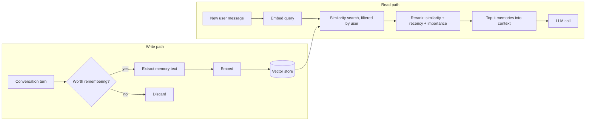

# Vector-Based Memory

## Introduction

[File-based memory](./6-agents-memory-tool.mdx) works well when an agent can find what it needs by name: `account.md`, `progress.md`. But imagine a personal assistant that has talked to the same user 400 times. The user asks: *"What was that restaurant I said I didn't like?"* No file is called `restaurants_disliked.md`. The fact is buried in one sentence of one conversation from three months ago.

**Vector-based memory** solves this. Each memory (a fact, a message, a summary of an episode) is turned into an **embedding**: a list of numbers that captures its meaning. To recall, you embed the current question and find the stored memories whose vectors are closest. "Restaurant I didn't like" lands near "The pasta place on 5th was awful, never again", even though they share almost no words.

If that sounds like retrieval-augmented generation (RAG), it is the same machinery. The difference is **what goes into the store and who writes it**:

| | RAG | Vector memory |
| --- | --- | --- |
| Content | Documents you prepared (docs, wikis, manuals) | Things the agent learned during interactions |
| Who writes | An offline ingestion pipeline | The agent (or your app) during conversations |
| Changes | Re-indexed occasionally | Grows every session; needs updates and forgetting |
| Scope | Usually shared across users | Usually **per user** |
| Key extra concerns | Chunking, citations | Write policy, deduplication, recency, privacy |

This page focuses on the memory-specific parts. For how embeddings and vector databases work in depth, see the RAG section: [Embeddings](../5-agents-rag/1-agents-embeddings.mdx), [Vector Databases](../5-agents-rag/2-agents-vector-databases.mdx), and [Building a Retrieval Pipeline](../5-agents-rag/4-agents-retrieval-pipeline.mdx).

## How Vector Memory Works



There are two paths:

1. **Write path.** Decide whether something is worth remembering, turn it into a short self-contained memory, embed it, and store it with metadata (user ID, timestamp, type, importance).
2. **Read path.** When a new message arrives, embed it, search the store (only that user's memories), score the results, and put the best few into the prompt or return them from a tool.

## A Minimal Vector Memory with numpy

Let's build one from scratch so nothing is hidden. To make it run **offline with no model downloads**, we use a toy embedding: hash each word into one of 512 buckets and count. This "bag of hashed words" only captures word overlap, not real meaning, but the store, search, and scoring code is exactly what you'd use with a real embedding model.

```python
import hashlib
import re
import time
from dataclasses import dataclass, field

import numpy as np

DIM = 512
STOPWORDS = {"the", "a", "an", "i", "is", "my", "to", "of", "and", "it", "that", "was", "on", "in", "for"}


def toy_embed(text: str) -> np.ndarray:
    """Hash words into a fixed-size vector. Replace with a real embedding model."""
    vec = np.zeros(DIM)
    for word in re.findall(r"[a-z0-9]+", text.lower()):
        if word in STOPWORDS:
            continue
        bucket = int(hashlib.md5(word.encode()).hexdigest(), 16) % DIM
        vec[bucket] += 1.0
    norm = np.linalg.norm(vec)
    return vec / norm if norm else vec


@dataclass
class Memory:
    text: str
    user_id: str
    created_at: float
    importance: float = 0.5
    vector: np.ndarray = field(repr=False, default=None)


class VectorMemory:
    def __init__(self):
        self.items: list[Memory] = []

    def add(self, text: str, user_id: str, importance: float = 0.5, created_at: float = None):
        m = Memory(text, user_id, created_at or time.time(), importance, toy_embed(text))
        self.items.append(m)

    def search(self, query: str, user_id: str, k: int = 3):
        candidates = [m for m in self.items if m.user_id == user_id]  # per-user filter
        if not candidates:
            return []
        q = toy_embed(query)
        matrix = np.stack([m.vector for m in candidates])
        sims = matrix @ q  # cosine similarity, since vectors are normalized
        order = np.argsort(-sims)[:k]
        return [(float(sims[i]), candidates[i].text) for i in order]


mem = VectorMemory()
mem.add("User is vegetarian and allergic to peanuts", "alice", importance=0.9)
mem.add("User's favorite programming language is Rust", "alice")
mem.add("The pasta restaurant on 5th street was awful, user won't go back", "alice")
mem.add("User prefers window seats on flights", "bob")

for score, text in mem.search("which restaurant did the user dislike?", "alice"):
    print(f"{score:.2f}  {text}")
```

Example output:

```text
0.28  The pasta restaurant on 5th street was awful, user won't go back
0.22  User is vegetarian and allergic to peanuts
0.18  User's favorite programming language is Rust
```

The words "restaurant" and "user" overlap, so the right memory wins, but only narrowly: the other two score points just for containing "user". Bob's memory never appears because of the `user_id` filter. A real embedding model would also match "dislike" to "awful" and separate the results much more clearly, which the toy can't.

:::tip Swapping in real embeddings
Replace `toy_embed` with any embedding model: a hosted API (Voyage AI, OpenAI, Google, Cohere) or a local model through `sentence-transformers`. Keep the normalization so `matrix @ q` stays a cosine similarity. See [Embeddings](../5-agents-rag/1-agents-embeddings.mdx) for how to choose one.
:::

A numpy array is a perfectly good store for a few thousand memories per user. Brute-force search over 10,000 vectors of a few hundred dimensions is fast on a laptop. You only need an index or a vector database when you have many users, many memories, or need persistence and filtering at scale.

## Beyond Similarity: Recency and Importance

Pure similarity has a problem for memory: it ignores **time**. If the user said "I live in Boston" two years ago and "I just moved to Denver" last week, both match "where does the user live?" about equally. The newer one should win.

A common approach, popularized by the *Generative Agents* research (Park et al., 2023), scores each memory with a weighted sum of:

- **Relevance**: similarity to the query
- **Recency**: exponential decay since the memory was created (or last accessed)
- **Importance**: how significant the memory is, set when it's written (by a rule or by asking an LLM)

```python
import math
import time

DAY = 86_400


def recency(created_at: float, now: float, half_life_days: float = 30) -> float:
    age_days = (now - created_at) / DAY
    return math.pow(0.5, age_days / half_life_days)  # 1.0 when new, 0.5 after one half-life


def score(similarity: float, created_at: float, importance: float, now: float,
          w_sim: float = 1.0, w_rec: float = 0.5, w_imp: float = 0.3) -> float:
    return w_sim * similarity + w_rec * recency(created_at, now) + w_imp * importance


now = time.time()
memories = [
    ("User lives in Boston", 0.62, now - 700 * DAY, 0.6),
    ("User just moved to Denver", 0.58, now - 5 * DAY, 0.8),
]
ranked = sorted(memories, key=lambda m: score(m[1], m[2], m[3], now), reverse=True)
for text, sim, created, imp in ranked:
    print(f"{score(sim, created, imp, now):.2f}  {text}")
```

Example output:

```text
1.27  User just moved to Denver
0.80  User lives in Boston
```

The weights and half-life are tuning knobs, not universal constants. Set them by testing against real queries from your app. Even better, avoid the contradiction in the first place with a good write policy (next section).

## The Write Policy: What Gets Stored

Most vector memory problems are **write** problems, not search problems. If you store every message verbatim, the store fills with noise like "ok thanks" and "can you make it shorter?", and retrieval quality drops.

Good write policies usually:

1. **Extract, don't dump.** Turn conversation turns into short, self-contained statements: "User is allergic to peanuts", not "yeah and also peanuts are a no-go for me lol".
2. **Deduplicate.** Before inserting, search for very similar existing memories. If one is above a threshold, skip it or update it.
3. **Resolve contradictions.** When a new fact conflicts with an old one ("moved to Denver"), update or delete the old memory instead of keeping both.
4. **Attach metadata.** `user_id`, `created_at`, `source` (which session), `type` (fact, preference, event), and `importance`.
5. **Run off the critical path when possible.** Extraction can happen in a background job after the reply is sent, so the user doesn't wait.

Here's a deduplicating `remember` that updates in place:

```python
import time
import numpy as np

# Reuses toy_embed and the Memory/VectorMemory classes from the first example


def remember(store: "VectorMemory", text: str, user_id: str, importance: float = 0.5,
             dup_threshold: float = 0.85) -> str:
    vec = toy_embed(text)
    for m in store.items:
        if m.user_id == user_id and float(m.vector @ vec) >= dup_threshold:
            m.text, m.vector, m.created_at = text, vec, time.time()  # refresh
            m.importance = max(m.importance, importance)
            return "updated"
    store.add(text, user_id, importance)
    return "added"


store = VectorMemory()
print(remember(store, "User prefers dark mode in the dashboard", "alice"))
print(remember(store, "User prefers dark mode in the dashboard UI", "alice"))
print(len(store.items))
```

Example output:

```text
added
updated
1
```

Contradictions ("Boston" vs "Denver") usually aren't caught by a similarity threshold, because the texts differ. A practical fix is to retrieve the top few similar memories and ask a small, cheap model (for example `claude-haiku-5-5`) to decide whether the new fact **adds**, **updates**, or **deletes** an existing one. Libraries such as Mem0 and LangMem implement variations of this idea.

## A Persistent Store with Chroma

For persistence, metadata filtering, and built-in embeddings, use a lightweight local vector database. [Chroma](https://docs.trychroma.com/) runs in-process, stores data in a local folder, and needs no server.

```bash
pip install chromadb
```

```python
import time
import uuid

import chromadb

client = chromadb.PersistentClient(path="./agent_memory_db")  # data saved to disk
memories = client.get_or_create_collection(name="user_memories")


def remember(user_id: str, text: str, kind: str = "fact", importance: float = 0.5) -> None:
    memories.upsert(
        ids=[str(uuid.uuid4())],
        documents=[text],
        metadatas=[{"user_id": user_id, "kind": kind, "importance": importance,
                    "created_at": time.time()}],
    )


def recall(user_id: str, query: str, k: int = 3) -> list[str]:
    result = memories.query(
        query_texts=[query],
        n_results=k,
        where={"user_id": user_id},  # never search other users' memories
    )
    return result["documents"][0]  # one inner list per query text


remember("alice", "User is vegetarian and allergic to peanuts", importance=0.9)
remember("alice", "The pasta restaurant on 5th street was awful; user won't return", kind="event")
remember("alice", "User's favorite programming language is Rust", kind="preference")
remember("bob", "User prefers window seats on flights", kind="preference")

for doc in recall("alice", "Which place to eat did the user hate?"):
    print("-", doc)
```

Example output (order can vary slightly by embedding model):

```text
- The pasta restaurant on 5th street was awful; user won't return
- User is vegetarian and allergic to peanuts
- User's favorite programming language is Rust
```

A few notes:

- When you don't pass an embedding function, Chroma uses a small default local embedding model that it downloads on first use. That is fine for learning; for production, pick an embedding model deliberately and pass it in explicitly so it never changes underneath you.
- `where` filters on metadata. Scoping by `user_id` at query time is how you keep users' memories apart. Pass `n_results` no larger than the number of memories the user has, or handle fewer results than requested.
- `upsert` with your own IDs lets you update a memory in place (for example after deduplication).
- Chroma returns `distances` too. You can combine them with `created_at` and `importance` from `metadatas` to apply the recency scoring from earlier.

Chroma is one of many options. pgvector inside an existing Postgres database is often the most practical choice for a production app because memories then live next to your other user data. See [Vector Databases](../5-agents-rag/2-agents-vector-databases.mdx) for a comparison.

## Exposing Memory to the Agent

There are two ways to connect vector memory to an LLM:

1. **Automatic injection.** Before each call, your code runs `recall()` on the user's message and adds the results to the context. Simple and predictable, but it retrieves on every turn, even when it isn't needed, and the user's message isn't always a good query.
2. **Memory as tools.** Give the agent `recall_memory` and `save_memory` tools and let it decide when to use them. This is the agentic version, similar to [Agentic RAG](../5-agents-rag/6-agents-agentic-rag.mdx).

Here is the tool version with Claude, reusing the Chroma `remember` and `recall` functions:

```python
from anthropic import Anthropic

# remember() and recall() from the Chroma example above

client = Anthropic()

TOOLS = [
    {
        "name": "recall_memory",
        "description": "Search long-term memories about the current user by meaning. "
                       "Use before answering questions about the user's past, preferences, or history.",
        "input_schema": {
            "type": "object",
            "properties": {"query": {"type": "string", "description": "What to look for"}},
            "required": ["query"],
        },
    },
    {
        "name": "save_memory",
        "description": "Save one durable, self-contained fact about the user worth remembering in "
                       "future conversations. Do not save small talk, secrets, or passwords.",
        "input_schema": {
            "type": "object",
            "properties": {
                "text": {"type": "string"},
                "kind": {"type": "string", "enum": ["fact", "preference", "event"]},
            },
            "required": ["text", "kind"],
        },
    },
]


def chat(user_id: str, message: str) -> str:
    messages = [{"role": "user", "content": message}]
    while True:
        response = client.messages.create(
            model="claude-opus-5-5",
            max_tokens=16000,
            system="You are a personal assistant with long-term memory tools.",
            tools=TOOLS,
            messages=messages,
        )
        messages.append({"role": "assistant", "content": response.content})
        if response.stop_reason != "tool_use":
            return "".join(b.text for b in response.content if b.type == "text")

        results = []
        for block in response.content:
            if block.type != "tool_use":
                continue
            try:
                if block.name == "recall_memory":
                    found = recall(user_id, block.input["query"])  # user_id from YOUR code
                    content = "\n".join(found) or "No matching memories."
                else:
                    remember(user_id, block.input["text"], block.input["kind"])
                    content = "Saved."
                results.append({"type": "tool_result", "tool_use_id": block.id, "content": content})
            except Exception as e:
                results.append({"type": "tool_result", "tool_use_id": block.id,
                                "content": f"Error: {e}", "is_error": True})
        messages.append({"role": "user", "content": results})


print(chat("alice", "Can you suggest somewhere for dinner tonight?"))
```

Example output (wording will vary):

```text
Since you're vegetarian and avoid peanuts, and you weren't a fan of the pasta place on 5th,
how about a Mediterranean spot with lots of vegetable mezze? Want me to find one nearby?
```

Notice that `user_id` is passed in by **your code**, not chosen by the model. The model can only search inside the current user's memories.

## Real-World Scenario

You're building a personal learning coach for a language-learning app. Users chat with the coach a few times a week over months. The coach should remember each learner's goals ("trip to Japan in May"), weak spots ("confuses は and が"), and stories they've told, and bring them up naturally.

**The solution.**

- After each session, a background job sends the transcript to `claude-haiku-5-5` and asks for up to five self-contained memories, each tagged `goal`, `weakness`, `preference`, or `event`, with an importance score.
- Each candidate goes through dedup and contradiction checks against the learner's existing memories, then is upserted into a pgvector table with `user_id`, `kind`, `importance`, and `created_at`.
- At the start of each session, the app injects the learner's active goals (a plain database query, no vectors) and gives the coach a `recall_memory` tool for everything else.
- Retrieval ranks by similarity plus recency, so a weak spot that was fixed last month (marked resolved) fades behind newer ones.
- A "Your coach remembers" page lets learners view and delete memories.

**Why this approach.** Thousands of small memories per learner, recalled by meaning ("that story about my grandmother's cooking"), is exactly what vector search is good at. Background extraction keeps chat latency unaffected.

**When to use vector memory.** Large, growing, unstructured histories; fuzzy, meaning-based recall; many users with independent memories.

**When not to.** If you have a handful of facts per user, put them in a profile table or [memory files](./6-agents-memory-tool.mdx); vector search adds infrastructure and a failure mode (bad retrieval) for no gain. If you need exact answers ("how many lessons did I complete?"), query structured data. If the whole history still fits in the context window, consider just keeping it there or summarizing it: see [RAG vs Long Context](../5-agents-rag/9-agents-rag-vs-long-context.mdx).

| Approach | Pros | Cons | Best for |
| --- | --- | --- | --- |
| Vector memory | Recall by meaning; scales to many memories | Retrieval can miss or surface stale items; opaque | Large personal histories |
| File-based memory | Transparent, editable, no embeddings | Navigation by name; clutters at scale | Project notes, small per-user profiles |
| Structured profile / DB | Exact, queryable, consistent | Fixed schema; can't hold free-form insights | Known fields (plan, timezone, goals) |
| Summarize history into the prompt | No retrieval step | Grows over time; details lost in summaries | Short-lived relationships |
| Hybrid (profile + vectors) | Exact facts always present, fuzzy recall on demand | More moving parts | Most production assistants |

## Common Mistakes

- **Storing raw transcripts.** Retrieval returns chatty fragments without context. Extract self-contained memories instead, or store episode summaries.
- **Forgetting the user filter.** A missing `where={"user_id": ...}` leaks one user's memories into another's conversation. Enforce it in the storage layer, not in the prompt.
- **Letting the model choose whose memory to read.** Take the user ID from authentication, never from tool input.
- **Never forgetting.** Stale and contradictory memories pile up. Add update/delete logic, recency decay, and expiry for low-importance items.
- **Changing embedding models without re-embedding.** Vectors from different models aren't comparable. If you switch models, re-embed everything (keep the original text so you can).
- **Trusting retrieved memories blindly.** Memories can be wrong, outdated, or planted through prompt injection. Label them as "notes from past conversations" in the prompt, and keep provenance.
- **Retrieving too much.** Ten loosely related memories in every prompt distract the model. Start with 3 to 5 and measure.

## Summary

- Vector memory stores agent-learned memories as embeddings and recalls them by meaning, using the same machinery as RAG.
- The memory-specific challenges are the **write policy** (extract, dedup, resolve contradictions), **ranking** (similarity plus recency and importance), **per-user isolation**, and **forgetting**.
- A numpy array with cosine similarity is enough to learn and for small scales; Chroma gives you a persistent local store with metadata filters; pgvector or a dedicated vector database suits production.
- Expose memory either by automatic injection or as `recall_memory` / `save_memory` tools, always scoping by a user ID your code controls.
- Use vector memory for large, unstructured histories; prefer files or structured data when the information is small or exact.

## Exercises

1. **Real embeddings.** Replace `toy_embed` with a `sentence-transformers` model and rerun the restaurant query. Check that "Which place to eat did the user hate?" now matches without sharing the word "restaurant".
2. **Recency in Chroma.** Modify `recall` to fetch 10 candidates, then rerank them with the `score()` function using `distances` (convert to similarity) and the `created_at` / `importance` metadata.
3. **Contradiction handling.** Write `update_memory(user_id, new_fact)` that retrieves the top 3 similar memories and asks `claude-haiku-5-5` (with structured outputs) to return `add`, `update <id>`, or `delete <id>`. Test it with "User lives in Boston" followed by "User moved to Denver".
4. **Forget me.** Add a `forget_user(user_id)` function that deletes all of a user's memories from Chroma using a `where` filter, and verify `recall` returns nothing afterward.

### Related pages

- [Long-Term Memory](./5-agents-long-term-memory.mdx) and [File-Based Memory Tools](./6-agents-memory-tool.mdx)
- [Episodic, Semantic and Procedural Memory](./8-agents-memory-types.mdx): what kinds of memories to store
- RAG section: [Embeddings](../5-agents-rag/1-agents-embeddings.mdx), [Vector Databases](../5-agents-rag/2-agents-vector-databases.mdx), [Building a Retrieval Pipeline](../5-agents-rag/4-agents-retrieval-pipeline.mdx), [Hybrid Search and Reranking](../5-agents-rag/5-agents-hybrid-search-reranking.mdx)
- [Data Privacy and PII](../12-agents-safety-and-security/5-agents-data-privacy.mdx)
