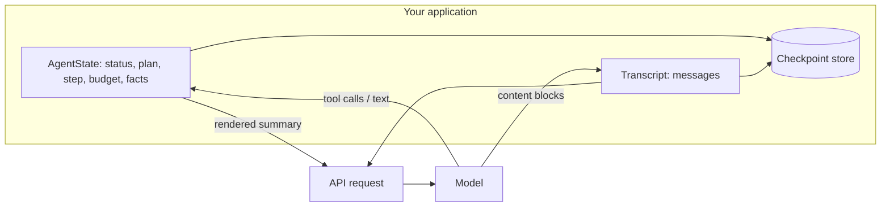
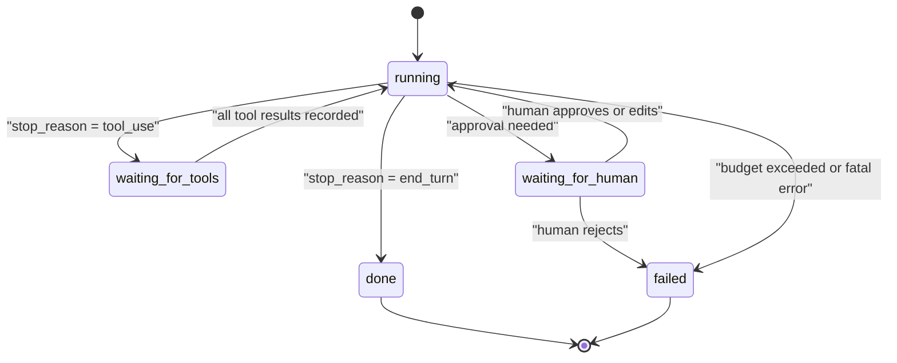

# Agent State Management

## Introduction

When you first build an agent, it's tempting to treat the conversation transcript as the agent's entire state. The model reads the transcript, decides what to do, and you append the result. Everything the agent "knows" is in `messages`.

That works for demos. In production it causes trouble:

- **Your code can't answer simple questions** like "which step is this run on?", "how much budget is left?" or "is this run waiting for a human?" without parsing free text.
- **Facts get lost** when the history is trimmed or compacted (see [Compaction and Summarization](./2-agents-compaction-and-summarization.mdx)).
- **Crashes are expensive.** If the process dies on step 37 of 40, you start over, and tools with side effects (sending emails, charging cards) may run twice.

**Agent state management** means keeping a structured record of the run, in your code and your storage, alongside the transcript. The transcript is what the *model* reads. The state is what your *program* reads.

A good analogy is a hospital patient. The conversation between doctor and patient is like the transcript: rich, detailed, unstructured. The patient's chart is the state: current medications, allergies, vitals, what's been done, what's next. A new doctor coming on shift reads the chart first. Nobody would run a hospital on conversation transcripts alone.

## Transcript vs Structured State

| | Transcript (`messages`) | Structured state |
| --- | --- | --- |
| Who reads it | The model | Your code (and the model, via a rendered summary) |
| Format | Content blocks: text, tool calls, results | Typed fields: dataclass, Pydantic model, DB row |
| Grows | Every turn, without bound | Stays small, updated in place |
| Survives compaction | Only as a summary | Exactly |
| Good for | Reasoning context, nuance | Control flow, budgets, status, resume, UI |

The two work together. Your code keeps structured state, and on each turn it renders a compact view of that state into the context so the model sees it too.



## Defining Agent State

Start with a typed state object. Include only what your code needs to make decisions or show users.

```python
from dataclasses import dataclass, field, asdict
from enum import Enum
import json
import uuid

class RunStatus(str, Enum):
    RUNNING = "running"
    WAITING_FOR_TOOLS = "waiting_for_tools"
    WAITING_FOR_HUMAN = "waiting_for_human"
    DONE = "done"
    FAILED = "failed"

@dataclass
class PlanItem:
    title: str
    done: bool = False

@dataclass
class AgentState:
    run_id: str = field(default_factory=lambda: uuid.uuid4().hex[:8])
    goal: str = ""
    status: RunStatus = RunStatus.RUNNING
    step: int = 0
    max_steps: int = 30
    tokens_used: int = 0
    token_budget: int = 500_000
    plan: list[PlanItem] = field(default_factory=list)
    facts: dict[str, str] = field(default_factory=dict)
    completed_tool_calls: dict[str, str] = field(default_factory=dict)  # tool_use_id -> result
    error: str | None = None

    def to_json(self) -> str:
        return json.dumps(asdict(self))

    @classmethod
    def from_json(cls, raw: str) -> "AgentState":
        data = json.loads(raw)
        data["status"] = RunStatus(data["status"])
        data["plan"] = [PlanItem(**p) for p in data["plan"]]
        return cls(**data)

state = AgentState(goal="Refund order A-1001 if eligible")
state.plan = [PlanItem("Look up order"), PlanItem("Check refund policy"), PlanItem("Issue refund")]
state.facts["customer_id"] = "C-778"

restored = AgentState.from_json(state.to_json())
print(restored.status.value, restored.plan[0].title, restored.facts)
```

Output:

```text
running Look up order {'customer_id': 'C-778'}
```

A few design choices here:

- **`status` is an enum**, not free text. Your UI, your scheduler and your alerting all switch on it.
- **Budgets live in state** (`max_steps`, `token_budget`), so stopping conditions are enforced by code, not by hoping the model stops. See [Stopping Conditions and Budgets](../6-agents-planning-and-reasoning/10-agents-stopping-conditions.mdx).
- **`completed_tool_calls`** records results by `tool_use_id`. That's the key to safe resume, covered below.
- **JSON round-trip** is tested from day one. If you can't serialize it, you can't checkpoint it.

## The Run Status Machine

Agent runs move through a small set of states. Making the transitions explicit prevents bugs such as resuming a run that already finished.



```python
ALLOWED = {
    RunStatus.RUNNING: {RunStatus.WAITING_FOR_TOOLS, RunStatus.WAITING_FOR_HUMAN,
                        RunStatus.DONE, RunStatus.FAILED},
    RunStatus.WAITING_FOR_TOOLS: {RunStatus.RUNNING, RunStatus.FAILED},
    RunStatus.WAITING_FOR_HUMAN: {RunStatus.RUNNING, RunStatus.FAILED},
    RunStatus.DONE: set(),
    RunStatus.FAILED: set(),
}

def transition(state: AgentState, new: RunStatus, error: str | None = None) -> None:
    if new not in ALLOWED[state.status]:
        raise ValueError(f"Illegal transition {state.status.value} -> {new.value}")
    state.status = new
    if error:
        state.error = error

s = AgentState()
transition(s, RunStatus.WAITING_FOR_TOOLS)
transition(s, RunStatus.RUNNING)
transition(s, RunStatus.DONE)
try:
    transition(s, RunStatus.RUNNING)
except ValueError as e:
    print(e)
```

Output:

```text
Illegal transition done -> running
```

## Checkpointing Every Step

A **checkpoint** is a saved snapshot of state plus transcript. Save one after every meaningful step: after each model response and after each batch of tool results. Then a crash costs you at most one step.

Here's a minimal SQLite checkpointer. It stores the latest snapshot per run (you could keep every version for debugging and time travel).

```python
import sqlite3
import json

class Checkpointer:
    def __init__(self, path: str = "agent_runs.db"):
        self.db = sqlite3.connect(path)
        self.db.execute("""
            CREATE TABLE IF NOT EXISTS checkpoints (
                run_id   TEXT PRIMARY KEY,
                state    TEXT NOT NULL,
                messages TEXT NOT NULL,
                updated  TEXT DEFAULT CURRENT_TIMESTAMP
            )""")

    def save(self, state: AgentState, messages: list[dict]) -> None:
        self.db.execute(
            "INSERT INTO checkpoints (run_id, state, messages) VALUES (?, ?, ?) "
            "ON CONFLICT(run_id) DO UPDATE SET state=excluded.state, "
            "messages=excluded.messages, updated=CURRENT_TIMESTAMP",
            (state.run_id, state.to_json(), json.dumps(messages)),
        )
        self.db.commit()

    def load(self, run_id: str) -> tuple[AgentState, list[dict]] | None:
        row = self.db.execute(
            "SELECT state, messages FROM checkpoints WHERE run_id = ?", (run_id,)
        ).fetchone()
        if row is None:
            return None
        return AgentState.from_json(row[0]), json.loads(row[1])

cp = Checkpointer(":memory:")
st = AgentState(run_id="run-42", goal="demo")
cp.save(st, [{"role": "user", "content": "hello"}])
loaded_state, loaded_msgs = cp.load("run-42")
print(loaded_state.goal, loaded_msgs)
```

Output:

```text
demo [{'role': 'user', 'content': 'hello'}]
```

:::caution
The transcript must be stored **exactly** as the API returned it. Convert SDK content blocks with `block.model_dump(exclude_none=True)` before `json.dumps`. A plain `model_dump()` adds `null` fields; for some block types (such as `compaction` blocks) the API rejects those extra fields when you send them back.
:::

## An Agent Loop with State and Checkpoints

Now combine everything into a loop that a crash can't derail.

```python
from anthropic import Anthropic

client = Anthropic()
MODEL = "claude-opus-5-5"

def run_tool(name: str, args: dict) -> str:
    """Your real tool dispatch goes here."""
    if name == "lookup_order":
        return json.dumps({"order": args["order_id"], "status": "delivered", "total": 42.0})
    return f"Unknown tool {name}"

TOOLS = [{
    "name": "lookup_order",
    "description": "Look up an order by ID. Returns status and total.",
    "input_schema": {"type": "object", "properties": {"order_id": {"type": "string"}},
                     "required": ["order_id"]},
}]

def render_state(state: AgentState) -> str:
    plan = "\n".join(f"- [{'x' if p.done else ' '}] {p.title}" for p in state.plan) or "- (none)"
    facts = "\n".join(f"- {k}: {v}" for k, v in sorted(state.facts.items())) or "- (none)"
    return (f"<run_state>\nGoal: {state.goal}\nStep {state.step} of {state.max_steps}\n"
            f"Plan:\n{plan}\nKnown facts:\n{facts}\n</run_state>")

def run(state: AgentState, messages: list[dict], cp: Checkpointer) -> AgentState:
    while state.status == RunStatus.RUNNING:
        if state.step >= state.max_steps or state.tokens_used >= state.token_budget:
            transition(state, RunStatus.FAILED, error="budget exceeded")
            break

        response = client.messages.create(
            model=MODEL, max_tokens=16000, tools=TOOLS,
            system="You are an order-support agent. Use tools; be concise.",
            messages=messages,
        )
        state.step += 1
        state.tokens_used += response.usage.input_tokens + response.usage.output_tokens
        messages.append({"role": "assistant",
                         "content": [b.model_dump(exclude_none=True) for b in response.content]})

        if response.stop_reason != "tool_use":
            transition(state, RunStatus.DONE)
            cp.save(state, messages)
            break

        transition(state, RunStatus.WAITING_FOR_TOOLS)
        cp.save(state, messages)  # checkpoint BEFORE running side-effecting tools

        results = []
        for block in response.content:
            if block.type != "tool_use":
                continue
            if block.id in state.completed_tool_calls:      # already ran before a crash
                output = state.completed_tool_calls[block.id]
            else:
                output = run_tool(block.name, block.input)
                state.completed_tool_calls[block.id] = output
                cp.save(state, messages)                    # record each result as it lands
            results.append({"type": "tool_result", "tool_use_id": block.id, "content": output})

        # Append-only: tool results, then the current state as a trailing text block.
        results.append({"type": "text", "text": render_state(state)})
        messages.append({"role": "user", "content": results})
        transition(state, RunStatus.RUNNING)
        cp.save(state, messages)
    return state
```

Example output (printing `state.status`, `state.step` and the final text after a run):

```text
done 2
Order A-1001 was delivered and totals $42.00. It's eligible for a refund under the 30-day policy.
```

Three things make this loop robust:

1. **Checkpoint before side effects.** If the process dies while a tool runs, the checkpoint shows `waiting_for_tools` and the pending `tool_use` blocks.
2. **Record each tool result by `tool_use_id`.** On resume, tools that already ran return their recorded result instead of running again. That's what keeps a refund from being issued twice.
3. **The state view is appended, never edited in place.** Each turn adds a fresh `run_state` text block after the tool results. Earlier copies stay where they were.

### Why append instead of updating the system prompt?

You might be tempted to put the state into the system prompt and rewrite it each turn. Don't. Changing the system prompt invalidates the prompt cache for the entire conversation (see [Prompt Caching](./4-agents-prompt-caching.mdx)), and on models with preserved thinking it invalidates earlier thinking blocks. Appending a text block after the tool results, or a mid-conversation `{"role": "system", "content": ...}` message on models that support it, keeps the history append-only and the cache intact. The cost is a few hundred tokens per turn for the repeated state view, so keep it short.

## Resuming After a Crash

With checkpoints in place, resuming is mostly a matter of finding where the run stopped.

```python
def resume(run_id: str, cp: Checkpointer) -> AgentState | None:
    loaded = cp.load(run_id)
    if loaded is None:
        return None
    state, messages = loaded

    if state.status in (RunStatus.DONE, RunStatus.FAILED):
        return state  # nothing to do

    if state.status == RunStatus.WAITING_FOR_TOOLS:
        # The last assistant message has tool_use blocks without results yet.
        last = messages[-1]
        results = []
        for block in last["content"]:
            if block.get("type") != "tool_use":
                continue
            output = state.completed_tool_calls.get(block["id"])
            if output is None:
                output = run_tool(block["name"], block["input"])
                state.completed_tool_calls[block["id"]] = output
            results.append({"type": "tool_result", "tool_use_id": block["id"], "content": output})
        messages.append({"role": "user", "content": results})
        state.status = RunStatus.RUNNING
        cp.save(state, messages)

    if state.status == RunStatus.WAITING_FOR_HUMAN:
        return state  # wait for the approval endpoint to flip it back to RUNNING

    return run(state, messages, cp)
```

Resume needs to handle each status differently:

| Status at crash | What resume does |
| --- | --- |
| `running` | Call the model again with the saved transcript |
| `waiting_for_tools` | Run only the tools without recorded results, then continue |
| `waiting_for_human` | Do nothing until a person responds |
| `done` / `failed` | Nothing. Return the final state |

### Making tools idempotent

Recording results covers crashes *between* tool calls. A crash *during* a side-effecting call (the payment API was called, but the process died before you saved the result) needs help from the tool itself. Pass an **idempotency key** derived from the `tool_use_id`, so a retry of the same call is recognized and ignored by the downstream service.

```python
def issue_refund(order_id: str, amount: float, tool_use_id: str) -> str:
    idempotency_key = f"refund-{tool_use_id}"
    # payments.refund(order_id, amount, idempotency_key=idempotency_key)  # real API call
    return f"Refunded {amount:.2f} on {order_id} (key {idempotency_key})"

print(issue_refund("A-1001", 42.0, "toolu_01AbC"))
```

Output:

```text
Refunded 42.00 on A-1001 (key refund-toolu_01AbC)
```

Many payment and messaging APIs support idempotency keys. For your own services, store processed keys in a table with a unique constraint.

## Letting the Model Update State

Some state is best updated by your code (step counters, budgets, tool results). Other state is best updated by the model, such as the plan. Give the model a narrow tool for that, rather than letting it rewrite state through free text.

```python
UPDATE_PLAN_TOOL = {
    "name": "update_plan",
    "description": "Replace the task plan or mark items done. "
                   "Call after finishing a step or when the plan changes.",
    "input_schema": {
        "type": "object",
        "properties": {
            "items": {"type": "array", "items": {
                "type": "object",
                "properties": {"title": {"type": "string"}, "done": {"type": "boolean"}},
                "required": ["title", "done"]}},
        },
        "required": ["items"],
    },
}

def apply_update_plan(state: AgentState, args: dict) -> str:
    items = args["items"][:15]  # validate: cap plan length
    state.plan = [PlanItem(title=i["title"][:200], done=bool(i["done"])) for i in items]
    done = sum(p.done for p in state.plan)
    return f"Plan updated: {done}/{len(state.plan)} done."

s = AgentState()
print(apply_update_plan(s, {"items": [{"title": "Look up order", "done": True},
                                      {"title": "Issue refund", "done": False}]}))
```

Output:

```text
Plan updated: 1/2 done.
```

Your code validates and caps whatever the model sends. The model proposes, your code decides.

## Framework Comparison: LangGraph Checkpointers

Frameworks build these ideas in. In LangGraph, a graph's state is a typed object, and a **checkpointer** saves it after every node, keyed by a `thread_id`:

```python
from langgraph.checkpoint.memory import InMemorySaver

checkpointer = InMemorySaver()
graph = builder.compile(checkpointer=checkpointer)  # `builder` is your StateGraph

config = {"configurable": {"thread_id": "run-42"}}
result = graph.invoke({"messages": [{"role": "user", "content": "Refund A-1001"}]}, config)
```

For production, LangGraph provides database-backed checkpointers such as `PostgresSaver` (from `langgraph.checkpoint.postgres`, with a one-time `checkpointer.setup()` to create tables). Invoking the graph again with the same `thread_id` continues from the last checkpoint. See [LangGraph](../9-agents-frameworks/5-agents-langgraph.mdx) and the official persistence docs for details, since package layouts change between versions.

The trade-off is the usual one for frameworks: you get checkpointing, human-in-the-loop interrupts and time travel for free, but your state must fit the framework's model.

## Real-World Scenario

Your team runs an e-commerce platform. A returns agent handles refund requests end to end: it looks up the order, checks the policy, asks a human to approve refunds over $200, issues the refund, and emails the customer. Runs take 2 to 30 minutes because of human approvals. Twice last month, a deploy restarted the workers mid-run. One customer was refunded twice, and several runs were silently lost.

**Solution:**

1. Model each run with an `AgentState` (status, plan, facts, `completed_tool_calls`, budgets).
2. Checkpoint to Postgres after each model response and each tool result.
3. Use idempotency keys derived from `tool_use_id` for `issue_refund` and `send_email`.
4. When approval is needed, set `waiting_for_human` and stop the worker. An approval endpoint loads the checkpoint, records the decision, sets `running` and enqueues the run.
5. On worker start-up, scan for runs in `running` or `waiting_for_tools` older than a few minutes and resume them.

### Why this approach

The failures were caused by state living only in process memory. Checkpoints make runs durable, the status machine makes "where is this run?" a database query, and recorded results plus idempotency keys make retries safe. The model never needed to change.

### When to use it, and when not

Use explicit state and checkpoints for any agent that has side effects, runs longer than a single HTTP request, waits for humans, or runs in background workers. For a stateless Q&A bot answering within one request, a transcript is enough, and this machinery is overhead.

### Alternatives and trade-offs

| Approach | Pros | Cons | Best for |
| --- | --- | --- | --- |
| Transcript only, in memory | Simplest | Lost on crash, no control flow | Prototypes |
| Transcript + typed state in memory | Clear control flow | Still lost on crash | Short synchronous agents |
| Custom checkpoints (SQLite/Postgres) | Durable, resumable, full control | You write and test resume logic | Production agents with side effects |
| Framework checkpointers (e.g. LangGraph) | Built-in resume, interrupts, history | Framework lock-in, learning curve | Graph-shaped workflows |
| Durable workflow engines (e.g. Temporal) | Battle-tested retries and timers | Extra infrastructure | Long, business-critical processes |
| Managed agent platforms | Hosted sessions and state | Less control, vendor coupling | Teams that don't want to run infrastructure |

## Common Mistakes

1. **Parsing state out of the transcript.** If your code needs to know something, store it in a typed field.
2. **Checkpointing only at the end.** A crash on step 37 loses 36 steps. Checkpoint after every model response and tool result.
3. **Running side effects before checkpointing.** Save the pending tool calls first, then run them, then save the results.
4. **Re-running tools on resume.** Look up `completed_tool_calls` first, and use idempotency keys for external side effects.
5. **Rewriting the system prompt with fresh state.** It breaks caching and, on preserved-thinking models, earlier thinking. Append a short state view instead.
6. **Unbounded state.** Plans with 200 items or facts dictionaries with megabytes of data recreate the context problem. Validate and cap.
7. **Lossy serialization.** Store SDK content blocks with `model_dump(exclude_none=True)` and test the JSON round-trip.

## Summary

- The transcript is for the model. **Structured state** is for your program: status, plan, budgets, facts and tool results.
- Model run status as an explicit **state machine** with allowed transitions.
- **Checkpoint** state and transcript after every step, and checkpoint *before* running side-effecting tools.
- Record tool results by `tool_use_id` and use **idempotency keys** so resumed runs never repeat side effects.
- Render a compact state view into the context each turn by **appending**, not by editing earlier turns or the system prompt.
- Frameworks such as LangGraph provide checkpointers keyed by `thread_id` if you'd rather not build this yourself.

## Exercises

1. Add a `waiting_for_human` path to the loop: when the model calls `issue_refund` with an amount over 200, save state and stop. Write an `approve(run_id)` function that resumes the run.
2. Kill the process (simulate with an exception) right after `run_tool` returns but before the next checkpoint. Resume and confirm the tool doesn't run twice.
3. Store every checkpoint version instead of only the latest. Write a function that prints a timeline of status changes for a run.
4. Compare token usage with and without the appended `run_state` block over a 20-step run. Is the extra context worth it for your task?

**Related pages:**

- [Short-Term Memory](./1-agents-short-term-memory.mdx)
- [Session Persistence](./10-agents-session-persistence.mdx)
- [Shared State Between Agents](../8-agents-multi-agent-systems/7-agents-shared-state.mdx)
- [Human-in-the-Loop](../6-agents-planning-and-reasoning/9-agents-human-in-the-loop.mdx)
- [Running Agents as Background Jobs](../10-agents-integration/3-agents-background-jobs.mdx)
