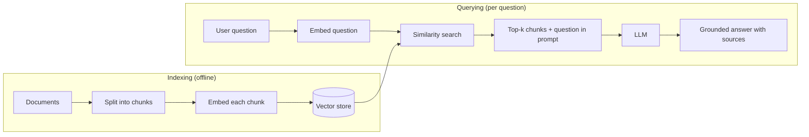
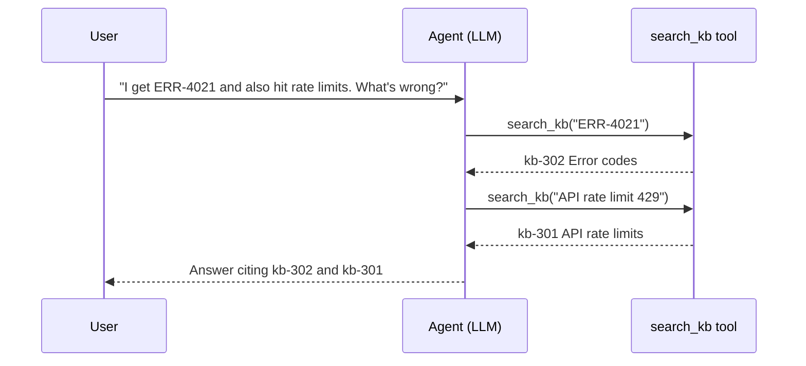

# RAG Introduction

## Introduction

A large language model knows a lot, but it does not know **your** data. It has never read your company's help center, your internal runbooks, last week's pricing change, or the contract a customer signed yesterday. If you ask it about those things anyway, it will often answer with confidence and be wrong.

**Retrieval-Augmented Generation (RAG)** fixes this by adding one step before the model answers. Your code first **retrieves** the passages most likely to contain the answer from your own documents. Then it puts those passages into the prompt, and the model **generates** an answer based on them.

An analogy helps:

- A model without RAG is a student taking a **closed-book exam**. It answers from memory, and when memory runs out it guesses.
- A model with RAG is a student taking an **open-book exam** who is handed the right three pages. It reads them and writes an answer that is grounded in the text.

RAG is one of the most widely used patterns in applied AI. Support bots, internal "ask the docs" tools, legal and policy assistants, and coding assistants that search a repository all use some form of it. For agents, retrieval is often the most important tool they have, because it is how the agent learns facts it was never trained on.

In this section you will build RAG systems step by step. This first page explains the big picture. It covers the problem RAG solves, the moving parts, a tiny working example, and when you should *not* use RAG.

## The Problem RAG Solves

LLMs have three limits that matter for real applications:

1. **Knowledge cutoff.** A model's training data stops at some date. It cannot know about things that happened later.
2. **No private data.** The model has never seen your internal wiki, tickets, or database.
3. **Hallucination.** When the model lacks a fact, it may produce a plausible-sounding answer instead of saying "I don't know."

You have three broad ways to give a model knowledge it lacks:

| Approach | How it works | Good for | Weak at |
|---|---|---|---|
| **Fine-tuning** | Train the model further on your data | Style, format, domain vocabulary, narrow skills | Facts that change often, citing sources, deleting data |
| **Long context** | Paste all your documents into every prompt | Small, stable document sets | Large or fast-changing corpora, cost at high volume |
| **RAG** | Search your documents per question and include only the relevant parts | Large or changing knowledge bases, answers with sources | Questions that need the whole corpus at once |

Fine-tuning is usually the wrong tool for teaching facts. It is expensive to redo when facts change, and you cannot point to where an answer came from. RAG and long context are the two common choices, and they work well together. The page [RAG vs Long Context](./9-agents-rag-vs-long-context.mdx) compares them in detail.

:::tip
A useful rule of thumb from Anthropic's [Contextual Retrieval](https://www.anthropic.com/engineering/contextual-retrieval) article: if your whole knowledge base is under about 200,000 tokens (roughly 500 pages), you may not need RAG at all. You can put everything in the prompt and use prompt caching to keep it fast and cheap. RAG earns its complexity when the corpus is bigger than that, changes often, or needs per-user access control.
:::

## How RAG Works

A RAG system has two phases. **Indexing** happens ahead of time (or whenever documents change). **Querying** happens every time a user asks a question.



Here is what each step does:

1. **Load** documents from wherever they live: Markdown files, PDFs, web pages, a database, Confluence, Google Drive.
2. **Chunk** each document into pieces of a few hundred tokens. A whole document is too big to retrieve precisely. A single sentence has too little context. See [Chunking Strategies](./3-agents-chunking-strategies.mdx).
3. **Embed** each chunk. An embedding model turns text into a list of numbers (a vector) so that texts with similar meaning get similar vectors. See [Embeddings](./1-agents-embeddings.mdx).
4. **Store** the vectors, the chunk text, and metadata in a **vector database** that can find the nearest vectors quickly. See [Vector Databases](./2-agents-vector-databases.mdx).
5. **Retrieve.** At question time, embed the question and find the chunks whose vectors are closest to it.
6. **Augment.** Put the retrieved chunks into the prompt along with instructions such as "answer only from these sources."
7. **Generate.** The LLM writes the answer, ideally with citations to the chunks it used. See [Citations and Grounding](./7-agents-citations-and-grounding.mdx).

The word "retrieval" does not have to mean vector search. Keyword search (BM25), SQL queries, a call to a search API, or a lookup in a knowledge graph all count. Most strong production systems combine several of these. See [Hybrid Search and Reranking](./5-agents-hybrid-search-reranking.mdx).

## A Minimal RAG Example

Let's build the smallest useful RAG system. The running example in this section is **Acme Cloud**, a fictional SaaS company whose help center has a few hundred articles. We will start with eight short articles.

First, install the libraries. We use [sentence-transformers](https://sbert.net/) for embeddings because it runs locally and is free, and the Anthropic SDK for generation.

```bash
pip install sentence-transformers numpy anthropic
export ANTHROPIC_API_KEY="your-api-key"
```

### Step 1: Index the documents

```python
from sentence_transformers import SentenceTransformer

ARTICLES = [
    ("kb-101", "Refund policy",
     "Annual plans can be refunded within 30 days of purchase. Monthly plans are not "
     "refunded, but you can cancel any time and keep access until the end of the billing period."),
    ("kb-102", "Changing your plan",
     "Upgrades take effect immediately and are prorated. Downgrades take effect at the next renewal date."),
    ("kb-201", "Setting up SAML SSO",
     "SSO is available on the Business and Enterprise plans. Go to Settings > Security > SSO, "
     "upload your IdP metadata XML, then test with one user before enforcing SSO for everyone."),
    ("kb-202", "Two-factor authentication",
     "Admins can require 2FA for all members under Settings > Security. Members get 7 days to enroll."),
    ("kb-301", "API rate limits",
     "The REST API allows 600 requests per minute per workspace on Business and 3,000 on Enterprise. "
     "Exceeding the limit returns HTTP 429 with a Retry-After header."),
    ("kb-302", "Error codes",
     "ERR-4021 means the API key was revoked. ERR-4090 means a webhook endpoint failed verification."),
    ("kb-401", "Exporting your data",
     "Workspace owners can export all projects as JSON or CSV from Settings > Data > Export. "
     "Exports over 2 GB are delivered by email link that expires after 72 hours."),
    ("kb-402", "Deleting your account",
     "Account deletion is permanent after a 14-day grace period."),
]

# A small, fast, general-purpose embedding model (384 dimensions).
model = SentenceTransformer("all-MiniLM-L6-v2")

texts = [f"{title}\n{body}" for _, title, body in ARTICLES]
doc_vectors = model.encode(texts, normalize_embeddings=True)
print(doc_vectors.shape)
```

Output:

```text
(8, 384)
```

Each article is now a vector of 384 numbers. Because we normalized the vectors to length 1, the dot product of two vectors equals their **cosine similarity**, a score where higher means "more similar in meaning."

### Step 2: Retrieve

```python
import numpy as np

def retrieve(question: str, k: int = 2) -> list[tuple[str, str, str, float]]:
    """Return the k articles most similar to the question."""
    q_vec = model.encode([question], normalize_embeddings=True)[0]
    scores = doc_vectors @ q_vec            # cosine similarity for each article
    top = np.argsort(scores)[::-1][:k]      # indices of the best scores
    return [(*ARTICLES[i], float(scores[i])) for i in top]

for doc_id, title, _, score in retrieve("Can I get my money back on a yearly plan?"):
    print(f"{doc_id}  {score:.2f}  {title}")
```

Example output:

```text
kb-101  0.55  Refund policy
kb-102  0.33  Changing your plan
```

Notice that the question says "money back" and "yearly," while the article says "refunded" and "annual." Keyword search would struggle here. Embeddings match on **meaning**, which is why they are the default retrieval method. (Exact scores vary by model and library version.)

### Step 3: Augment and generate

```python
from anthropic import Anthropic

client = Anthropic()  # reads ANTHROPIC_API_KEY from the environment

SYSTEM = (
    "You are the Acme Cloud support assistant. Answer using ONLY the help articles "
    "provided. Cite article IDs in square brackets, like [kb-101]. If the articles do "
    "not contain the answer, say you don't know and suggest contacting support."
)

def answer(question: str) -> str:
    hits = retrieve(question, k=3)
    context = "\n\n".join(
        f'<article id="{doc_id}" title="{title}">\n{body}\n</article>'
        for doc_id, title, body, _ in hits
    )
    response = client.messages.create(
        model="claude-opus-5-5",
        max_tokens=1024,
        system=SYSTEM,
        messages=[{
            "role": "user",
            "content": f"<articles>\n{context}\n</articles>\n\nQuestion: {question}",
        }],
    )
    return next(b.text for b in response.content if b.type == "text")

print(answer("Can I get my money back on a yearly plan?"))
```

Example output:

```text
Yes. Annual plans can be refunded if you request it within 30 days of purchase [kb-101].
After 30 days, annual plans are not refundable.
```

That is a complete RAG system in about 50 lines. Everything else in this section makes it more accurate, more scalable, and easier to trust.

:::note
Other providers work the same way. OpenAI, Google Gemini, and open-source models served with Ollama or vLLM all accept retrieved text in the prompt. The retrieval half of RAG does not depend on which LLM you use.
:::

## Anatomy of a RAG Prompt

The "augment" step looks trivial, but how you lay out the prompt has a real effect on answer quality. A good RAG prompt has four parts:

1. **Role and rules** (system prompt): who the assistant is, that it must answer from the sources, how to cite, and what to do when the sources are silent.
2. **Sources**: the retrieved chunks, each wrapped in a clear delimiter with an ID and title. XML-style tags work well with Claude and most other models.
3. **The question**: placed *after* the sources. With long inputs, models tend to do better when the question comes at the end.
4. **Output guidance**: length, format, and citation style.

Here is the user message the example above produces, so you can see exactly what the model receives:

```text
<articles>
<article id="kb-101" title="Refund policy">
Annual plans can be refunded within 30 days of purchase. Monthly plans are not refunded,
but you can cancel any time and keep access until the end of the billing period.
</article>

<article id="kb-102" title="Changing your plan">
Upgrades take effect immediately and are prorated. Downgrades take effect at the next renewal date.
</article>
</articles>

Question: Can I get my money back on a yearly plan?
```

Some practical guidelines:

- **Include IDs and titles.** The model needs them to cite, and you need them to debug.
- **Retrieve a few more chunks than you think you need**, then trim. Missing the right chunk is usually worse than including one irrelevant chunk. But dozens of loosely related chunks can distract the model, so measure.
- **Keep instructions out of the sources block.** Anything inside `<articles>` should be treated as data. This also helps against prompt injection hidden in documents.
- **Log the full prompt** for every request in development. When an answer is wrong, the first question is always "what did the model actually see?"

:::info
Claude's API also has a built-in **citations** feature: you pass chunks as `document` or `search_result` blocks, and the response points to the exact passages it used. It is more reliable than asking for `[kb-101]` tags in plain text. See [Citations and Grounding](./7-agents-citations-and-grounding.mdx).
:::

## Why the Simple Version Breaks

The minimal example works on eight articles. On a real knowledge base, several problems show up:

| Problem | Symptom | Fix (covered in) |
|---|---|---|
| Documents are long | The right paragraph is buried in a 20-page article and its vector is "blurry" | [Chunking Strategies](./3-agents-chunking-strategies.mdx) |
| Thousands of chunks | Comparing the question against every vector is slow | [Vector Databases](./2-agents-vector-databases.mdx) |
| Exact terms such as `ERR-4021` | Embeddings miss rare tokens, codes, and names | [Hybrid Search and Reranking](./5-agents-hybrid-search-reranking.mdx) |
| Chunks lose context | A chunk says "the limit is 600" but not *which* limit | Contextual retrieval, in [Chunking Strategies](./3-agents-chunking-strategies.mdx) |
| Multi-step questions | "Which plan do I need for SSO, and what does upgrading cost?" needs two searches | [Agentic RAG](./6-agents-agentic-rag.mdx) |
| Users need to trust answers | No way to check where a claim came from | [Citations and Grounding](./7-agents-citations-and-grounding.mdx) |
| You changed something | You can't tell if retrieval got better or worse | [Evaluating RAG Systems](./8-agents-rag-evaluation.mdx) |
| "Summarize all themes" questions | Top-k retrieval only sees a few chunks | [Graph RAG](./10-agents-graph-rag.mdx) |

## Classic RAG vs Agentic RAG

There are two ways to wire retrieval into an LLM application.

**Classic (pipeline) RAG** always retrieves once, before the model runs. Your code decides what to search for: usually the user's question as written.

**Agentic RAG** gives the model a `search` tool. The model decides *whether* to search, *what* query to use, and whether to search again after seeing the results.



| | Classic RAG | Agentic RAG |
|---|---|---|
| Who decides to retrieve | Your code, every time | The model |
| LLM calls per question | 1 | 1 to many |
| Latency and cost | Low, predictable | Higher, variable |
| Multi-part questions | Weak | Strong |
| Easy to debug | Yes | Harder (need traces) |

Start with classic RAG. Move to agentic RAG when questions regularly need more than one search or when the agent needs retrieval alongside other tools. [Agentic RAG](./6-agents-agentic-rag.mdx) shows how.

## Real-World Scenario

**Your team runs Acme Cloud's support desk.** Support agents spend hours a day searching the help center and old tickets to answer the same questions. Customers also wait for answers that already exist in the docs. Leadership asks for an AI assistant that answers questions from the help center, both for customers in a chat widget and for support staff in their ticket tool.

The help center has about 400 articles. They change weekly when the product ships. Some articles are internal-only and must never reach customers.

**The solution** is a RAG pipeline:

1. A nightly job (plus a webhook on article publish) re-chunks and re-embeds changed articles. Each chunk stores metadata: `article_id`, `title`, `audience` (`public` or `internal`), and `updated_at`.
2. At query time, the assistant filters by `audience`. Customers only search `public` chunks, while staff search everything.
3. It retrieves the top chunks with hybrid search, then reranks them.
4. Claude answers using only those chunks and cites article IDs. If nothing relevant is found, it says so and offers to open a ticket.
5. A small evaluation set of real customer questions runs in CI whenever the chunking, embedding model, or prompt changes.

**Why this approach fits:**

- The content changes weekly. Re-indexing a few changed articles is cheap. Retraining a model would not be.
- Per-audience access control is a metadata filter. With long context you would need a separate prompt per audience.
- Citations let support staff verify an answer before they send it to a customer.

**When to use RAG:**

- The knowledge base is larger than you can comfortably put in every prompt, or it is growing.
- Content changes often, or different users may see different documents.
- Users need sources they can check.

**When not to use RAG:**

- The whole corpus fits in the context window and rarely changes. Put it in the prompt and cache it.
- The answer requires computation over structured data ("total revenue by region last quarter"). Give the agent a SQL tool instead. See [Agents That Work with Your Database](../10-agents-integration/6-agents-with-databases.mdx).
- The task needs behavior or style, not facts. Use prompting or fine-tuning.

**Alternatives and trade-offs:**

| Approach | Pros | Cons | Best for |
|---|---|---|---|
| Classic RAG | Simple, cheap, predictable latency | One search per question; quality depends on retrieval | FAQ-style Q&A over large docs |
| Agentic RAG | Handles multi-part questions, can refine searches | More LLM calls, more latency, harder to debug | Research and troubleshooting assistants |
| Long context + prompt caching | No retrieval errors; model sees everything | Cost grows with corpus size; no per-user filtering | Small, stable corpora (under ~200K tokens) |
| Fine-tuning | Bakes in style and vocabulary | Expensive to update, no citations, can still hallucinate | Tone, format, domain jargon |
| SQL / API tools | Exact answers from live data | Only works on structured data | Metrics, orders, account data |

## Common Mistakes

1. **Blaming the LLM for retrieval failures.** Most bad RAG answers come from retrieving the wrong chunks. Always log what was retrieved, and look at it first when an answer is wrong.
2. **Not letting the model say "I don't know."** If the prompt does not allow it, the model may stretch weakly related chunks into a confident wrong answer.
3. **Skipping evaluation.** Without a set of test questions, you cannot tell whether a new chunk size or embedding model helped. Build even 30 questions early. See [Evaluating RAG Systems](./8-agents-rag-evaluation.mdx).
4. **Trusting retrieved text as instructions.** Documents can contain text like "ignore previous instructions." Treat retrieved content as data, not commands. See [Prompt Injection](../12-agents-safety-and-security/1-agents-prompt-injection.mdx).
5. **Ignoring access control.** If every user searches every document, the assistant can leak internal or other customers' data. Filter at retrieval time, not in the prompt.
6. **Building RAG when you don't need it.** For a 50-page handbook, long context with caching is simpler and often more accurate.

## Summary

- RAG retrieves relevant passages from your own data and puts them in the prompt so the model answers from them.
- It has an **indexing** phase (load, chunk, embed, store) and a **query** phase (embed question, search, augment, generate).
- Embeddings let you search by meaning, but strong systems combine them with keyword search and reranking.
- **Classic RAG** retrieves once per question. **Agentic RAG** lets the model decide when and what to search.
- RAG is best for large, changing, or access-controlled knowledge. For small, stable corpora, long context with prompt caching can be simpler.
- Most RAG quality problems are retrieval problems. Log retrieval, evaluate it, and cite sources.

## Exercises

1. Run the minimal example and ask "How long do I have to set up two-factor login?" Which article ranks first? Change `k` to 1 and then to 5. How does the answer change?
2. Ask a question the articles cannot answer, such as "Do you have a mobile app?" Does the assistant say it doesn't know? Remove the "say you don't know" sentence from the system prompt and try again.
3. Add a ninth article about something new, re-run indexing, and confirm it can be retrieved.
4. Write down three questions your own project's users ask. For each, decide whether it needs RAG, a SQL tool, or neither.

Continue with [Embeddings](./1-agents-embeddings.mdx) to learn how the "search by meaning" step works. For the context-management side of the same problem, see [Context Engineering](../4-agents-memory-and-context/0-agents-context-engineering.mdx).
