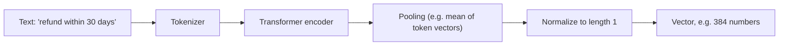

# Embeddings

## Introduction

Search engines used to match **words**. If you searched for "money back" and the document said "refund," you were out of luck. **Embeddings** let a computer match **meaning** instead.

An embedding model reads a piece of text and outputs a fixed-length list of numbers called a **vector**, for example 384 or 1024 numbers. The model is trained so that texts with similar meaning end up with vectors that point in similar directions. "Can I get my money back?" and "Refund policy" land close together. "Can I get my money back?" and "Setting up SSO" land far apart.

Think of it like a map. Every piece of text gets coordinates. Related ideas sit in the same neighborhood. Retrieval becomes "find the documents closest to the question on the map."

In RAG, embeddings power the "R." You embed every chunk once at indexing time, embed each question at query time, and return the nearest chunks. This page explains how that works, how to compute similarity, how to pick a model, and the mistakes that quietly ruin retrieval quality.

## What an Embedding Looks Like

Let's look at real vectors using [sentence-transformers](https://sbert.net/), an open-source library that runs embedding models on your own machine.

```bash
pip install sentence-transformers numpy
```

```python
from sentence_transformers import SentenceTransformer

model = SentenceTransformer("all-MiniLM-L6-v2")

vector = model.encode("Annual plans can be refunded within 30 days.")
print(vector.shape)
print(vector[:5])
```

Example output:

```text
(384,)
[-0.0431  0.0207 -0.0049  0.0654 -0.0331]
```

The individual numbers mean nothing on their own. No dimension stands for "money" or "time." Only the **relationships between vectors** carry meaning.

`all-MiniLM-L6-v2` is small (about 23 million parameters), fast on a laptop CPU, and a good default for learning. The first time you run it, the library downloads the model weights from Hugging Face. After that, everything runs offline.

## Measuring Similarity

To compare two vectors, RAG systems use one of three measures:

| Measure | Formula idea | Range | Notes |
|---|---|---|---|
| **Cosine similarity** | Angle between vectors | -1 to 1 (higher = more similar) | The most common choice. Ignores vector length. |
| **Dot product** | Sum of element-wise products | Unbounded | Equals cosine similarity when vectors are normalized to length 1. Fastest. |
| **Euclidean (L2) distance** | Straight-line distance | 0 and up (lower = more similar) | Gives the same ranking as cosine on normalized vectors. |

Many vector databases talk about **distance** rather than similarity. Cosine **distance** is `1 - cosine similarity`, so lower is better. Mixing these up is a classic bug: you sort the wrong way and return the *least* relevant chunks.

Let's compute similarity by hand and then with the library's helper.

```python
import numpy as np
from sentence_transformers import SentenceTransformer

model = SentenceTransformer("all-MiniLM-L6-v2")

sentences = [
    "Can I get my money back on a yearly plan?",
    "Annual plans can be refunded within 30 days of purchase.",
    "Upload your IdP metadata XML to set up SAML SSO.",
]
vecs = model.encode(sentences, normalize_embeddings=True)

def cosine(a: np.ndarray, b: np.ndarray) -> float:
    return float(np.dot(a, b) / (np.linalg.norm(a) * np.linalg.norm(b)))

print("question vs refund:", round(cosine(vecs[0], vecs[1]), 3))
print("question vs SSO:   ", round(cosine(vecs[0], vecs[2]), 3))

# The library's helper computes a full similarity matrix (cosine by default).
print(model.similarity(vecs, vecs))
```

Example output:

```text
question vs refund: 0.552
question vs SSO:    0.021
tensor([[1.0000, 0.5520, 0.0210],
        [0.5520, 1.0000, 0.0560],
        [0.0210, 0.0560, 1.0000]])
```

The question and the refund article share almost no words, yet they score far higher than the question and the SSO article. That is the whole point of embeddings.

:::note
Absolute scores differ between models. One model's "0.55" might be another model's "0.82." Never copy a similarity threshold from a blog post. Measure it on your own data with your own model.
:::

## How Embeddings Are Made (Briefly)

You do not need to train embedding models to use them, but a rough picture helps you reason about their behavior.



1. The text is split into tokens.
2. A transformer encoder (similar to the inside of an LLM) produces one vector per token.
3. **Pooling** combines token vectors into one vector for the whole text.
4. The model was trained with **contrastive learning**: it saw millions of pairs that should match (a question and its answer) and pairs that should not, and it learned to pull matches together and push mismatches apart.

Two practical consequences follow:

- **Each model has a maximum input length.** Text beyond it is silently cut off. `all-MiniLM-L6-v2` was trained on short passages and truncates long inputs, so a 10-page document becomes "the first paragraph or so." This is one reason we chunk documents. See [Chunking Strategies](./3-agents-chunking-strategies.mdx).
- **The model only knows what it was trained on.** General models can be weak on specialized jargon, product codes, or other languages. That is why domain-specific and multilingual models exist, and why hybrid search with keywords helps. See [Hybrid Search and Reranking](./5-agents-hybrid-search-reranking.mdx).

## Queries vs Documents

A question and the passage that answers it are not paraphrases. "How long do I have to enroll in 2FA?" looks quite different from "Members get 7 days to enroll." Many modern embedding models handle this **asymmetry** by encoding queries and documents slightly differently, usually by adding a short instruction prefix.

sentence-transformers exposes this with `encode_query` and `encode_document`. If the model defines query and document prompts, these methods apply them for you. If it does not, they behave like plain `encode`.

```python
from sentence_transformers import SentenceTransformer

model = SentenceTransformer("all-MiniLM-L6-v2")

docs = [
    "Members get 7 days to enroll in two-factor authentication.",
    "Exports over 2 GB are delivered by an email link.",
]
doc_vecs = model.encode_document(docs, normalize_embeddings=True)
q_vec = model.encode_query("How long do I have to set up 2FA?", normalize_embeddings=True)

scores = model.similarity(q_vec, doc_vecs)
print(scores)
```

Example output:

```text
tensor([[0.6130, 0.0890]])
```

Hosted APIs have the same idea. Voyage AI, for example, takes an `input_type` of `"query"` or `"document"` and recommends always setting it for retrieval tasks.

:::caution
Whatever model you choose, use the **same model** (and the same version and settings) for documents and queries. Vectors from different models live in different "maps." Comparing them produces meaningless scores without any error message.
:::

## Batching and Speed

Embedding thousands of chunks one at a time is slow. Pass lists and let the library batch them:

```python
import time
from sentence_transformers import SentenceTransformer

model = SentenceTransformer("all-MiniLM-L6-v2")
chunks = [f"Help article paragraph number {i} about billing and accounts." for i in range(2000)]

start = time.perf_counter()
vectors = model.encode(chunks, batch_size=64, normalize_embeddings=True, show_progress_bar=False)
elapsed = time.perf_counter() - start
print(f"{len(vectors)} vectors in {elapsed:.1f}s")
```

Example output (laptop CPU; your numbers will differ):

```text
2000 vectors in 6.8s
```

A GPU makes this much faster. For very large corpora, embedding is a batch job you run once and then incrementally, not on every request. You only re-embed chunks whose text changed.

## Hosted Embedding APIs

Local models are free and private, but hosted models are often more accurate, support longer inputs, and require no hardware. Your options include:

- **Voyage AI.** Anthropic does **not** offer its own embedding model. Its [embeddings guide](https://platform.claude.com/docs/en/build-with-claude/embeddings) points to Voyage AI (now part of MongoDB), which offers general-purpose models (the `voyage-4` family), code, finance, and legal models, plus rerankers.
- **OpenAI**: `text-embedding-3-small` (1536 dimensions by default) and `text-embedding-3-large` (3072 by default). Both accept a `dimensions` parameter to return shorter vectors.
- **Google** (Gemini embedding models), **Cohere** (Embed), and the major clouds (Amazon Bedrock, Azure, Vertex AI) also offer embeddings.

Here is the same task with Voyage AI and with OpenAI. Each needs its own API key.

```python
import voyageai

vo = voyageai.Client()  # reads VOYAGE_API_KEY from the environment

doc_vecs = vo.embed(
    ["Annual plans can be refunded within 30 days of purchase."],
    model="voyage-4",
    input_type="document",
).embeddings
query_vec = vo.embed(
    ["Can I get my money back?"],
    model="voyage-4",
    input_type="query",
).embeddings[0]
print(len(query_vec))
```

```python
from openai import OpenAI

client = OpenAI()  # reads OPENAI_API_KEY from the environment

response = client.embeddings.create(
    model="text-embedding-3-small",
    input=["Annual plans can be refunded within 30 days of purchase."],
)
print(len(response.data[0].embedding))
```

Example output (for the two snippets):

```text
1024
1536
```

Model names, dimensions, and prices change often. Check the provider's docs before you commit.

### Wrap your embedder

Because you may switch models later, hide the provider behind a tiny interface. Then your indexing and retrieval code never imports a vendor SDK directly.

```python
from typing import Protocol, Sequence

import numpy as np
from sentence_transformers import SentenceTransformer


class Embedder(Protocol):
    name: str

    def embed_documents(self, texts: Sequence[str]) -> np.ndarray: ...
    def embed_query(self, text: str) -> np.ndarray: ...


class LocalEmbedder:
    def __init__(self, model_name: str = "all-MiniLM-L6-v2"):
        self.name = model_name
        self._model = SentenceTransformer(model_name)

    def embed_documents(self, texts: Sequence[str]) -> np.ndarray:
        return self._model.encode_document(list(texts), normalize_embeddings=True)

    def embed_query(self, text: str) -> np.ndarray:
        return self._model.encode_query(text, normalize_embeddings=True)


embedder: Embedder = LocalEmbedder()
print(embedder.name, embedder.embed_query("refund").shape)
```

Output:

```text
all-MiniLM-L6-v2 (384,)
```

Store `embedder.name` next to every vector you save. When you switch models, you will know exactly which vectors need re-embedding.

## Dimensions, Storage, and Truncation

More dimensions can capture more nuance, but they cost memory and search time. Rough storage math for float32 vectors:

```python
def storage_mb(num_chunks: int, dims: int, bytes_per_value: int = 4) -> float:
    return num_chunks * dims * bytes_per_value / 1_000_000

for dims in (384, 1024, 1536, 3072):
    print(f"{dims:>5} dims x 1M chunks = {storage_mb(1_000_000, dims):,.0f} MB")
```

Output:

```text
  384 dims x 1M chunks = 1,536 MB
 1024 dims x 1M chunks = 4,096 MB
 1536 dims x 1M chunks = 6,144 MB
 3072 dims x 1M chunks = 12,288 MB
```

That is the raw vectors only. Indexes add overhead. Two techniques shrink this:

- **Matryoshka embeddings.** Some models (including OpenAI's `text-embedding-3` models and several Voyage models) are trained so the first N dimensions are a useful embedding on their own. You can request fewer dimensions, or truncate and re-normalize vectors you already have.
- **Quantization.** Store each value as an 8-bit integer or even a single bit instead of a 32-bit float. This cuts storage by 4x or 32x, usually with a small accuracy loss. Some providers and vector databases support it directly.

For a help center with a few thousand chunks, none of this matters. For tens of millions of chunks, it decides your hardware bill.

## Choosing an Embedding Model

Public leaderboards such as [MTEB](https://huggingface.co/spaces/mteb/leaderboard) rank models on many tasks. They are a good starting point, but your data is what counts. A model that tops a general benchmark can lose on your product's jargon.

A practical process:

1. Shortlist two or three models: one small local model, one strong hosted model, maybe one domain-specific model.
2. Build a small evaluation set: 30 to 100 real questions, each labeled with the chunk(s) that answer it.
3. Measure **recall@k**: how often the right chunk appears in the top k results. See [Evaluating RAG Systems](./8-agents-rag-evaluation.mdx).
4. Weigh accuracy against cost, latency, privacy, and language support.

| Factor | Local (sentence-transformers) | Hosted API |
|---|---|---|
| Cost | Free (your hardware) | Per-token fee |
| Privacy | Data never leaves your servers | Data sent to a vendor |
| Accuracy | Good to very good | Often state of the art |
| Max input length | Often short (a few hundred tokens for small models) | Often thousands of tokens |
| Operations | You host and scale it | Rate limits, network latency, vendor uptime |

## Real-World Scenario

**Acme Cloud's support assistant retrieves the wrong articles for about one question in five.** The team started with `all-MiniLM-L6-v2` because it was free and easy. Now they want to know whether a better embedding model would help, and whether it is worth the cost.

They do the following:

1. Export 80 real customer questions from support tickets and label which help article answers each one.
2. Wrap each candidate model in the `Embedder` interface above.
3. Index the help center once per model, in separate collections, and record recall@5 for each.
4. Look at the failures. Many involve error codes like `ERR-4021` and plan names. No embedding model fixes those reliably, so the team also adds keyword search ([Hybrid Search and Reranking](./5-agents-hybrid-search-reranking.mdx)).
5. They pick the model with the best recall that meets their privacy rules, then re-embed everything and store the model name with each vector.

**Why this approach fits:** The decision is based on the team's own questions instead of a leaderboard. The interface makes switching models a configuration change.

**When to invest in a better embedding model:** Retrieval failures are about *meaning* (paraphrases, synonyms, other languages). **When not to:** failures are about exact strings (codes, IDs, names) or about chunks missing context. Those need hybrid search or better chunking instead.

**Alternatives and trade-offs:**

| Approach | Pros | Cons | Best for |
|---|---|---|---|
| Small local model (e.g. `all-MiniLM-L6-v2`) | Free, private, fast | Lower accuracy, short inputs | Prototypes, private data, laptops |
| Larger local model (e.g. `BAAI/bge-small-en-v1.5` and bigger variants) | Better accuracy, still private | Needs more compute, ideally a GPU | Self-hosted production |
| Hosted general model (Voyage, OpenAI, Cohere, Google) | Strong accuracy, long inputs, no hardware | Cost, data leaves your network, vendor lock-in | Most production systems |
| Domain-specific model (code, legal, finance) | Better on specialist text | Narrower; sometimes pricier | Specialist corpora |
| Fine-tuned embedding model | Learns your vocabulary | Needs training data and ML skills | Large teams with unusual jargon |

## Common Mistakes

1. **Mixing models.** Indexing with one model and querying with another (or upgrading the model without re-embedding) produces nonsense results with no error. Store the model name with every vector.
2. **Sorting distance as if it were similarity.** Cosine distance is low for good matches, while cosine similarity is high. Check which one your library returns.
3. **Forgetting to normalize.** If you use dot product, normalize vectors first, or long texts get unfairly high scores.
4. **Embedding whole documents.** Inputs beyond the model's limit are truncated silently, and even within the limit a long text's vector becomes an average of many topics. Chunk first.
5. **Copying similarity thresholds.** Score ranges differ by model. Calibrate thresholds on your own evaluation set.
6. **Expecting embeddings to match exact codes.** `ERR-4021` and `ERR-4090` may look almost identical to an embedding model. Use keyword search for identifiers.
7. **Embedding one text at a time in production.** Batch your calls, both locally and against APIs, to cut time and rate-limit pressure.

## Summary

- An embedding model turns text into a vector so that similar meanings get nearby vectors.
- Similarity is usually measured with cosine similarity. With normalized vectors, dot product gives the same result faster.
- Use the same model for documents and queries, and use query or document modes when the model supports them.
- Anthropic has no embedding endpoint and points to Voyage AI. OpenAI, Google, Cohere, and local sentence-transformers models are all common choices.
- Pick a model with a small evaluation on your own data, not only a leaderboard.
- Embeddings are weak at exact identifiers, so pair them with keyword search.

## Exercises

1. Encode ten Acme Cloud sentences and print the full similarity matrix with `model.similarity`. Which pairs surprise you?
2. Compare `all-MiniLM-L6-v2` and `BAAI/bge-small-en-v1.5` on five questions. Do they rank the same article first?
3. Embed `"ERR-4021"` and `"ERR-4090"` and compute their similarity. What does this tell you about using embeddings for error codes?
4. Truncate 384-dimension vectors to 128 dimensions, re-normalize, and check whether the top result for each question changes. (For a model not trained for truncation, expect some loss.)

Next, learn where to store vectors in [Vector Databases](./2-agents-vector-databases.mdx). For using embeddings as an agent's memory rather than a document index, see [Vector-Based Memory](../4-agents-memory-and-context/7-agents-vector-memory.mdx).
