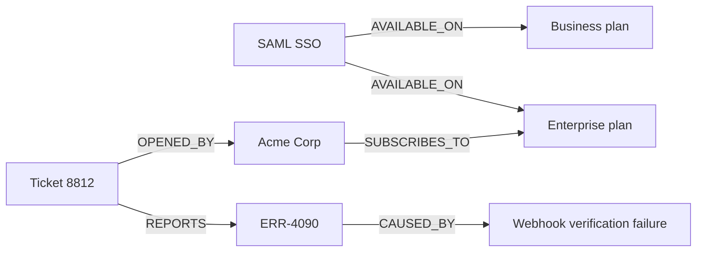
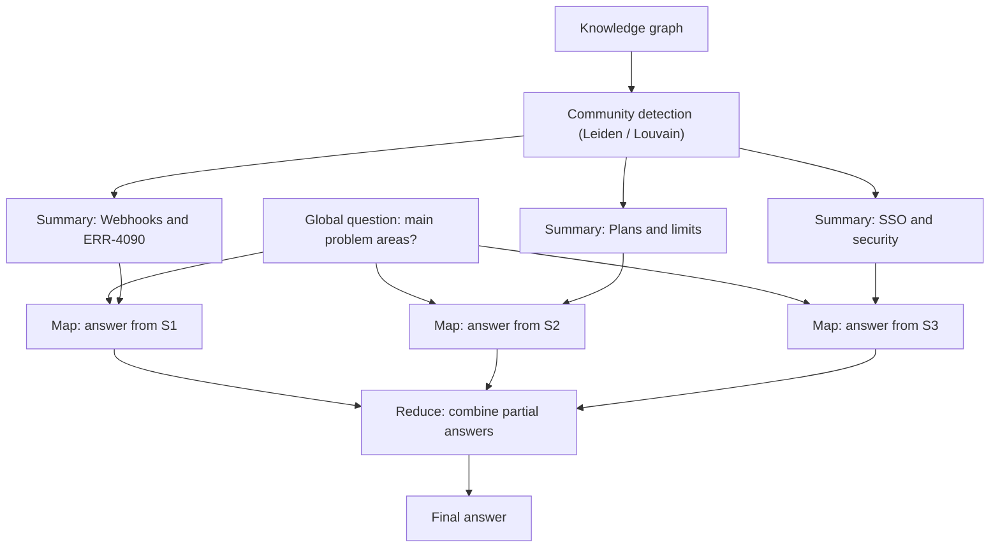

# Graph RAG

## Introduction

Vector RAG is excellent at one kind of question: "Find the passage that answers this." It struggles with two other kinds:

1. **Multi-hop questions** that connect facts across documents. "Which customers on the Enterprise plan are affected by the webhook outage that started after the EU region migration?" No single chunk contains the answer. You need to follow links: outage, then affected feature, then region, then customers, then plan.
2. **Global questions** about the whole corpus. "What are the main themes in last quarter's support tickets?" Top-k retrieval returns ten tickets out of fifty thousand, and the model summarizes those ten, not the whole set.

**Graph RAG** adds a **knowledge graph** to retrieval. Instead of (or alongside) storing text chunks as vectors, you extract **entities** (customers, features, error codes, plans, teams) and the **relationships** between them ("ERR-4090 is caused by webhook verification," "Acme Corp is on Enterprise"). Retrieval can then walk the graph, and summaries can be built per cluster of related entities.

An analogy: vector RAG is a pile of index cards sorted by topic. Graph RAG is a detective's evidence board with photos connected by string. To answer "who is connected to whom," the board is far more useful than the card pile.

Graph RAG is powerful, but it is also expensive and complex. This page explains how it works, builds a small version by hand, introduces Microsoft's GraphRAG project and alternatives, and spends real time on when it is **not** worth it.

## Knowledge Graph Basics

A knowledge graph stores facts as **triples**: `(subject, relationship, object)`.

| Subject | Relationship | Object |
|---|---|---|
| SAML SSO | AVAILABLE_ON | Business plan |
| SAML SSO | AVAILABLE_ON | Enterprise plan |
| ERR-4090 | CAUSED_BY | Webhook verification failure |
| Acme Corp | SUBSCRIBES_TO | Enterprise plan |
| Ticket 8812 | REPORTS | ERR-4090 |
| Ticket 8812 | OPENED_BY | Acme Corp |



Now "Which plan is Acme Corp on, and what error did they report?" is a short walk from the `Acme Corp` node, with no similarity search needed.

You can store graphs in a dedicated **graph database** such as Neo4j (queried with Cypher), Amazon Neptune, or Memgraph. You can use Postgres tables for nodes and edges. Or, for learning and small graphs, you can use an in-memory library such as **NetworkX**.

## Step 1: Extract Entities and Relationships with an LLM

Building the graph by hand doesn't scale. The core trick of Graph RAG is using an LLM to read each chunk and output structured triples. Structured outputs guarantee the response matches a schema.

```bash
pip install anthropic networkx pydantic
```

```python
from pydantic import BaseModel

from anthropic import Anthropic

client = Anthropic()


class Entity(BaseModel):
    name: str
    type: str            # e.g. "plan", "feature", "error_code", "customer", "ticket"
    description: str


class Relationship(BaseModel):
    source: str
    target: str
    relation: str        # e.g. "AVAILABLE_ON", "CAUSED_BY"
    description: str


class Extraction(BaseModel):
    entities: list[Entity]
    relationships: list[Relationship]


EXTRACT_PROMPT = """Extract a knowledge graph from the text below.
- Entity types: plan, feature, error_code, customer, ticket, region, setting.
- Use canonical names (e.g. "Enterprise plan", not "Enterprise tier" or "the enterprise plan").
- Relation names are UPPER_SNAKE_CASE verbs.
- Only extract facts stated in the text.

<text>
{text}
</text>"""


def extract(chunk_id: str, text: str) -> Extraction:
    response = client.messages.parse(
        model="claude-haiku-5-5",          # cheap model for high-volume extraction
        max_tokens=4096,
        messages=[{"role": "user", "content": EXTRACT_PROMPT.format(text=text)}],
        output_format=Extraction,
    )
    return response.parsed_output


result = extract("kb-201", "SSO is available on the Business and Enterprise plans. "
                           "Go to Settings > Security > SSO and upload your IdP metadata XML.")
for r in result.relationships:
    print(r.source, "-", r.relation, "->", r.target)
```

Example output:

```text
SAML SSO - AVAILABLE_ON -> Business plan
SAML SSO - AVAILABLE_ON -> Enterprise plan
SAML SSO - CONFIGURED_IN -> Settings > Security > SSO
SAML SSO - REQUIRES -> IdP metadata XML
```

:::caution
Extraction quality is the foundation of Graph RAG, and it is imperfect. The LLM may name the same entity differently in different chunks ("Enterprise", "Enterprise plan", "Enterprise tier"), miss relationships, or produce vague ones. Production systems add **entity resolution** (merging duplicates by normalized name, embeddings, or another LLM pass) and review samples by hand.
:::

## Step 2: Build the Graph

```python
import networkx as nx

TEXTS = {
    "kb-201": "SSO is available on the Business and Enterprise plans.",
    "kb-301": "The REST API allows 600 requests per minute on Business and 3,000 on Enterprise.",
    "kb-302": "ERR-4090 means a webhook endpoint failed verification.",
    "t-8812": "Ticket 8812 from Acme Corp (Enterprise plan): webhooks fail with ERR-4090 since EU migration.",
    "t-8830": "Ticket 8830 from Globex (Business plan): ERR-4090 after rotating the webhook secret.",
}


def normalize(name: str) -> str:
    return " ".join(name.lower().replace("tier", "plan").split())


def build_graph(texts: dict[str, str]) -> nx.MultiDiGraph:
    graph = nx.MultiDiGraph()
    for chunk_id, text in texts.items():
        extraction = extract(chunk_id, text)
        for e in extraction.entities:
            key = normalize(e.name)
            if key not in graph:
                graph.add_node(key, label=e.name, type=e.type, descriptions=[], sources=set())
            graph.nodes[key]["descriptions"].append(e.description)
            graph.nodes[key]["sources"].add(chunk_id)
        for r in extraction.relationships:
            src, dst = normalize(r.source), normalize(r.target)
            for node in (src, dst):
                if node not in graph:
                    graph.add_node(node, label=node, type="unknown", descriptions=[], sources=set())
            graph.add_edge(src, dst, relation=r.relation, description=r.description, source=chunk_id)
    return graph


graph = build_graph(TEXTS)
print(graph.number_of_nodes(), "nodes,", graph.number_of_edges(), "edges")
```

Example output:

```text
14 nodes, 15 edges
```

Every node and edge remembers which chunk it came from (`sources`, `source`). That is essential for citations later.

## Step 3: Local Search (Entity Neighborhoods)

**Local search** answers questions about specific entities. Find the entities mentioned in the question, collect their neighborhood in the graph (often one or two hops), and give the model those facts plus the original source chunks.

```python
def find_entities(question: str, graph: nx.MultiDiGraph) -> list[str]:
    """Naive matching: graph nodes whose name appears in the question.
    Real systems embed entity names and match by similarity."""
    q = question.lower()
    return [node for node in graph.nodes if node in q]


def neighborhood_facts(graph: nx.MultiDiGraph, seeds: list[str], hops: int = 2) -> tuple[list[str], set[str]]:
    undirected = graph.to_undirected(as_view=True)
    nodes = set()
    for seed in seeds:
        nodes |= set(nx.single_source_shortest_path_length(undirected, seed, cutoff=hops))
    facts, sources = [], set()
    for src, dst, data in graph.subgraph(nodes).edges(data=True):
        facts.append(f"{graph.nodes[src]['label']} -{data['relation']}-> {graph.nodes[dst]['label']}")
        sources.add(data["source"])
    return facts, sources


def local_answer(question: str) -> str:
    seeds = find_entities(question, graph)
    facts, sources = neighborhood_facts(graph, seeds)
    context = "\n".join(facts) + "\n\n" + "\n".join(f"[{s}] {TEXTS[s]}" for s in sorted(sources))
    response = client.messages.create(
        model="claude-opus-5-5",
        max_tokens=1024,
        system="Answer from the graph facts and source passages only. Cite sources like [t-8812].",
        messages=[{"role": "user", "content": f"<context>\n{context}\n</context>\n\nQuestion: {question}"}],
    )
    return next(b.text for b in response.content if b.type == "text")


print(local_answer("Which customers reported err-4090, and what plans are they on?"))
```

Example output:

```text
Two customers reported ERR-4090: Acme Corp, on the Enterprise plan [t-8812], and Globex,
on the Business plan [t-8830]. ERR-4090 means a webhook endpoint failed verification [kb-302].
```

Vector search for this question would likely return the error-code article and maybe one ticket. The graph connects the error code to **every** ticket that reports it and from there to each customer's plan.

## Step 4: Global Search (Community Summaries)

**Global search** answers whole-corpus questions. The idea, popularized by Microsoft's GraphRAG paper, works like this:

1. Detect **communities**, which are clusters of densely connected entities (for example, everything about webhooks, or everything about billing).
2. Ask an LLM to write a **summary report** for each community, at indexing time.
3. At query time, ask the question against **each** community summary (map), then combine the partial answers (reduce).



```python
def summarize_communities(graph: nx.MultiDiGraph) -> list[str]:
    undirected = nx.Graph(graph.to_undirected())
    communities = nx.community.louvain_communities(undirected, seed=42)
    summaries = []
    for members in communities:
        facts = [
            f"{graph.nodes[u]['label']} -{d['relation']}-> {graph.nodes[v]['label']}"
            for u, v, d in graph.subgraph(members).edges(data=True)
        ]
        if not facts:
            continue
        response = client.messages.create(
            model="claude-haiku-5-5",
            max_tokens=400,
            messages=[{"role": "user", "content":
                       "Write a 3-sentence report on this group of related facts:\n" + "\n".join(facts)}],
        )
        summaries.append(next(b.text for b in response.content if b.type == "text"))
    return summaries


def global_answer(question: str, summaries: list[str]) -> str:
    partials = []
    for summary in summaries:                       # map step (could run in parallel)
        r = client.messages.create(
            model="claude-haiku-5-5",
            max_tokens=300,
            messages=[{"role": "user", "content":
                       f"<report>{summary}</report>\nWhat does this report say about: {question}\n"
                       "If nothing relevant, reply NONE."}],
        )
        text = next(b.text for b in r.content if b.type == "text").strip()
        if text != "NONE":
            partials.append(text)
    final = client.messages.create(                 # reduce step
        model="claude-opus-5-5",
        max_tokens=1024,
        messages=[{"role": "user", "content":
                   "Combine these partial findings into one answer:\n\n" + "\n\n".join(partials)
                   + f"\n\nQuestion: {question}"}],
    )
    return next(b.text for b in final.content if b.type == "text")
```

NetworkX ships Louvain community detection. Microsoft GraphRAG uses the related **Leiden** algorithm, which is available in libraries such as `graspologic` and `igraph`. The map step makes one LLM call per community, so global search is far more expensive per question than vector search. It is worth it only for questions that truly need the whole corpus.

## Microsoft GraphRAG

[Microsoft GraphRAG](https://microsoft.github.io/graphrag/) is an open-source project that packages this whole approach. Its indexing pipeline:

1. Splits the corpus into **TextUnits** (chunks).
2. Uses an LLM to extract **entities, relationships, and key claims** from each TextUnit.
3. Clusters the graph hierarchically with the **Leiden** algorithm.
4. Generates bottom-up **community reports** at each level of the hierarchy.

It offers several query modes:

| Mode | What it does | Good for |
|---|---|---|
| `global` | Map-reduce over community reports | Whole-corpus themes and summaries |
| `local` | Entity neighborhoods plus related text | Questions about specific entities |
| `drift` | Local search enriched with community context | Entity questions that need broader context |
| `basic` | Plain top-k vector search | Questions where baseline RAG suffices |

Getting started looks like this (check the docs for the current version's configuration, including how to point it at your LLM provider):

```bash
python -m pip install graphrag
graphrag init --root ./acme_graphrag        # creates settings and prompt files
# put your .txt documents in ./acme_graphrag/input, then configure models in settings.yaml
graphrag index --root ./acme_graphrag
graphrag query --root ./acme_graphrag --method global "What are the main problem areas in support tickets?"
graphrag query --root ./acme_graphrag --method local "Which customers are affected by ERR-4090?"
```

:::warning
The GraphRAG docs warn that indexing "can consume a lot of LLM resources." Every chunk goes through extraction, and every community gets a report. Start with a small sample of your data and inexpensive models, measure the cost, and then decide whether to index everything. GraphRAG also provides prompt tuning to adapt extraction prompts to your domain, which usually improves quality.
:::

## Other Graph RAG Options

- **LightRAG** ([HKUDS/LightRAG](https://github.com/HKUDS/LightRAG), package `lightrag-hku`) combines a knowledge graph with vector retrieval. It offers `naive`, `local`, `global`, `hybrid`, and `mix` query modes and emphasizes incremental updates and fewer LLM calls than GraphRAG, according to its authors.
- **Neo4j** offers a GraphRAG Python package and an LLM-based graph builder. Storing the graph in Neo4j lets an agent run **Cypher** queries directly, which is useful for precise multi-hop questions ("count Enterprise customers with open ERR-4090 tickets").
- **LlamaIndex** has a property graph index, and **LangChain** has graph-transformer and graph-QA components. These are handy if you already use those frameworks. See [LlamaIndex Agents](../9-agents-frameworks/8-agents-llamaindex.mdx).
- **Your existing data may already be a graph.** CRM records, ticket systems, and service catalogs have explicit relationships (customer to plan, ticket to customer). Loading those directly is cheaper and more accurate than extracting them from text with an LLM. Often the best "Graph RAG" is a SQL or graph-query tool given to an agent.

## Real-World Scenario

**Acme Cloud's head of support wants a monthly "voice of the customer" report** and an assistant that can answer cross-cutting questions: "What are the top problem areas for Enterprise customers this quarter?" and "Which customers hit both webhook errors and rate limits?" The source data is 40,000 support tickets per quarter plus the help center.

Vector RAG fails on both question types. Theme questions see only a handful of tickets, and the "both errors" question requires joining sets of tickets per customer.

The team builds two things:

1. **Structured facts from structured data.** Customer, plan, and ticket metadata come straight from the ticketing system and CRM into Postgres, with no LLM extraction needed. The agent gets a read-only SQL tool for questions like "customers with both ERR-4090 and 429 tickets." See [Agents That Work with Your Database](../10-agents-integration/6-agents-with-databases.mdx).
2. **GraphRAG over ticket text.** They run Microsoft GraphRAG on a quarter's tickets to extract problem entities (features, error codes, symptoms) and community reports. Global search produces the theme report. They first index a 2,000-ticket sample with a cheap model to estimate cost, then tune the extraction prompts for support vocabulary before indexing the full quarter.

The help-center assistant keeps using hybrid vector RAG, because its questions are single-passage lookups.

**Why this approach fits:** Relationships that already exist in systems of record are loaded directly, which is cheap and exact. LLM-built graphs are reserved for knowledge that exists only in free text, and only for the global questions that need them.

**When Graph RAG fits:**

- Questions that span many documents (themes, trends, summaries of a corpus).
- Multi-hop questions over entities that are mentioned across many documents.
- Domains rich in named entities and relationships: investigations, research literature, incident histories, compliance.

**When it is overkill:**

- Single-passage lookups ("how do I export data?"). Vector or hybrid RAG is cheaper and just as good.
- Small corpora that fit in the context window. Long context handles global questions directly. See [RAG vs Long Context](./9-agents-rag-vs-long-context.mdx).
- Fast-changing data where re-extraction costs more than it saves.
- Relationships that already live in a database. Query them instead.

**Alternatives and trade-offs:**

| Approach | Pros | Cons | Best for |
|---|---|---|---|
| Vector / hybrid RAG | Cheap, simple, fast | Weak on multi-hop and global questions | Passage lookups |
| Long context | Sees everything, no index | Corpus must fit, cost per query | Small corpora, whole-corpus questions |
| LLM-built graph + local search | Connects entities across documents | Extraction cost and errors, entity resolution | Multi-hop questions over text |
| GraphRAG global search | Answers themes across a large corpus | Expensive indexing and queries | Periodic reports, exploratory analysis |
| Structured data + SQL / Cypher tool | Exact, cheap, current | Only covers data that is already structured | Counts, joins, filters over records |
| Agentic RAG with several tools | Flexible combination of the above | More moving parts to test | Assistants with mixed question types |

## Common Mistakes

1. **Reaching for Graph RAG first.** Start with hybrid RAG and an evaluation set. Add a graph only for the question types that fail.
2. **Skipping entity resolution.** "Enterprise", "Enterprise plan", and "ENT tier" become three nodes, and the graph quietly loses its connections.
3. **Indexing everything before measuring cost.** Run extraction on a sample, multiply, and decide. Use a cheaper model for extraction where quality allows.
4. **Losing provenance.** Every node and edge should record its source chunk. Without that, you can't cite or debug.
5. **Extracting what you already have.** Don't pay an LLM to rediscover relationships stored in your CRM or ticketing system.
6. **Treating extracted facts as ground truth.** LLM extraction makes mistakes. For high-stakes answers, show the source passage, not just the triple.
7. **Never refreshing the graph.** Ticket and document graphs go stale. Plan incremental updates or periodic re-indexing.

## Summary

- Graph RAG extracts entities and relationships into a knowledge graph so retrieval can follow connections and summarize clusters.
- **Local search** walks entity neighborhoods for multi-hop questions. **Global search** maps a question over community summaries and reduces the results for whole-corpus questions.
- LLM extraction with structured outputs builds the graph, and entity resolution and provenance keep it usable.
- Microsoft GraphRAG implements the full pipeline (TextUnits, entity extraction, Leiden communities, community reports, and global, local, DRIFT, and basic search), but indexing can be costly.
- LightRAG, Neo4j, LlamaIndex, and direct SQL or Cypher tools are alternatives. Relationships already in your databases are best queried directly.
- Use Graph RAG for the questions that need it, and keep simpler retrieval for everything else.

## Exercises

1. Run `extract` on five Acme Cloud articles and inspect the entities. How many duplicates or naming inconsistencies do you see? Write a better `normalize` function.
2. Add a `hops` parameter to `local_answer` and compare answers with one and two hops. When does the extra context help, and when does it add noise?
3. Install Microsoft GraphRAG and index a small public-domain book or a few dozen of your own documents. Compare `--method global` and `--method basic` on a theme question.
4. List ten questions your users ask and classify each as passage lookup, multi-hop, global, or structured-data. Which retrieval approach would you use for each?

This completes the RAG section. To put these techniques together in a full application, see [Project: Document Q&A Agent](../14-agents-projects/4-agents-project-document-qa.mdx) and [Project: Company Knowledge MCP Server](../14-agents-projects/10-agents-project-mcp-integration.mdx).
