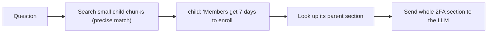

# Chunking Strategies

## Introduction

Before you can embed and search your documents, you have to cut them into pieces called **chunks**. This step sounds boring, but it often affects retrieval quality more than which embedding model or vector database you pick.

Why not embed whole documents? Three reasons:

1. **Precision.** A 20-page article about "Security settings" covers SSO, 2FA, IP allowlists, and audit logs. Its single vector is a blurry average of all four topics. A question about 2FA matches it only weakly.
2. **Model limits.** Embedding models truncate long inputs, often silently. See [Embeddings](./1-agents-embeddings.mdx).
3. **Prompt budget.** You want to send the model the paragraph that answers the question, not 20 pages around it.

Why not embed single sentences? Because a sentence such as "Members get 7 days to enroll." does not say *what* they enroll in. Tiny chunks lose context.

Chunking is a balance between those two failures. Think of cutting a textbook into index cards. If each card holds a whole chapter, you can't find anything. If each card holds one sentence, no card makes sense on its own. You want one idea per card, with enough context to understand it.

This page walks through the main chunking strategies, from simplest to most advanced, with runnable code for each.

## The Running Example

We will chunk one longer Acme Cloud help article written in Markdown:

```python
ARTICLE = """# Security settings

Acme Cloud gives workspace admins several ways to protect their accounts.

## Single sign-on (SAML SSO)

SSO is available on the Business and Enterprise plans. Go to Settings > Security > SSO and
upload your IdP metadata XML. Test with one user before enforcing SSO for everyone.

Once SSO is enforced, members can no longer sign in with a password. Admins keep a
break-glass password login in case the identity provider is down.

## Two-factor authentication

Admins can require 2FA for all members under Settings > Security. Members get 7 days to
enroll. After 7 days, members who have not enrolled are locked out until an admin resets them.

## API keys

API keys are created per workspace. Revoked keys return ERR-4021. Rotate keys every 90 days.
"""
```

## Strategy 1: Fixed-Size Chunks with Overlap

The simplest approach is to cut every N characters (or words, or tokens), with some **overlap** so a sentence split across a boundary still appears whole in at least one chunk.

```python
def fixed_size_chunks(text: str, size: int = 300, overlap: int = 50) -> list[str]:
    """Split text into chunks of `size` characters, each overlapping the previous by `overlap`."""
    if overlap >= size:
        raise ValueError("overlap must be smaller than size")
    chunks = []
    start = 0
    while start < len(text):
        chunks.append(text[start:start + size])
        start += size - overlap
    return chunks

for i, chunk in enumerate(fixed_size_chunks(ARTICLE)):
    print(i, repr(chunk[:60]), "...")
```

Example output:

```text
0 '# Security settings\n\nAcme Cloud gives workspace admins sever' ...
1 'xt with one user before enforcing SSO for everyone.\n\nOnce SSO' ...
2 'rd login in case the identity provider is down.\n\n## Two-fa' ...
3 'ers get 7 days to\nenroll. After 7 days, members who have not' ...
4 'ed per workspace. Revoked keys return ERR-4021. Rotate keys e' ...
```

It works, but look at the boundaries: chunks start mid-word and mix the end of one section with the start of the next. Chunk 3 talks about "7 days" without saying it is about 2FA.

**Use it when** your text has no structure (raw transcripts, OCR output) or as a quick baseline. **Avoid it** for structured documents like Markdown, HTML, or code.

### Characters, words, or tokens?

Embedding models and LLMs count **tokens**, not characters. A rough rule for English is about 4 characters per token, but this varies by tokenizer, language, and content (code and non-English text use more tokens). Character-based sizes are fine for learning. For production, measure with the tokenizer of your embedding model, or use a token-aware splitter. For Claude, the API's token counting endpoint gives exact counts. See [Tokens and Context Windows](../1-agents-llm-apis/8-agents-tokens-and-context.mdx).

## Strategy 2: Recursive Splitting

**Recursive splitting** tries to cut at the most natural boundary first. It splits on paragraph breaks. If a piece is still too big, it splits that piece on line breaks, then on sentence ends, then on spaces. Small neighboring pieces are merged back together up to the size limit.

```python
import re

SEPARATORS = ["\n\n", "\n", ". ", " "]

def recursive_split(text: str, max_chars: int = 300, separators: list[str] = SEPARATORS) -> list[str]:
    """Split at the most natural boundary that keeps pieces under max_chars."""
    if len(text) <= max_chars:
        return [text.strip()] if text.strip() else []
    if not separators:
        # No natural boundary left: fall back to a hard cut.
        return [text[i:i + max_chars] for i in range(0, len(text), max_chars)]

    sep, rest = separators[0], separators[1:]
    pieces = [p for p in text.split(sep) if p.strip()]

    chunks: list[str] = []
    current = ""
    for piece in pieces:
        candidate = f"{current}{sep}{piece}" if current else piece
        if len(candidate) <= max_chars:
            current = candidate
            continue
        if current:
            chunks.append(current.strip())
        if len(piece) > max_chars:
            chunks.extend(recursive_split(piece, max_chars, rest))
            current = ""
        else:
            current = piece
    if current.strip():
        chunks.append(current.strip())
    return chunks

for i, chunk in enumerate(recursive_split(ARTICLE)):
    print(f"--- chunk {i} ({len(chunk)} chars)\n{chunk}")
```

Example output (trimmed):

```text
--- chunk 0 (114 chars)
# Security settings

Acme Cloud gives workspace admins several ways to protect their accounts.
--- chunk 1 (229 chars)
## Single sign-on (SAML SSO)

SSO is available on the Business and Enterprise plans. Go to Settings > Security > SSO and
upload your IdP metadata XML. Test with one user before enforcing SSO for everyone.
...
```

Chunks now end at paragraph boundaries. This is the default strategy in most frameworks. LangChain's `RecursiveCharacterTextSplitter` (from the `langchain-text-splitters` package) and LlamaIndex's `SentenceSplitter` implement versions of it with token-based sizes.

## Strategy 3: Structure-Aware (Markdown Headers)

Documents often tell you where the topics are. Markdown has headers, HTML has `h2` tags, PDFs have sections, and code has functions and classes. Splitting along that structure gives the cleanest chunks. It also lets you attach the **heading path** to each chunk, which restores context that a bare paragraph lacks.

```python
import re
from dataclasses import dataclass, field


@dataclass
class Chunk:
    text: str
    metadata: dict = field(default_factory=dict)


def markdown_chunks(doc: str, doc_id: str, max_chars: int = 600) -> list[Chunk]:
    """Split Markdown by headers and prefix each chunk with its heading path."""
    chunks: list[Chunk] = []
    path: list[str] = []          # current heading path, e.g. ["Security settings", "Two-factor authentication"]
    buffer: list[str] = []

    def flush() -> None:
        body = "\n".join(buffer).strip()
        buffer.clear()
        if not body:
            return
        breadcrumb = " > ".join(path)
        for piece in recursive_split(body, max_chars):
            chunks.append(Chunk(
                text=f"{breadcrumb}\n\n{piece}" if breadcrumb else piece,
                metadata={"doc_id": doc_id, "section": breadcrumb, "chunk_index": len(chunks)},
            ))

    for line in doc.splitlines():
        match = re.match(r"^(#{1,6})\s+(.*)", line)
        if match:
            flush()
            level = len(match.group(1))
            path[:] = path[:level - 1] + [match.group(2).strip()]
        else:
            buffer.append(line)
    flush()
    return chunks

for c in markdown_chunks(ARTICLE, doc_id="kb-205"):
    print(c.metadata["section"], "|", c.text.splitlines()[-1][:50])
```

Example output:

```text
Security settings | Acme Cloud gives workspace admins several ways to p
Security settings > Single sign-on (SAML SSO) | break-glass password login in case the identity
Security settings > Two-factor authentication | enroll. After 7 days, members who have not enrol
Security settings > API keys | API keys are created per workspace. Revoked keys
```

Now the 2FA chunk begins with "Security settings > Two-factor authentication", so "Members get 7 days to enroll" is clearly about 2FA, both for the embedding model and for the LLM that reads it later.

:::tip
For code, split on functions and classes (for example with Python's `ast` module or a parser such as tree-sitter) and include the file path and class name in each chunk. For HTML, strip navigation and footers first: boilerplate repeated on every page pollutes every chunk.
:::

## Strategy 4: Semantic Chunking

**Semantic chunking** uses embeddings to find topic shifts. It embeds each sentence, compares neighbors, and starts a new chunk where similarity drops sharply.

```python
import re

import numpy as np
from sentence_transformers import SentenceTransformer

model = SentenceTransformer("all-MiniLM-L6-v2")

def semantic_chunks(text: str, threshold: float = 0.35) -> list[str]:
    """Start a new chunk when adjacent sentences are less similar than `threshold`."""
    sentences = [s.strip() for s in re.split(r"(?<=[.!?])\s+", text) if s.strip()]
    if not sentences:
        return []
    vecs = model.encode(sentences, normalize_embeddings=True)
    chunks, current = [], [sentences[0]]
    for prev, cur, sentence in zip(vecs, vecs[1:], sentences[1:]):
        if float(np.dot(prev, cur)) < threshold:
            chunks.append(" ".join(current))
            current = []
        current.append(sentence)
    chunks.append(" ".join(current))
    return chunks

plain = re.sub(r"#+ .*\n", "", ARTICLE)   # drop headers to show the method on its own
for chunk in semantic_chunks(plain):
    print("-", chunk[:80])
```

Example output (depends on the model and threshold):

```text
- Acme Cloud gives workspace admins several ways to protect their accounts. SSO is av
- Once SSO is enforced, members can no longer sign in with a password. Admins keep a
- Admins can require 2FA for all members under Settings > Security. Members get 7 day
- API keys are created per workspace. Revoked keys return ERR-4021. Rotate keys every
```

Semantic chunking can help with long, unstructured text such as meeting transcripts. But it costs an embedding call per sentence, adds a threshold you must tune, and in published comparisons it does not consistently beat simpler recursive splitting. Try it only if your evaluation shows the simpler methods failing.

## Strategy 5: Parent-Child (Small-to-Big) Retrieval

There is a tension: **small chunks retrieve precisely**, but **large chunks give the LLM enough context** to answer well. Parent-child retrieval gets both.



1. Split each document into **parent** sections (for example, by header).
2. Split each parent into small **child** chunks. Embed only the children and store each child's `parent_id`.
3. At query time, search the children, then return their **parents** (deduplicated) to the LLM.

```python
def build_parent_child(doc: str, doc_id: str) -> tuple[dict[str, str], list[Chunk]]:
    parents: dict[str, str] = {}
    children: list[Chunk] = []
    for p_index, parent in enumerate(markdown_chunks(doc, doc_id, max_chars=2000)):
        parent_id = f"{doc_id}#p{p_index}"
        parents[parent_id] = parent.text
        for c_index, child in enumerate(recursive_split(parent.text, max_chars=150)):
            children.append(Chunk(child, {"parent_id": parent_id, "child_id": f"{parent_id}c{c_index}"}))
    return parents, children

def parents_for(child_hits: list[Chunk], parents: dict[str, str]) -> list[str]:
    seen, result = set(), []
    for hit in child_hits:
        pid = hit.metadata["parent_id"]
        if pid not in seen:
            seen.add(pid)
            result.append(parents[pid])
    return result

parents, children = build_parent_child(ARTICLE, "kb-205")
print(len(parents), "parents,", len(children), "children")
```

Example output:

```text
4 parents, 9 children
```

LlamaIndex calls related ideas "auto-merging" and "sentence window" retrieval, and LangChain has a `ParentDocumentRetriever`. The idea is the same everywhere.

## Strategy 6: Contextual Retrieval

Even good chunks lose context. A chunk from a quarterly report might say "Revenue grew 3% over the previous quarter" without naming the company or the quarter. Anthropic's [Contextual Retrieval](https://www.anthropic.com/engineering/contextual-retrieval) technique fixes this by asking an LLM to write a short context for **each chunk**, given the whole document, and prepending it before embedding and keyword indexing.

In Anthropic's experiments, contextual embeddings reduced the top-20 retrieval failure rate by 35%. Combined with contextual BM25 keyword search, the reduction was 49%, and adding reranking brought it to 67%. Your results will depend on your data, so measure.

The cost problem is obvious: you send the whole document once per chunk. **Prompt caching** solves most of it. Put the document in a cached block, so each subsequent chunk call reads the document from cache at a fraction of the price.

```python
from anthropic import Anthropic

client = Anthropic()

CONTEXT_INSTRUCTIONS = (
    "Here is the chunk we want to situate within the whole document\n"
    "<chunk>\n{chunk}\n</chunk>\n"
    "Please give a short succinct context to situate this chunk within the overall "
    "document for the purposes of improving search retrieval of the chunk. "
    "Answer only with the succinct context and nothing else."
)

def contextualize(document: str, chunk: str) -> str:
    response = client.messages.create(
        model="claude-haiku-5-5",      # a cheap, fast model is enough for this job
        max_tokens=200,
        messages=[{
            "role": "user",
            "content": [
                {
                    "type": "text",
                    "text": f"<document>\n{document}\n</document>",
                    "cache_control": {"type": "ephemeral"},   # cache the shared document
                },
                {"type": "text", "text": CONTEXT_INSTRUCTIONS.format(chunk=chunk)},
            ],
        }],
    )
    context = next(b.text for b in response.content if b.type == "text").strip()
    return f"{context}\n\n{chunk}"

for chunk in recursive_split(ARTICLE)[:2]:
    print(contextualize(ARTICLE, chunk), "\n---")
```

Example output:

```text
This chunk introduces Acme Cloud's security settings article, which covers SSO, 2FA and API keys.

# Security settings

Acme Cloud gives workspace admins several ways to protect their accounts.
---
This chunk explains how to set up SAML SSO in Acme Cloud's security settings, including plan requirements.

## Single sign-on (SAML SSO)
...
```

Notes on using it well:

- Embed and keyword-index the **contextualized** text, but you can show the LLM either version at answer time.
- The cache only helps if the document block is byte-identical across calls and long enough to meet the model's minimum cacheable size. Check `usage.cache_read_input_tokens` to confirm hits. See [Prompt Caching](../4-agents-memory-and-context/4-agents-prompt-caching.mdx).
- Run it as a batch job at indexing time, not per query. Only re-run it for chunks whose document changed.
- Some embedding providers offer **contextualized chunk embeddings** that achieve a similar effect inside the embedding model (Voyage's `voyage-context` models, for example). That avoids the LLM call.

## Choosing Chunk Size and Overlap

There is no universal best size. Common starting points are a few hundred tokens per chunk with 10 to 20 percent overlap, and Anthropic's contextual retrieval write-up assumed chunks of around 800 tokens. Then tune with data:

| Smaller chunks | Larger chunks |
|---|---|
| More precise matches | More context per hit |
| Need more chunks per answer (higher top-k) | Fewer, but noisier, hits |
| Risk losing context | Risk diluting the embedding |
| Better for FAQ-style facts | Better for explanations and procedures |

Build an evaluation set, try two or three sizes, and keep the one with the best recall on your questions. See [Evaluating RAG Systems](./8-agents-rag-evaluation.mdx).

## Special Content

- **Tables.** Splitting a table by characters destroys it. Keep each table whole if it is small. For large tables, repeat the header row in each chunk or convert each row to a sentence ("Plan: Business. API limit: 600 requests per minute."). Questions about tabular data are often better served by a SQL tool.
- **Code.** Split by function or class, never mid-function. Include imports or the file path as context.
- **PDFs.** Extraction quality matters more than chunking. Check that columns, headers, and footers come out in a sensible order. Store page numbers in metadata for citations.
- **Lists and FAQs.** Keep each question with its answer in one chunk.

## Real-World Scenario

**Acme Cloud's assistant gives vague answers about security settings.** Support finds that "How long do members have to enroll in 2FA?" often retrieves the SSO chunk, and when the 2FA chunk is retrieved, the model sometimes answers "7 days to enroll in SSO." The help center is Markdown, and the first version used 500-character fixed-size chunks.

The team changes the pipeline:

1. Switch to **Markdown-aware chunking** with heading breadcrumbs. Each chunk now starts with "Security settings > Two-factor authentication".
2. Use **parent-child retrieval** for long procedural articles, so the model receives the whole section when any child chunk matches.
3. Run **contextual retrieval** with `claude-haiku-5-5` on the 30 longest articles, where chunks most often lacked context, using prompt caching to keep indexing cheap.
4. Re-run the 80-question evaluation set after each change and keep only the changes that improve recall@5.

**Why this approach fits:** The documents already have good structure, so using the headers is nearly free and fixes the main failure. Contextual retrieval costs money at indexing time, so the team applies it where measurements show it helps most.

**When to use advanced chunking:** Evaluation shows retrieval failures caused by missing context or split ideas. **When not to:** your documents are short FAQs where each entry is already a perfect chunk. Then one chunk per entry is the best strategy.

**Alternatives and trade-offs:**

| Approach | Pros | Cons | Best for |
|---|---|---|---|
| Fixed-size with overlap | Trivial, predictable | Splits ideas mid-sentence | Unstructured text, baselines |
| Recursive splitting | Respects paragraphs, good default | Ignores document semantics | General prose |
| Structure-aware (headers, AST) | Clean topics, breadcrumbs add context | Needs a parser per format | Docs, wikis, code |
| Semantic chunking | Finds topic shifts in unstructured text | Extra embedding cost, threshold tuning, inconsistent gains | Transcripts, long essays |
| Parent-child | Precise search plus rich context | More storage, more complex | Long procedural docs |
| Contextual retrieval | Restores missing context, measurable gains | LLM cost at indexing time | Dense reports, docs full of pronouns and references |
| One chunk per document | No splitting errors | Blurry vectors, truncation | Very short docs (FAQs, tickets) |

## Common Mistakes

1. **Never looking at your chunks.** Print 20 random chunks and read them. You will spot broken tables, navigation menus, and mid-word splits immediately.
2. **Dropping metadata during chunking.** Every chunk needs its document ID, title, section, and position, or you cannot cite or rebuild context.
3. **Chunks larger than the embedding model's input limit.** The extra text is silently ignored. Check the model's maximum sequence length.
4. **Huge overlap.** Overlap of 50 percent doubles storage and fills the top-k with near-duplicates. Ten to twenty percent is usually enough.
5. **Tuning chunk size by feel.** Change one variable at a time and measure with an evaluation set.
6. **Re-running contextualization on every re-index.** Hash each document and only reprocess documents that changed.

## Summary

- Chunking decides what can be retrieved. Too big blurs topics, and too small loses context.
- Start with recursive or structure-aware splitting and add heading breadcrumbs.
- Use overlap modestly to avoid losing sentences at boundaries.
- Parent-child retrieval searches small chunks but returns larger sections to the LLM.
- Contextual retrieval prepends LLM-written context to each chunk. It measurably improved retrieval in Anthropic's tests, and prompt caching keeps it affordable.
- Pick chunk sizes with an evaluation set, not intuition.

## Exercises

1. Chunk a long page from your own docs with fixed-size, recursive, and Markdown-aware chunking. Read the results side by side. Which one would you want to retrieve?
2. Extend `markdown_chunks` to skip fenced code blocks when looking for headers (a `#` comment inside a code block is not a header).
3. Measure how many tokens your chunks use with your embedding model's tokenizer (`model.tokenizer` in sentence-transformers). How many exceed the model's `max_seq_length`?
4. Run `contextualize` on five chunks and check `response.usage` for `cache_creation_input_tokens` and `cache_read_input_tokens`. Did the cache hit after the first call?

Next, put the pieces together in [Building a Retrieval Pipeline](./4-agents-retrieval-pipeline.mdx).
