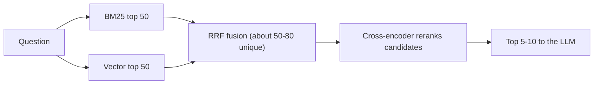

# Hybrid Search and Reranking

## Introduction

Vector search is good at meaning. Ask "Can I get my money back?" and it finds the refund policy even though the words differ. But ask "What does ERR-4021 mean?" and it may stumble. To an embedding model, `ERR-4021` and `ERR-4090` look almost the same: short, code-like strings in a similar context. A keyword search engine would find the exact match instantly.

Real questions mix both kinds of need. Users paraphrase ("my key stopped working") and use exact identifiers (error codes, product names, ticket numbers, function names, SKUs). Strong retrieval systems therefore combine two ideas:

1. **Hybrid search**: run a keyword search and a vector search, then merge the results.
2. **Reranking**: take the merged candidates and re-score each one against the question with a more accurate (but slower) model.

An analogy: hybrid search is asking two librarians, one who knows the catalog by exact title and one who knows what books are *about*, and pooling their suggestions. Reranking is a subject expert who reads the 50 pooled books' first pages and picks the best five.

Anthropic's [Contextual Retrieval](https://www.anthropic.com/engineering/contextual-retrieval) experiments show why this matters. Adding contextual BM25 to contextual embeddings cut the top-20 retrieval failure rate by 49% compared with plain embeddings, and adding a reranker raised the reduction to 67%. Your data will differ, but the direction is consistent across many teams' reports.

## Keyword Search with BM25

**BM25** is the classic ranking function behind most keyword search engines (Elasticsearch, OpenSearch, Lucene, and Postgres-adjacent tools). It scores a document higher when:

- it contains the query's terms,
- those terms are **rare** across the corpus (matching `ERR-4021` counts for more than matching "the"),
- the document is not padded out with unrelated text (it normalizes for length).

The `rank_bm25` package gives you BM25 in a few lines of Python.

```bash
pip install rank_bm25 sentence-transformers numpy
```

```python
import re

from rank_bm25 import BM25Okapi

CHUNKS = {
    "kb-101": "Refund policy. Annual plans can be refunded within 30 days of purchase. Monthly plans are not refunded.",
    "kb-102": "Changing your plan. Upgrades take effect immediately and are prorated. Downgrades apply at renewal.",
    "kb-201": "Setting up SAML SSO. SSO is available on the Business and Enterprise plans.",
    "kb-202": "Two-factor authentication. Admins can require 2FA for all members. Members get 7 days to enroll.",
    "kb-301": "API rate limits. 600 requests per minute on Business and 3,000 on Enterprise. Exceeding returns HTTP 429.",
    "kb-302": "Error codes. ERR-4021 means the API key was revoked. ERR-4090 means a webhook endpoint failed verification.",
    "kb-401": "Exporting your data. Owners can export projects as JSON or CSV from Settings > Data > Export.",
    "kb-402": "Deleting your account. Account deletion is permanent after a 14-day grace period.",
}
IDS = list(CHUNKS)


def tokenize(text: str) -> list[str]:
    # Keep codes like "err-4021" together; lowercase everything.
    return re.findall(r"[a-z0-9]+(?:-[a-z0-9]+)*", text.lower())


bm25 = BM25Okapi([tokenize(CHUNKS[i]) for i in IDS])


def keyword_search(query: str, k: int = 5) -> list[tuple[str, float]]:
    scores = bm25.get_scores(tokenize(query))
    ranked = sorted(zip(IDS, scores), key=lambda pair: pair[1], reverse=True)
    return [(doc_id, float(score)) for doc_id, score in ranked[:k] if score > 0]


print(keyword_search("what does ERR-4021 mean"))
print(keyword_search("can I get my money back"))
```

Example output:

```text
[('kb-302', 2.31)]
[]
```

BM25 nails the error code and finds nothing for the paraphrase, because no chunk contains "money" or "back." That is the mirror image of vector search, and it is why combining them works.

:::tip
Tokenization matters a lot for BM25. The default "split on whitespace" would turn `ERR-4021.` (with a period) into a token that never matches. Lowercase text, strip punctuation, and keep identifiers intact. Production engines add stemming ("refunded" to "refund") and stop-word removal.
:::

## Vector Search for Comparison

```python
import numpy as np
from sentence_transformers import SentenceTransformer

model = SentenceTransformer("all-MiniLM-L6-v2")
doc_vecs = model.encode([CHUNKS[i] for i in IDS], normalize_embeddings=True)


def vector_search(query: str, k: int = 5) -> list[tuple[str, float]]:
    q = model.encode(query, normalize_embeddings=True)
    scores = doc_vecs @ q
    order = np.argsort(scores)[::-1][:k]
    return [(IDS[i], float(scores[i])) for i in order]


print(vector_search("what does ERR-4021 mean")[:3])
print(vector_search("can I get my money back")[:3])
```

Example output:

```text
[('kb-302', 0.41), ('kb-301', 0.29), ('kb-202', 0.18)]
[('kb-101', 0.48), ('kb-102', 0.31), ('kb-402', 0.17)]
```

On this tiny corpus, vector search happens to rank `kb-302` first for the error code too. On a real corpus with hundreds of error codes in dozens of articles, it often won't, while BM25 will.

## Merging Results: Reciprocal Rank Fusion

BM25 scores (unbounded, like 2.31) and cosine similarities (like 0.41) are on different scales, so you can't simply add them. **Reciprocal Rank Fusion (RRF)** sidesteps the problem by using only **rank positions**:

`score(doc) = sum over each result list of 1 / (k + rank)`

Here `rank` starts at 1 and `k` is a constant, commonly 60, that keeps a single first place from dominating. A document that appears near the top of both lists wins.

```python
from collections import defaultdict


def reciprocal_rank_fusion(result_lists: list[list[str]], k: int = 60) -> list[tuple[str, float]]:
    fused: dict[str, float] = defaultdict(float)
    for results in result_lists:
        for rank, doc_id in enumerate(results, start=1):
            fused[doc_id] += 1.0 / (k + rank)
    return sorted(fused.items(), key=lambda pair: pair[1], reverse=True)


def hybrid_search(query: str, k: int = 5, candidates: int = 20) -> list[tuple[str, float]]:
    keyword_ids = [doc_id for doc_id, _ in keyword_search(query, candidates)]
    vector_ids = [doc_id for doc_id, _ in vector_search(query, candidates)]
    return reciprocal_rank_fusion([keyword_ids, vector_ids])[:k]


for q in ["what does ERR-4021 mean", "can I get my money back", "429 errors on business plan"]:
    print(q, "->", [doc_id for doc_id, _ in hybrid_search(q, k=3)])
```

Example output:

```text
what does ERR-4021 mean -> ['kb-302', 'kb-301', 'kb-202']
can I get my money back -> ['kb-101', 'kb-102', 'kb-402']
429 errors on business plan -> ['kb-301', 'kb-201', 'kb-302']
```

RRF is popular because it needs no tuning and no score normalization. Alternatives include a **weighted sum of normalized scores** (min-max normalize each list, then weight, for example 0.7 vector and 0.3 keyword) and Qdrant's distribution-based score fusion. Weighted methods can beat RRF when tuned on an evaluation set, but they need that tuning.

## Reranking with a Cross-Encoder

The embedding model behind vector search is a **bi-encoder**: it encodes the question and each document **separately**, then compares vectors. That is fast, since documents are encoded once at indexing time, but the model never sees the question and document together.

A **cross-encoder** reads the question and a document **together** in one pass and outputs a relevance score. It can notice that "Monthly plans are not refunded" answers "Can I get a refund on my monthly plan?" with a "no." It is much more accurate, and much slower, because it runs once per (question, document) pair at query time. So you use it only on a short list.



sentence-transformers includes cross-encoders. `cross-encoder/ms-marco-MiniLM-L6-v2` is a small model trained for search relevance:

```python
from sentence_transformers import CrossEncoder

reranker = CrossEncoder("cross-encoder/ms-marco-MiniLM-L6-v2")


def rerank(query: str, doc_ids: list[str], top_n: int = 3) -> list[tuple[str, float]]:
    pairs = [(query, CHUNKS[doc_id]) for doc_id in doc_ids]
    scores = reranker.predict(pairs)
    ranked = sorted(zip(doc_ids, scores), key=lambda pair: pair[1], reverse=True)
    return [(doc_id, float(score)) for doc_id, score in ranked[:top_n]]


def search(query: str, top_n: int = 3) -> list[tuple[str, float]]:
    candidates = [doc_id for doc_id, _ in hybrid_search(query, k=20)]
    return rerank(query, candidates, top_n)


print(search("is a monthly subscription refundable?"))
```

Example output:

```text
[('kb-101', 6.12), ('kb-102', -4.87), ('kb-402', -9.31)]
```

Cross-encoder scores are not probabilities, and their range depends on the model. Many ms-marco models output raw logits, so negative numbers are normal. Only the order matters, unless you calibrate a threshold on your own data.

### Hosted rerankers

You can also call a reranking API, which is often more accurate than small local models:

- **Voyage AI** offers `rerank-3` and `rerank-3-lite` (Anthropic's embeddings docs list them alongside Voyage's embedding models).
- **Cohere Rerank** was the reranker used in Anthropic's contextual retrieval experiments.
- Several vector databases and search engines offer built-in reranking.

```python
import voyageai

vo = voyageai.Client()  # reads VOYAGE_API_KEY

result = vo.rerank(
    query="is a monthly subscription refundable?",
    documents=[CHUNKS[i] for i in IDS],
    model="rerank-3-lite",
    top_k=3,
)
for item in result.results:
    print(IDS[item.index], round(item.relevance_score, 3))
```

Check the provider's docs for current model names and response fields before relying on them.

### LLMs as rerankers

You can ask an LLM to pick the most relevant chunks. It is flexible (it can follow instructions like "prefer the newest policy") but usually slower and more expensive per query than a dedicated reranker. A middle ground is letting the agent itself judge relevance as part of [Agentic RAG](./6-agents-agentic-rag.mdx).

## Beyond Relevance: Metadata Boosts

Relevance isn't the only thing that should affect ranking. Two help articles may match equally well, but one was updated last week and the other three years ago. After fusion or reranking, you can apply small, explicit adjustments:

```python
from datetime import date


def apply_boosts(ranked: list[tuple[str, float]], updated: dict[str, date], today: date) -> list[tuple[str, float]]:
    """Penalize stale documents slightly. Tune the numbers on your evaluation set."""
    boosted = []
    for doc_id, score in ranked:
        age_days = (today - updated[doc_id]).days
        penalty = 0.1 if age_days > 365 else 0.0
        boosted.append((doc_id, score - penalty))
    return sorted(boosted, key=lambda pair: pair[1], reverse=True)
```

Keep boosts small and measured. A large freshness boost can push a new but irrelevant article above an old, correct one. Better still, archive or delete outdated documents so they never compete.

## Hybrid Search in Your Database

You rarely run BM25 in Python at scale. Most vector stores now support hybrid search directly.

### PostgreSQL: full-text search + pgvector

Postgres has built-in full-text search (`tsvector`, `ts_rank_cd`). Combine it with pgvector using RRF in SQL:

```sql
ALTER TABLE kb_chunks
  ADD COLUMN IF NOT EXISTS tsv tsvector
  GENERATED ALWAYS AS (to_tsvector('english', content)) STORED;
CREATE INDEX IF NOT EXISTS kb_chunks_tsv_idx ON kb_chunks USING gin (tsv);

-- $1 = query embedding, $2 = query text
WITH semantic AS (
    SELECT id, ROW_NUMBER() OVER (ORDER BY embedding <=> $1) AS rank
    FROM kb_chunks
    WHERE audience = 'public'
    ORDER BY embedding <=> $1
    LIMIT 50
),
keyword AS (
    SELECT id, ROW_NUMBER() OVER (ORDER BY ts_rank_cd(tsv, query) DESC) AS rank
    FROM kb_chunks, websearch_to_tsquery('english', $2) AS query
    WHERE audience = 'public' AND tsv @@ query
    ORDER BY ts_rank_cd(tsv, query) DESC
    LIMIT 50
)
SELECT id,
       COALESCE(1.0 / (60 + semantic.rank), 0) + COALESCE(1.0 / (60 + keyword.rank), 0) AS rrf_score
FROM semantic
FULL OUTER JOIN keyword USING (id)
ORDER BY rrf_score DESC
LIMIT 20;
```

Postgres's built-in ranking is not exactly BM25, but it is good enough for many apps. Extensions that add true BM25 to Postgres exist if you need it.

### Qdrant: dense + sparse with server-side fusion

Qdrant stores a dense vector and a **sparse** vector (keyword weights, for example from BM25 or a learned sparse model such as SPLADE) per point, and fuses results in one query:

```python
from qdrant_client import QdrantClient, models

client = QdrantClient(url="http://localhost:6333")

results = client.query_points(
    collection_name="acme_kb",
    prefetch=[
        models.Prefetch(query=models.SparseVector(indices=[17, 942], values=[0.8, 1.3]),
                        using="sparse", limit=50),
        models.Prefetch(query=[0.01, 0.45, 0.67], using="dense", limit=50),  # your query embedding
    ],
    query=models.RrfQuery(rrf=models.Rrf()),
    limit=20,
)
```

The sparse vector and dense vector here are placeholders. You compute them from the query with your sparse and dense encoders. Weaviate, Elasticsearch, OpenSearch, Milvus, and others have their own hybrid query syntax. See their docs.

## Real-World Scenario

**Acme Cloud's support engineers say the assistant is useless for error codes and API questions.** Customers paste messages like "Getting ERR-4090 on /v2/webhooks after rotating secrets," and vector search returns general webhook articles instead of the error-code reference. Meanwhile, paraphrased billing questions work fine.

The team's evaluation set confirms it. Recall@5 is high for natural-language questions but much lower for questions containing codes, endpoint paths, or plan names.

They roll out in two steps, measuring after each:

1. **Hybrid search.** Add a Postgres full-text column to the existing pgvector table and fuse results with RRF in SQL. The tokenizer settings keep error codes intact. Code-heavy questions improve sharply, and paraphrase questions stay flat.
2. **Reranking.** Fetch 50 fused candidates and rerank them with a hosted reranker, keeping the top 8. The right chunk moves to the top more often, so they also cut the number of chunks sent to Claude from 15 to 8, which lowers input tokens.

**Why this approach fits:** The failures were exact-match failures, which BM25 solves, and ordering failures, which reranking solves. Neither required changing the embedding model or re-indexing everything.

**When to use hybrid search:** Your users type identifiers, codes, names, or jargon, or your corpus is technical. **When reranking pays off:** the right chunk is often in the top 50 but not the top 5. **When to skip them:** a small, conversational FAQ where vector search already scores near-perfect recall. Extra stages add latency and moving parts.

**Alternatives and trade-offs:**

| Approach | Pros | Cons | Best for |
|---|---|---|---|
| Vector search only | Simple, handles paraphrase | Misses exact codes and rare terms | Conversational FAQs |
| BM25 only | Exact matches, fast, explainable | Misses synonyms and paraphrase | Code search, logs, legal citations |
| Hybrid + RRF | Best of both, no tuning | Two indexes to maintain | Most production RAG |
| Hybrid + weighted scores | Can beat RRF when tuned | Needs score normalization and tuning | Teams with good eval sets |
| + Local cross-encoder | Big quality gain, private, no per-call fee | Adds query latency, needs CPU or GPU | Self-hosted systems |
| + Hosted reranker | Strong accuracy, no hardware | Per-call cost, network latency, data leaves your network | Most cloud deployments |
| + LLM reranking | Can follow nuanced instructions | Slowest and most expensive | Small candidate sets, high-value queries |

## Common Mistakes

1. **Adding raw scores from different systems.** BM25 and cosine scores live on different scales. Use RRF or normalize first.
2. **Reranking too few candidates.** If the right chunk isn't among the candidates, the reranker can't promote it. Rerank 20 to 100, not 5.
3. **Reranking too many.** Cross-encoder cost grows linearly with candidates. Measure the latency at your p95.
4. **Bad tokenization for keywords.** Splitting `ERR-4021` or `user_id` into pieces, or dropping digits, defeats the reason you added BM25.
5. **Applying filters to only one branch.** Access-control filters must apply to both the keyword and vector searches. Otherwise the keyword branch leaks restricted chunks.
6. **Treating reranker scores as probabilities.** They are relative. Calibrate any threshold on your own data.
7. **Skipping measurement.** Hybrid search and reranking usually help, but not always. Confirm with recall@k and MRR. See [Evaluating RAG Systems](./8-agents-rag-evaluation.mdx).

## Summary

- Vector search handles meaning, and keyword search (BM25) handles exact terms. Real questions need both.
- Reciprocal Rank Fusion merges ranked lists using positions only, so it needs no score normalization.
- Cross-encoder rerankers read the question and each candidate together and reorder a shortlist much more accurately than embeddings alone.
- The common production shape is BM25 + vector, fused, then reranked, with only the top handful sent to the LLM.
- Postgres, Qdrant, Weaviate, Elasticsearch, and others support hybrid search natively.
- Anthropic's contextual retrieval experiments found that each of these stages reduced retrieval failures further, but you should verify on your own data.

## Exercises

1. Add ten more Acme Cloud error codes to `CHUNKS` and compare `vector_search` and `keyword_search` for each code. How often does each find the right article first?
2. Change the RRF constant from 60 to 1 and to 1000. How do the hybrid rankings change, and why?
3. Implement weighted fusion with min-max normalization and compare it with RRF on ten questions.
4. Time `rerank` with 10, 50, and 200 candidates on your machine. Where would you set the candidate count for a chat app with a one-second retrieval budget?

Next, let the model decide when and how to search in [Agentic RAG](./6-agents-agentic-rag.mdx).
