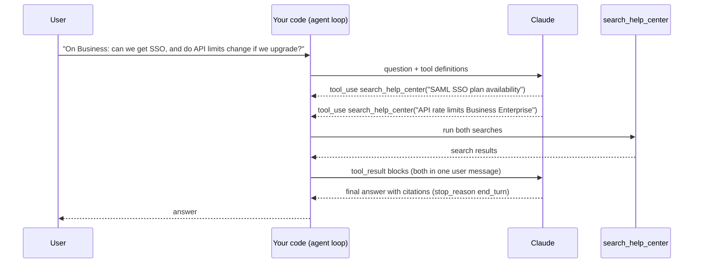

# Agentic RAG

## Introduction

In classic RAG, your code always runs one search with the user's question, pastes the results into the prompt, and asks the model to answer. The model has no say in what gets retrieved.

That works well for "How do I export my data?" It works poorly for questions like these:

- "We're on Business. Can we get SSO, and what happens to our API limits if we upgrade?" (two topics, so two searches)
- "My integration fails with ERR-4021 after I rotated keys yesterday. Is that expected?" (the user's words are not the best search query)
- "Thanks! Can you make that shorter?" (no search needed at all)

**Agentic RAG** turns retrieval into a **tool** the model can call. The model decides **whether** to search, **what** to search for, **which** source to search, and whether to **search again** after reading the results. Retrieval becomes one step in the [agent loop](../2-agents-tool-use/3-agents-manual-agent-loop.mdx) instead of a fixed preprocessing step.

An analogy: classic RAG is a research assistant who photocopies the first three pages that match your question and hands them over. Agentic RAG is a researcher who reads your question, runs several searches, follows up on what they find, and stops when they have enough.

This page builds an agentic RAG assistant for Acme Cloud with the Claude API. It covers tool design, a complete agent loop, citations from tool results, budgets, and when the extra cost is worth it.

## How It Differs from Classic RAG



In this example, Claude issued two searches in parallel in a single turn. It could also have searched once, read the results, and then searched again with a refined query. That is called **multi-hop** retrieval.

| | Classic RAG | Agentic RAG |
|---|---|---|
| Retrieval trigger | Always, once | Model decides, zero to many times |
| Query text | The user's message | Written by the model, can be rewritten |
| Multiple sources | You must route in code | Model picks the tool |
| LLM calls | 1 | 2 or more |
| Latency and cost | Low, predictable | Higher, variable |
| Failure modes | Bad retrieval | Bad retrieval, plus too many or too few searches |

## Designing the Retrieval Tool

The tool's name, description, and input schema are the model's only guide to using it. Good [tool design](../2-agents-tool-use/7-agents-tool-design-principles.mdx) matters even more here, because the model is writing search queries.

```python
SEARCH_TOOL = {
    "name": "search_help_center",
    "description": (
        "Search Acme Cloud's public help center articles. Returns the most relevant passages "
        "with their article IDs. Use it for questions about Acme Cloud features, plans, billing, "
        "security settings, API behavior, and error codes. Write short keyword-rich queries "
        "(for example 'SAML SSO plan availability'), not full sentences. For questions that "
        "cover several topics, search each topic separately. If results look irrelevant, "
        "try again with different wording before concluding the answer is not documented."
    ),
    "input_schema": {
        "type": "object",
        "properties": {
            "query": {
                "type": "string",
                "description": "Search query: key terms, product names, or exact error codes.",
            },
            "category": {
                "type": "string",
                "enum": ["billing", "security", "api", "data", "any"],
                "description": "Optional category filter. Use 'any' if unsure.",
            },
        },
        "required": ["query"],
        "additionalProperties": False,
    },
    "strict": True,
}
```

Design choices to notice:

- **The description says when to use it**, how to phrase queries, and what to do if results look bad. The model follows these instructions.
- **Filters are optional inputs**, with an `enum` so the model can't invent categories.
- **Access control is not a tool input.** The user's permissions come from your application, never from the model. A prompt-injected model must not be able to request `audience: internal`.
- `strict: True` makes the API guarantee the tool input matches the schema.

## Returning Results as `search_result` Blocks

You could return search results as a plain string. The Claude API also supports **`search_result` content blocks** inside a `tool_result`. Each one carries a `source`, a `title`, and the text content. When citations are enabled, Claude's answer comes back with citations that point at the exact result it used, in the same way it cites web search results.

```python
from anthropic.types import SearchResultBlockParam, TextBlockParam

# A tiny in-memory "index". In a real app this calls the hybrid search from earlier pages.
KB = [
    {"id": "kb-101", "category": "billing", "title": "Refund policy",
     "text": "Annual plans can be refunded within 30 days of purchase. Monthly plans are not refunded."},
    {"id": "kb-102", "category": "billing", "title": "Changing your plan",
     "text": "Upgrades take effect immediately and are prorated. Downgrades take effect at the next renewal date."},
    {"id": "kb-201", "category": "security", "title": "Setting up SAML SSO",
     "text": "SSO is available on the Business and Enterprise plans. Go to Settings > Security > SSO."},
    {"id": "kb-301", "category": "api", "title": "API rate limits",
     "text": "The REST API allows 600 requests per minute per workspace on Business and 3,000 on Enterprise."},
    {"id": "kb-302", "category": "api", "title": "Error codes",
     "text": "ERR-4021 means the API key was revoked. ERR-4090 means a webhook endpoint failed verification."},
]


def search_index(query: str, category: str = "any", k: int = 3) -> list[dict]:
    """Naive keyword-overlap search, standing in for real hybrid retrieval."""
    terms = set(query.lower().split())
    pool = [a for a in KB if category in ("any", a["category"])]
    scored = [(len(terms & set(f'{a["title"]} {a["text"]}'.lower().split())), a) for a in pool]
    return [a for score, a in sorted(scored, key=lambda s: s[0], reverse=True) if score > 0][:k]


def search_help_center(query: str, category: str = "any") -> list[SearchResultBlockParam] | str:
    hits = search_index(query, category)
    if not hits:
        return "No results found. Try different keywords or category 'any'."
    return [
        SearchResultBlockParam(
            type="search_result",
            source=f"https://help.acme.example/articles/{hit['id']}",
            title=f"{hit['id']}: {hit['title']}",
            content=[TextBlockParam(type="text", text=hit["text"])],
            citations={"enabled": True},
        )
        for hit in hits
    ]
```

Returning a helpful message on "no results" (instead of an empty list or an exception) lets the model decide to retry with a better query or tell the user it couldn't find anything.

:::note
All `search_result` blocks in a request must use the same citations setting (all enabled or all disabled). Citations can't be combined with structured outputs (`output_config.format`) in the same request. See [Citations and Grounding](./7-agents-citations-and-grounding.mdx) for details.
:::

## The Agent Loop

Here is a complete loop. It follows the rules for tool use with the Claude API:

- Keep looping while `stop_reason` is `"tool_use"`.
- Append the assistant's **full** `response.content` (not just the text) to the history.
- Run every `tool_use` block, and return **all** `tool_result` blocks in **one** user message.
- Mark failed tools with `is_error: True` so the model knows the call failed.
- Handle `max_tokens`, `pause_turn`, and `refusal` explicitly.
- Cap the number of iterations so a confused model can't loop forever.

```python
import anthropic
from anthropic import Anthropic

client = Anthropic()

SYSTEM = """You are Acme Cloud's support assistant.
Use the search_help_center tool to find facts before answering product questions.
Answer only from search results. If the help center doesn't cover something, say so plainly.
Do not search for greetings, thanks, or requests to rephrase your previous answer."""

TOOLS = {"search_help_center": search_help_center}
MAX_TURNS = 6


def run_tool(name: str, tool_input: dict) -> dict:
    """Execute one tool call and wrap the outcome as a tool_result payload (minus the id)."""
    try:
        result = TOOLS[name](**tool_input)
        return {"content": result}
    except Exception as exc:  # report the failure to the model instead of crashing the loop
        return {"content": f"Tool error: {exc}", "is_error": True}


def ask(question: str, history: list | None = None) -> tuple[anthropic.types.Message, list]:
    messages = list(history or []) + [{"role": "user", "content": question}]

    for turn in range(MAX_TURNS):
        response = client.messages.create(
            model="claude-opus-5-5",
            max_tokens=4096,
            system=SYSTEM,
            tools=[SEARCH_TOOL],
            messages=messages,
        )
        messages.append({"role": "assistant", "content": response.content})

        if response.stop_reason == "tool_use":
            results = []
            for block in response.content:
                if block.type == "tool_use":
                    print(f"  [turn {turn}] {block.name}({block.input})")
                    results.append({"type": "tool_result", "tool_use_id": block.id,
                                    **run_tool(block.name, block.input)})
            messages.append({"role": "user", "content": results})   # all results, one message
            continue

        if response.stop_reason == "pause_turn":
            # Only happens with server-side tools; re-send to let the model continue.
            continue
        if response.stop_reason == "refusal":
            raise RuntimeError("The model declined to answer this request.")
        if response.stop_reason == "max_tokens":
            raise RuntimeError("Answer was cut off; raise max_tokens or ask for a shorter answer.")
        return response, messages            # end_turn: final answer

    raise RuntimeError(f"Stopped after {MAX_TURNS} turns without a final answer.")
```

### Showing the answer with citations

When Claude uses search results with citations enabled, the final message contains text blocks, and some of them carry a `citations` list. Each citation of type `search_result_location` includes the `source`, `title`, and `cited_text`.

```python
def render(message: anthropic.types.Message) -> str:
    out, sources = [], []
    for block in message.content:
        if block.type != "text":
            continue
        out.append(block.text)
        for cite in block.citations or []:
            if cite.type == "search_result_location":
                if cite.source not in sources:
                    sources.append(cite.source)
                out.append(f"[{sources.index(cite.source) + 1}]")
    footer = "\n".join(f"[{i}] {src}" for i, src in enumerate(sources, start=1))
    return "".join(out) + ("\n\nSources:\n" + footer if footer else "")


final, history = ask("We're on Business. Can we use SSO, and do API limits change if we upgrade?")
print(render(final))
```

Example output:

```text
  [turn 0] search_help_center({'query': 'SAML SSO plan availability', 'category': 'security'})
  [turn 0] search_help_center({'query': 'API rate limits Business Enterprise', 'category': 'api'})
Yes. SSO is available on the Business and Enterprise plans, so you can set it up today[1].
If you upgrade to Enterprise, your API limit rises from 600 to 3,000 requests per minute per workspace[2].

Sources:
[1] https://help.acme.example/articles/kb-201
[2] https://help.acme.example/articles/kb-301
```

Claude split the question into two searches, wrote keyword-style queries (as the tool description asked), and chose category filters. A follow-up such as "Thanks, can you shorten that?" with `history` passed in should be answered without any search.

:::tip
The Anthropic Python SDK also has a **tool runner** (`client.beta.messages.tool_runner` with `@beta_tool` functions) that runs this loop for you. Frameworks such as LlamaIndex, LangGraph, and the OpenAI Agents SDK offer similar "retriever as a tool" helpers. Writing the loop by hand once, as here, makes it much easier to debug those abstractions later. See [Using an SDK Tool Runner](../2-agents-tool-use/4-agents-tool-runner.mdx).
:::

## Patterns Beyond a Single Search Tool

### Multiple retrieval tools

Give the agent separate tools for separate sources, each with a clear description: `search_help_center` (public docs), `search_past_tickets` (resolved support tickets, staff only), and `get_account_status` (live data from your API). The model routes each sub-question to the right source. Keep the set small and the descriptions distinct, because overlapping tools confuse the model. See [Working with Large Toolsets](../2-agents-tool-use/10-agents-large-toolsets.mdx).

### Search, then read

Return short snippets from `search_*`, and add a `get_article(article_id)` tool that returns a full article. The agent skims many results cheaply and reads only the one it needs, which keeps context small. This mirrors how people use a search engine.

### Query rewriting and multi-hop

The model naturally rewrites queries ("my key stopped working" becomes "API key revoked error"). For multi-hop questions ("Which plan do I need for SSO, and what is its API limit?") it can search for SSO, learn that Business is required, and then search for Business API limits. Encourage this in the tool description and system prompt.

### Retrieval in a subagent

For research-style tasks with many searches, run retrieval in a **subagent** with its own context window and return only a summary with citations to the main agent. This keeps the main conversation small. See [Subagents and Context Isolation](../8-agents-multi-agent-systems/8-agents-subagents-and-context-isolation.mdx).

## Budgets and Guardrails

Agentic RAG gives the model freedom, so you need limits:

| Risk | Guardrail |
|---|---|
| Endless search loops | `MAX_TURNS`, plus a cap on total tool calls per request |
| Cost blowups | Cap `k` and snippet length in tool results, and track tokens per request |
| Latency | Encourage parallel searches in one turn, use a faster model for simple routes |
| Searching when it shouldn't | System prompt rules ("don't search for greetings"), test cases in your eval set |
| Not searching when it should | "Search before answering product questions," plus eval cases that check a search happened |
| Prompt injection in results | Results are data, and tools that act (refunds, deletes) need [human approval](../12-agents-safety-and-security/1-agents-prompt-injection.mdx) |
| Data leaks | Permissions come from the session, never from tool inputs |

Evaluate agentic RAG on the **trajectory** (which searches it ran) as well as the final answer. See [Evaluating Agent Trajectories](../11-agents-evaluation-and-testing/3-agents-trajectory-evaluation.mdx).

## Real-World Scenario

**Acme Cloud's support console needs a troubleshooting copilot for support engineers.** Questions are messy: "Customer on Enterprise says webhooks fail with ERR-4090 since they moved to the EU region, and their export also timed out. Known issue?" Answering requires the error-code reference, the webhook setup guide, the data export article, and recent tickets with similar symptoms. Classic RAG retrieving five chunks for the whole paragraph returns a mix that covers none of the parts well.

**The solution** is an agent with three tools: `search_help_center`, `search_past_tickets` (restricted to staff sessions by the application), and `get_article`. Claude splits the question, searches each part, opens the most relevant article in full, checks tickets for the EU-region symptom, and writes a summary with citations to articles and ticket IDs. The loop is capped at 8 turns and 12 tool calls, and every trajectory is traced.

**Why this approach fits:** The questions are multi-part and the right query isn't the user's wording. Support engineers value thoroughness over a few extra seconds, and each answer saves minutes of manual searching.

**When to use agentic RAG:**

- Questions often have several parts or need follow-up searches.
- The assistant has several sources or also needs non-retrieval tools.
- Conversations mix questions that need retrieval with ones that don't.

**When not to:**

- Single-topic FAQ traffic at high volume. Classic RAG is cheaper, faster, and easier to test.
- Strict latency budgets (for example, voice assistants) where an extra model round trip is too slow.
- Regulated flows where you must show exactly which documents were consulted every time. A fixed pipeline is easier to audit, although agent traces can also serve.

**Alternatives and trade-offs:**

| Approach | Pros | Cons | Best for |
|---|---|---|---|
| Classic RAG (always retrieve once) | Cheap, fast, predictable | Can't decompose or refine queries | FAQ bots, high volume |
| Classic RAG + LLM query rewriting | Better queries, still one fixed pass | Extra LLM call on every request | Messy user wording, single topic |
| Agentic RAG, one search tool | Decides when and what to search, multi-hop | More calls, variable latency | General assistants |
| Agentic RAG, multiple tools | Routes across sources and live data | Tool confusion if descriptions overlap | Support and ops copilots |
| Retrieval subagent | Keeps main context clean for long research | Extra orchestration and cost | Deep research tasks |

## Common Mistakes

1. **Vague tool descriptions.** "Searches documents" gives the model nothing to work with. Say what's in the index, when to use it, and how to phrase queries.
2. **Letting the model choose permissions.** Never expose `audience`, `tenant_id`, or similar as tool inputs that the model controls.
3. **Returning huge results.** Ten full articles per search can consume tens of thousands of tokens per turn. Return snippets and offer a "read full article" tool.
4. **Returning tool results in separate messages.** All `tool_result` blocks for one assistant turn belong in a single user message.
5. **Dropping `response.content`.** Appending only the text breaks the loop, because the next request must include the `tool_use` blocks that the results refer to.
6. **No iteration cap.** A model that keeps rephrasing an unanswerable query will happily search ten times. Cap turns and tool calls.
7. **Testing only final answers.** Check whether the agent searched when it should have, and didn't when it shouldn't have.

## Summary

- Agentic RAG exposes retrieval as a tool, and the model decides whether, what, where, and how often to search.
- It excels at multi-part questions, query rewriting, and combining sources, at the cost of more latency, tokens, and test effort.
- Write tool descriptions that teach good querying, keep permissions out of tool inputs, and return compact results.
- With the Claude API, return `search_result` blocks from tools to get citations that point at your sources.
- Follow the agent loop rules: full assistant content, all tool results in one message, `is_error` on failures, explicit handling of every stop reason, and an iteration cap.
- Start with classic RAG. Move to agentic RAG when your evaluation shows questions that one search can't serve.

## Exercises

1. Run `ask` with "Thanks!" after a real question (passing `history`). Did the model search? Adjust the system prompt until it reliably doesn't.
2. Add a `get_article(article_id: str)` tool that returns a full article as a single `search_result`, and change `search_help_center` to return only the first sentence of each hit. Does answer quality change?
3. Add a tool-call counter and stop the loop after 5 calls with a polite "I couldn't finish researching this" message.
4. Write five multi-part questions and record how many searches the agent runs for each. Compare the cost with classic RAG on the same questions.

Next, learn how to make answers verifiable in [Citations and Grounding](./7-agents-citations-and-grounding.mdx).
