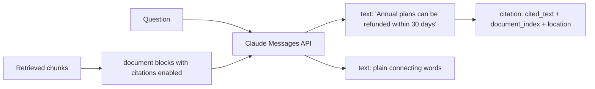

# Citations and Grounding

## Introduction

Retrieving the right passages is only half of RAG. The model still has to **use** them faithfully. Even with perfect retrieval, a model can:

- add a "fact" that is not in any source,
- mix up two sources (applying the Enterprise limit to the Business plan),
- answer from its general training knowledge instead of your documents,
- cite a source that doesn't say what the answer claims.

**Grounding** means every claim in the answer is supported by the provided sources. **Citations** make that support visible: each claim points to the exact passage it came from, so a user or reviewer can check it in seconds.

Think of a well-written research paper. You don't have to trust the author, because every claim has a footnote you can follow. Citations do the same for your assistant. They build user trust, make wrong answers quick to diagnose, and give you something you can verify automatically.

This page covers two approaches:

1. The **Claude API's built-in citations feature**, which returns structured pointers to the exact text used.
2. A **DIY approach** that works with any LLM: ask for source tags, then validate them in code.

## Grounding Starts with the Prompt

Before any citation mechanics, the instructions must make grounding the rule:

```text
Answer ONLY using the provided sources.
If the sources don't contain the answer, say "I couldn't find that in our documentation."
Do not use outside knowledge, even if you are confident.
If sources conflict, say so and cite both.
```

Two details matter more than they look:

- **An explicit "not found" path.** Without one, the model feels pressure to answer anyway.
- **Permission to say sources conflict.** Real knowledge bases contain outdated articles. Surfacing the conflict is better than silently picking one.

## The Claude Citations Feature

With the Claude API you can pass sources as **document** blocks with `"citations": {"enabled": True}`. The response then comes back as a list of text blocks, and blocks that make a claim carry a `citations` list pointing at the exact supporting text.



### Plain-text documents

The simplest form: one document per retrieved chunk. Claude splits plain-text documents into sentences, so it can cite individual sentences.

```python
from anthropic import Anthropic

client = Anthropic()

chunks = [
    ("kb-101", "Refund policy",
     "Annual plans can be refunded within 30 days of purchase. Monthly plans are not refunded, "
     "but you can cancel any time and keep access until the end of the billing period."),
    ("kb-102", "Changing your plan",
     "Upgrades take effect immediately and are prorated. Downgrades take effect at the next renewal date."),
]

documents = [
    {
        "type": "document",
        "source": {"type": "text", "media_type": "text/plain", "data": text},
        "title": f"{doc_id}: {title}",
        "context": "Acme Cloud help center article.",   # passed to the model, never cited
        "citations": {"enabled": True},
    }
    for doc_id, title, text in chunks
]

response = client.messages.create(
    model="claude-opus-5-5",
    max_tokens=1024,
    system="Answer only from the provided documents. If they don't cover it, say so.",
    messages=[{
        "role": "user",
        "content": documents + [
            {"type": "text", "text": "I'm on a monthly plan. Can I get a refund if I cancel?"}
        ],
    }],
)

for block in response.content:
    if block.type == "text":
        print(repr(block.text))
        for cite in block.citations or []:
            print("   ->", cite.type, cite.document_index, repr(cite.cited_text))
```

Example output:

```text
'No. '
'Monthly plans are not refunded'
   -> char_location 0 'Monthly plans are not refunded, but you can cancel any time and keep access until the end of the billing period.'
', but '
'you can cancel at any time and keep access until the end of your billing period'
   -> char_location 0 'Monthly plans are not refunded, but you can cancel any time and keep access until the end of the billing period.'
'.'
```

The citation fields depend on the document type:

| Document type | Citation type | Location fields |
|---|---|---|
| Plain text | `char_location` | `start_char_index`, `end_char_index` (0-indexed, end exclusive) |
| PDF | `page_location` | `start_page_number`, `end_page_number` (1-indexed, end exclusive) |
| Custom content | `content_block_location` | `start_block_index`, `end_block_index` (0-indexed, end exclusive) |
| `search_result` block | `search_result_location` | `search_result_index`, `start_block_index`, `end_block_index`, plus `source` and `title` |

Every citation also has `cited_text` (the exact source text) and identifies the source document. Because the API extracts `cited_text` from your document rather than the model retyping it, the quote is guaranteed to exist in the source. Anthropic's docs also note that `cited_text` doesn't count toward output tokens.

### Custom content documents for RAG chunks

If you want to control citation granularity yourself, for example citing whole chunks or bullet points rather than sentences, use a **custom content** document. You pass a list of text blocks, and Claude cites block ranges without splitting further.

```python
article_chunks = [
    "SSO is available on the Business and Enterprise plans.",
    "Go to Settings > Security > SSO and upload your IdP metadata XML.",
    "Test with one user before enforcing SSO for everyone.",
]

sso_document = {
    "type": "document",
    "source": {
        "type": "content",
        "content": [{"type": "text", "text": c} for c in article_chunks],
    },
    "title": "kb-201: Setting up SAML SSO",
    "citations": {"enabled": True},
}
```

A citation from this document has type `content_block_location`, and `start_block_index` tells you which chunk was used.

### Search results for agentic RAG

When retrieval happens inside a tool, return `search_result` blocks from the tool. Each carries your own `source` (a URL or an ID such as `kb://kb-201`) and `title`, and citations come back as `search_result_location` with those fields filled in. The full pattern is in [Agentic RAG](./6-agents-agentic-rag.mdx). You can also put `search_result` blocks directly in a user message if you retrieve before calling the model.

### Rendering citations as footnotes

Most UIs show numbered footnotes. Here is a helper that turns any response with citations into Markdown text and a source list:

```python
def to_footnotes(message, titles: list[str]) -> str:
    """Render text blocks with numbered footnotes. `titles` maps document_index to a label."""
    body, notes = [], {}
    for block in message.content:
        if block.type != "text":
            continue
        body.append(block.text)
        for cite in block.citations or []:
            if cite.type == "search_result_location":
                key = (cite.source, cite.cited_text)
                label = cite.title or cite.source
            else:
                key = (cite.document_index, cite.cited_text)
                label = titles[cite.document_index]
            if key not in notes:
                notes[key] = (len(notes) + 1, label, cite.cited_text)
            body.append(f"[^{notes[key][0]}]")
    lines = [f'[^{n}]: {label}: "{quote}"' for n, label, quote in notes.values()]
    return "".join(body) + "\n\n" + "\n".join(lines)


print(to_footnotes(response, titles=[f"{d}: {t}" for d, t, _ in chunks]))
```

Example output:

```text
No. Monthly plans are not refunded[^1], but you can cancel at any time and keep access until the end of your billing period[^1].

[^1]: kb-101: Refund policy: "Monthly plans are not refunded, but you can cancel any time and keep access until the end of the billing period."
```

### Rules and limits to know

- Citations must be enabled on **all or none** of the documents in a request.
- Citations **can't be combined with structured outputs** (`output_config.format`). The API returns a 400 error. If you need JSON output and citations, make two calls or use the DIY approach.
- `title` and `context` are passed to the model but are **not citable**. Put metadata such as URLs and dates in `context`.
- Citations work with **prompt caching**. Put `cache_control` on the document blocks when you reuse the same documents across requests, such as a long policy PDF that many users ask about.
- Enabling citations adds some input tokens for the citation instructions and document chunking.

Check the [citations documentation](https://platform.claude.com/docs/en/build-with-claude/citations) for the latest details. This feature evolves.

## DIY Citations (Any Provider)

Other providers have their own grounding features, and some don't have one. A portable approach works with any LLM:

1. Give every source a short, stable ID.
2. Instruct the model to cite IDs inline and to quote supporting text.
3. **Validate in code**: cited IDs must exist among the sources you sent, and quotes must appear in those sources.

```python
import re

SOURCES = {
    "kb-301": "The REST API allows 600 requests per minute per workspace on Business and 3,000 on "
              "Enterprise. Exceeding the limit returns HTTP 429 with a Retry-After header.",
    "kb-302": "ERR-4021 means the API key was revoked. ERR-4090 means a webhook endpoint failed verification.",
}

DIY_INSTRUCTIONS = """Answer using only the sources. After each sentence, add one or more citations
in the form [id: "exact quote from that source"]. Quotes must be copied word for word."""


def normalize(text: str) -> str:
    return re.sub(r"\s+", " ", text).strip().lower()


def verify_citations(answer: str, sources: dict[str, str]) -> dict:
    pattern = r'\[([\w-]+):\s*"([^"]+)"\]'
    found = re.findall(pattern, answer)
    problems = []
    for doc_id, quote in found:
        if doc_id not in sources:
            problems.append(f"unknown source {doc_id}")
        elif normalize(quote) not in normalize(sources[doc_id]):
            problems.append(f"quote not found in {doc_id}: {quote!r}")
    sentences = [s for s in re.split(r"(?<=[.!?])\s+", answer) if s.strip()]
    uncited = [s for s in sentences if not re.search(pattern, s)]
    return {"citations": len(found), "problems": problems, "has_uncited_text": bool(uncited)}


good = 'Business allows 600 requests per minute [kb-301: "600 requests per minute per workspace on Business"].'
bad = 'Business allows 1,000 requests per minute [kb-301: "1,000 requests per minute on Business"].'
print(verify_citations(good, SOURCES))
print(verify_citations(bad, SOURCES))
```

Output:

```text
{'citations': 1, 'problems': [], 'has_uncited_text': False}
{'citations': 1, 'problems': ["quote not found in kb-301: '1,000 requests per minute on Business'"], 'has_uncited_text': False}
```

The second answer would be blocked or regenerated. Quote verification catches the most dangerous failure: a confident claim with a fake citation.

What DIY verification **can't** catch: a real quote attached to a claim that doesn't follow from it ("The API allows 600 requests per minute" cited for "Enterprise allows 600 requests per minute"). For that you need a second check. Options include an LLM judge that compares each claim with its quote, or an entailment (natural language inference) model. See [Evaluating RAG Systems](./8-agents-rag-evaluation.mdx).

## Verifying Grounding After Generation

For high-stakes answers, add a cheap verification pass with a small model. Here `claude-haiku-5-5` checks each claim against the cited text and returns a structured verdict. Because this second call has no documents with citations enabled, structured outputs are allowed.

```python
from pydantic import BaseModel

from anthropic import Anthropic

client = Anthropic()


class ClaimCheck(BaseModel):
    claim: str
    supported: bool
    reason: str


class GroundingReport(BaseModel):
    checks: list[ClaimCheck]


def check_grounding(answer: str, sources: dict[str, str]) -> GroundingReport:
    source_text = "\n".join(f'<source id="{k}">{v}</source>' for k, v in sources.items())
    response = client.messages.parse(
        model="claude-haiku-5-5",
        max_tokens=2048,
        messages=[{
            "role": "user",
            "content": (
                f"<sources>\n{source_text}\n</sources>\n\n<answer>\n{answer}\n</answer>\n\n"
                "Split the answer into individual factual claims. For each claim, decide whether "
                "the sources fully support it. Unsupported includes claims that are partly right."
            ),
        }],
        output_format=GroundingReport,
    )
    return response.parsed_output


report = check_grounding("Enterprise allows 600 requests per minute.", SOURCES)
for check in report.checks:
    print(check.supported, "-", check.claim, "-", check.reason)
```

Example output:

```text
False - Enterprise allows 600 requests per minute. - The sources say 600 is the Business limit; Enterprise allows 3,000.
```

This adds latency and cost, so use it where errors are expensive (billing, legal, medical, security answers) or run it on a sample of traffic for monitoring.

## Real-World Scenario

**Acme Cloud's billing team is nervous.** The assistant once told a customer that monthly plans could be refunded within 30 days, which mixed up the annual and monthly rules. The customer quoted the bot in a chargeback dispute. Billing wants every billing answer to be verifiable and wants to know how often this happens.

The team changes three things:

1. **Built-in citations.** Retrieved chunks are sent as plain-text documents with citations enabled. The chat UI shows footnotes with the exact quoted policy text, and support staff can click through to the article.
2. **Uncited claims are flagged.** If a billing answer contains a sentence with no citation, the UI shows "Please confirm with our billing team" and logs the event.
3. **Sampled verification.** Ten percent of billing conversations get a `claude-haiku-5-5` grounding check. Unsupported claims go to a review queue, and the cases feed the evaluation set.

**Why this approach fits:** The cost of a wrong billing answer (refunds, disputes, trust) is far higher than a few extra tokens. Built-in citations give guaranteed-valid quotes without parsing. The sampled check measures the residual error rate without slowing every request.

**When to invest in citations:** Users act on answers (money, security, compliance), reviewers must audit answers, or you need to debug generation failures. **When lighter grounding is enough:** low-stakes internal tools where a list of retrieved sources below the answer is sufficient.

**Alternatives and trade-offs:**

| Approach | Pros | Cons | Best for |
|---|---|---|---|
| Show retrieved sources only (no inline citations) | Trivial | Doesn't show which claim came from where | Low-stakes internal search |
| Prompted `[id]` tags | Works with any model | Model can cite wrong or nonexistent IDs | Prototypes, any provider |
| Prompted quotes + code verification | Catches fabricated quotes, any provider | Can't catch misapplied real quotes, more output tokens | Portable production systems |
| Claude citations feature | Valid pointers guaranteed, precise locations, `cited_text` free of output tokens | Claude-specific, incompatible with structured outputs in the same call | Claude-based apps |
| Post-hoc LLM or NLI verification | Catches unsupported claims | Extra latency and cost, judge can err | High-stakes answers, monitoring |

## Common Mistakes

1. **Trusting a citation because it exists.** A prompted citation can point at a source that doesn't support the claim. Verify, or use a feature that guarantees valid pointers.
2. **Citing whole articles.** "Source: Refund policy" doesn't tell the user which sentence matters. Cite passages.
3. **Requesting citations and structured outputs together** with the Claude API. That combination returns an error. Split the work into two calls.
4. **Mixing enabled and disabled citations** across documents in one request. Enable them on all or none.
5. **Putting key facts in `title` or `context`.** Those fields can't be cited. Put citable content in the document source.
6. **No "not found" path.** Grounding instructions without an escape hatch push the model to stretch weak sources.
7. **Never measuring.** Track the rate of uncited or unsupported claims over time. It is one of the best health metrics for a RAG system.

## Summary

- Grounding means every claim is supported by the sources. Citations make that visible and checkable.
- The Claude API citations feature works with plain-text, PDF, custom content documents, and `search_result` blocks, and returns `cited_text` plus precise locations.
- Use custom content documents or `search_result` blocks to control citation granularity for RAG chunks.
- For any provider, ask for IDs and verbatim quotes, then validate them in code.
- Add an LLM or NLI grounding check where errors are costly, or sample it for monitoring.
- Citations and structured outputs can't be combined in one Claude request. Design around that.

## Exercises

1. Run the plain-text example, then ask a question the documents can't answer ("Do you offer student discounts?"). Inspect the response. Are there any citations?
2. Convert the same chunks to one custom content document and compare the citation granularity with plain-text documents.
3. Extend `verify_citations` to return the list of uncited sentences (not just a flag) and show them highlighted in a UI.
4. Build a set of ten answers, half with a deliberately wrong number, and measure how many `check_grounding` catches.

Next, measure all of this systematically in [Evaluating RAG Systems](./8-agents-rag-evaluation.mdx).
