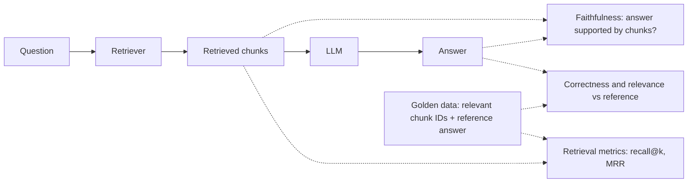

# Evaluating RAG Systems

## Introduction

Every page in this section has offered choices: chunk size, embedding model, top-k, hybrid search, reranking, prompts, citations. Each choice can make answers better or worse, and you can't tell which by trying three questions in a notebook. A change that fixes the question you were looking at often breaks two others you weren't.

**Evaluation** turns "it seems better" into a number you can compare. It is what lets you change a RAG system with confidence.

Think of it like unit tests for a search engine. You keep a list of questions with known right answers. Every time you change something, you rerun the list and look at the scores. A drop means you broke something, even if your favorite demo question still works.

A RAG system can fail in two places, so you evaluate both:

1. **Retrieval**: did we fetch the chunks that contain the answer?
2. **Generation**: given those chunks, did the model answer correctly and faithfully?

Separating them is the most important idea on this page. If you only score final answers, a bad score doesn't tell you whether to fix the retriever or the prompt.

## What to Measure



| Metric | Question it answers | Needs | How to compute |
|---|---|---|---|
| **Recall@k / hit rate** | Is a relevant chunk in the top k? | Labeled relevant IDs | Code |
| **MRR** (mean reciprocal rank) | How high is the first relevant chunk? | Labeled relevant IDs | Code |
| **Context precision** | How much of what we retrieved is relevant? | Labels or an LLM judge | Code or LLM |
| **Faithfulness** (groundedness) | Is every claim in the answer supported by retrieved chunks? | Answer + chunks | LLM judge |
| **Answer correctness** | Does the answer match the reference answer? | Reference answer | LLM judge or exact match |
| **Answer relevance** | Does the answer address the question? | Question + answer | LLM judge |
| **Refusal accuracy** | Does it say "not found" when it should, and only then? | Unanswerable questions | Code |
| **Citation validity** | Do citations exist and support the claims? | Citations + chunks | Code + judge |

## Step 1: Build a Golden Dataset

You need a set of questions, each labeled with the IDs of the chunks (or documents) that answer it, plus a short reference answer. Good sources:

- **Real user questions** from logs, support tickets, or search queries. These matter most.
- **Questions written by domain experts**, especially for important or tricky topics.
- **Synthetic questions** generated by an LLM from your documents. They are fast to produce, but review them, because they tend to reuse the document's exact wording and so are easier than real questions.
- **Unanswerable questions** that your knowledge base doesn't cover, to test the "not found" path.

Start with 30 to 100 examples. A small, high-quality set beats a large, sloppy one. See [Building Evaluation Datasets](../11-agents-evaluation-and-testing/1-agents-building-eval-sets.mdx).

```python
GOLDEN = [
    {"id": "q1", "question": "Can I get my money back on a yearly plan?",
     "relevant": ["kb-101"], "reference": "Yes, within 30 days of purchase."},
    {"id": "q2", "question": "What does ERR-4021 mean?",
     "relevant": ["kb-302"], "reference": "The API key was revoked."},
    {"id": "q3", "question": "How many API calls per minute on Enterprise?",
     "relevant": ["kb-301"], "reference": "3,000 requests per minute per workspace."},
    {"id": "q4", "question": "How long until account deletion is final?",
     "relevant": ["kb-402"], "reference": "After a 14-day grace period."},
    {"id": "q5", "question": "Do we need Business to use SAML?",
     "relevant": ["kb-201"], "reference": "SSO requires the Business or Enterprise plan."},
    {"id": "q6", "question": "Do you have an Android app?",
     "relevant": [], "reference": "NOT_FOUND"},                  # unanswerable on purpose
]
```

Store the set in version control (JSONL is convenient) and grow it every time a user reports a bad answer.

## Step 2: Retrieval Metrics in Code

Retrieval metrics need no LLM, so they are fast, cheap, and deterministic. Run them on every change.

```python
def recall_at_k(retrieved: list[str], relevant: list[str], k: int) -> float:
    """Fraction of relevant IDs found in the top k."""
    if not relevant:
        return 1.0
    return len(set(retrieved[:k]) & set(relevant)) / len(relevant)


def hit_at_k(retrieved: list[str], relevant: list[str], k: int) -> float:
    """1.0 if any relevant ID appears in the top k."""
    return float(bool(set(retrieved[:k]) & set(relevant))) if relevant else 1.0


def reciprocal_rank(retrieved: list[str], relevant: list[str]) -> float:
    for rank, doc_id in enumerate(retrieved, start=1):
        if doc_id in relevant:
            return 1.0 / rank
    return 0.0


def evaluate_retriever(search_fn, golden: list[dict], k: int = 5) -> dict:
    answerable = [g for g in golden if g["relevant"]]
    rows = []
    for g in answerable:
        retrieved = search_fn(g["question"], k)
        rows.append({
            "id": g["id"],
            "recall": recall_at_k(retrieved, g["relevant"], k),
            "hit": hit_at_k(retrieved, g["relevant"], k),
            "rr": reciprocal_rank(retrieved, g["relevant"]),
            "retrieved": retrieved,
        })
    n = len(rows)
    return {
        f"recall@{k}": sum(r["recall"] for r in rows) / n,
        f"hit@{k}": sum(r["hit"] for r in rows) / n,
        "mrr": sum(r["rr"] for r in rows) / n,
        "failures": [r for r in rows if r["hit"] == 0],
    }
```

Plug in any retriever that returns a ranked list of document IDs. Here is a vector-only retriever and a hybrid retriever (from [Hybrid Search and Reranking](./5-agents-hybrid-search-reranking.mdx)) compared side by side:

```python
def compare(retrievers: dict, golden: list[dict], k: int = 3) -> None:
    print(f"{'retriever':<12} {'recall@' + str(k):>9} {'mrr':>6}")
    for name, fn in retrievers.items():
        scores = evaluate_retriever(fn, golden, k)
        print(f"{name:<12} {scores[f'recall@{k}']:>9.2f} {scores['mrr']:>6.2f}")
        for failure in scores["failures"]:
            print(f"   miss: {failure['id']} got {failure['retrieved']}")

# compare({"vector": vector_ids, "hybrid": hybrid_ids}, GOLDEN, k=3)
```

Example output (on a larger version of the dataset):

```text
retriever    recall@3    mrr
vector           0.81   0.69
   miss: q2 got ['kb-301', 'kb-202', 'kb-401']
hybrid           0.94   0.85
```

The `miss` lines matter as much as the averages. Read every failure. They tell you *why* retrieval fails: missing context in chunks, exact codes, synonyms, or bad labels.

:::tip
Look at retrieval at the same `k` you actually send to the model. If you send 5 chunks, recall@5 is what limits answer quality. Recall@50 matters for the candidate stage before a reranker.
:::

## Step 3: Generation Metrics with an LLM Judge

Answers are free text, so string matching rarely works. "Within 30 days" and "You have a month to request it" can both be right. An **LLM judge** reads the question, the retrieved context, the answer, and the reference, then scores specific criteria.

Use a clear rubric, ask for a reason before the verdict, and use structured outputs so the result is machine-readable. A small, fast model such as `claude-haiku-5-5` is usually enough for narrow yes/no checks. Use a stronger model for subtle judgments, and check either one against human labels.

```python
from typing import Literal

from pydantic import BaseModel

from anthropic import Anthropic

client = Anthropic()


class Verdict(BaseModel):
    reasoning: str
    faithful: bool                       # every claim supported by the context
    correct: Literal["correct", "partially_correct", "incorrect"]
    answered_question: bool


JUDGE_PROMPT = """You are grading a support assistant's answer.

<question>{question}</question>
<context>{context}</context>
<reference_answer>{reference}</reference_answer>
<answer>{answer}</answer>

Rules:
- faithful: true only if EVERY factual claim in the answer is supported by the context.
  Claims from outside knowledge count as unfaithful even if they are true.
- correct: compare the answer's meaning to the reference answer. Wording doesn't matter.
  If the reference is NOT_FOUND, the answer is correct only if it says the information isn't available.
- answered_question: true if the answer addresses what was asked.
Explain your reasoning briefly first."""


def judge(question: str, context: str, answer: str, reference: str) -> Verdict:
    response = client.messages.parse(
        model="claude-haiku-5-5",
        max_tokens=1024,
        messages=[{"role": "user", "content": JUDGE_PROMPT.format(
            question=question, context=context, reference=reference, answer=answer)}],
        output_format=Verdict,
    )
    return response.parsed_output


verdict = judge(
    question="Can I get my money back on a yearly plan?",
    context="kb-101: Annual plans can be refunded within 30 days of purchase. Monthly plans are not refunded.",
    answer="Yes, annual plans are refundable within 60 days.",
    reference="Yes, within 30 days of purchase.",
)
print(verdict.faithful, verdict.correct, "-", verdict.reasoning)
```

Example output:

```text
False incorrect - The context says 30 days, but the answer says 60 days, which is unsupported and contradicts the reference.
```

### Faithfulness vs correctness

These two metrics separate failure causes:

| Faithful? | Correct? | What it means | Where to look |
|---|---|---|---|
| Yes | Yes | Working as intended | — |
| Yes | No | Answer matches the retrieved text, but the text was wrong or incomplete | Retrieval or the documents themselves |
| No | Yes | Right by luck or from training knowledge | Prompt: enforce grounding |
| No | No | Model made things up | Prompt, model choice, citations |

### Calibrate the judge

An LLM judge is a model too, and it can be wrong. Before trusting it:

1. Have a person label 30 to 50 answers with the same rubric.
2. Run the judge on the same answers and measure agreement.
3. Read the disagreements and fix the rubric, which is usually ambiguous wording.
4. Re-check agreement whenever you change the judge prompt or model.

See [Grading Methods: Code, Rubrics and LLM Judges](../11-agents-evaluation-and-testing/2-agents-grading-methods.mdx) for more on judge design.

## Step 4: Run the Whole Suite

```python
import json
import statistics


def run_eval(golden: list[dict], retrieve_fn, answer_fn, k: int = 5) -> dict:
    """retrieve_fn(question, k) -> list of (doc_id, text); answer_fn(question, hits) -> str"""
    results = []
    for g in golden:
        hits = retrieve_fn(g["question"], k)
        answer = answer_fn(g["question"], hits)
        context = "\n".join(f"{doc_id}: {text}" for doc_id, text in hits)
        verdict = judge(g["question"], context, answer, g["reference"])
        results.append({
            "id": g["id"],
            "hit": hit_at_k([d for d, _ in hits], g["relevant"], k),
            "faithful": verdict.faithful,
            "correct": verdict.correct == "correct",
            "reasoning": verdict.reasoning,
        })
    summary = {
        "hit_rate": statistics.mean(r["hit"] for r in results),
        "faithfulness": statistics.mean(r["faithful"] for r in results),
        "correctness": statistics.mean(r["correct"] for r in results),
    }
    with open("eval_results.jsonl", "w") as f:
        for row in results:
            f.write(json.dumps(row) + "\n")
    return summary
```

Example output:

```text
{'hit_rate': 0.92, 'faithfulness': 0.96, 'correctness': 0.88}
```

Save per-question results, not just averages, so you can diff two runs and see exactly which questions changed.

## Using RAGAS

[RAGAS](https://docs.ragas.io/) is a popular open-source library of RAG metrics. Its RAG metrics include **Faithfulness**, **Response Relevancy**, **Context Precision**, **Context Recall**, **Context Entities Recall**, and **Noise Sensitivity**. Each one is implemented with LLM prompts and, for some, embeddings.

Most RAGAS metrics take the same fields you already have: `user_input` (the question), `response` (the answer), `retrieved_contexts` (chunk texts), and optionally `reference` (the reference answer). Some context precision variants work without an LLM by comparing retrieved and reference context IDs or texts.

```python
# Shape of a RAGAS faithfulness evaluation (check the docs for your installed version).
import asyncio

from ragas.metrics.collections import Faithfulness


async def main(evaluator_llm) -> None:
    # evaluator_llm is created with ragas.llms.llm_factory(...); see the RAGAS docs
    # for the providers and arguments your version supports.
    scorer = Faithfulness(llm=evaluator_llm)
    result = await scorer.ascore(
        user_input="When does account deletion become permanent?",
        response="Deletion is permanent after a 14-day grace period.",
        retrieved_contexts=["Account deletion is permanent after a 14-day grace period."],
    )
    print(result.value)

# asyncio.run(main(evaluator_llm))
```

:::caution
RAGAS's API has changed between versions. Recent docs show a "collections" metrics API (as above) and mark the older `SingleTurnSample` / `evaluate()` style for deprecation. Pin the version you use and follow the docs for that version. Also note that library metrics are LLM judges with their own prompts: calibrate them against human labels just like your own judge.
:::

Other tools in this space include DeepEval, TruLens, Arize Phoenix, LangSmith, and the evaluation features of LlamaIndex. They differ mostly in workflow (tracing, dashboards, CI integration) rather than in the core ideas on this page.

## Regression Testing in CI

Treat the eval suite like tests:

- **On every change** to chunking, embeddings, retrieval settings, or prompts, run retrieval metrics (cheap and deterministic) and fail the build if recall@k drops below a threshold.
- **Nightly or before release**, run the full suite with LLM judges, since it is slower and costs money.
- **Track trends.** Plot metrics per run. Small drops add up.
- **Account for noise.** LLM answers and judges vary between runs. Run important comparisons more than once, or on a larger set, before concluding one version is better.

```python
def test_retrieval_recall_does_not_regress():
    scores = evaluate_retriever(hybrid_ids, GOLDEN, k=5)
    assert scores["recall@5"] >= 0.90, scores["failures"]
```

See [Regression Testing for Agents](../11-agents-evaluation-and-testing/6-agents-regression-testing.mdx) for wiring this into a pipeline.

## Real-World Scenario

**Acme Cloud wants to switch embedding models and add reranking**, but the last "improvement" (bigger chunks) quietly made error-code questions worse, and nobody noticed for two weeks. The support lead now insists that no retrieval change ships without numbers.

The team builds an evaluation workflow:

1. **Golden set.** 120 questions from real tickets, labeled with article IDs by two support agents, plus 20 unanswerable questions. Disagreements between labelers get resolved and documented.
2. **Retrieval gate in CI.** Hit@5 and MRR for every pull request that touches the indexing or retrieval code. The build fails if hit@5 drops more than two points.
3. **Weekly full eval.** Faithfulness, correctness, and refusal accuracy with a `claude-haiku-5-5` judge, calibrated against 50 human-labeled answers.
4. **Feedback loop.** Every thumbs-down in production is reviewed. If it reveals a new failure type, the question joins the golden set.

The embedding switch improves hit@5 on paraphrased questions but slightly lowers it on error codes. Adding hybrid search recovers the codes. The team ships both together, with numbers to show for it.

**Why this approach fits:** Retrieval metrics are cheap enough to run on every change, while judge-based metrics catch generation issues at a cadence that fits their cost. Labeled article IDs make retrieval metrics exact.

**When to invest heavily:** Users act on answers, or the system changes often. **When lighter is fine:** an internal prototype, where 20 questions you check by hand may be enough to start. But start *something* early, since a golden set is much harder to build after launch.

**Alternatives and trade-offs:**

| Approach | Pros | Cons | Best for |
|---|---|---|---|
| Manual spot checks | No setup | Not repeatable, biased toward demo questions | First prototype only |
| Retrieval metrics (recall@k, MRR) | Fast, cheap, deterministic | Need labeled relevant IDs, says nothing about answers | Every code change |
| Custom LLM judge | Tailored rubric, scores answers | Costs money, must be calibrated | Generation quality |
| RAGAS or similar library | Ready-made metrics, quick start | Generic prompts, API churn, still needs calibration | Teams starting out, benchmarking |
| Human review | Highest-quality signal | Slow and expensive | Calibration, high-stakes domains |
| Online signals (thumbs, escalations) | Real users, real questions | Sparse and noisy, after the fact | Finding new failure types |

## Common Mistakes

1. **Only scoring final answers.** You won't know whether to fix retrieval or generation. Measure both separately.
2. **An eval set made only of easy, synthetic questions.** It will say everything is great. Use real questions, including messy and unanswerable ones.
3. **Trusting an uncalibrated judge.** Check judge agreement with humans before relying on its numbers.
4. **Looking only at averages.** Read the failures. One systematic failure type can hide behind a decent average.
5. **Changing several things at once.** If chunking, embeddings, and prompt change together, you can't tell which helped. Change one thing per experiment when you can.
6. **Leaking answers into the context.** If the reference answer accidentally appears in the prompt, scores are meaningless.
7. **Never updating the set.** Products change, so the golden set must too. Stale labels produce misleading scores.

## Summary

- Evaluate **retrieval** and **generation** separately, so a bad score tells you what to fix.
- Build a golden dataset of real questions with labeled relevant chunks, reference answers, and unanswerable cases.
- Recall@k, hit rate, and MRR are cheap code-based metrics. Run them on every change.
- Use a calibrated LLM judge with a clear rubric and structured outputs for faithfulness and correctness.
- Libraries like RAGAS package common metrics, but pin versions and calibrate them too.
- Wire evaluation into CI, read failures, and grow the dataset from production feedback.

## Exercises

1. Write 20 golden questions for a knowledge base you know, including 4 unanswerable ones. Label the relevant document IDs.
2. Run `evaluate_retriever` with k equal to 1, 3, 5, and 10. Plot recall@k. Where does it level off?
3. Label 20 answers by hand as faithful or not, run the judge, and compute the agreement rate. Fix one rubric ambiguity and re-measure.
4. Add a retrieval-recall test to a CI workflow that fails if recall@5 drops below your current baseline.

Next, consider whether you need retrieval at all in [RAG vs Long Context](./9-agents-rag-vs-long-context.mdx). For evaluation of agents more broadly, see [Agent Evaluation Introduction](../11-agents-evaluation-and-testing/0-agents-evaluation-introduction.mdx).
