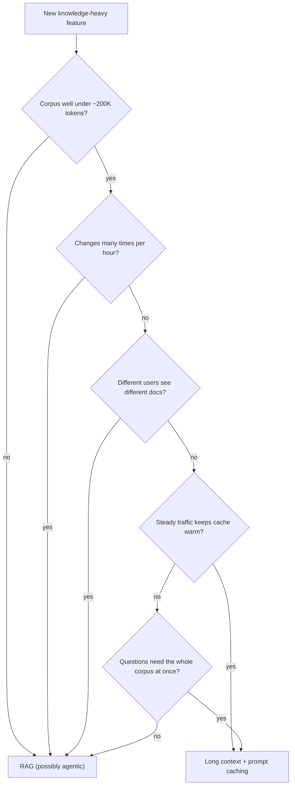

# RAG vs Long Context

## Introduction

RAG was invented when models could read only a few thousand tokens at a time. You *had* to pick a few relevant passages because nothing else fit. Today, current Claude models accept up to **1 million tokens** of input, and other providers offer similarly large windows. One million tokens is very roughly a few thousand pages of English text.

So a fair question is: **why not just put all the documents in the prompt?** No chunking, no embeddings, no vector database, no retrieval errors. The model sees everything.

Sometimes that is the right answer. Anthropic's own [Contextual Retrieval](https://www.anthropic.com/engineering/contextual-retrieval) guidance says that if your knowledge base is smaller than about 200,000 tokens (around 500 pages), you can often skip RAG and include the whole thing in the prompt, using **prompt caching** to keep it fast and affordable.

Other times it is a costly mistake. This page compares the two approaches honestly, gives you a cost calculator you can adapt, and shows hybrid patterns that use both.

An analogy: long context is handing the model the entire binder and asking it to find the answer. RAG is handing it the three pages a librarian picked. The binder never misses a page but takes longer to read and costs more every time. The librarian is fast and cheap but sometimes picks the wrong pages.

## What Long Context Looks Like in Practice

With long context, the "pipeline" is just a prompt. The whole knowledge base goes into a stable prefix, and only the question changes.

```python
from pathlib import Path

from anthropic import Anthropic

client = Anthropic()

# Concatenate every help article into one block (IDs make citing possible).
articles = sorted(Path("kb").glob("*.md"))
knowledge_base = "\n\n".join(
    f'<article id="{p.stem}">\n{p.read_text(encoding="utf-8")}\n</article>' for p in articles
)

SYSTEM = [
    {"type": "text", "text": "You are Acme Cloud's support assistant. Answer only from the articles "
                             "below and cite article IDs like [kb-101]. If they don't cover the "
                             "question, say so."},
    {
        "type": "text",
        "text": f"<articles>\n{knowledge_base}\n</articles>",
        "cache_control": {"type": "ephemeral"},     # cache everything up to here
    },
]


def ask(question: str) -> str:
    response = client.messages.create(
        model="claude-opus-5-5",
        max_tokens=1024,
        system=SYSTEM,
        messages=[{"role": "user", "content": question}],
    )
    u = response.usage
    print(f"input={u.input_tokens} cache_write={u.cache_creation_input_tokens} "
          f"cache_read={u.cache_read_input_tokens}")
    return next(b.text for b in response.content if b.type == "text")


print(ask("Can I get a refund on an annual plan?"))
print(ask("What does ERR-4090 mean?"))
```

Example output:

```text
input=14 cache_write=182340 cache_read=0
Yes. Annual plans can be refunded within 30 days of purchase [kb-101].
input=13 cache_write=0 cache_read=182340
ERR-4090 means a webhook endpoint failed verification [kb-302].
```

The first request **writes** the knowledge base to the cache. The second request **reads** it from cache, which is much cheaper and faster than processing it from scratch. Only the question is processed at the full price.

### How prompt caching works (the parts that matter here)

Prompt caching is covered in depth in [Prompt Caching](../4-agents-memory-and-context/4-agents-prompt-caching.mdx). The facts that drive the RAG vs long-context decision are:

- **It is a prefix match.** The cached part must be byte-for-byte identical across requests. Changing one character in any article invalidates the cache from that point onward.
- **Reads are cheap, writes cost extra.** At the time of writing, cache reads cost about 0.1x the normal input price on most Claude models (0.05x on Claude Opus 5.5 and Claude Sonnet 5.5). Cache writes cost 1.25x for the default 5-minute lifetime, or 2x for the 1-hour option.
- **Entries expire.** The default cache lives about 5 minutes and is refreshed each time it is read. A 1-hour lifetime is available at a higher write price. If traffic is sparse, you keep paying for writes.
- **Up to 4 cache breakpoints** per request, so you can cache, for example, tools, a shared knowledge base, and the conversation history separately.
- **Caches are scoped** (per workspace on the Claude API) and are never shared across organizations.

Check the [pricing page](https://platform.claude.com/docs/en/about-claude/pricing) and the prompt caching docs for current numbers. Prices and multipliers change.

## A Back-of-Envelope Cost Calculator

Let's compare cost per question for both approaches. The prices below are **assumptions** taken from Anthropic's published list prices at the time of writing for Claude Opus 5.5. Replace them with current prices for your model.

```python
# ---- Assumptions (USD per million tokens). Check current pricing before relying on these. ----
INPUT_PRICE = 4.00          # normal input
OUTPUT_PRICE = 20.00        # output
CACHE_READ_PRICE = 0.20     # cache read (0.05x input on this model)
CACHE_WRITE_PRICE = 5.00    # 5-minute cache write (1.25x input)

M = 1_000_000


def long_context_cost(kb_tokens: int, question_tokens: int, output_tokens: int,
                      queries_per_cache_write: int) -> float:
    """Cost per query when the whole KB is cached. One write is amortized over N reads."""
    write = kb_tokens * CACHE_WRITE_PRICE / M / queries_per_cache_write
    read = kb_tokens * CACHE_READ_PRICE / M
    fresh = question_tokens * INPUT_PRICE / M
    return write + read + fresh + output_tokens * OUTPUT_PRICE / M


def rag_cost(chunks: int, chunk_tokens: int, prompt_overhead: int, output_tokens: int) -> float:
    """Cost per query when only retrieved chunks are sent (retrieval infra cost not included)."""
    tokens_in = chunks * chunk_tokens + prompt_overhead
    return tokens_in * INPUT_PRICE / M + output_tokens * OUTPUT_PRICE / M


OUTPUT = 300
for kb_tokens in (50_000, 200_000, 600_000):
    lc_busy = long_context_cost(kb_tokens, 50, OUTPUT, queries_per_cache_write=100)
    lc_sparse = long_context_cost(kb_tokens, 50, OUTPUT, queries_per_cache_write=1)
    rag = rag_cost(chunks=8, chunk_tokens=500, prompt_overhead=800, output_tokens=OUTPUT)
    print(f"KB {kb_tokens:>7,} tokens | long context busy ${lc_busy:.4f}  sparse ${lc_sparse:.4f} | RAG ${rag:.4f}")
```

Output:

```text
KB  50,000 tokens | long context busy $0.0187  sparse $0.2662 | RAG $0.0252
KB 200,000 tokens | long context busy $0.0562  sparse $1.0462 | RAG $0.0252
KB 600,000 tokens | long context busy $0.1562  sparse $3.1262 | RAG $0.0252
```

What the numbers say under these assumptions:

- **Busy traffic, small knowledge base:** long context with caching costs about the same as RAG. Since it removes retrieval errors and infrastructure, it is very attractive.
- **Larger knowledge base:** long-context cost per query grows linearly with the corpus, even when cached. RAG's cost stays flat because it sends the same few chunks regardless of corpus size.
- **Sparse traffic:** if the cache expires between questions, every request pays to write the whole knowledge base. Long context gets expensive fast.
- **Output tokens** are the same in both approaches, so they don't change the comparison.

RAG has costs this calculator ignores: embedding the corpus, running a vector database, and the engineering time to build and evaluate retrieval. For a small team with a small corpus, those can outweigh a few cents per query.

:::note
The 1M-token window is a limit, not a target. Even with caching, a request that processes hundreds of thousands of tokens takes longer before the first output token appears than a request with 5,000 tokens. Measure time-to-first-token for your own workload if latency matters.
:::

## Reducing Cache Invalidation with Two Breakpoints

A single cached block has a weakness: editing any article rewrites the whole cache. If most of your corpus is stable and a small part changes daily, split it into two cached blocks, stable first. An edit to the volatile block then rewrites only that block, and the stable prefix keeps getting cache hits.

```python
from anthropic import Anthropic

client = Anthropic()


def build_system(stable_articles: list[str], volatile_articles: list[str]) -> list[dict]:
    return [
        {"type": "text", "text": "You are Acme Cloud's support assistant. Answer only from the "
                                 "articles and cite their IDs."},
        {
            "type": "text",
            "text": "<stable_articles>\n" + "\n\n".join(stable_articles) + "\n</stable_articles>",
            "cache_control": {"type": "ephemeral", "ttl": "1h"},   # rarely changes
        },
        {
            "type": "text",
            "text": "<recent_articles>\n" + "\n\n".join(volatile_articles) + "\n</recent_articles>",
            "cache_control": {"type": "ephemeral"},                # changes daily, 5-minute TTL
        },
    ]


def ask(question: str, system: list[dict]) -> str:
    response = client.messages.create(
        model="claude-opus-5-5",
        max_tokens=1024,
        system=system,
        messages=[{"role": "user", "content": question}],
    )
    return next(b.text for b in response.content if b.type == "text")
```

Two rules from the caching docs apply here. Entries with the longer TTL must come before entries with the shorter TTL, which is why the 1-hour block is first. And a request can have at most four breakpoints in total, so plan them across tools, system content, and conversation history.

This pattern is sometimes called **cache-augmented generation**: preload a knowledge base into a cached context instead of retrieving per query. It works best when the knowledge base is small and the stable portion is large.

## Beyond Cost: The Honest Trade-offs



### Accuracy

- **Long context avoids retrieval misses.** If the answer is anywhere in the prompt, the model *can* find it. RAG fails silently when the right chunk isn't retrieved.
- **But attention is not uniform.** Research such as "Lost in the Middle" (Liu et al.) found that models used information at the start and end of long inputs more reliably than information buried in the middle. Newer models handle long inputs much better than the models in that study, but performance can still degrade as context grows and fills with similar, distracting passages. Simple "needle in a haystack" tests are easier than real questions that require combining several facts.
- **Whole-corpus questions** ("What are the common themes across all customer complaints?") are where long context shines. RAG's top-k only sees a handful of chunks. See also [Graph RAG](./10-agents-graph-rag.mdx).

The only reliable way to know which is more accurate for your questions is to run both on the same evaluation set. See [Evaluating RAG Systems](./8-agents-rag-evaluation.mdx).

### Freshness

Any edit to a cached knowledge base invalidates the cache from that point onward. If articles change every few minutes, the cache constantly rewrites. RAG updates only the changed chunks, and the next query sees them immediately. One mitigation is to order content by stability (rarely changing articles first) and put a cache breakpoint after the stable part.

### Access control and multi-tenancy

With RAG, permissions are a filter in the retrieval query. With long context, each distinct set of documents is a different prompt and a different cache entry. For a SaaS app where every customer has private documents, a per-tenant knowledge base can still work if each tenant's corpus is small and busy enough to keep a cache warm. Once each user sees a unique combination of documents, long context loses most of its caching advantage.

### Debuggability and citations

RAG logs show exactly which chunks were considered. With long context, you know the model saw everything, but not what it relied on. Citations help in both cases: the Claude citations feature works on long documents too. See [Citations and Grounding](./7-agents-citations-and-grounding.mdx).

### Context budget for agents

An agent's context window also holds the system prompt, tool definitions, conversation history, and tool results. A 600K-token knowledge base leaves less room for a long agentic session and makes every turn heavier. See [Context Engineering](../4-agents-memory-and-context/0-agents-context-engineering.mdx).

## Making Long Context Work Well

If you choose long context, a few prompt-structure habits make a noticeable difference. They follow Anthropic's long-context prompting advice and apply to most models:

1. **Put the documents first and the question last.** Long material at the top, then instructions and the question at the end of the prompt.
2. **Wrap each document in tags with metadata**, such as `<article id="kb-101" title="Refund policy" updated="2026-09-02">`. The model can tell documents apart, cite them, and prefer newer ones when they conflict.
3. **Ask the model to quote first.** For hard questions, ask it to pull the relevant quotes into a scratch section before answering. This helps it find the needle and gives you something to check. With the Claude API, the citations feature does this for you.
4. **Order content by stability, not importance.** For caching, put content that never changes first and content that changes often last, so an edit invalidates as little of the cache as possible.
5. **Keep per-request data out of the cached prefix.** The user's name, account details, and the current date go after the knowledge base, in the user message.

## Running a Head-to-Head Test

Opinions about RAG and long context are cheap. A comparison on your own questions is not much more expensive. The harness below runs the same questions through both approaches and records correctness, input tokens, and latency. It reuses the `judge` function from [Evaluating RAG Systems](./8-agents-rag-evaluation.mdx) and assumes you have a long-context `ask_long` and a RAG `ask_rag` that each return `(answer_text, usage)`.

```python
import statistics
import time


def head_to_head(golden: list[dict], approaches: dict, judge_fn) -> None:
    """approaches: name -> function(question) returning (answer_text, usage, context_text)."""
    for name, ask_fn in approaches.items():
        correct, tokens, latencies = [], [], []
        for item in golden:
            start = time.perf_counter()
            answer, usage, context = ask_fn(item["question"])
            latencies.append(time.perf_counter() - start)
            total_in = (usage.input_tokens + usage.cache_read_input_tokens
                        + usage.cache_creation_input_tokens)
            tokens.append(total_in)
            verdict = judge_fn(item["question"], context, answer, item["reference"])
            correct.append(verdict.correct == "correct")
        latencies.sort()
        p90 = latencies[int(0.9 * (len(latencies) - 1))]
        print(f"{name:<14} correct={statistics.mean(correct):.0%} "
              f"avg_input_tokens={statistics.mean(tokens):,.0f} p90_latency={p90:.1f}s")

# head_to_head(GOLDEN, {"long_context": ask_long, "rag": ask_rag}, judge)
```

Example output (illustrative, from a mid-sized help center):

```text
long_context   correct=91% avg_input_tokens=182,410 p90_latency=6.8s
rag            correct=88% avg_input_tokens=5,120 p90_latency=2.9s
```

Numbers like these turn the decision into a business question: is a few points of accuracy worth the extra cost and latency for this product? The answer differs between an internal HR bot and a high-volume customer chat. Also check *which* questions each approach got wrong. If RAG's misses are all retrieval failures on one topic, better chunking or hybrid search may close the gap.

## Summary Comparison

| Factor | Long context + caching | RAG |
|---|---|---|
| Setup effort | Very low | Moderate to high |
| Retrieval misses | None | Possible, must be measured |
| Cost per query | Grows with corpus size | Roughly flat |
| Sparse traffic | Expensive (cache writes) | Unaffected |
| Latency | Grows with corpus size | Low, plus retrieval time |
| Frequent updates | Invalidate cache | Cheap incremental updates |
| Per-user permissions | Awkward | Natural (metadata filters) |
| Whole-corpus questions | Strong | Weak without extra techniques |
| Corpus beyond the window | Impossible | No limit |
| Debugging | Can't see what was relied on | Retrieval logs |

## Hybrid Patterns

You don't have to pick one. Common combinations:

1. **Retrieve generously, then read deeply.** Use retrieval to pick the top 20 *documents* (not chunks), and put those whole documents in a large context. This keeps the precision of search while the model gets full context around each hit.
2. **Cache the core, retrieve the long tail.** Put the 50 most-asked-about articles in a cached prefix and retrieve from the rest only when needed. The agent gets a search tool for everything else. See [Agentic RAG](./6-agents-agentic-rag.mdx).
3. **Route by question type.** A cheap classifier sends "summarize everything about X" questions to a long-context path and specific lookups to RAG.
4. **Per-session long context.** When a user uploads a contract or a log file, put that one document in context (and cache it for the session), and use RAG over the company knowledge base alongside it.

## Real-World Scenario

**Acme Cloud runs two assistants with very different profiles.**

1. **The HR policy assistant** for 300 employees. The handbook is about 120,000 tokens, changes a few times a month, and every employee sees the same content. Traffic comes in bursts.
2. **The customer support assistant.** The help center is about 900,000 tokens and growing, articles change daily, some articles are customer-specific, and traffic is steady at thousands of questions per day.

**For the HR assistant, the team chooses long context with prompt caching.** The whole handbook fits comfortably in one cached system block. They use the 1-hour cache lifetime because questions arrive in bursts with quiet gaps, and they accept a cache write a few times a day. There is no vector database to run, no chunking to tune, and no retrieval misses. Evaluation shows accuracy at least as good as their RAG prototype.

**For the support assistant, they keep RAG.** The corpus is already close to the context limit and growing. Per-customer articles require filters, daily edits would constantly invalidate a cache, and the cost calculator shows RAG is several times cheaper per query at their volume. They do adopt hybrid pattern 1: after reranking, the top three *whole articles* go into the prompt instead of isolated chunks.

**Why these choices fit:** The decision follows the corpus size, change rate, permission model, and traffic pattern, not a belief that one technique is better.

**When to prefer long context:** small, stable, shared corpus, steady traffic, questions that need broad context. **When to prefer RAG:** large or growing corpus, frequent updates, per-user permissions, strict cost or latency budgets, or a need for retrieval logs.

**Alternatives and trade-offs:**

| Approach | Pros | Cons | Best for |
|---|---|---|---|
| Long context without caching | Simplest possible | Full input price on every request | Rare one-off analyses |
| Long context + prompt caching | No retrieval errors, low ops | Cost grows with corpus, cache invalidation, shared-content only | Small, stable, busy corpora |
| Classic RAG | Flat cost, fresh, permission-aware | Retrieval misses, more infrastructure | Large or dynamic corpora |
| Retrieve documents, then long context | High recall, full context around hits | More tokens than chunk RAG | Complex documents (contracts, specs) |
| Cached core + agentic retrieval | Fast common answers, coverage of the tail | Two mechanisms to maintain | Assistants with a skewed question distribution |

## Common Mistakes

1. **Assuming "it fits" means "it's the best choice."** Fitting in the window says nothing about cost per query, latency, or accuracy on your questions.
2. **Breaking the cache with a dynamic prefix.** A timestamp, user name, or shuffled article order before the knowledge base makes every request a cache write. Keep the cached prefix identical and put per-request content after it.
3. **Ignoring traffic patterns.** Caching only pays off if requests arrive before the cache expires. Model your real request gaps.
4. **Not checking the usage fields.** `cache_read_input_tokens` staying at zero means you are paying for a write on every request. Monitor it.
5. **Putting private documents in a shared prefix.** Anyone whose request uses that prompt can get answers from those documents. Long context needs per-audience prompts.
6. **Comparing approaches without an eval set.** Run both on the same questions before deciding.

## Summary

- Current Claude models accept up to 1M input tokens, and prompt caching makes reusing a large, stable prefix much cheaper and faster.
- For small, stable, shared corpora (roughly under 200K tokens), long context with caching is often simpler and at least as accurate as RAG.
- Long-context cost and latency grow with corpus size, caches are invalidated by edits, and per-user permissions are awkward.
- RAG keeps cost flat as the corpus grows, updates incrementally, and filters by permission, but it can miss relevant chunks.
- Hybrid patterns, such as retrieving whole documents into a large context or caching the core while retrieving the tail, often beat either extreme.
- Decide with your own cost model and evaluation set, and re-check as prices and models change.

## Exercises

1. Adapt the cost calculator with current prices for the model you use. Find the knowledge-base size at which RAG becomes cheaper than cached long context for your traffic.
2. Run the long-context `ask` example twice within five minutes and once after ten minutes. Compare the `cache_read` and `cache_write` values.
3. Take an evaluation set from [Evaluating RAG Systems](./8-agents-rag-evaluation.mdx) and run it through both a long-context and a RAG version of the same assistant. Which wins on accuracy? On latency?
4. Design a hybrid for a corpus where 20 articles get 80 percent of questions. Which content goes in the cached prefix, and which behind a search tool?

Next, learn how to answer questions that span a whole corpus in [Graph RAG](./10-agents-graph-rag.mdx). For token budgeting basics, see [Tokens and Context Windows](../1-agents-llm-apis/8-agents-tokens-and-context.mdx).
