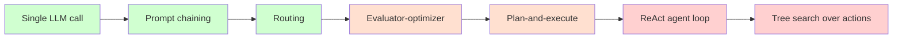
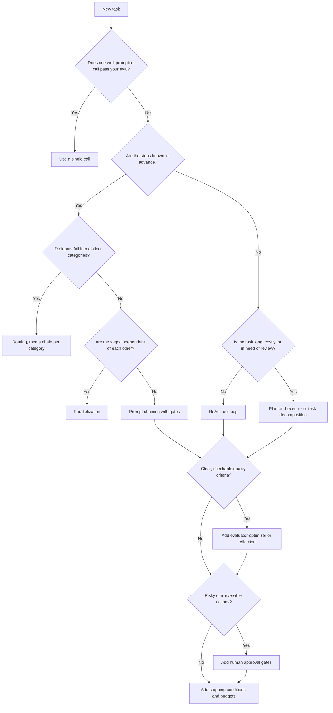
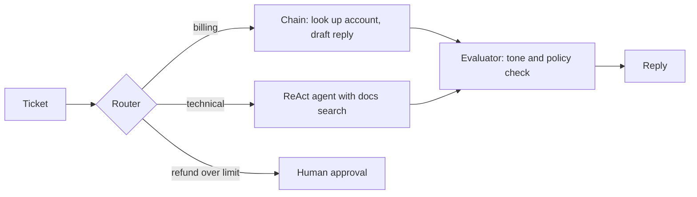

# Agent Patterns Overview

## Introduction

Once you can make an LLM call and run a tool loop, a harder question comes up: **how should you arrange those calls?** Should the model answer in one shot? Should you split the job into fixed steps? Should the model decide its own steps? Should a second model check the work?

These recurring arrangements are called **agent patterns** (or agentic design patterns). They are to agents what design patterns like Strategy or Observer are to object-oriented code: named, reusable shapes that solve a common problem, each with known costs.

This section of the tutorial is a catalogue of those patterns. Each page shows how to build one pattern, **when it is the right choice, when it is not, and what you could use instead**. This overview page gives you the map: a comparison table, a decision flowchart, and a short description of each pattern so you can jump to the one you need.

:::tip The one rule to remember
Start with the simplest thing that could work, usually a single well-prompted LLM call, and add structure only when you can measure that it helps. Anthropic's engineering post [Building effective agents](https://www.anthropic.com/engineering/building-effective-agents) puts it the same way: the most successful teams it worked with used "simple, composable patterns" rather than complex frameworks.
:::

## Workflows vs Agents: The Spectrum

All the patterns sit on a spectrum of **who controls the flow**:

- **Workflows**: your code decides the sequence of steps. The LLM fills in each step. The path is predictable and easy to test.
- **Agents**: the LLM decides what to do next, usually by calling tools in a loop until it judges the task done. The path is flexible but harder to predict.



Green patterns are code-driven workflows. Orange patterns mix code-driven structure with model judgment. Red patterns give the model the most control. Moving right buys flexibility and pays for it with cost, latency, and unpredictability. The page [Agents vs Workflows](../0-agents-fundamentals/3-agents-vs-workflows.mdx) covers this distinction in depth.

## The Three Building Blocks

Every pattern in this section is a combination of three primitives:

1. **An LLM call** (optionally with tools, structured output, or thinking).
2. **Control flow in your code**: `if`, `for`, `while`, function calls.
3. **A loop with a stop condition**, driven either by your code or by the model's `stop_reason`.

Here is the smallest useful helper that the later pages build on. It wraps one call and returns the text.

```python
from anthropic import Anthropic

client = Anthropic()  # reads ANTHROPIC_API_KEY from the environment

def ask(prompt: str, system: str = "", model: str = "claude-opus-5-5") -> str:
    """One LLM call, returning only the text blocks."""
    response = client.messages.create(
        model=model,
        max_tokens=4000,
        system=system,
        messages=[{"role": "user", "content": prompt}],
    )
    return "".join(b.text for b in response.content if b.type == "text")

print(ask("In one sentence, what is an agent pattern?"))
```

Example output:

```text
An agent pattern is a reusable way of arranging LLM calls, tools, and control flow to solve a recurring kind of task.
```

With just `ask()` plus ordinary Python you can already build chaining, routing, and evaluator-optimizer loops. Add a tool loop (see [Building a Manual Agent Loop](../2-agents-tool-use/3-agents-manual-agent-loop.mdx)) and you get ReAct, plan-and-execute, and the rest.

:::note Provider neutrality
The examples use the Anthropic Python SDK, but none of the patterns depend on it. OpenAI, Google Gemini, and open-source models served with Ollama or vLLM all support the same ingredients: messages, tool calling, and structured output. The patterns transfer directly.
:::

## The Pattern Catalogue

### Prompt chaining

Break a task into a fixed sequence of LLM calls, where each step consumes the previous step's output. Add **gates** (code checks) between steps to catch problems early. Use it when the steps are known in advance. See [Prompt Chaining](./1-agents-prompt-chaining.mdx).

### Routing

Classify the input first, then send it to a specialized prompt, tool set, or model. Use it when inputs fall into distinct categories that are handled better separately, or when you want cheap models for easy cases. See [Routing](./2-agents-routing.mdx).

### ReAct (reason + act)

The model alternates between reasoning, taking an action (a tool call), and reading the observation, in a loop it controls. This is the default shape of a modern tool-using agent. See [The ReAct Pattern](./3-agents-react-pattern.mdx).

### Plan-and-execute

A planner writes an explicit multi-step plan up front. Executors carry out the steps, and a replanner adjusts the plan when results come in. Use it for longer tasks where a visible plan helps with cost, review, or reliability. See [Plan-and-Execute](./4-agents-plan-and-execute.mdx).

### Task decomposition

Split a large task into smaller subtasks, possibly with dependencies, and run independent ones in parallel. This is the skill underneath plan-and-execute and orchestrator-workers. See [Task Decomposition](./5-agents-task-decomposition.mdx).

### Reflection and self-critique

The model reviews its own output (ideally with outside evidence such as test results) and revises. Reflexion-style agents also keep lessons from failed attempts. See [Reflection and Self-Critique](./6-agents-reflection.mdx).

### Evaluator-optimizer

A generator produces output and a separate evaluator scores it against explicit criteria, looping until it passes or a round limit hits. Use it when you have clear, checkable quality criteria. See [Evaluator-Optimizer Loops](./7-agents-evaluator-optimizer.mdx).

### Tree-of-thoughts and search

Generate several candidate next steps, score them, and explore the most promising branches, with backtracking. Use it for problems with a reliable way to score partial solutions. See [Tree-of-Thoughts and Search-Based Planning](./8-agents-tree-search.mdx).

### Human-in-the-loop

Not a standalone pattern but a modifier for any of the others: pause for approval before risky actions, ask clarifying questions, or let a person review a plan. See [Human-in-the-Loop](./9-agents-human-in-the-loop.mdx).

### Stopping conditions and budgets

Every loop needs a way to end: iteration caps, token and cost budgets, timeouts, and loop detection. This also applies to every pattern above. See [Stopping Conditions and Budgets](./10-agents-stopping-conditions.mdx).

Two related patterns live in the multi-agent section: **parallelization** (sectioning and voting, see [Parallel Agents](../8-agents-multi-agent-systems/4-agents-parallel-agents.mdx)) and **orchestrator-workers** (see [Orchestrator-Workers Pattern](../8-agents-multi-agent-systems/1-agents-orchestrator-workers.mdx)).

## Comparison Table

The ratings below are relative and qualitative. They describe typical implementations. Your real numbers depend on prompts, models, and task size, so measure on your own workload.

| Pattern | Complexity | Cost (LLM calls) | Latency | Predictability | Best for |
| --- | --- | --- | --- | --- | --- |
| Single call | Very low | 1 call | Lowest | High | Most tasks. Try this first. |
| Prompt chaining | Low | N fixed calls | Medium (sequential) | High | Fixed multi-step jobs such as outline, draft, translate |
| Routing | Low | 1 classifier + 1 handler | Low to medium | High | Mixed traffic with distinct categories, cost tiering |
| Parallelization | Low to medium | N calls at once | Low (parallel) | High | Independent subtasks, voting for confidence |
| ReAct / tool loop | Medium | Variable, 1 per step | Variable | Low to medium | Open-ended tasks needing tools and feedback |
| Plan-and-execute | Medium to high | Planner + per-step executor + replans | Medium to high | Medium | Long tasks where an explicit plan helps |
| Task decomposition / orchestrator-workers | Medium to high | Planner + N workers + synthesis | Medium (parallel workers) | Medium | Large tasks with separable parts |
| Reflection | Low to medium | 2 to 3x the base task | Medium to high | Medium | Tasks with outside feedback such as tests or linters |
| Evaluator-optimizer | Medium | 2 calls per round, several rounds | High | Medium | Output with clear, checkable quality criteria |
| Tree search (ToT) | High | Branching factor x depth x scoring | Highest | Low | Puzzles and planning with a reliable scorer |
| Human-in-the-loop | Medium (UX and state) | Same as base pattern | Adds human wait time | High at gates | Risky, irreversible, or ambiguous actions |

:::caution Cost compounds
A loop of 10 steps, each with a 20,000-token context, processes 200,000 input tokens before the final answer. Patterns that add rounds (reflection, evaluator-optimizer, tree search) multiply that again. Always pair loops with the budgets described in [Stopping Conditions and Budgets](./10-agents-stopping-conditions.mdx), and check current prices on your provider's pricing page.
:::

## Choosing a Pattern: Decision Flowchart

Use this flowchart as a starting point, not a rule book. Many real systems combine several patterns.



Notice two things about this chart:

- **Tree search does not appear on the main path.** Reach for it only when you have a reliable way to score partial solutions and a measured quality gap that cheaper patterns cannot close.
- **Every path ends at budgets.** No pattern is production-ready without a way to stop.

## Composing Patterns

Patterns are building blocks, not exclusive choices. A typical customer support system might look like this:



Here routing picks the path, chaining handles the predictable billing case, a ReAct agent handles open-ended technical questions, an evaluator checks every reply, and a human approves large refunds. Each piece is simple. The combination is powerful.

A minimal sketch of the composition in code shows how little machinery it needs:

```python
from anthropic import Anthropic

client = Anthropic()

def ask(prompt: str, model: str = "claude-opus-5-5") -> str:
    response = client.messages.create(
        model=model,
        max_tokens=2000,
        messages=[{"role": "user", "content": prompt}],
    )
    return "".join(b.text for b in response.content if b.type == "text")

def route(ticket: str) -> str:
    label = ask(
        "Classify this ticket as exactly one word: billing, technical, or other.\n\n"
        f"Ticket: {ticket}",
        model="claude-haiku-5-5",
    )
    label = label.strip().lower()
    return label if label in {"billing", "technical", "other"} else "other"

def billing_chain(ticket: str) -> str:
    facts = ask(f"List the account facts we need to answer this ticket:\n{ticket}")
    return ask(f"Write a short, friendly reply.\nTicket: {ticket}\nFacts needed: {facts}")

def handle(ticket: str) -> str:
    category = route(ticket)
    if category == "billing":
        draft = billing_chain(ticket)
    else:
        draft = ask(f"Write a helpful reply to this support ticket:\n{ticket}")
    verdict = ask(
        "Does this reply promise refunds or make legal claims? Answer YES or NO.\n\n" + draft,
        model="claude-haiku-5-5",
    )
    if verdict.strip().upper().startswith("YES"):
        return "[needs human review]\n" + draft
    return draft

print(handle("I was charged twice for my March invoice."))
```

Example output:

```text
Hi there, sorry about the double charge on your March invoice. I've flagged the duplicate payment for our billing team...
```

The individual pattern pages make each piece robust: structured outputs instead of string matching, validation gates, error handling, and budgets.

## Estimating Calls Before You Build

Before committing to a pattern, a quick back-of-envelope estimate of LLM calls per request often settles the decision. The function below encodes the rough call counts from the comparison table. The numbers you plug in are your own guesses, so treat the output as a comparison between options, not a forecast.

```python
def estimated_calls(pattern: str, steps: int = 4, rounds: int = 3,
                    branching: int = 3, depth: int = 3, workers: int = 4) -> int:
    """Rough number of LLM calls per request for each pattern."""
    estimates = {
        "single": 1,
        "chain": steps,
        "routing": 1 + 1,                         # classifier + handler
        "react": steps + 1,                       # one call per tool step + final answer
        "plan_execute": 1 + steps + 1,            # plan + execute each step + final replan
        "orchestrator": 1 + workers + 1,          # plan + workers + synthesis
        "evaluator_optimizer": 1 + 2 * rounds,    # first draft + (evaluate + revise) per round
        "tree_search": depth * branching * 2,     # propose + score per node kept
    }
    return estimates[pattern]

for name in ["single", "chain", "routing", "react", "plan_execute",
             "orchestrator", "evaluator_optimizer", "tree_search"]:
    print(f"{name:20} ~{estimated_calls(name)} calls")
```

Output:

```text
single               ~1 calls
chain                ~4 calls
routing              ~2 calls
react                ~5 calls
plan_execute         ~6 calls
orchestrator         ~6 calls
evaluator_optimizer  ~7 calls
tree_search          ~18 calls
```

Call counts are only half the story. Agent loops also resend a growing conversation on every step, so input tokens grow faster than the call count. Prompt caching softens this considerably (see [Prompt Caching](../4-agents-memory-and-context/4-agents-prompt-caching.mdx)).

## Patterns and Modern Reasoning Models

Several patterns in this section were invented when models could not reason much on their own. Classic ReAct asked the model to write "Thought:" lines. Tree-of-Thoughts asked it to propose and score alternatives explicitly. Today, many models (Claude with adaptive thinking, OpenAI's reasoning models, Gemini's thinking modes) reason internally before answering and between tool calls.

That changes the calculus:

- **Explicit reasoning scaffolding is often unnecessary.** Native tool calling plus built-in thinking already gives you the reason-act-observe loop. The [ReAct page](./3-agents-react-pattern.mdx) explains this mapping.
- **Depth is a parameter now.** Instead of adding reflection rounds, you can often raise the effort level (`output_config={"effort": "high"}` on Claude) and measure whether that closes the gap more cheaply. See [Reasoning, Thinking and Effort](../1-agents-llm-apis/7-agents-thinking-and-effort.mdx).
- **Structure still matters for control.** Plans you can review, gates you can test, evaluators with explicit criteria, and budgets you can enforce are about engineering control, not raw intelligence. Those patterns stay valuable no matter how capable the model gets.

## Real-World Scenario

**Your team runs a B2B SaaS helpdesk product** and has been asked to add three AI features this quarter: (1) auto-tagging incoming tickets, (2) drafting replies for agents to edit, and (3) an "investigate" button that looks into a customer's account, logs, and recent deploys to explain a reported bug.

A common first instinct is to build one big autonomous agent for all three. Instead, pick a pattern per feature:

| Feature | Pattern | Why |
| --- | --- | --- |
| Auto-tagging | Single call with structured output, or routing | Fixed label set, high volume, needs to be cheap and predictable |
| Reply drafting | Routing + prompt chaining + evaluator check | Steps are known: classify, gather facts, draft, check tone and policy |
| Investigate button | ReAct agent with read-only tools, budgets, and HITL for any write | Steps are unknown in advance and depend on what the logs show |

### Why this approach

- The two high-volume features stay as **workflows**, so they are cheap, fast, and easy to regression-test.
- Only the genuinely open-ended feature gets an **agent loop**, and it is limited to read-only tools with strict budgets.
- Each feature can be evaluated on its own metric: tag accuracy, edit distance between draft and sent reply, and investigation usefulness ratings.

### When to use this approach, and when not to

Use per-feature pattern selection whenever features differ in volume, risk, or predictability. Do not reach for agents simply because "agentic" is fashionable. If the investigate feature only ever needs the same three lookups, it should become a chain, not an agent.

### Alternatives and trade-offs

| Approach | Pros | Cons | Best for |
| --- | --- | --- | --- |
| One general agent for everything | One code path, flexible | Expensive on high-volume tasks, hard to test, unpredictable | Prototypes and internal tools |
| Per-feature patterns (recommended) | Right cost and risk for each job | More code paths to maintain | Production products |
| Off-the-shelf framework agents | Fast start, built-in tracing | Abstractions can hide prompts and make debugging harder | Teams already using that framework |
| No AI, rules only | Fully predictable, free to run | Brittle on messy text | Narrow, well-defined inputs |

## Common Mistakes

1. **Starting with the most complex pattern.** Multi-agent tree search for a task that one call solves wastes money and time. Climb the complexity ladder one rung at a time.
2. **Choosing patterns without an evaluation set.** You cannot tell whether reflection "helps" without measuring. Build even 20 labeled examples first (see [Building Evaluation Datasets](../11-agents-evaluation-and-testing/1-agents-building-eval-sets.mdx)).
3. **Loops without exits.** Every `while` loop around an LLM needs an iteration cap and a budget.
4. **Self-critique without evidence.** Asking a model "are you sure?" with no new information often does not improve reasoning answers. Give the critic tests, tool results, or explicit criteria.
5. **Hiding the plan.** Transparency, meaning showing the agent's planning steps and logging them, makes debugging much easier.
6. **Treating patterns as exclusive.** Real systems mix routing, chaining, agents, and evaluators.

## Summary

- Agent patterns are reusable arrangements of LLM calls, code control flow, and loops.
- They range from **workflows** (code controls the path) to **agents** (the model controls the path). Flexibility costs money, latency, and predictability.
- The catalogue: prompt chaining, routing, ReAct, plan-and-execute, task decomposition, reflection, evaluator-optimizer, tree search, plus human-in-the-loop and stopping conditions as cross-cutting concerns.
- Choose with the flowchart: try a single call, then known steps (chain or route), then unknown steps (ReAct or planning), then add quality loops, approvals, and budgets.
- Compose simple patterns rather than building one giant agent.

## Exercises

1. Take an AI feature you use or want to build. Write down which pattern from the comparison table fits it and justify the choice in two sentences, including one alternative you rejected.
2. Extend the composition sketch above so that `route()` uses structured outputs instead of string matching (see [Structured Outputs](../1-agents-llm-apis/6-agents-structured-outputs.mdx)).
3. Draw a mermaid diagram of a system you know (for example a code review bot) and label each box with the pattern it uses.
4. For the same system, estimate the number of LLM calls per request for each pattern you chose. Which part dominates the cost?

### Related pages

- [Agents vs Workflows](../0-agents-fundamentals/3-agents-vs-workflows.mdx)
- [The Agent Loop](../0-agents-fundamentals/4-agents-agent-loop.mdx)
- [When Should You Build an Agent?](../0-agents-fundamentals/7-agents-when-to-build.mdx)
- [Single Agent vs Multi-Agent](../8-agents-multi-agent-systems/10-agents-single-vs-multi-agent.mdx)
