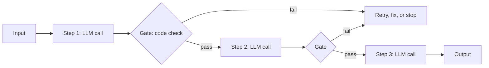
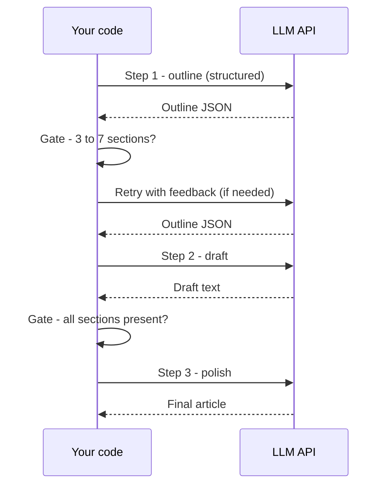
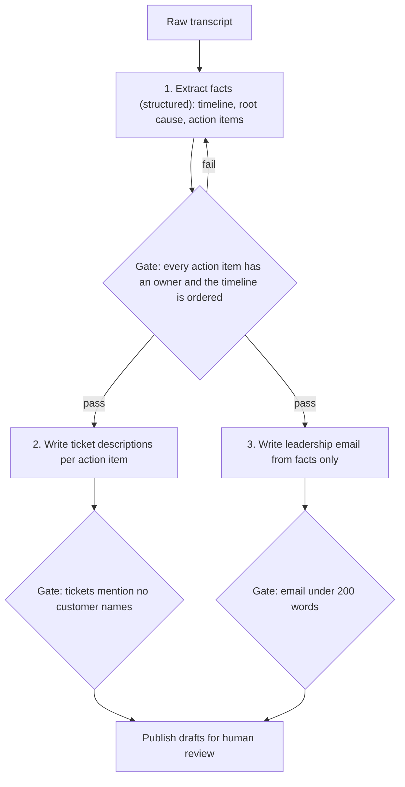

# Prompt Chaining

## Introduction

**Prompt chaining** splits one task into a fixed sequence of LLM calls. Each call does one focused job and hands its output to the next. Between calls, your code can run **gates**: checks that verify the intermediate result before you spend money on the next step.

Think of an assembly line. One station cuts the wood, the next drills holes, the next paints. Each station is simple and easy to inspect, and a bad part gets pulled off the line before it is painted. A single "do everything" prompt is more like asking one worker to build the whole cabinet in one go: possible, but harder to check and harder to fix when it goes wrong.

Prompt chaining is the simplest multi-call pattern and often the first one worth adding after a single call. Anthropic's [Building effective agents](https://www.anthropic.com/engineering/building-effective-agents) describes it as ideal when a task "can be easily and cleanly decomposed into fixed subtasks", trading some latency for higher accuracy by making each call an easier task.

In this page you will:

- Build a basic two-step chain, then a realistic chain with gates.
- Pass structured data between steps instead of loose text.
- Handle failures at each link.
- Learn when chaining is the right tool and when a single call or an agent is better.

## How a Chain Works



Three properties define a chain:

1. **The steps are fixed in code.** The model never decides which step comes next.
2. **Each step has a narrow job and its own prompt.** Narrow prompts are easier to write, test, and improve.
3. **Gates are ordinary code.** Length checks, schema validation, regexes, unit tests, or a cheap classifier call.

## A Minimal Two-Step Chain

The classic example: write marketing copy, then translate it. Each step is a separate call with a focused instruction.

```python
from anthropic import Anthropic

client = Anthropic()

def ask(prompt: str, system: str = "", model: str = "claude-opus-5-5") -> str:
    response = client.messages.create(
        model=model,
        max_tokens=2000,
        system=system,
        messages=[{"role": "user", "content": prompt}],
    )
    return "".join(b.text for b in response.content if b.type == "text")

product = "A reusable water bottle that tracks how much you drink and syncs to your phone."

# Step 1: write the copy
copy_en = ask(
    f"Write a 2-sentence product blurb for this product:\n{product}",
    system="You are a concise marketing copywriter. No hashtags, no emojis.",
)

# Step 2: translate it
copy_es = ask(
    f"Translate this into natural Latin American Spanish. Return only the translation.\n\n{copy_en}",
)

print("EN:", copy_en)
print("ES:", copy_es)
```

Example output:

```text
EN: Meet the bottle that remembers so you don't have to. It tracks every sip and syncs to your phone, so staying hydrated finally feels effortless.
ES: Conoce la botella que recuerda por ti. Registra cada sorbo y se sincroniza con tu teléfono, para que mantenerte hidratado por fin sea fácil.
```

Why not one prompt that does both? You could. But splitting lets you review the English copy before translating, swap in a cheaper model for translation, and translate the approved copy into ten languages without regenerating it.

## Adding Gates

A gate is a check between steps. Gates make chains robust because they catch errors early, while they are cheap to fix.

```python
def word_count_gate(text: str, max_words: int) -> bool:
    return 0 < len(text.split()) <= max_words

def banned_words_gate(text: str, banned: list[str]) -> bool:
    lower = text.lower()
    return not any(word in lower for word in banned)

copy_en = ask(
    f"Write a 2-sentence product blurb for this product:\n{product}",
    system="You are a concise marketing copywriter. No hashtags, no emojis.",
)

if not word_count_gate(copy_en, max_words=50):
    raise ValueError(f"Copy too long ({len(copy_en.split())} words)")
if not banned_words_gate(copy_en, ["guarantee", "cure", "best in the world"]):
    raise ValueError("Copy contains a banned claim")

print("Gates passed, ready to translate.")
```

Output:

```text
Gates passed, ready to translate.
```

Gates come in a few flavors, from cheapest to most expensive:

| Gate type | Example | Cost |
| --- | --- | --- |
| Structural | Is it valid JSON? Does it parse into the schema? | Free |
| Rule-based | Length limits, banned words, required fields, regexes | Free |
| Executable | Does the generated SQL run on a test database? Do tests pass? | Cheap |
| LLM classifier | "Does this text make a medical claim? YES or NO" with a small model | One small call |

Prefer the cheapest gate that catches the failure you care about.

## Passing Structured Data Between Steps

Loose text between steps causes subtle bugs: step 2 has to guess where step 1's answer starts, and a stray "Sure, here you go!" leaks into the next prompt. Use **structured outputs** so each step returns typed data your code can validate. The Anthropic SDK can parse a response straight into a Pydantic model with `client.messages.parse()`.

```python
from pydantic import BaseModel, Field
from anthropic import Anthropic

client = Anthropic()

class Outline(BaseModel):
    title: str
    sections: list[str] = Field(description="Section headings in order")
    target_audience: str

def make_outline(topic: str) -> Outline:
    response = client.messages.parse(
        model="claude-opus-5-5",
        max_tokens=2000,
        messages=[{"role": "user", "content": f"Create a blog post outline about: {topic}"}],
        output_format=Outline,
    )
    return response.parsed_output

outline = make_outline("Why database indexes speed up queries")
print(outline.title)
for i, section in enumerate(outline.sections, 1):
    print(f"{i}. {section}")
```

Example output:

```text
Why Database Indexes Make Your Queries Fast
1. The cost of a full table scan
2. How a B-tree index works
3. When an index helps and when it hurts
4. Measuring the difference with EXPLAIN
```

Now the gate can be precise ("between 3 and 7 sections"), and the next step receives exactly the fields it needs. See [Structured Outputs](../1-agents-llm-apis/6-agents-structured-outputs.mdx) for details. Other providers offer the same capability (OpenAI structured outputs, Gemini response schemas, JSON mode in Ollama and vLLM).

## A Realistic Chain: Outline, Check, Draft, Polish

Here is a complete chain with structured steps, gates, and a retry on gate failure.

```python
from pydantic import BaseModel, Field
from anthropic import Anthropic

client = Anthropic()

class Outline(BaseModel):
    title: str
    sections: list[str] = Field(description="Section headings in order")

class ChainError(Exception):
    """Raised when a step fails its gate after retries."""

def text_of(response) -> str:
    return "".join(b.text for b in response.content if b.type == "text")

def step_outline(topic: str, feedback: str = "") -> Outline:
    prompt = f"Create a blog post outline about: {topic}"
    if feedback:
        prompt += f"\n\nA previous attempt was rejected: {feedback}"
    response = client.messages.parse(
        model="claude-opus-5-5",
        max_tokens=2000,
        messages=[{"role": "user", "content": prompt}],
        output_format=Outline,
    )
    return response.parsed_output

def gate_outline(outline: Outline) -> str:
    """Return an empty string if OK, otherwise a reason."""
    if not 3 <= len(outline.sections) <= 7:
        return f"Need 3 to 7 sections, got {len(outline.sections)}."
    if len(set(outline.sections)) != len(outline.sections):
        return "Duplicate section headings."
    return ""

def step_draft(outline: Outline) -> str:
    sections = "\n".join(f"- {s}" for s in outline.sections)
    response = client.messages.create(
        model="claude-opus-5-5",
        max_tokens=8000,
        messages=[{"role": "user", "content":
            f"Write a blog post titled '{outline.title}' with these sections:\n{sections}\n"
            "Use markdown headings. Aim for about 150 words per section."}],
    )
    return text_of(response)

def gate_draft(draft: str, outline: Outline) -> str:
    missing = [s for s in outline.sections if s.lower() not in draft.lower()]
    if missing:
        return f"Draft is missing sections: {missing}"
    return ""

def step_polish(draft: str) -> str:
    response = client.messages.create(
        model="claude-sonnet-5-5",
        max_tokens=8000,
        system="You are a careful copy editor. Fix grammar and clarity. Keep structure and meaning.",
        messages=[{"role": "user", "content": draft}],
    )
    return text_of(response)

def run_chain(topic: str, max_retries: int = 2) -> str:
    feedback = ""
    for attempt in range(max_retries + 1):
        outline = step_outline(topic, feedback)
        feedback = gate_outline(outline)
        if not feedback:
            break
        print(f"Outline gate failed (attempt {attempt + 1}): {feedback}")
    else:
        raise ChainError(f"Outline never passed: {feedback}")

    draft = step_draft(outline)
    problem = gate_draft(draft, outline)
    if problem:
        raise ChainError(problem)

    return step_polish(draft)

article = run_chain("Why database indexes speed up queries")
print(article[:300])
```

Example output:

```text
Outline gate failed (attempt 1): Need 3 to 7 sections, got 9.
# Why Database Indexes Make Your Queries Fast

## The cost of a full table scan

Imagine looking for one name in a phone book that isn't sorted. You'd have to read every entry...
```

A few design choices to notice:

- **Feedback flows back into the retry.** The gate's reason becomes part of the next prompt, so retries are not blind.
- **Different steps use different models.** Copy editing is an easier job, so it runs on a mid-tier model. Choose per step based on your evaluations (see [Choosing the Right Model](../1-agents-llm-apis/10-agents-model-selection.mdx)).
- **Failures raise a specific exception** rather than passing bad data downstream.

## Sequence View



## Chains and Cost

A chain makes more calls than a single prompt, but each call is usually shorter and more focused, so total tokens are not always higher. Three tips keep chains cheap:

1. **Send each step only what it needs.** The polish step does not need the original topic or the outline.
2. **Use smaller models for mechanical steps** such as formatting, translation, or extraction, when your evals show no quality drop.
3. **Cache shared prefixes.** If every step shares a long system prompt or reference document, prompt caching cuts repeated input cost (see [Prompt Caching](../4-agents-memory-and-context/4-agents-prompt-caching.mdx)).

Latency is the real cost of chaining, because steps run one after another. If two steps do not depend on each other, run them in parallel instead (see [Parallel Agents](../8-agents-multi-agent-systems/4-agents-parallel-agents.mdx)).

## Real-World Scenario

**Your team builds an internal tool for an engineering org.** After each incident review meeting, someone pastes the raw transcript into the tool. The tool must produce: a structured incident summary, a list of action items with owners, Jira-ready ticket descriptions, and a short status email for leadership.

### The chain



The extraction step is the foundation, so it gets the strongest model and a strict Pydantic schema. Steps 2 and 3 read only the extracted facts, never the raw transcript, which reduces the chance of leaking off-topic details from the meeting. They can run in parallel because they do not depend on each other.

```python
from pydantic import BaseModel

class ActionItem(BaseModel):
    description: str
    owner: str
    due: str | None = None

class IncidentFacts(BaseModel):
    title: str
    timeline: list[str]
    root_cause: str
    action_items: list[ActionItem]

def gate_facts(facts: IncidentFacts) -> str:
    unowned = [a.description for a in facts.action_items if not a.owner.strip()]
    if unowned:
        return f"Action items without owners: {unowned}"
    if not facts.action_items:
        return "No action items found; ask the transcript author to confirm."
    return ""

sample = IncidentFacts(
    title="Checkout latency spike",
    timeline=["14:02 alert fired", "14:10 rollback started", "14:25 recovered"],
    root_cause="N+1 query introduced in release 4.12",
    action_items=[ActionItem(description="Add query count check to CI", owner="")],
)
print(gate_facts(sample) or "OK")
```

Output:

```text
Action items without owners: ['Add query count check to CI']
```

### Why this approach

- The steps are **known in advance** and do not change per transcript. That is exactly the case chaining is built for.
- Each output type (structured facts, tickets, email) has different quality criteria, so separate prompts can each be tuned and tested.
- Gates catch the most common real failure, action items without owners, before anything is published.

### When to use it, and when not to

Use chaining when you can write the steps on a whiteboard before seeing the input. Do not use it when the steps depend on what you discover along the way, for example "investigate why this test is flaky". That needs an agent loop (see [The ReAct Pattern](./3-agents-react-pattern.mdx)). Also skip chaining when a single call already passes your evals: extra steps add latency and code for no gain.

### Alternatives and trade-offs

| Approach | Pros | Cons | Best for |
| --- | --- | --- | --- |
| Single large prompt | Lowest latency, least code | Hard to debug, no intermediate checks, one failure ruins all outputs | Short, simple tasks |
| Prompt chain with gates | Testable steps, early failure detection, per-step models | Sequential latency, more code | Fixed multi-step transformations |
| Parallel calls | Fast | Only works for independent steps | Several outputs from the same facts |
| Agent loop | Handles unknown steps | Less predictable, costlier | Open-ended investigation |

## Common Mistakes

1. **Passing free text where structure is needed.** Use structured outputs for anything the next step or a gate must parse.
2. **No gates.** A chain without gates is just a slower single prompt. Put at least one check after the step most likely to fail.
3. **Forwarding everything.** Sending the full history to every step inflates cost and invites the model to blend unrelated content. Pass only the fields a step needs.
4. **Blind retries.** Retrying with the same prompt often yields the same failure. Include the gate's reason in the retry prompt, and cap retries.
5. **Too many tiny steps.** Ten micro-steps can be slower and less coherent than three well-scoped ones. Split only where a gate or a different model adds value.
6. **Ignoring API errors between steps.** A rate limit in step 3 should not discard steps 1 and 2. Save intermediate results and retry the failed step (see [Error Handling and Retries](../1-agents-llm-apis/9-agents-api-error-handling.mdx)).

## Summary

- Prompt chaining runs a **fixed sequence** of focused LLM calls, with your code in control.
- **Gates** between steps (schema checks, rules, tests, cheap classifiers) catch errors early.
- **Structured outputs** make hand-offs between steps reliable.
- Chains trade latency for accuracy and debuggability. Run independent steps in parallel.
- Use chaining when the steps are known up front. Use an agent when they are not.

## Exercises

1. Extend the marketing chain with a third step that writes a tweet-length version, and a gate that rejects anything over 280 characters.
2. Add a gate to the incident chain that rejects tickets mentioning email addresses, using a regex.
3. Rewrite `run_chain` so it saves each step's output to a JSON file and can resume from the last successful step after a crash.
4. Measure: run the outline-draft-polish chain and a single "write the whole post" prompt on five topics. Compare total tokens (from `response.usage`) and your quality judgment.

### Related pages

- [Agent Patterns Overview](./0-agents-patterns-overview.mdx)
- [Routing](./2-agents-routing.mdx)
- [Evaluator-Optimizer Loops](./7-agents-evaluator-optimizer.mdx)
- [Prompt Templates](../3-agents-prompt-engineering/7-agents-prompt-templates.mdx)
