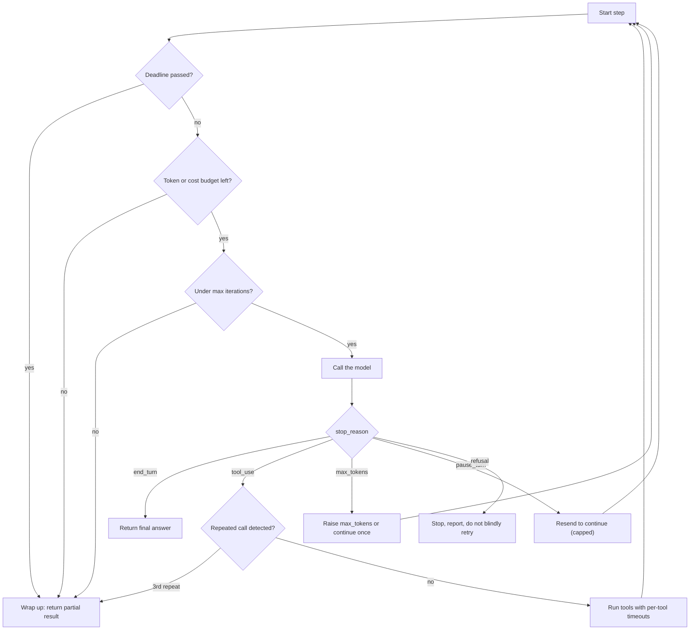

# Stopping Conditions and Budgets

## Introduction

Every pattern in this section has a loop: a ReAct agent calling tools, an evaluator-optimizer revising drafts, a tree search expanding nodes. Every loop needs a reliable answer to one question: **when do we stop?**

In the happy path, the model stops on its own: it finishes the task and returns a final answer. But agents also get stuck. They retry the same failing tool call, wander through irrelevant files, or keep "improving" a draft that was already fine. Without limits, a stuck agent burns tokens, time, and money, and may keep taking actions in the world while it does.

Think of a taxi meter combined with a GPS. The meter caps what you will spend, the GPS notices when you have driven around the same block three times, and you have a time by which you must arrive. You need all three, because each catches a different failure.

Anthropic's [Building effective agents](https://www.anthropic.com/engineering/building-effective-agents) puts it simply: "it's also common to include stopping conditions (such as a maximum number of iterations) to maintain control."

This page covers the full set of controls:

| Control | Catches | Enforced by |
| --- | --- | --- |
| Natural completion (`stop_reason`) | The normal end of a task | The model and API |
| Max iterations | Runaway loops of any kind | Your code |
| Token and cost budgets | Expensive runs, context blow-ups | Your code |
| Task budgets (API beta) | Lets the model pace itself to finish within a budget | The model, advisory |
| Timeouts | Hung requests, slow tools, long runs | SDK client and your code |
| Loop detection | Repeating the same action without progress | Your code |
| Platform caps | Last-resort spend limits | Provider console, workspace limits |

## Layered Stopping



Notice that most limits do not simply crash. They route to **wrap up**: return what the agent has so far, clearly marked as incomplete, so the user or caller can decide what to do.

## 1. Natural Completion: Handle Every Stop Reason

The model tells you why it stopped through `stop_reason`. A robust loop handles all of them, not just `tool_use` and `end_turn`.

| `stop_reason` | Meaning | What to do |
| --- | --- | --- |
| `end_turn` | The model finished | Return the answer |
| `tool_use` | The model wants tools run | Run them, append all results in one user message, continue |
| `max_tokens` | Output hit the `max_tokens` cap | If cut off mid tool call, retry with a higher cap. If cut off in text, raise the cap or stream |
| `pause_turn` | A long server-side tool turn paused | Send the conversation back unchanged to let it continue, with a cap on continuations |
| `refusal` | The model declined for safety reasons | Stop and report. Do not loop retrying the same request |
| `stop_sequence` | A custom stop sequence was hit | Handle as your app defines |

Other providers use different names (for example `finish_reason` values such as `stop`, `length`, and `tool_calls` in OpenAI-style APIs), but the same categories exist everywhere. See [Building a Manual Agent Loop](../2-agents-tool-use/3-agents-manual-agent-loop.mdx) for the full loop.

## 2. Max Iterations

The simplest and most important limit. Every agent loop should be a bounded `for` loop, never a bare `while True`.

```python
MAX_STEPS = 15

for step in range(MAX_STEPS):
    ...  # call model, run tools, break on end_turn
else:
    print("Stopped: reached the step limit")   # runs only if the loop never hit break
```

How to pick the number: run the agent on your evaluation set without a cap (in a safe environment), record how many steps successful runs take, and set the cap comfortably above the typical maximum. Look at runs that hit the cap: they are usually stuck, which is useful debugging information.

Iteration caps belong at **every level**: steps in the agent loop, rounds in evaluator-optimizer, replans in plan-and-execute, depth and breadth in tree search, retries on tool errors, and `pause_turn` continuations.

## 3. Token and Cost Budgets

Steps are a crude proxy for cost. A single step that reads a large file can cost more than ten small steps. Track actual usage from each response's `usage` field and stop when a budget is exhausted.

```python
from dataclasses import dataclass, field

@dataclass
class Usage:
    input_tokens: int = 0
    output_tokens: int = 0
    cache_read_tokens: int = 0
    cache_write_tokens: int = 0

    def add(self, u) -> None:
        self.input_tokens += u.input_tokens
        self.output_tokens += u.output_tokens
        self.cache_read_tokens += getattr(u, "cache_read_input_tokens", 0) or 0
        self.cache_write_tokens += getattr(u, "cache_creation_input_tokens", 0) or 0

    def cost_usd(self, prices: dict[str, float]) -> float:
        """prices: USD per million tokens. Fill these from your provider's pricing page."""
        return (self.input_tokens * prices["input"]
                + self.output_tokens * prices["output"]
                + self.cache_read_tokens * prices["cache_read"]
                + self.cache_write_tokens * prices["cache_write"]) / 1_000_000

@dataclass
class Budget:
    max_steps: int = 20
    max_output_tokens: int = 60_000
    max_total_tokens: int = 1_000_000
    max_cost_usd: float | None = None
    prices: dict[str, float] = field(default_factory=dict)

    def exceeded(self, used: Usage) -> str | None:
        total = (used.input_tokens + used.output_tokens
                 + used.cache_read_tokens + used.cache_write_tokens)
        if used.output_tokens >= self.max_output_tokens:
            return "output token budget"
        if total >= self.max_total_tokens:
            return "total token budget"
        if self.max_cost_usd is not None and self.prices:
            if used.cost_usd(self.prices) >= self.max_cost_usd:
                return "cost budget"
        return None
```

:::caution Prices change
Do not hard-code prices from a blog post, including this one. Load them from configuration and update them from your provider's official pricing page. Remember that cached input tokens are billed at different rates from uncached ones, and different models have different rates.
:::

A few budgeting tips:

- **Input tokens dominate long agent runs**, because the whole conversation is re-sent on every step. Prompt caching and context management reduce this (see [Prompt Caching](../4-agents-memory-and-context/4-agents-prompt-caching.mdx) and [Compaction and Summarization](../4-agents-memory-and-context/2-agents-compaction-and-summarization.mdx)).
- **Budget the whole task, not just the agent.** Include subagents, evaluators, and retries in the same budget object.
- **Set budgets from data.** Measure token usage per task on your evaluation set and set limits from the high percentiles, not the average.

## 4. Task Budgets: Letting the Model Pace Itself

The budgets above are enforced by your code: when the limit hits, the loop stops, possibly mid-task. A complementary approach is to **tell the model** how much it may spend, so it can prioritize and finish gracefully.

The Claude API offers this as **task budgets** (beta at the time of writing, header `task-budgets-2026-03-13`). You set a token budget for the whole agentic loop, covering thinking, tool calls, tool results, and output. The model sees a running countdown injected by the server and uses it to pace its work and wrap up as the budget runs low.

```python
import anthropic

client = anthropic.Anthropic()

with client.beta.messages.stream(
    model="claude-opus-5-5",
    max_tokens=64000,
    output_config={
        "effort": "high",
        "task_budget": {"type": "tokens", "total": 128000},
    },
    messages=[{"role": "user", "content": "Review the repo and propose a refactor plan."}],
    betas=["task-budgets-2026-03-13"],
) as stream:
    response = stream.get_final_message()

print(response.stop_reason, response.usage.output_tokens)
```

Example output:

```text
end_turn 9214
```

Key facts from the [task budgets documentation](https://platform.claude.com/docs/en/build-with-claude/task-budgets), which you should re-check because beta features change:

- **It is advisory, not a hard cap.** The model may slightly exceed it to finish an action. `max_tokens` remains the enforced per-request limit, and your own budget checks remain the enforced per-task limit. Use both.
- **The minimum `total` is 20,000 tokens.** Smaller values are rejected.
- **Set it once at the start of the task and keep it unchanged** on the requests in that loop. The server tracks what the model has already processed. Changing the value mid-task breaks prompt cache matches. If your own code compacts or rewrites history, the docs describe an optional `remaining` field for carrying the countdown forward.
- **Too small a budget can backfire.** A budget clearly insufficient for the task can make the model scope the work down aggressively or decline to start. Size it from measured usage on representative tasks.
- **Model support varies.** Check the docs for the supported model list. It is not available on every model or platform.
- **Prefer it for unattended loops.** Anthropic's migration guidance for some newer models advises against task budgets in interactive chat sessions, where the injected countdown can interfere with how the model reads the user's mid-task messages. Control interactive sessions with `effort` and `max_tokens`.

Other providers offer different controls (for example per-request output caps and reasoning effort settings). Where a native "pace yourself" feature is missing, you can approximate it by telling the model its remaining step count in a short system note, but be careful: showing remaining-budget numbers can also make a model wrap up too early. Measure before relying on it.

## 5. Timeouts

Three kinds of time limit protect an agent:

1. **Request timeouts** on each API call. The Anthropic Python SDK accepts `timeout` (seconds) and `max_retries` on the client, or per call with `with_options()`. It raises `anthropic.APITimeoutError` when a request times out.
2. **Tool timeouts** on each tool execution, so one hung HTTP call or database query cannot freeze the agent.
3. **A wall-clock deadline** for the whole task, checked at the top of each iteration.

```python
import time
from concurrent.futures import ThreadPoolExecutor, TimeoutError as FutureTimeout
import anthropic

client = anthropic.Anthropic(timeout=120.0, max_retries=2)   # per-request limits

_tool_pool = ThreadPoolExecutor(max_workers=4)

def run_with_timeout(fn, args: dict, seconds: float) -> tuple[str, bool]:
    """Return (content, is_error). The thread is abandoned, not killed, on timeout."""
    future = _tool_pool.submit(fn, **args)
    try:
        return str(future.result(timeout=seconds)), False
    except FutureTimeout:
        return f"Tool timed out after {seconds:.0f}s. Try a narrower query.", True
    except Exception as exc:
        return f"Tool error: {exc}", True

class Deadline:
    def __init__(self, seconds: float):
        self.end = time.monotonic() + seconds

    def remaining(self) -> float:
        return self.end - time.monotonic()

    def expired(self) -> bool:
        return self.remaining() <= 0
```

:::note Thread timeouts do not stop the work
Python cannot kill a thread. `future.result(timeout=...)` stops **waiting**, but the tool keeps running in the background. For tools that must truly stop (shell commands, generated code), run them in a subprocess with its own timeout, or use the timeout options of the underlying client library (HTTP and database drivers usually have them).
:::

When the deadline is close, prefer a graceful wrap-up over a hard stop: make one final model call without tools, asking for the best answer from what has been gathered so far.

## 6. Loop Detection

Iteration caps stop loops eventually, but a stuck agent can waste most of its budget first. **Loop detection** notices repetition early. The most common signal is the same tool called with the same arguments several times.

```python
import hashlib
import json
from collections import Counter

class LoopDetector:
    def __init__(self, warn_at: int = 2, stop_at: int = 3):
        self.counts: Counter[str] = Counter()
        self.warn_at, self.stop_at = warn_at, stop_at

    @staticmethod
    def key(name: str, args: dict) -> str:
        raw = name + json.dumps(args, sort_keys=True)
        return hashlib.sha256(raw.encode()).hexdigest()[:16]

    def check(self, name: str, args: dict) -> str:
        """Return 'ok', 'warn', or 'stop' for this tool call."""
        k = self.key(name, args)
        self.counts[k] += 1
        if self.counts[k] >= self.stop_at:
            return "stop"
        if self.counts[k] >= self.warn_at:
            return "warn"
        return "ok"

detector = LoopDetector()
for _ in range(3):
    print(detector.check("search_logs", {"query": "timeout", "service": "api"}))
```

Output:

```text
ok
warn
stop
```

On `warn`, run the tool but append a note to its result, such as "You already made this exact call. The result has not changed. Try a different approach or finish with what you have." This nudge often breaks the loop. On `stop`, end the loop and wrap up.

Other loop signals worth tracking:

- **Identical tool results** several times in a row (the world is not changing).
- **Oscillation**: alternating between two actions (A, B, A, B).
- **No new information**: in evaluator-optimizer loops, the same criteria failing round after round.
- **Error streaks**: several consecutive tool errors usually means the agent lacks something it cannot fix itself.

## Putting It All Together

Here is a bounded agent loop that combines all the controls. Tool definitions and implementations are passed in.

```python
import anthropic

client = anthropic.Anthropic(timeout=120.0, max_retries=2)

def text_of(content) -> str:
    return "".join(b.text for b in content if b.type == "text")

def wrap_up(messages: list, reason: str) -> str:
    """One last call, without tools, to summarize progress."""
    try:
        response = client.messages.create(
            model="claude-opus-5-5",
            max_tokens=4000,
            messages=messages + [{"role": "user", "content":
                f"Stop working now ({reason}). Summarize what you found and what remains undone."}],
        )
        return f"[INCOMPLETE: {reason}]\n" + text_of(response.content)
    except anthropic.APIError:
        return f"[INCOMPLETE: {reason}] No summary available."

def bounded_agent(task: str, tools: list, impls: dict, budget: Budget,
                  deadline_s: float = 300, tool_timeout_s: float = 30) -> str:
    messages = [{"role": "user", "content": task}]
    used, deadline, loops = Usage(), Deadline(deadline_s), LoopDetector()
    continuations = 0

    for step in range(budget.max_steps):
        if deadline.expired():
            return wrap_up(messages, "time limit")
        if reason := budget.exceeded(used):
            return wrap_up(messages, reason)

        response = client.messages.create(
            model="claude-opus-5-5", max_tokens=16000, tools=tools, messages=messages,
        )
        used.add(response.usage)

        if response.stop_reason == "refusal":
            return "[STOPPED: the model declined this request]"
        if response.stop_reason == "end_turn":
            return text_of(response.content)
        if response.stop_reason == "pause_turn":
            continuations += 1
            if continuations > 3:
                return wrap_up(messages, "too many pause_turn continuations")
            messages.append({"role": "assistant", "content": response.content})
            continue
        if response.stop_reason == "max_tokens":
            return wrap_up(messages, "response hit max_tokens")

        messages.append({"role": "assistant", "content": response.content})
        results, must_stop = [], False
        for block in response.content:
            if block.type != "tool_use":
                continue
            verdict = loops.check(block.name, block.input)
            if verdict == "stop":
                must_stop = True
                results.append({"type": "tool_result", "tool_use_id": block.id, "is_error": True,
                                "content": "Repeated identical call blocked."})
                continue
            fn = impls.get(block.name)
            if fn is None:
                content, is_error = f"Unknown tool {block.name}", True
            else:
                content, is_error = run_with_timeout(fn, block.input, tool_timeout_s)
            if verdict == "warn":
                content += "\n\nNote: you already made this exact call. Try something different."
            result = {"type": "tool_result", "tool_use_id": block.id, "content": content}
            if is_error:
                result["is_error"] = True
            results.append(result)
        messages.append({"role": "user", "content": results})
        if must_stop:
            return wrap_up(messages, "repeated tool calls")

    return wrap_up(messages, "step limit")
```

Every exit path returns something useful and says why it stopped. In production, also **log the stop reason** with each run. A rising share of "step limit" or "repeated tool calls" exits is an early warning that a prompt, tool, or model change has caused a regression (see [Monitoring and Alerting](../13-agents-production/6-agents-monitoring-and-alerting.mdx)).

## Real-World Scenario

**Your company offers a "research this lead" button** in its CRM. It runs a web-search agent in a background job for each click. One day, a single job runs for 40 minutes, calls the search tool hundreds of times with slight variations of the same query, and costs as much as a typical week of usage. Nobody noticed until the monthly bill.

### The fix: layered limits

| Layer | Setting | Why |
| --- | --- | --- |
| Max steps | 25 | Successful runs on the eval set never needed more than about 12 |
| Total token budget | Set from the 95th percentile of measured usage, plus headroom | Caps the expensive tail |
| Task budget (where supported) | Generous total sized from measured usage | Lets the agent prioritize and write a summary instead of being cut off |
| Request timeout | 120 s, 2 retries | Hung API calls fail fast |
| Tool timeout | 20 s per search | One slow site cannot block the job |
| Wall-clock deadline | 5 minutes | Users expect results within a few minutes |
| Loop detection | Warn on 2nd identical search, stop on 3rd | Catches the exact failure that happened |
| Workspace spend limit | Set in the provider console | Last-resort backstop for bugs in your own limits |
| Alert | Page if the share of budget-limited runs doubles | Detects regressions quickly |

### Why this approach

- **Each layer catches a different failure.** Steps stop long loops, tokens stop expensive steps, deadlines stop slow tools, loop detection stops repetitive behavior early.
- **Graceful wrap-up** means users still get a partial brief instead of an error.
- **Limits are set from data**, so they rarely interrupt legitimate runs.

### When to use it, and when not to

Every production agent loop needs at least a step cap, a token budget, request timeouts, and a deadline. Loop detection and task budgets are most valuable for long, unattended runs. For a short interactive agent that usually takes two or three steps, simple caps are enough, and very tight limits can hurt quality by cutting off legitimate work.

### Alternatives and trade-offs

| Approach | Pros | Cons | Best for |
| --- | --- | --- | --- |
| Step cap only | Trivial to add | Ignores step size and time | Prototypes |
| Code-enforced token or cost budget | Hard guarantee per task | Can cut off mid-task | All production loops |
| Task budget (model-aware, advisory) | Model prioritizes and wraps up gracefully | Not a hard cap, beta, model-dependent | Long unattended agentic tasks |
| Timeouts and deadlines | Bound latency | Abandoned threads may keep running | User-facing and background jobs |
| Loop detection | Catches waste early | Heuristic, can misfire on legitimate polling | Tool-heavy agents |
| Platform spend limits | Catch bugs in your own limits | Coarse, can block all traffic | Final backstop |

## Common Mistakes

1. **`while True` agent loops.** Always bound the loop.
2. **Treating `max_tokens` as a task budget.** It limits a single response, not the whole run.
3. **Ignoring stop reasons.** Treating `max_tokens` or `pause_turn` as completion returns truncated answers silently.
4. **Hard stops with no output.** Wrap up with a summary of progress so the work is not wasted.
5. **Retrying refusals in a loop.** A refusal is not a transient error.
6. **Limits from guesswork.** Measure usage on real tasks and set limits from high percentiles.
7. **Budgets per agent instead of per task.** Subagents and evaluators spend money too. Share one budget.
8. **Not logging why runs stopped.** Stop reasons are one of the best health signals for an agent.

## Summary

- Every agent loop needs several independent ways to end: natural completion, max iterations, token and cost budgets, timeouts, and loop detection.
- Handle every `stop_reason`: `end_turn`, `tool_use`, `max_tokens`, `pause_turn`, `refusal`, and `stop_sequence`.
- Track `usage` from each response and enforce budgets in code. Load prices from configuration.
- Task budgets (Claude API beta) tell the model its budget so it can pace itself. They are advisory, so keep your own hard limits.
- Use request timeouts, tool timeouts, and a wall-clock deadline. Detect repeated calls early.
- Prefer graceful wrap-up over hard failure, and log stop reasons for monitoring.

## Exercises

1. Add oscillation detection to `LoopDetector`: stop if the last four calls follow the pattern A, B, A, B.
2. Extend `Budget` so a subagent can receive a child budget carved out of the parent's remaining tokens.
3. Run an agent on ten tasks without limits in a safe environment, record steps and tokens per task, and choose `max_steps` and `max_total_tokens` from the results.
4. Make `wrap_up` respect the deadline: if less than 15 seconds remain, skip the model call and return the last assistant text instead.

### Related pages

- [Agent Patterns Overview](./0-agents-patterns-overview.mdx)
- [Understanding API Costs](../1-agents-llm-apis/11-agents-api-cost-basics.mdx)
- [Error Handling and Retries](../1-agents-llm-apis/9-agents-api-error-handling.mdx)
- [Cost Optimization](../13-agents-production/4-agents-cost-optimization.mdx)
- [Reliability and Fallbacks](../13-agents-production/5-agents-reliability-and-fallbacks.mdx)
