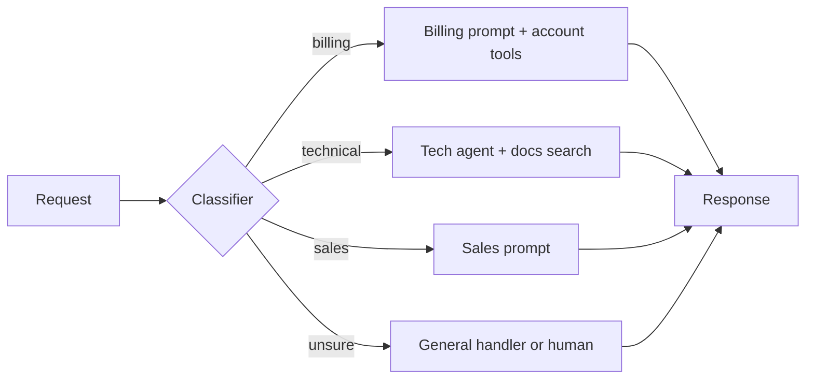
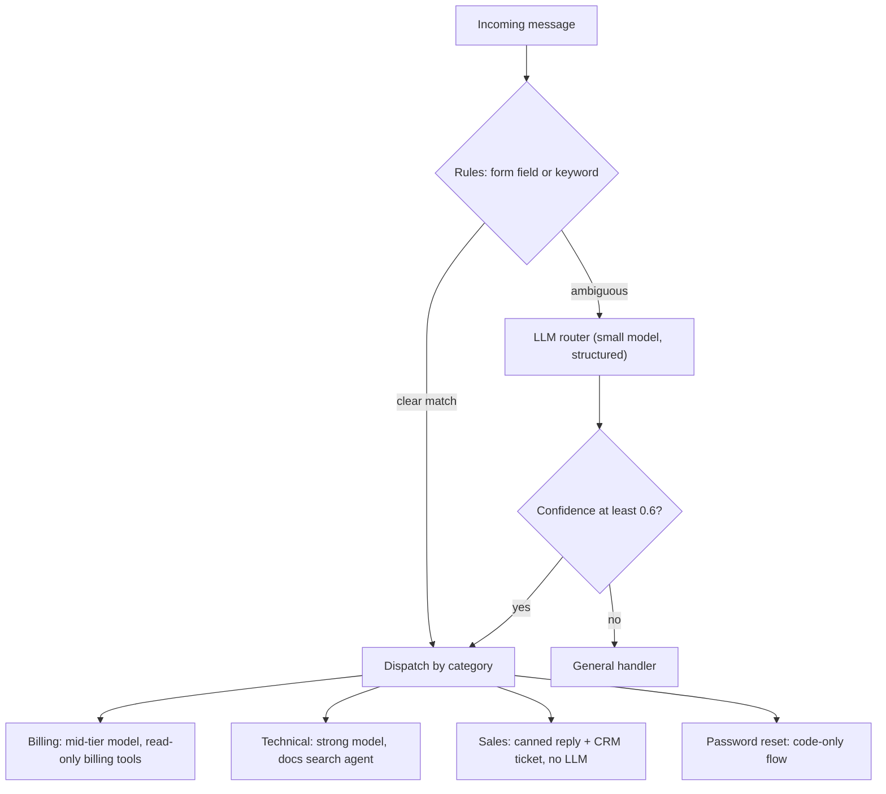

# Routing

## Introduction

**Routing** classifies an input first, then sends it to the handler best suited for it. A handler might be a specialized prompt, a different set of tools, a different model, a human queue, or plain code.

A hospital triage desk is the classic analogy. The nurse at the front does not treat anyone. They decide quickly whether a patient goes to the emergency room, a general practitioner, or the pharmacy. That decision is cheap, and it lets each specialist focus on what they do best.

Routing solves two common problems:

1. **Prompt overload.** A single prompt that tries to handle refunds, bug reports, sales questions, and password resets gets long and contradictory. Optimizing it for one category often makes another worse.
2. **Cost and latency.** Most traffic is easy. Routing lets you send easy requests to a small, fast model and save the expensive model for hard cases.

Anthropic's [Building effective agents](https://www.anthropic.com/engineering/building-effective-agents) recommends routing "for complex tasks where there are distinct categories that are better handled separately, and where classification can be handled accurately."

That last condition is the important one: **routing is only as good as its classifier.**

## How Routing Works



The classifier can be:

- **Rules** (keywords, regexes, the form field the user picked). Free and predictable.
- **An LLM call** with a fixed set of labels. Handles messy natural language.
- **An embedding similarity search** against example requests per category. Cheap at scale.
- **A trained classifier** (for example a fine-tuned small model). Cheapest per request once trained, but needs labeled data.

## A Basic LLM Router

Use structured outputs with a fixed set of labels so the router can never return something your code does not expect. A `Literal` type in Pydantic constrains the answer.

```python
from typing import Literal
from pydantic import BaseModel, Field
from anthropic import Anthropic

client = Anthropic()

class Route(BaseModel):
    category: Literal["billing", "technical", "sales", "other"]
    confidence: float = Field(description="How sure you are, from 0.0 to 1.0")
    reason: str = Field(description="One short sentence")

ROUTER_SYSTEM = """You route customer messages for a project-management SaaS.
Categories:
- billing: invoices, charges, refunds, plan changes, payment methods
- technical: bugs, errors, integrations, API, login problems
- sales: pricing questions from prospects, demos, enterprise features
- other: anything else
Pick exactly one category."""

def classify(message: str) -> Route:
    response = client.messages.parse(
        model="claude-haiku-5-5",
        max_tokens=1000,
        system=ROUTER_SYSTEM,
        messages=[{"role": "user", "content": message}],
        output_format=Route,
    )
    return response.parsed_output

for msg in [
    "My card was charged twice this month.",
    "The Slack integration stopped posting updates yesterday.",
    "Do you offer SSO on the Team plan?",
]:
    r = classify(msg)
    print(f"{r.category:10} {r.confidence:.2f}  {r.reason}")
```

Example output:

```text
billing    0.97  Duplicate charge on the customer's card.
technical  0.95  An integration is malfunctioning.
sales      0.80  Question about feature availability on a plan.
```

:::note Confidence scores
A self-reported confidence is a rough signal, not a calibrated probability. Treat it as a hint for fallback logic, and check on your evaluation set whether low scores actually correlate with mistakes.
:::

## Dispatching to Handlers

Once you have a label, dispatch with a plain dictionary. Each handler owns its own prompt, model, and tools.

```python
from typing import Callable

def text_of(response) -> str:
    return "".join(b.text for b in response.content if b.type == "text")

def handle_billing(message: str) -> str:
    response = client.messages.create(
        model="claude-sonnet-5-5",
        max_tokens=2000,
        system="You are a billing specialist. Never promise a refund; say a specialist will confirm.",
        messages=[{"role": "user", "content": message}],
    )
    return text_of(response)

def handle_technical(message: str) -> str:
    response = client.messages.create(
        model="claude-opus-5-5",
        max_tokens=4000,
        system="You are a senior support engineer. Ask for logs or steps to reproduce if needed.",
        messages=[{"role": "user", "content": message}],
    )
    return text_of(response)

def handle_sales(message: str) -> str:
    return "Thanks for your interest! A sales rep will reach out within one business day."

def handle_other(message: str) -> str:
    response = client.messages.create(
        model="claude-sonnet-5-5",
        max_tokens=2000,
        system="You are a friendly general support assistant.",
        messages=[{"role": "user", "content": message}],
    )
    return text_of(response)

HANDLERS: dict[str, Callable[[str], str]] = {
    "billing": handle_billing,
    "technical": handle_technical,
    "sales": handle_sales,
    "other": handle_other,
}

def answer(message: str, min_confidence: float = 0.6) -> str:
    route = classify(message)
    if route.confidence < min_confidence:
        return handle_other(message)          # safe fallback
    return HANDLERS[route.category](message)

print(answer("Do you offer SSO on the Team plan?"))
```

Example output:

```text
Thanks for your interest! A sales rep will reach out within one business day.
```

Notice that `handle_sales` makes **no LLM call at all**. Routing is a great place to replace AI with plain code for categories that have a fixed answer.

## Routing by Difficulty: Model Tiering

A second flavor of routing picks a **model** rather than a prompt. Easy questions go to a small model, hard ones to a large one.

```python
class Difficulty(BaseModel):
    level: Literal["easy", "hard"]

MODEL_FOR = {"easy": "claude-haiku-5-5", "hard": "claude-opus-5-5"}

def tiered_answer(question: str) -> tuple[str, str]:
    d = client.messages.parse(
        model="claude-haiku-5-5",
        max_tokens=500,
        system=("Rate the question. 'easy' = factual lookup or short how-to. "
                "'hard' = multi-step reasoning, debugging, or design trade-offs."),
        messages=[{"role": "user", "content": question}],
        output_format=Difficulty,
    ).parsed_output
    model = MODEL_FOR[d.level]
    response = client.messages.create(
        model=model,
        max_tokens=4000,
        messages=[{"role": "user", "content": question}],
    )
    return model, text_of(response)

model, reply = tiered_answer("What does HTTP status 404 mean?")
print(model)
```

Example output:

```text
claude-haiku-5-5
```

Whether tiering saves money depends on your traffic mix and on how often the small model gets "easy" questions wrong. Measure **cost per correctly answered request**, not cost per request. A cheaper model that fails more often can cost more once you count retries and escalations. Model names and prices change, so check your provider's current models page before hard-coding a tier.

An alternative to "classify then answer" is **escalation**: always try the small model first, check the answer with a gate, and escalate to the large model only on failure. Escalation needs a reliable gate (tests, schema validation, a verifier). Up-front classification does not, but it pays for a classifier call on every request.

## Rule-First Routing

LLM routers are flexible, but many requests can be routed for free. A good production router tries cheap rules first and falls back to the LLM only for ambiguous input.

```python
import re

RULES = [
    (re.compile(r"\b(invoice|refund|charged|billing|receipt)\b", re.I), "billing"),
    (re.compile(r"\b(error|bug|crash|500|api|integration)\b", re.I), "technical"),
]

def route_with_rules(message: str) -> str:
    matches = {label for pattern, label in RULES if pattern.search(message)}
    if len(matches) == 1:
        return matches.pop()          # unambiguous rule hit, no LLM call
    return classify(message).category  # zero or several matches: ask the LLM

print(route_with_rules("Where can I download my receipt?"))
```

Output:

```text
billing
```

The `len(matches) == 1` check matters: "I got an error when downloading my invoice" matches both rules, so it goes to the LLM instead of guessing.

## Evaluating a Router

Because every downstream handler depends on the route, evaluate the router on its own. Build a labeled set of real messages and compute accuracy and a confusion matrix.

```python
from collections import Counter

labeled = [
    ("I was billed after cancelling", "billing"),
    ("Webhook returns 401", "technical"),
    ("Can I get a demo for my team of 200?", "sales"),
    ("Change my plan to annual", "billing"),
    ("Export to CSV is broken", "technical"),
]

def evaluate_router(router, data):
    confusion = Counter()
    correct = 0
    for message, expected in data:
        predicted = router(message)
        confusion[(expected, predicted)] += 1
        correct += predicted == expected
    print(f"Accuracy: {correct}/{len(data)}")
    for (exp, pred), n in sorted(confusion.items()):
        if exp != pred:
            print(f"  {exp} -> {pred}: {n}")

evaluate_router(lambda m: classify(m).category, labeled)
```

Example output:

```text
Accuracy: 5/5
```

In practice you want hundreds of examples, including the tricky boundary cases. The confusion pairs tell you which category descriptions to sharpen. See [Building Evaluation Datasets](../11-agents-evaluation-and-testing/1-agents-building-eval-sets.mdx).

## Monitoring a Router in Production

Traffic drifts. A new product launch can create a category your router has never seen, and it will quietly squeeze those messages into the nearest existing label. Log every routing decision and watch a few signals:

| Signal | What it can mean | Action |
| --- | --- | --- |
| Share of each category shifts suddenly | New feature, outage, or seasonal change | Review a sample; maybe add a category |
| Low-confidence rate rises | Messages no longer match category descriptions | Update descriptions and examples |
| Handlers often escalate or hand back | Misroutes reaching the wrong specialist | Add the misrouted messages to the eval set |
| Users rephrase and retry | The answer missed the intent | Check whether the route was wrong or the handler |

A cheap habit with a big payoff: every week, pull 20 random routed messages and label them by hand. Add the disagreements to your evaluation set, so the router's tests grow with real traffic.

Routing also appears inside agents, not only in front of them. In multi-agent systems, an agent can **hand off** a conversation to a specialist agent partway through, which is routing decided by the model during the conversation rather than by a classifier up front. See [Agent Handoffs](../8-agents-multi-agent-systems/3-agents-handoffs.mdx).

## Real-World Scenario

**Your team runs a SaaS helpdesk** that receives about 5,000 messages a day. Today one large prompt answers everything with the most capable model. It is expensive, and fixing the refund answers keeps breaking the API answers.

### The routed design



### Why this approach

- **Separation of concerns.** Each handler's prompt is short and focused, so changes to billing behavior cannot regress technical answers.
- **Least privilege.** The billing handler gets billing tools only. A technical question can never trigger a refund tool because that handler never sees it (see [Least Privilege for Agent Tools](../12-agents-safety-and-security/2-agents-least-privilege.mdx)).
- **Cost control.** Rules and canned flows handle a share of traffic with no LLM call. Only technical questions use the most capable model.
- **Measurable.** Router accuracy, per-category resolution rate, and per-category cost can each be tracked.

### When to use it, and when not to

Use routing when categories are **distinct**, when they need **different prompts, tools, or models**, and when you can classify them **accurately**. Avoid it when categories overlap heavily (many messages are both billing and technical), when you have only one kind of request, or when a misroute is very costly and you cannot detect it. In overlapping cases, consider a single agent with all tools, or a router that can return multiple labels and run several handlers.

### Alternatives and trade-offs

| Approach | Pros | Cons | Best for |
| --- | --- | --- | --- |
| One general prompt | Simplest, no misroutes | Long, conflicting prompt; expensive model for everything | Low volume, few categories |
| Rule-based routing | Free, instant, predictable | Brittle on free text | Structured inputs, form fields |
| LLM router | Handles messy language, easy to change | One extra call, can misroute | Natural-language traffic |
| Embedding router | Cheap at scale, no generation | Needs example sets per category, less nuanced | High volume, stable categories |
| Single agent with all tools | Handles mixed requests | Broader permissions, harder to test | Low volume, overlapping needs |
| Escalation (small model first) | Saves cost when gates are reliable | Extra latency on failures | Tasks with a cheap verifier |

## Common Mistakes

1. **Free-text labels.** Parsing "I think this is probably billing" is fragile. Use a fixed label set with structured outputs.
2. **No fallback.** Always define what happens on low confidence or an unknown label. A general handler or a human queue is fine.
3. **Not evaluating the router separately.** If end-to-end quality drops, you need to know whether the router or the handler is at fault.
4. **Too many fine-grained categories.** Twenty overlapping categories confuse the classifier. Start with four or five and split only when a handler clearly needs it.
5. **Paying a strong model to route.** The classifier usually does not need your most capable model. Test a small model on your labeled set first.
6. **Forgetting that routes leak privileges.** If any route can reach a dangerous tool, a misroute can too. Gate risky tools inside the handler as well.

## Summary

- Routing classifies input and dispatches it to a specialized handler, model, or code path.
- Use structured outputs with a fixed label set, plus a confidence fallback.
- Try free rules first and fall back to an LLM for ambiguous cases.
- Model tiering is routing by difficulty. Judge it by cost per correct answer.
- Evaluate the router on its own labeled set and watch the confusion pairs.

## Exercises

1. Add a `"security"` category for messages that mention account takeover or leaked keys, and route it straight to a human queue with no LLM reply.
2. Change the router to return a **list** of categories, and run all matching handlers, combining their answers with one final call.
3. Build an embedding-based router: embed five example messages per category, then route a new message to the category with the highest average cosine similarity (see [Embeddings](../5-agents-rag/1-agents-embeddings.mdx)).
4. Run the evaluation function on 30 messages you write yourself, including deliberately ambiguous ones. Which pairs get confused?

### Related pages

- [Prompt Chaining](./1-agents-prompt-chaining.mdx)
- [Agent Handoffs](../8-agents-multi-agent-systems/3-agents-handoffs.mdx)
- [Choosing the Right Model](../1-agents-llm-apis/10-agents-model-selection.mdx)
- [Cost Optimization](../13-agents-production/4-agents-cost-optimization.mdx)
