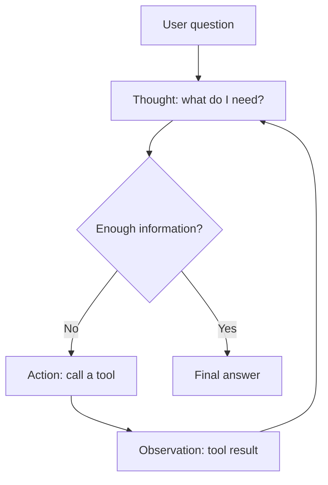
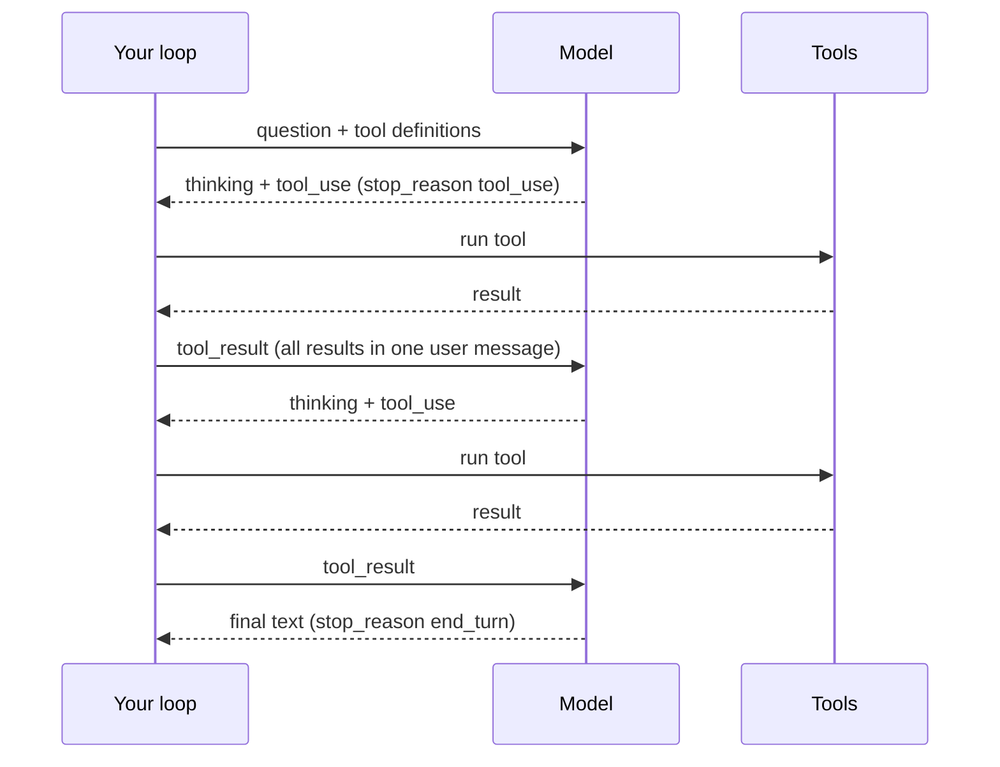

# The ReAct Pattern

## Introduction

**ReAct** (short for **Re**asoning and **Act**ing) is the pattern behind almost every tool-using agent you will meet. The model works in a loop:

1. **Thought**: reason about what to do next.
2. **Action**: call a tool.
3. **Observation**: read the tool's result.
4. Repeat until it can give a final answer.

Think of a detective. They do not write the whole solution up front. They form a hunch ("the butler had access to the study"), check something ("ask the maid when the study was locked"), update their thinking with what they learn, and decide on the next check. Reasoning guides the actions, and the actions feed new facts back into the reasoning.

ReAct was introduced in the paper [ReAct: Synergizing Reasoning and Acting in Language Models](https://arxiv.org/abs/2210.03629) by Shunyu Yao and colleagues (ICLR 2023). Its key observation was that the two abilities help each other. Reasoning alone (chain-of-thought) can hallucinate facts because it never checks the world. Acting alone (just calling tools) lacks a plan and does not recover well from surprises. Interleaving them gave more grounded and more interpretable results on question answering (HotpotQA), fact checking (FEVER), and interactive tasks (ALFWorld, WebShop), using only one or two examples in the prompt.

This page builds ReAct twice:

- First the **classic text-based** version, so you can see exactly how it works.
- Then the **modern** version using native tool calling plus built-in thinking, which is what you should use in production.

## The ReAct Loop



The model controls this loop. Your code only executes the actions and appends the observations. This is what makes ReAct an **agent** rather than a workflow: the number and order of steps are decided at run time.

## Classic Text-Based ReAct

Before LLM APIs had native tool calling, ReAct was implemented entirely through text. The prompt asked the model to write lines starting with `Thought:`, `Action:`, and `Final Answer:`. Your code parsed the `Action:` line with a regex, ran the tool, and appended an `Observation:` line before calling the model again. A **stop sequence** on `Observation:` prevented the model from inventing tool results.

Here is a compact implementation with two toy tools.

```python
import ast
import operator
import re
from anthropic import Anthropic

client = Anthropic()

# --- Tools ---------------------------------------------------------------
OPS = {ast.Add: operator.add, ast.Sub: operator.sub,
       ast.Mult: operator.mul, ast.Div: operator.truediv}

def calculator(expression: str) -> str:
    """Safely evaluate + - * / arithmetic (no eval)."""
    def walk(node):
        if isinstance(node, ast.Constant) and isinstance(node.value, (int, float)):
            return node.value
        if isinstance(node, ast.BinOp) and type(node.op) in OPS:
            return OPS[type(node.op)](walk(node.left), walk(node.right))
        raise ValueError("unsupported expression")
    return str(walk(ast.parse(expression, mode="eval").body))

FACTS = {
    "eiffel tower height": "The Eiffel Tower is 330 metres tall.",
    "statue of liberty height": "The Statue of Liberty is 93 metres tall including its pedestal.",
}

def lookup(query: str) -> str:
    return FACTS.get(query.lower().strip(), "No result found.")

TOOLS = {"calculator": calculator, "lookup": lookup}

# --- Prompt --------------------------------------------------------------
REACT_PROMPT = """Answer the question using this format:

Thought: your reasoning about what to do next
Action: tool_name[input]
Observation: (the tool result will be inserted here)
... (repeat Thought/Action/Observation as needed)
Thought: I now know the answer
Final Answer: the answer

Available tools:
- lookup[query]: look up a fact. Known queries: eiffel tower height, statue of liberty height
- calculator[expression]: arithmetic with + - * /

Question: {question}
"""

ACTION_RE = re.compile(r"Action:\s*(\w+)\[(.*)\]")

def text_react(question: str, max_steps: int = 6) -> str:
    transcript = REACT_PROMPT.format(question=question)
    for step in range(max_steps):
        response = client.messages.create(
            model="claude-haiku-5-5",
            max_tokens=1000,
            stop_sequences=["Observation:"],
            messages=[{"role": "user", "content": transcript}],
        )
        output = "".join(b.text for b in response.content if b.type == "text")
        transcript += output
        print(output.strip())

        if "Final Answer:" in output:
            return output.split("Final Answer:")[-1].strip()

        match = ACTION_RE.search(output)
        if not match:
            transcript += "\nObservation: Invalid format. Use Action: tool[input].\n"
            continue
        name, arg = match.groups()
        tool = TOOLS.get(name)
        try:
            result = tool(arg) if tool else f"Unknown tool '{name}'"
        except Exception as exc:
            result = f"Error: {exc}"
        print(f"Observation: {result}")
        transcript += f"\nObservation: {result}\n"
    return "Stopped: step limit reached"

print(text_react("How much taller is the Eiffel Tower than the Statue of Liberty?"))
```

Example output:

```text
Thought: I need the height of the Eiffel Tower.
Action: lookup[eiffel tower height]
Observation: The Eiffel Tower is 330 metres tall.
Thought: Now I need the Statue of Liberty's height.
Action: lookup[statue of liberty height]
Observation: The Statue of Liberty is 93 metres tall including its pedestal.
Thought: Subtract 93 from 330.
Action: calculator[330 - 93]
Observation: 237
Thought: I now know the answer
Final Answer: The Eiffel Tower is about 237 metres taller.
```

This works, and it is a good way to understand the idea. But notice how much fragile plumbing it needs:

- A regex to parse actions, which breaks on nested brackets or extra text.
- A stop sequence to stop the model from hallucinating observations.
- Tool arguments squeezed into a single string with no types.
- The whole history re-sent as one growing user message.

## Modern ReAct: Native Tool Calling Plus Thinking

Today's LLM APIs build ReAct into the protocol. Each part of the classic format has a native equivalent:

| Classic text ReAct | Native API equivalent (Claude) | Equivalent elsewhere |
| --- | --- | --- |
| `Thought:` lines | `thinking` blocks (adaptive thinking), plus any text the model writes | Reasoning items or thinking parts in OpenAI and Gemini reasoning models |
| `Action: tool[input]` | `tool_use` block with a name and JSON input validated against a schema | Function or tool calls |
| `Observation:` | `tool_result` block in the next user message, matched by `tool_use_id` | Tool or function result messages |
| `Final Answer:` | A response with `stop_reason == "end_turn"` | A response with no tool calls |
| Stop sequence on `Observation:` | Not needed. Generation pauses at `stop_reason == "tool_use"` | Same |
| Regex parsing | Not needed. Inputs arrive as parsed JSON | Same |

With adaptive thinking, Claude decides how much to reason before each step and can think **between** tool calls (interleaved thinking). So the reasoning half of ReAct now happens inside the model's own thinking, and the acting half is the tool-call protocol. On current Claude models such as `claude-opus-5-5`, thinking is on by default. You control how deep it goes with the `effort` setting rather than a token budget.



### The native ReAct loop

The same task with native tools. The tool functions are the same as before. Only the loop changes.

```python
import json
from anthropic import Anthropic

client = Anthropic()

tools = [
    {
        "name": "lookup",
        "description": "Look up a fact. Known queries: 'eiffel tower height', 'statue of liberty height'.",
        "input_schema": {
            "type": "object",
            "properties": {"query": {"type": "string"}},
            "required": ["query"],
        },
    },
    {
        "name": "calculator",
        "description": "Evaluate an arithmetic expression using + - * / only.",
        "input_schema": {
            "type": "object",
            "properties": {"expression": {"type": "string"}},
            "required": ["expression"],
        },
    },
]

def run_tool(name: str, args: dict) -> str:
    if name == "lookup":
        return lookup(args["query"])        # from the previous example
    if name == "calculator":
        return calculator(args["expression"])
    raise ValueError(f"Unknown tool {name}")

def react_agent(question: str, max_steps: int = 10) -> str:
    messages = [{"role": "user", "content": question}]
    for step in range(max_steps):
        response = client.messages.create(
            model="claude-opus-5-5",
            max_tokens=16000,
            thinking={"type": "adaptive", "display": "summarized"},
            output_config={"effort": "medium"},
            tools=tools,
            messages=messages,
        )
        # Keep the FULL content (thinking + tool_use) in history
        messages.append({"role": "assistant", "content": response.content})

        for block in response.content:
            if block.type == "thinking" and block.thinking:
                print(f"[thought] {block.thinking.strip()[:120]}")
            elif block.type == "tool_use":
                print(f"[action]  {block.name}({json.dumps(block.input)})")

        if response.stop_reason != "tool_use":
            return "".join(b.text for b in response.content if b.type == "text")

        results = []
        for block in response.content:
            if block.type != "tool_use":
                continue
            try:
                output = run_tool(block.name, block.input)
                results.append({"type": "tool_result", "tool_use_id": block.id, "content": output})
            except Exception as exc:
                results.append({"type": "tool_result", "tool_use_id": block.id,
                                "content": f"Error: {exc}", "is_error": True})
            print(f"[observe] {results[-1]['content']}")
        messages.append({"role": "user", "content": results})   # all results, one message
    return "Stopped: step limit reached"

print(react_agent("How much taller is the Eiffel Tower than the Statue of Liberty?"))
```

Example output:

```text
[thought] I need both heights. I can look them up in parallel.
[action]  lookup({"query": "eiffel tower height"})
[action]  lookup({"query": "statue of liberty height"})
[observe] The Eiffel Tower is 330 metres tall.
[observe] The Statue of Liberty is 93 metres tall including its pedestal.
[thought] 330 minus 93.
[action]  calculator({"expression": "330 - 93"})
[observe] 237
The Eiffel Tower is about 237 metres taller than the Statue of Liberty (330 m vs 93 m with pedestal).
```

Key details that differ from the classic version:

- **Parallel actions.** The model issued two lookups in one turn. Classic ReAct is strictly one action per step. Return all results together in a single user message (see [Parallel Tool Calls](../2-agents-tool-use/5-agents-parallel-tool-calls.mdx)).
- **Thinking is preserved.** Appending the full `response.content`, including thinking blocks, lets the model continue its reasoning across tool calls. Do not filter thinking blocks out of the history.
- **Thinking display.** On recent Claude models, the thinking text is omitted from responses by default. Pass `"display": "summarized"` if you want to log or show a summary. Either way, the reasoning still happens.
- **Errors are observations.** A failed tool returns a `tool_result` with `is_error: True`, so the model can adapt instead of crashing (see [Handling Tool Errors](../2-agents-tool-use/6-agents-tool-errors.mdx)).
- **Other stop reasons.** A production loop also handles `max_tokens`, `pause_turn` (server tools), and `refusal`. This sketch simply returns on anything other than `tool_use`. See [Building a Manual Agent Loop](../2-agents-tool-use/3-agents-manual-agent-loop.mdx) for the full version, and [Using an SDK Tool Runner](../2-agents-tool-use/4-agents-tool-runner.mdx) for an SDK helper that runs this loop for you.

:::tip Do you still need "Think step by step" prompts?
With built-in thinking, prompting the model to write out `Thought:` lines in visible text is usually redundant and adds output tokens. Prefer adjusting `effort`. Visible reasoning text is still useful when you need a human-readable rationale stored with each action, for example in an audit log. In that case, ask for a short one-sentence reason in the tool input itself, such as a `reason` field.
:::

### When classic text ReAct still makes sense

- Teaching and debugging, because every step is plain text.
- Models or serving stacks without tool-calling support.
- Research on prompting where you want full control of the format.

For everything else, use native tool calling.

## Strengths and Weaknesses of ReAct

| Strengths | Weaknesses |
| --- | --- |
| Adapts to what it observes. No need to know the steps in advance | One model call per step, so cost and latency grow with steps |
| Grounded: facts come from tools rather than memory | Can be myopic, choosing the next step without a global plan |
| Interpretable trace of actions and observations | Can loop: repeating the same failing action |
| Simple to implement: one loop | Context grows with every observation |

The last three weaknesses motivate other pages in this section: [Plan-and-Execute](./4-agents-plan-and-execute.mdx) for long tasks that need a global plan, [Stopping Conditions and Budgets](./10-agents-stopping-conditions.mdx) for loops, and [Context Engineering](../4-agents-memory-and-context/0-agents-context-engineering.mdx) for growing context.

## Real-World Scenario

**Your company's on-call engineers** keep asking the same kind of question during incidents: "Why did signups drop at 14:00?" The answer requires looking at metrics, recent deploys, error logs, and feature flags, and the right next step depends on what the previous one revealed.

### The design

A ReAct agent with **read-only** tools:

- `query_metric(name, start, end)`: returns a time series summary.
- `list_deploys(service, since)`: recent deploys with commit messages.
- `search_logs(service, query, start, end)`: top error messages and counts.
- `get_flag_changes(since)`: feature flag changes.


A trace like this cannot be scripted in advance. If the deploy list had been empty, the agent would have checked feature flags next. That run-time branching is exactly what ReAct is for.

### Why this approach

- The investigation path depends on observations, so a fixed chain would either miss cases or run every lookup every time.
- All tools are read-only, so a wrong step costs a little time and money, not an outage.
- The trace of actions and observations doubles as an explanation the engineer can verify.

### When to use it, and when not to

Use ReAct when steps are unknown in advance, tools give reliable feedback, and mistakes are cheap or reversible. Avoid it when the steps are always the same (use [Prompt Chaining](./1-agents-prompt-chaining.mdx)), when tasks are long enough that a global plan matters (use [Plan-and-Execute](./4-agents-plan-and-execute.mdx)), or when actions are risky without approval (add [Human-in-the-Loop](./9-agents-human-in-the-loop.mdx)).

### Alternatives and trade-offs

| Approach | Pros | Cons | Best for |
| --- | --- | --- | --- |
| Fixed runbook chain | Predictable, cheap, testable | Misses novel incidents | Known, repeated incident types |
| Native ReAct agent | Adapts to findings, simple loop | Variable cost, can wander | Open-ended investigation |
| Classic text ReAct | Transparent, works without tool APIs | Fragile parsing, one action per step | Teaching, legacy models |
| Plan-and-execute | Global plan, reviewable, cheaper executors | Plans can go stale, more machinery | Long multi-step tasks |
| Single call with all data pasted in | One call, no loop | Huge context, data may not fit, stale | Small, bounded data |

## Common Mistakes

1. **Dropping thinking or tool_use blocks from history.** Always append the full `response.content` as the assistant turn.
2. **Sending tool results in separate messages.** All `tool_result` blocks for one assistant turn go in a single user message.
3. **No step limit.** A ReAct loop must have a maximum number of iterations and a budget.
4. **Vague tool descriptions.** The model chooses actions from descriptions. Say what a tool returns, when to use it, and the input format (see [Tool Design Principles](../2-agents-tool-use/7-agents-tool-design-principles.mdx)).
5. **Huge observations.** Returning 50,000 lines of logs floods the context. Summarize, paginate, or filter inside the tool.
6. **Building text ReAct in production.** Native tool calling is more robust, supports parallel calls, and validates inputs.

## Summary

- ReAct interleaves **reasoning** and **acting**: thought, action, observation, repeat.
- It was introduced by Yao et al. (ICLR 2023) and showed that grounding reasoning in tool results reduces hallucination.
- Classic ReAct uses text markers, regex parsing, and stop sequences. Modern ReAct uses **native tool calling** for actions and observations and **built-in thinking** for reasoning.
- Keep full assistant content in history, return all tool results together, and treat tool errors as observations.
- ReAct suits open-ended tasks with reliable tools. Pair it with step limits, budgets, and approvals.

## Exercises

1. Add a third tool, `convert_units(value, from_unit, to_unit)`, and ask "How much taller is the Eiffel Tower in feet?" Watch how the trace changes.
2. Break the `lookup` tool so it raises an exception on the second call. Confirm the agent sees the error and tries something else.
3. Run the native agent at `effort` levels `low` and `high` on five questions and compare the number of steps and total tokens from `response.usage`.
4. Add a `reason` string field to each tool's input schema and log it, so every action carries a short human-readable rationale.

### Related pages

- [The Agent Loop](../0-agents-fundamentals/4-agents-agent-loop.mdx)
- [Reasoning, Thinking and Effort](../1-agents-llm-apis/7-agents-thinking-and-effort.mdx)
- [Prompting for Reasoning](../3-agents-prompt-engineering/6-agents-reasoning-prompts.mdx)
- [Evaluating Agent Trajectories](../11-agents-evaluation-and-testing/3-agents-trajectory-evaluation.mdx)
