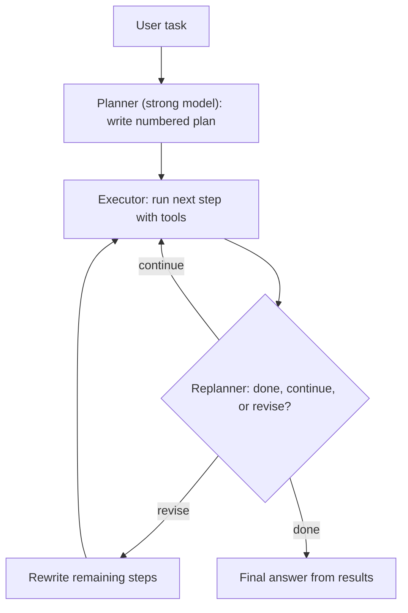

# Plan-and-Execute

## Introduction

A [ReAct](./3-agents-react-pattern.mdx) agent decides one step at a time. That works well for short investigations, but on longer tasks it has two weaknesses: it never writes down a global plan, so it can wander, and it calls the most capable (and most expensive) model for every single step.

**Plan-and-execute** separates the thinking from the doing:

1. A **planner** writes an explicit, numbered plan for the whole task.
2. An **executor** carries out the steps one at a time, often with a cheaper model and a focused prompt.
3. A **replanner** looks at the results so far and decides whether to finish, continue, or revise the remaining plan.

It is like a general contractor renovating a kitchen. They write the plan first (demolition, plumbing, electrical, cabinets, paint), hand each job to a specialist, and revise the schedule when the plumber finds rotten pipes behind the wall. Nobody asks the contractor to personally decide every swing of the hammer.

The idea draws on the [Plan-and-Solve prompting paper](https://arxiv.org/abs/2305.04091) (Wang et al., 2023) and early projects like BabyAGI. LangChain's post [Plan-and-Execute Agents](https://www.langchain.com/blog/planning-agents) (February 2024) summarizes the claimed benefits: fewer calls to the large model, the option of cheaper models for sub-tasks, and better results because the planner has to think through the whole task up front.

## How It Works



Compared with ReAct:

| Aspect | ReAct | Plan-and-execute |
| --- | --- | --- |
| Planning | Implicit, one step at a time | Explicit plan written up front |
| Model per step | Usually the same model throughout | Strong planner, possibly cheaper executors |
| Visibility | Trace after the fact | Plan visible before work starts |
| Adapting to surprises | Natural, every step re-decides | Needs a replan step |
| Calls for a simple task | Few | More (plan + steps + replan) |

## Step 1: A Structured Plan

The plan should be data, not prose, so your code can loop over it, show it to a user, and check it. Use structured outputs.

```python
from pydantic import BaseModel, Field
from anthropic import Anthropic

client = Anthropic()

class Step(BaseModel):
    id: int
    description: str = Field(description="One concrete action, doable with the listed tools")
    tool_hint: str = Field(description="Which tool is most likely needed, or 'none'")

class Plan(BaseModel):
    goal: str
    steps: list[Step]

PLANNER_SYSTEM = """You are a planning assistant. Break the user's task into 3 to 8 concrete steps.
Each step must be executable on its own with these tools:
- search_docs(query): search internal documentation
- run_sql(query): run a read-only SQL query on the analytics database
- none: pure reasoning or writing
Do not execute anything. Only plan."""

def make_plan(task: str) -> Plan:
    response = client.messages.parse(
        model="claude-opus-5-5",
        max_tokens=4000,
        system=PLANNER_SYSTEM,
        messages=[{"role": "user", "content": task}],
        output_format=Plan,
    )
    return response.parsed_output

plan = make_plan("Write a short report on how many trial users converted to paid last month, "
                 "and which onboarding step they most often skipped.")
for s in plan.steps:
    print(f"{s.id}. [{s.tool_hint}] {s.description}")
```

Example output:

```text
1. [search_docs] Find the table and column definitions for trials, subscriptions, and onboarding events.
2. [run_sql] Count trial users who started last month and how many converted to paid.
3. [run_sql] For converted users, count how often each onboarding step was skipped.
4. [none] Identify the most-skipped step and compute the conversion rate.
5. [none] Write a short report with the numbers and one recommendation.
```

### What makes a good plan

A plan is only useful if executors can carry it out. Ask the planner for steps that are:

- **Concrete**: "Count trials started in May" rather than "Analyze trials".
- **Executable with the listed tools**: never "Ask the finance team" if there is no tool for that.
- **Ordered by dependency**: data lookups before the analysis that uses them.
- **Checkable**: you can tell from the result whether the step succeeded.
- **Few**: a short plan is easier to review and cheaper to run. Ask for a range, such as 3 to 8 steps.

You can enforce some of these properties in code before running anything. A plan gate catches bad plans for the price of a few lines of Python:

```python
ALLOWED_TOOLS = {"search_docs", "run_sql", "none"}

def check_plan(plan: Plan) -> list[str]:
    problems = []
    if not 1 <= len(plan.steps) <= 8:
        problems.append(f"Plan has {len(plan.steps)} steps; expected 1 to 8.")
    ids = [s.id for s in plan.steps]
    if ids != list(range(1, len(ids) + 1)):
        problems.append("Step ids must be 1, 2, 3, ... in order.")
    for s in plan.steps:
        if s.tool_hint not in ALLOWED_TOOLS:
            problems.append(f"Step {s.id} uses unknown tool '{s.tool_hint}'.")
        if len(s.description.split()) < 4:
            problems.append(f"Step {s.id} is too vague: '{s.description}'.")
    return problems

bad_plan = Plan(goal="demo", steps=[
    Step(id=1, description="Analyze data", tool_hint="spreadsheet"),
])
print(check_plan(bad_plan))
```

Output:

```text
["Step 1 uses unknown tool 'spreadsheet'.", "Step 1 is too vague: 'Analyze data'."]
```

If the gate fails, send the problems back to the planner and ask for a corrected plan, just like a gate in a [prompt chain](./1-agents-prompt-chaining.mdx).

## Step 2: Executing Each Step

The executor is a small, focused agent loop. It sees the overall goal, the current step, and the results of earlier steps, but not the planner's full reasoning. That keeps its context small and its job clear.

```python
import json

EXEC_TOOLS = [
    {
        "name": "search_docs",
        "description": "Search internal documentation. Returns the top matching snippets.",
        "input_schema": {"type": "object",
                         "properties": {"query": {"type": "string"}},
                         "required": ["query"]},
    },
    {
        "name": "run_sql",
        "description": "Run a read-only SQL query on the analytics database. Returns rows as JSON.",
        "input_schema": {"type": "object",
                         "properties": {"query": {"type": "string"}},
                         "required": ["query"]},
    },
]

def run_tool(name: str, args: dict) -> str:
    # Stand-ins for real implementations
    if name == "search_docs":
        return "Table trials(user_id, started_at, converted_at). Table onboarding_events(user_id, step, skipped)."
    if name == "run_sql":
        return json.dumps([{"started": 1200, "converted": 168}])
    raise ValueError(f"unknown tool {name}")

def execute_step(goal: str, step: Step, history: list[str], max_turns: int = 6) -> str:
    context = "\n".join(history) or "(no earlier results)"
    messages = [{"role": "user", "content":
        f"Overall goal: {goal}\n\nResults so far:\n{context}\n\n"
        f"Your current step: {step.description}\n"
        "Do only this step, then reply with a concise result."}]
    for _ in range(max_turns):
        response = client.messages.create(
            model="claude-sonnet-5-5",           # cheaper executor; validate with evals
            max_tokens=8000,
            tools=EXEC_TOOLS,
            messages=messages,
        )
        messages.append({"role": "assistant", "content": response.content})
        if response.stop_reason != "tool_use":
            return "".join(b.text for b in response.content if b.type == "text")
        results = []
        for block in response.content:
            if block.type == "tool_use":
                try:
                    out = run_tool(block.name, block.input)
                    results.append({"type": "tool_result", "tool_use_id": block.id, "content": out})
                except Exception as exc:
                    results.append({"type": "tool_result", "tool_use_id": block.id,
                                    "content": str(exc), "is_error": True})
        messages.append({"role": "user", "content": results})
    return "Step not finished within the turn limit."
```

## Step 3: Replanning

After each step, a replanner decides what happens next. Structured output again keeps the decision machine-readable.

```python
from typing import Literal

class Decision(BaseModel):
    action: Literal["continue", "revise", "finish"]
    remaining_steps: list[Step] = Field(default_factory=list,
        description="Only when action is 'revise': the new remaining steps")
    final_answer: str = Field(default="", description="Only when action is 'finish'")

def replan(goal: str, plan: Plan, done: list[str]) -> Decision:
    remaining = [s.description for s in plan.steps[len(done):]]
    response = client.messages.parse(
        model="claude-opus-5-5",
        max_tokens=4000,
        system=("You supervise a plan. Choose 'finish' if the goal is fully answered, "
                "'revise' if the results show the remaining steps are wrong or insufficient, "
                "otherwise 'continue'."),
        messages=[{"role": "user", "content":
            f"Goal: {goal}\n\nCompleted step results:\n" + "\n".join(done) +
            f"\n\nRemaining steps:\n{json.dumps(remaining, indent=2)}"}],
        output_format=Decision,
    )
    return response.parsed_output
```

:::tip Replan less often to save money
Calling the replanner after every step doubles the strong-model calls. Cheaper options: replan only when a step reports an error or an unexpected result, or let the executor return a `needs_replan` flag. Measure both ways on your tasks.
:::

## Putting It Together

```python
def plan_and_execute(task: str, max_steps: int = 12) -> str:
    plan = make_plan(task)
    done: list[str] = []
    print("PLAN:", *[f"  {s.id}. {s.description}" for s in plan.steps], sep="\n")

    while len(done) < max_steps:
        if len(done) >= len(plan.steps):
            break
        step = plan.steps[len(done)]
        result = execute_step(plan.goal, step, done)
        done.append(f"Step {step.id} ({step.description}): {result}")
        print(f"DONE {step.id}: {result[:80]}")

        decision = replan(plan.goal, plan, done)
        if decision.action == "finish":
            return decision.final_answer
        if decision.action == "revise":
            plan.steps = plan.steps[:len(done)] + decision.remaining_steps
            print("REVISED remaining steps:", [s.description for s in decision.remaining_steps])

    # Plan exhausted: ask the strong model to write the answer from the results
    response = client.messages.create(
        model="claude-opus-5-5",
        max_tokens=4000,
        messages=[{"role": "user", "content":
            f"Goal: {plan.goal}\nResults:\n" + "\n".join(done) + "\n\nWrite the final answer."}],
    )
    return "".join(b.text for b in response.content if b.type == "text")
```

Example output:

```text
PLAN:
  1. Find the table and column definitions for trials, subscriptions, and onboarding events.
  2. Count trial users who started last month and how many converted to paid.
  3. For converted users, count how often each onboarding step was skipped.
  4. Identify the most-skipped step and compute the conversion rate.
  5. Write a short report with the numbers and one recommendation.
DONE 1: Tables: trials(user_id, started_at, converted_at), onboarding_events(user_id, step, sk
DONE 2: 1,200 trials started last month; 168 converted (14%).
...
```

The `max_steps` guard caps total execution even if the replanner keeps adding steps. See [Stopping Conditions and Budgets](./10-agents-stopping-conditions.mdx).

## Variations Worth Knowing

The LangChain post linked above describes two refinements of the basic pattern:

- **ReWOO** ("Reasoning WithOut Observations", Xu et al.). The planner writes the whole plan with **variables** like `#E1` and `#E2` that later steps reference ("look up the CEO of `#E1`"). A worker fills in the variables by running the tools in order, and a solver writes the final answer. There is no replanning, so it uses fewer LLM calls but cannot adapt mid-run.
- **LLMCompiler** (Kim et al.). The planner emits a **dependency graph** of tasks, and a scheduler runs tasks in parallel as soon as their inputs are ready. Good when many steps are independent. The authors report significant speedups over sequential execution; see the paper for their benchmarks.

Both are forms of [Task Decomposition](./5-agents-task-decomposition.mdx). Frameworks such as LangGraph include tutorials for these designs. If you use one, read the generated prompts so you understand what each node does.

## Real-World Scenario

**Your data team** gets dozens of ad-hoc questions a week from product managers, such as "How did the new pricing page affect upgrades in Europe?" Each answer needs schema lookups, three to six SQL queries, some arithmetic, and a short written summary. A ReAct agent on the strongest model works, but costs add up, and PMs cannot see what it is going to do until it is done.

### The design

1. **Planner** (strong model) writes a plan with structured steps.
2. The plan is **shown to the PM** in the UI. They can edit or approve it (see [Human-in-the-Loop](./9-agents-human-in-the-loop.mdx)). This catches misunderstandings, such as "Europe means EU only", before any query runs.
3. **Executors** (mid-tier model) run each SQL step with a read-only database role.
4. **Replanner** runs only when a query errors or returns zero rows.
5. A final **report** call writes the summary with the numbers.

### Why this approach

- **Reviewable intent.** An explicit plan is a natural approval point and an audit record.
- **Cost.** Most calls are executor calls on a cheaper model. The strong model is used for planning, occasional replans, and the final write-up.
- **Focus.** Each executor sees only one step plus prior results, which keeps contexts short.

### When to use it, and when not to

Use plan-and-execute for tasks with **several distinct steps** where a **global view matters**, where **reviewing the plan** is valuable, or where you want **cheaper executors**. Avoid it for short tasks (two or three tool calls), where planning overhead dominates, and for highly reactive tasks where each observation changes everything, such as debugging a flaky test. There, the plan goes stale after step one and ReAct is simpler. Also note that strong current models with built-in thinking often plan well implicitly inside a ReAct loop. Compare both on your evaluation set before adding the machinery.

### Alternatives and trade-offs

| Approach | Pros | Cons | Best for |
| --- | --- | --- | --- |
| ReAct loop | Simple, adapts every step | Strong model on every step, no upfront plan | Short or reactive tasks |
| Plan-and-execute with replanning | Visible plan, cheaper executors, adapts | More calls and code, replans add latency | Multi-step analytical tasks |
| ReWOO (plan with variables, no replanning) | Fewest planner calls | Cannot recover from surprises | Predictable tool chains |
| LLMCompiler (DAG, parallel) | Fast on independent steps | Most complex | Many independent lookups |
| Prompt chain | Cheapest, fully predictable | Steps must be known at design time | Repeated identical workflows |

## Common Mistakes

1. **Plans as free text.** Use structured outputs so code can iterate, display, and validate steps.
2. **Plans that reference tools the executor does not have.** List the exact tools in the planner prompt, and validate `tool_hint` values.
3. **Never replanning.** Results often invalidate later steps, for example when a table does not exist. Trigger a replan on errors at minimum.
4. **Replanning after every trivial step.** This can cost more than a plain ReAct agent. Replan on signals.
5. **Passing the whole transcript to every executor.** Pass a compact summary of prior results instead.
6. **Unbounded plans.** A replanner that keeps appending steps needs a global step cap and a budget.

## Summary

- Plan-and-execute splits work into a **planner**, **executors**, and a **replanner**.
- Explicit plans improve reviewability, let you use cheaper executor models, and force up-front thinking.
- Use structured outputs for plans and decisions, and cap total steps.
- Variants include ReWOO (variables, no replanning) and LLMCompiler (parallel DAG execution).
- Prefer ReAct for short or highly reactive tasks. Measure before adding planning machinery.

## Exercises

1. Modify `plan_and_execute` so it replans only when the executor's result contains the word "error" or "no rows". Count how many strong-model calls you save.
2. Add a plan-approval step: print the plan and ask the user to type `y` to proceed or enter feedback that is sent back to the planner.
3. Implement a mini ReWOO: have the planner output steps with `#E1`-style variables and substitute earlier results into later step descriptions before execution.
4. Run the same five questions through a ReAct agent and through plan-and-execute. Compare total tokens, number of strong-model calls, and answer quality.

### Related pages

- [The ReAct Pattern](./3-agents-react-pattern.mdx)
- [Task Decomposition](./5-agents-task-decomposition.mdx)
- [Prompting for Planning](../3-agents-prompt-engineering/5-agents-prompting-for-planning.mdx)
- [Orchestrator-Workers Pattern](../8-agents-multi-agent-systems/1-agents-orchestrator-workers.mdx)
